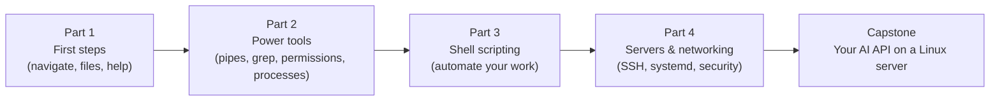

# Linux from Zero 🐧

**A guided path through the best free Linux material on the internet**, in the right order, from "what is a terminal?" to running an AI app on a real server.

There are already excellent free Linux courses, books and practice games. Instead of rewriting them, this guide picks the best one for each topic, tells you **what to learn, where to learn it, what to practise, and how you know you're done**.

**Time:** about 4–6 weeks at 1 hour a day · **Needs:** any computer (Windows, Mac or Linux) · **Cost:** free

## How to use this guide
1. Go through the 4 parts in order. Each topic has:
   - **Like you're 5:** the idea in one line.
   - **Learn:** the best free reading or course for it.
   - **Watch:** a video search on YouTube (pick the top result from the named channel).
   - **Practise:** something to actually do in your own terminal.
   - **Done when:** a check you can answer or do without looking anything up.
2. Keep 3 helpers open in browser tabs the whole time:
   - **[explainshell.com](https://explainshell.com)**: paste any command and it explains **every word and symbol** in it. Perfect for "what does `ls -la | grep ai > out.txt` mean?"
   - **[tldr pages](https://github.com/tldr-pages/tldr)** (`tldr ls` in a terminal, or [tldr.inbrowser.app](https://tldr.inbrowser.app)): short, practical examples for every command.
   - **[ShellCheck](https://www.shellcheck.net)**: paste a script, it tells you what's wrong and why.
3. Write a one-line note for every new command you learn, in your own words. That notebook becomes your cheat sheet.

## Get a terminal first (pick one)
| You have | Do this | Official guide |
|----------|---------|----------------|
| Windows 10/11 | Install **WSL2 with Ubuntu**: open PowerShell as administrator and run `wsl --install`, restart, open "Ubuntu" from the Start menu | [learn.microsoft.com/windows/wsl/install](https://learn.microsoft.com/en-us/windows/wsl/install) |
| Mac | Open **Terminal** (Cmd+Space, type "Terminal"). macOS is Unix: most commands are the same; a few options differ (the Mac uses BSD versions of tools like `sed`) | [support.apple.com/guide/terminal](https://support.apple.com/guide/terminal/welcome/mac) |
| Linux | Open your **Terminal** app | — |
| Any, without installing | A free online Linux sandbox: [killercoda.com/playgrounds](https://killercoda.com/playgrounds) | — |

## The big map

---

## Part 1 · First steps (week 1)
**Main course for this part:** [Linux Journey](https://linuxjourney.com) ("Grasshopper" section) and the free book **[The Linux Command Line](https://linuxcommand.org/tlcl.php)** by William Shotts, chapters 1–10.

| # | Topic | Like you're 5 | Learn | Practise | Done when you can... |
|---|-------|---------------|-------|----------|----------------------|
| 1 | What Linux and the terminal are | Linux is the engine under most servers; the terminal is where you talk to it by typing | [Linux Journey: Getting Started](https://linuxjourney.com/lesson/linux-history) · [MIT Missing Semester, lecture 1](https://missing.csail.mit.edu/2020/course-shell/) | Open a terminal; run `whoami`, `date`, `echo hello` | explain what a shell, a terminal and a command are |
| 2 | Anatomy of a command | `command -options arguments` is like "verb, how, what" | [The Linux Command Line ch. 1–2](https://linuxcommand.org/tlcl.php) · paste commands into [explainshell.com](https://explainshell.com) | Run `ls`, `ls -l`, `ls -la /etc` and compare | name the command, options and arguments in `ls -la /home` |
| 3 | Moving around | Folders are rooms; `cd` walks between them, `pwd` says where you are | [Linux Journey: Command Line](https://linuxjourney.com/lesson/the-shell) | Use `pwd`, `cd`, `cd ..`, `cd ~`, `cd -`; explain `/`, `.`, `..`, `~` | move anywhere with absolute and relative paths |
| 4 | Creating, copying, moving, deleting | Make, copy, move and bin things | [The Linux Command Line ch. 4](https://linuxcommand.org/tlcl.php) | `mkdir -p`, `touch`, `cp -r`, `mv`, `rm -r`; wildcards `*`, `?`, `[abc]` | delete a folder safely and explain why `rm -rf /` is dangerous |
| 5 | Reading files | Peek inside files without opening an editor | [Linux Journey: Text-Fu](https://linuxjourney.com/lesson/stdout-standard-out-redirect) | `cat`, `less`, `head -n 5`, `tail -f`, `wc -l` on `/var/log` files | follow a log live with `tail -f` |
| 6 | Getting help | Every command has a manual | [The Linux Command Line ch. 5](https://linuxcommand.org/tlcl.php) · [tldr pages](https://github.com/tldr-pages/tldr) | `man ls`, `ls --help`, `tldr tar`, `type cd`, `which python3` | find an option you've never seen without Googling |
| 7 | Editing files with nano and vim | nano is a notepad; vim is a power tool with modes | `vimtutor` (type it in your terminal: a 30-minute built-in lesson) | Edit a file in nano; finish `vimtutor` | save and quit vim (`Esc` then `:wq`) without panic |

**Watch:** [freeCodeCamp Linux for beginners](https://www.youtube.com/results?search_query=freecodecamp+linux+for+beginners+full+course) · [NetworkChuck Linux for hackers](https://www.youtube.com/results?search_query=networkchuck+linux+for+hackers+episode+1) · [MIT Missing Semester lectures](https://www.youtube.com/results?search_query=mit+missing+semester+of+your+cs+education+2020)

**Part 1 check:** play **[OverTheWire Bandit](https://overthewire.org/wargames/bandit/)** levels 0–10. It's a game where every level is a Linux puzzle.

---

## Part 2 · Power tools (weeks 2–3)
**Main course for this part:** [The Art of Command Line](https://github.com/jlevy/the-art-of-command-line) (read the "Basics" and "Everyday use" sections) and [The Linux Command Line](https://linuxcommand.org/tlcl.php) ch. 6–10.

| # | Topic | Like you're 5 | Learn | Practise | Done when you can... |
|---|-------|---------------|-------|----------|----------------------|
| 8 | Redirection and pipes | `>` pours output into a file; `\|` hands it to the next command like a relay race | [Linux Journey: Text-Fu](https://linuxjourney.com/lesson/stdout-standard-out-redirect) · [Missing Semester: shell tools](https://missing.csail.mit.edu/2020/shell-tools/) | `>`, `>>`, `<`, `\|`, `2>`, `2>&1`, `/dev/null`, `tee` | explain every symbol in `cmd > out.txt 2>&1` |
| 9 | Finding files and text | `find` finds files by name; `grep` finds words inside them | [The Art of Command Line](https://github.com/jlevy/the-art-of-command-line) | `find . -name "*.py"`, `grep -rni "error" logs/` | find every Python file containing "TODO" in one command |
| 10 | Text processing | Cut, sort, count and edit text like a factory line | [learnbyexample: CLI text processing](https://github.com/learnbyexample/cli_text_processing_coreutils) · [Missing Semester: data wrangling](https://missing.csail.mit.edu/2020/data-wrangling/) | `cut`, `sort`, `uniq -c`, `tr`, `sed 's/a/b/g'`, `awk '{print $1}'` on a log file | print the 5 most common IP addresses in a web log |
| 11 | Permissions and ownership | Every file has an owner and a lock with read/write/run keys | [Linux Journey: Permissions](https://linuxjourney.com/lesson/file-permissions) | `ls -l`, `chmod 755`, `chmod u+x`, `chown`; decode `rwxr-xr--` | turn `rw-r--r--` into `644` in your head |
| 12 | Users, groups and sudo | `sudo` is "please, with the admin key" | [Linux Journey: User Management](https://linuxjourney.com/lesson/users-and-groups) | `id`, `groups`, `sudo adduser`, `sudo usermod -aG` (in a VM or container) | explain why you shouldn't work as root all day |
| 13 | Processes and jobs | Every running program is a process with a number | [Linux Journey: Processes](https://linuxjourney.com/lesson/linux-processes) | `ps aux`, `top`/`htop`, `kill`, `&`, `jobs`, `fg`, `Ctrl+Z` | find and stop a program that's using 100% CPU |
| 14 | Environment variables and quoting | Sticky notes every program can read, like `$HOME` and `$PATH` | [The Linux Command Line ch. 11 & 7](https://linuxcommand.org/tlcl.php) | `echo $PATH`, `export`, edit `~/.bashrc`; compare `'$HOME'` vs `"$HOME"` | explain why `python` sometimes isn't "found" |
| 15 | Installing software | An app store you use by typing | [Ubuntu: package management](https://ubuntu.com/server/docs/package-management) | `sudo apt update`, `apt install`, `apt remove`; Mac: [Homebrew](https://brew.sh) | install and remove a package cleanly |

**Watch:** [Fireship: 100+ Linux things you need to know](https://www.youtube.com/results?search_query=fireship+100%2B+linux+things+you+need+to+know) · [Learn Linux TV: Linux crash course](https://www.youtube.com/results?search_query=learn+linux+tv+linux+crash+course) · [NetworkChuck grep / pipes](https://www.youtube.com/results?search_query=networkchuck+linux+pipes+grep)

**Part 2 check:** finish **[OverTheWire Bandit](https://overthewire.org/wargames/bandit/)** levels 11–20.

---

## Part 3 · Shell scripting (week 4)
**Main course for this part:** [Introduction to Bash Scripting (free book)](https://github.com/bobbyiliev/introduction-to-bash-scripting) and the [Bash Guide](https://github.com/Idnan/bash-guide). Keep [pure bash bible](https://github.com/dylanaraps/pure-bash-bible) as a recipe book.

| # | Topic | Like you're 5 | Learn | Practise | Done when you can... |
|---|-------|---------------|-------|----------|----------------------|
| 16 | Your first script | A script is a recipe card the computer follows | [Intro to Bash Scripting](https://github.com/bobbyiliev/introduction-to-bash-scripting) ch. 1–3 | Write `hello.sh` with `#!/usr/bin/env bash`, `chmod +x`, run `./hello.sh` | explain the shebang line and why `./` is needed |
| 17 | Variables and arguments | Boxes with names; `$1` is the first thing you typed after the script | [Bash Guide](https://github.com/Idnan/bash-guide) | `$1`, `$@`, `$#`, `$?`, `$(date)` in a script | write a script that greets the name you pass it |
| 18 | Decisions and exit codes | `if` asks a question; every command answers 0 (OK) or not-0 (problem) | [Intro to Bash Scripting](https://github.com/bobbyiliev/introduction-to-bash-scripting) (conditionals) | `if [[ -f file ]]`, `&&`, `\|\|`, `exit 1` | check whether a file exists before using it |
| 19 | Loops and functions | Do the same thing for every file; give a block of steps a name | [Bash Guide](https://github.com/Idnan/bash-guide) | `for f in *.log`, `while read line`, `case`, functions with `local` | rename 100 files in one loop |
| 20 | Robust scripts | Make scripts stop at the first mistake instead of carrying on | [ShellCheck wiki](https://www.shellcheck.net/wiki/) · ["unofficial bash strict mode"](https://www.youtube.com/results?search_query=bash+strict+mode+set+-euo+pipefail) | Add `set -euo pipefail`, `trap`, run every script through [ShellCheck](https://github.com/koalaman/shellcheck) | get a script to zero ShellCheck warnings |
| 21 | Scheduling | cron is an alarm clock for commands | [crontab.guru](https://crontab.guru) (explains every field) | `crontab -e`, run a backup script every day at 2 am | read `*/15 9-17 * * 1-5` aloud correctly |

**Watch:** [freeCodeCamp bash scripting](https://www.youtube.com/results?search_query=freecodecamp+bash+scripting+full+course) · [NetworkChuck bash scripting](https://www.youtube.com/results?search_query=networkchuck+bash+scripting+episode+1) · [Fireship bash in 100 seconds](https://www.youtube.com/results?search_query=fireship+bash+in+100+seconds)

**Part 3 check:** write a script that backs up a folder into a dated `.tar.gz`, keeps only the last 7 backups, logs what it did, passes ShellCheck, and runs from cron.

---

## Part 4 · Servers and networking (weeks 5–6)
**Main course for this part:** the **[Linux Upskill Challenge](https://github.com/livialima/linuxupskillchallenge)** (a free 20-day course where you run a real cloud server) plus [Linux Journey: Networking](https://linuxjourney.com/lesson/network-basics).

| # | Topic | Like you're 5 | Learn | Practise | Done when you can... |
|---|-------|---------------|-------|----------|----------------------|
| 22 | Disks and the filesystem tree | Everything lives under `/`; `/etc` is settings, `/var/log` is the diary | [Linux Journey: Filesystem](https://linuxjourney.com/lesson/filesystem-hierarchy) | `df -h`, `du -sh *`, `lsblk`, `mount` | find what's filling up a full disk |
| 23 | Networking basics | IP = house address, port = door number, DNS = phone book | [Linux Journey: Networking](https://linuxjourney.com/lesson/network-basics) | `ip a`, `ping`, `curl -v`, `dig`, `ss -tlnp`, `/etc/hosts` | explain what happens when you type a URL |
| 24 | SSH and remote servers | A secret tunnel to another computer, opened with a key instead of a password | [Linux Upskill Challenge, day 1–2](https://github.com/livialima/linuxupskillchallenge) | `ssh-keygen`, `ssh-copy-id`, `~/.ssh/config`, `scp`, `rsync` | log into a server with a key, no password |
| 25 | Services and logs (systemd) | systemd starts your programs at boot and restarts them if they crash | [DigitalOcean: systemd essentials](https://www.digitalocean.com/community/tutorials/systemd-essentials-working-with-services-units-and-the-journal) | `systemctl status/start/enable`, `journalctl -u name -f`, write a `.service` file | make a script run as a service that survives a reboot |
| 26 | Security basics | Lock the doors: firewall, keys only, automatic updates | [Linux Upskill Challenge](https://github.com/livialima/linuxupskillchallenge) (security days) · [The Book of Secret Knowledge](https://github.com/trimstray/the-book-of-secret-knowledge) | `ufw allow 22`, disable password SSH, `unattended-upgrades`, `fail2ban` | harden a fresh server in 15 minutes |
| 27 | Troubleshooting a sick server | Doctor checklist: CPU, memory, disk, network, logs | [Brendan Gregg: Linux performance](https://www.brendangregg.com/linuxperf.html) (start with the "60-second analysis" checklist) | `uptime`, `top`, `free -h`, `df -h`, `ss`, `journalctl -p err` | find why a server is slow in under 5 minutes |
| 28 | **Capstone:** host an AI API on a Linux server | Put your own AI app on the internet, properly | Your FastAPI app from [ai-from-zero Part 1](../ai-from-zero/part-1-apis) + [FastAPI deployment guide](https://fastapi.tiangolo.com/deployment/) + [nginx beginner's guide](https://nginx.org/en/docs/beginners_guide.html) + [Certbot](https://certbot.eff.org/instructions) for HTTPS | Run it under systemd behind nginx, firewall on, HTTPS on, logs in `journalctl` | send a friend a working `https://` link to your API |

**Watch:** [NetworkChuck: SSH](https://www.youtube.com/results?search_query=networkchuck+ssh+you+need+to+learn) · [Learn Linux TV: systemd](https://www.youtube.com/results?search_query=learn+linux+tv+systemd+services) · [Hussein Nasser: networking fundamentals](https://www.youtube.com/results?search_query=hussein+nasser+networking+fundamentals) · [NetworkChuck: secure your Linux server](https://www.youtube.com/results?search_query=networkchuck+secure+linux+server)

**Part 4 check:** finish OverTheWire Bandit (all levels) and the Linux Upskill Challenge.

---

## Bookmark these
| What | Why |
|------|-----|
| [roadmap.sh/linux](https://roadmap.sh/linux) | a visual map of everything Linux, to see what's left |
| [The Art of Command Line](https://github.com/jlevy/the-art-of-command-line) | the single best page of command-line wisdom |
| [The Book of Secret Knowledge](https://github.com/trimstray/the-book-of-secret-knowledge) | huge list of admin tools, cheat sheets and one-liners |
| [cheat.sh](https://github.com/chubin/cheat.sh) | `curl cheat.sh/tar` gives you examples in the terminal |
| [awesome-shell](https://github.com/alebcay/awesome-shell) | the best shell tools and frameworks |
| [man7.org Linux man pages](https://man7.org/linux/man-pages/) | the official manual, online |
| [GNU Bash manual](https://www.gnu.org/software/bash/manual/) | the official Bash reference |

## Next
→ [Cloud & DevOps for AI](../cloud-and-devops-for-ai): Git, Docker, Kubernetes, microservices and the cloud.
