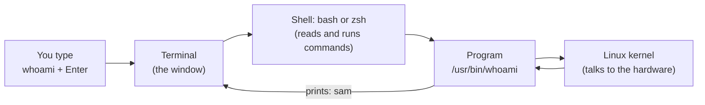

# 01 · What is Linux and the terminal

**What you'll build:** your own Linux practice computer (on Windows, Mac, Linux or inside Docker), your first ten commands, and a copy of this course on it, checked by a little script that prints ✅ when everything is ready.
**Time:** ~60 min · **Builds on:** nothing · **Needs:** a computer with Windows 10/11, macOS or Linux, and internet

**Like you're 5:** the terminal is a walkie-talkie to your computer. You say a short command ("who am I?"), the computer answers in words, and you say the next one.

## Why this matters
Almost every server on the internet runs Linux: the machines behind websites, cloud computers on AWS, Google Cloud and Azure, Docker containers, and the GPU servers that train and serve AI models. None of them have a mouse or windows to click. You talk to them by typing commands. As an AI engineer you will log into these machines, install things, read logs and fix problems, all from a terminal. This lesson gets you a terminal and teaches you to read what it says.

## What you'll learn
- **Operating system**: the boss program that shares the computer's memory, disk and processor between all other programs (Windows, macOS, Linux are all operating systems).
- **Linux and distributions**: Linux is a free operating system; a **distribution** (like Ubuntu) is Linux plus a bundle of ready-to-use tools.
- **Terminal and shell**: the **terminal** is the window you type in; the **shell** (usually `bash` or `zsh`) is the program inside it that reads your command and runs it.
- **The prompt**: the text before your cursor, like `sam@laptop:~$`, tells you who you are, which computer you're on and which folder you're in.
- **Your first commands**: `whoami`, `hostname`, `pwd`, `echo`, `date`, `uname`, `cat`, `clear`, `history`, `exit`.

## Before you start
- No install yet: Step 1 of "Run it" below *is* the install. Pick **one** of the four options (A, B, C or D).
- No API key needed. Nothing in this course costs money.
- **Golden rule for the whole course:** read a command before you run it. Every new command has a "Command, piece by piece" table that explains every word and symbol.

## Run it

### Step 1 · Get a terminal (pick ONE option)

| Your computer | Best option | What you get |
|---|---|---|
| Windows 10 (version 2004 or newer) or Windows 11 | **A · WSL2 Ubuntu** | a real Ubuntu Linux running inside Windows |
| Mac | **B · Terminal app** (or D) | macOS's own Unix-style terminal; a few commands behave differently, the lessons tell you when |
| Linux (Ubuntu, Fedora, Mint...) | **C · Your own terminal** | you're already there |
| Any of the above, with Docker Desktop installed | **D · Docker `ubuntu:24.04`** | a throwaway Ubuntu you can delete and rebuild in seconds |

The lessons were tested on **Ubuntu 24.04**, so A, C (Ubuntu) and D match the outputs exactly.

#### Option A · Windows: install WSL2 with Ubuntu
WSL means "Windows Subsystem for Linux". Version 2 runs a real Linux kernel in a tiny, hidden virtual machine.

1. Click the **Start** button, type `PowerShell`, right-click **Windows PowerShell** and choose **Run as administrator**. Click **Yes** when Windows asks.
2. In the blue window, type this and press **Enter**:
   ```powershell
   wsl --install -d Ubuntu-24.04
   ```

   | Piece | Meaning |
   |---|---|
   | `wsl` | the Windows program that manages Linux inside Windows |
   | `--install` | "install WSL and a Linux for me" (two dashes = a long, word-style option) |
   | `-d` | short for "distribution": which Linux to install (one dash = a short, one-letter option) |
   | `Ubuntu-24.04` | the name of the Linux to install (Ubuntu, version 24.04) |

   You should see lines like `Installing: Windows Subsystem for Linux` and `Installing: Ubuntu 24.04 LTS`, then `The requested operation is successful. Changes will not be effective until the system is rebooted.`
3. **Restart your computer.**
4. After the restart an Ubuntu window opens by itself (if not: **Start** → type `Ubuntu` → click **Ubuntu 24.04 LTS**). Wait a minute while it says `Installing, this may take a few minutes...`.
5. It asks `Enter new UNIX username:`. Type a short **lowercase** name with no spaces (for example `sam`) and press **Enter**.
6. It asks `New password:`. Type a password and press **Enter**. **Nothing appears while you type, not even dots.** That is normal on Linux: the terminal hides passwords. Type it again when asked `Retype new password:`. Remember it: you need it for `sudo` (admin commands).
7. You now see a prompt like `sam@DESKTOP-4F2K9:~$`. You're in Linux.
8. Optional check: open PowerShell again (normal, not admin) and run `wsl -l -v`. The `VERSION` column should say `2`.

   | Piece | Meaning |
   |---|---|
   | `wsl` | the WSL manager program |
   | `-l` | list the installed Linux distributions |
   | `-v` | verbose: also show their state and WSL version |

Tips for WSL:
- Install the free **Windows Terminal** app from the Microsoft Store (Windows 11 has it already). It has tabs, and the down-arrow next to the tab lets you open Ubuntu directly.
- Copy and paste in the terminal: select text, then **Ctrl + Shift + C** to copy and **Ctrl + Shift + V** (or right-click) to paste. Plain **Ctrl + C** means "stop the running command" in a terminal.
- Your Windows `C:` drive is visible from Linux at `/mnt/c`. Keep your course files inside Linux (in your home folder, as below): it's much faster.

#### Option B · Mac: use the Terminal app
1. Press **Cmd + Space**, type `Terminal`, press **Enter**.
2. You see a prompt like `sam@MacBook-Air ~ %`. On a Mac the shell is **zsh** and the prompt ends in `%` instead of `$`. Every command in this course works the same in zsh unless the lesson says "On a Mac".
3. Install Apple's developer tools (they include `git`). Type this, press **Enter**, then click **Install** in the window that pops up:
   ```bash
   xcode-select --install
   ```

   | Piece | Meaning |
   |---|---|
   | `xcode-select` | Apple's tool that manages the developer tools |
   | `--install` | "download and install the command line tools" |

4. Install **Homebrew**, the Mac's app store for terminal tools. Copy the one-line command from the front page of https://brew.sh, paste it into Terminal, press **Enter**, and follow what it prints (it asks for your Mac password; nothing shows while you type). At the end it prints two or three `echo ... >> ~/.zprofile` / `eval ...` lines under **Next steps**: run them too.
5. Install the extra tools the course uses:
   ```bash
   brew install tree nano
   ```
   `brew install` downloads and installs the named tools. macOS has no `tree`, and its `nano` is really an older editor called `pico`, so this gets you the real ones.

**GNU vs BSD, in one paragraph.** Linux's basic commands (`ls`, `cp`, `sed`, `grep`...) come from the **GNU** project. macOS's versions come from **BSD**, a different family. They agree on the basics, but some options differ (for example `ls --all` works on Linux but not on a Mac, and `sed -i` needs an extra `''` on a Mac). Each lesson has "On a Mac" notes where this bites. If you'd rather avoid surprises, use Option D on your Mac.

#### Option C · Linux: open your terminal
1. On Ubuntu, press **Ctrl + Alt + T**. On other Linux desktops, open the app menu and search for `Terminal`.
2. You see a prompt like `sam@laptop:~$`. Done.

#### Option D · Any computer with Docker: a throwaway Ubuntu 24.04
A **container** is a mini computer-inside-your-computer that starts in a second and can be thrown away. Great for practising without fear.

1. Install **Docker Desktop** from https://docs.docker.com/get-started/get-docker/ and start it (wait until it says "Engine running").
2. Open a terminal (PowerShell on Windows, Terminal on Mac) and run:
   ```bash
   docker run -it --name linux-lab --hostname linux-lab ubuntu:24.04 bash
   ```

   | Piece | Meaning |
   |---|---|
   | `docker` | the program that runs containers |
   | `run` | create a new container and start it |
   | `-i` | interactive: keep the keyboard connected so you can type |
   | `-t` | give it a terminal (so you get a proper prompt) |
   | `-it` | `-i` and `-t` squeezed together; short options can be combined |
   | `--name linux-lab` | call this container `linux-lab` so you can come back to it |
   | `--hostname linux-lab` | the computer name shown in the prompt |
   | `ubuntu:24.04` | the **image** (the template) to start from: Ubuntu, version (tag) 24.04 |
   | `bash` | the program to run inside: the bash shell |

   You should see `root@linux-lab:/#`. You are **root**, the all-powerful admin (`#` means root).
3. The container is tiny, so install the course tools (this is the root version of Step 3 below, so no `sudo` yet):
   ```bash
   apt update && apt install -y sudo nano vim less man-db git curl tree file
   ```
   (Each piece is explained in Step 3 below.) Wait until the prompt comes back.
4. Bring back the manual pages that the container removed to save space (lesson 06 needs them). Type `y` and **Enter** when it asks `Would you like to continue? [y/N]`:
   ```bash
   unminimize
   ```
5. The image already has a normal user called `ubuntu`. Give it a password (typing is invisible, type it twice):
   ```bash
   passwd ubuntu
   ```

   | Piece | Meaning |
   |---|---|
   | `passwd` | change a user's password |
   | `ubuntu` | which user (as root you may change anyone's) |

6. Become that normal user:
   ```bash
   su - ubuntu
   ```

   | Piece | Meaning |
   |---|---|
   | `su` | "switch user" |
   | `-` | start a fresh login for that user (go to their home folder, load their settings) |
   | `ubuntu` | the user to switch to |

   The prompt changes to `ubuntu@linux-lab:~$`. Practise as this user, not as root: root is allowed everything, which hides the mistakes the lessons want you to see.
7. **Coming back later:** type `exit` twice to leave. Next time run `docker start -ai linux-lab` (start the stopped container, attach your keyboard to it), then `su - ubuntu`. To throw it away for good: `docker rm -f linux-lab`. For a one-off throwaway that deletes itself when you exit, add `--rm`: `docker run -it --rm ubuntu:24.04 bash`.

### Step 2 · Your first commands
Type each command and press **Enter**. Commands are case-sensitive: `whoami` works, `WhoAmI` does not.

1. Who am I logged in as?
   ```bash
   whoami
   ```
   ```
   sam
   ```
   | Piece | Meaning |
   |---|---|
   | `whoami` | "who am I?": prints your user name |

2. What is this computer called?
   ```bash
   hostname
   ```
   ```
   laptop
   ```
   | Piece | Meaning |
   |---|---|
   | `hostname` | prints the computer's name (on WSL something like `DESKTOP-4F2K9`) |

3. Which folder am I in?
   ```bash
   pwd
   ```
   ```
   /home/sam
   ```
   | Piece | Meaning |
   |---|---|
   | `pwd` | "print working directory": the folder you are in right now. Folder and **directory** mean the same thing |

   `/home/sam` is your **home folder**, your own space on the computer. On a Mac it is `/Users/sam`.

4. Make the computer say something:
   ```bash
   echo Hello, Linux!
   ```
   ```
   Hello, Linux!
   ```
   | Piece | Meaning |
   |---|---|
   | `echo` | print the words that follow |
   | `Hello,` `Linux!` | the words to print (the **arguments**: the things a command works on) |

5. What's the date and time?
   ```bash
   date
   ```
   ```
   Thu Oct 22 04:11:27 UTC 2026
   ```
   | Piece | Meaning |
   |---|---|
   | `date` | print the current date and time (`UTC` is the time zone; yours may show your local one) |

6. Which kind of system is this?
   ```bash
   uname -s
   ```
   ```
   Linux
   ```
   | Piece | Meaning |
   |---|---|
   | `uname` | "Unix name": prints facts about the system |
   | `-s` | an **option** (a switch that changes what a command does): print the kernel's name only. A Mac prints `Darwin` |

7. Which Linux exactly?
   ```bash
   cat /etc/os-release
   ```
   ```
   PRETTY_NAME="Ubuntu 24.04.5 LTS"
   NAME="Ubuntu"
   VERSION_ID="24.04"
   VERSION="24.04.5 LTS (Noble Numbat)"
   VERSION_CODENAME=noble
   ID=ubuntu
   ID_LIKE=debian
   HOME_URL="https://www.ubuntu.com/"
   SUPPORT_URL="https://help.ubuntu.com/"
   BUG_REPORT_URL="https://bugs.launchpad.net/ubuntu/"
   PRIVACY_POLICY_URL="https://www.ubuntu.com/legal/terms-and-policies/privacy-policy"
   UBUNTU_CODENAME=noble
   LOGO=ubuntu-logo
   ```
   | Piece | Meaning |
   |---|---|
   | `cat` | print a file's contents on the screen (short for "concatenate", lesson 05) |
   | `/etc/os-release` | the file to print: a small text file that describes this Linux |
   | `/` | separates folder names in a path: the file `os-release` inside the folder `etc`, inside the top folder `/` |

   (On a Mac this file does not exist; try `sw_vers` instead.)

8. Clear the screen:
   ```bash
   clear
   ```
   | Piece | Meaning |
   |---|---|
   | `clear` | wipe the screen and put the prompt at the top (shortcut: **Ctrl + L**). Nothing is deleted except what's on screen |

9. See what you have typed so far:
   ```bash
   history
   ```
   ```
       1  whoami
       2  hostname
       3  pwd
       4  echo Hello, Linux!
       5  date
       6  uname -s
       7  cat /etc/os-release
       8  clear
       9  history
   ```
   | Piece | Meaning |
   |---|---|
   | `history` | list the commands you typed, numbered. Press the **Up arrow** to bring back the previous one |

10. Try the keyboard tricks you will use every day:
    - **Up / Down arrows**: walk through earlier commands. Press Enter to run one again.
    - **Tab**: finish a word for you. Type `whoa` and press Tab: it becomes `whoami`. Press Tab twice to see all choices.
    - **Ctrl + C**: stop a command that is running or stuck. Try `sleep 100` (waits 100 seconds), then press Ctrl + C to get the prompt back.
    - **Ctrl + A / Ctrl + E**: jump to the start / end of the line.

### Step 3 · Get the course files and run the check
1. (Ubuntu, WSL, Linux. Docker users already did this in Option D step 3; Mac users did Option B.) Update the list of available software:
   ```bash
   sudo apt update
   ```
   | Piece | Meaning |
   |---|---|
   | `sudo` | "superuser do": run the next command as the admin (root). It asks for **your** password the first time (invisible typing) |
   | `apt` | Ubuntu's software installer (the "app store" for the terminal; lesson 15 goes deeper) |
   | `update` | download the latest list of what can be installed. It installs nothing yet |

   You should see lines starting `Hit:` or `Get:` and finally `Reading package lists... Done`.
2. Install the tools this course uses:
   ```bash
   sudo apt install -y git curl nano vim less man-db tree file
   ```
   | Piece | Meaning |
   |---|---|
   | `sudo apt` | run Ubuntu's installer as admin |
   | `install` | install the packages named after it |
   | `-y` | answer "yes" automatically to "Do you want to continue?" |
   | `git` | downloads code projects (like this course) |
   | `curl` | downloads things from web addresses |
   | `nano` `vim` | two text editors (lesson 07) |
   | `less` | a file viewer (lesson 05) |
   | `man-db` | the built-in manual (lesson 06) |
   | `tree` | draws folders as a tree (lesson 03) |
   | `file` | tells you what kind of file something is (lesson 05) |

   You should see either lots of `Unpacking ...` / `Setting up ...` lines or `... is already the newest version`. Both are fine.
3. Download this course into a folder called `Learning` in your home folder:
   ```bash
   git clone https://github.com/SVashishta1/Learning.git ~/Learning
   ```
   | Piece | Meaning |
   |---|---|
   | `git` | the tool that copies and tracks code projects |
   | `clone` | download a full copy of a project |
   | `https://github.com/SVashishta1/Learning.git` | the web address of this course on GitHub |
   | `~` | short for your home folder (`/home/sam`) |
   | `~/Learning` | where to put the copy: a new folder `Learning` inside your home |

   You should see `Cloning into '/home/sam/Learning'...` and a few `Receiving objects: 100%` lines. (No git? Download the ZIP from the GitHub page with the green **Code** button instead, and unzip it into your home folder as `Learning`.)
4. Go into the course folder:
   ```bash
   cd ~/Learning/linux-from-zero
   ```
   | Piece | Meaning |
   |---|---|
   | `cd` | "change directory": move into a folder (lesson 03) |
   | `~/Learning/linux-from-zero` | the folder `linux-from-zero` inside `Learning` inside your home |

   The prompt changes to `sam@laptop:~/Learning/linux-from-zero$`. **Every lesson starts from this folder.**
5. Run this lesson's check:
   ```bash
   bash part-1-first-steps/01-what-is-linux-and-the-terminal/check.sh
   ```
   | Piece | Meaning |
   |---|---|
   | `bash` | start the bash shell and let it read commands from a file (a **script**) |
   | `part-1-first-steps/01-what-is-linux-and-the-terminal/check.sh` | the script file: `check.sh` in this lesson's folder. Type `part-1` and press **Tab** to save typing |

### What you should see
```
Checking your practice computer...

✅ You are on Linux (6.18.44-fc-v140)
✅ You are a normal user: sam
✅ Practice folder ready: /home/sam/linux-practice
✅ All course tools are installed (ls cat grep nano vim less man git curl tree file)
✅ Your tools are the GNU (Linux) versions, the same as the lessons show

Result: 5 of 5 checks passed.
You're ready for lesson 02.
```
Look at three things:
- The number in brackets on the first line is your Linux **kernel** version; it's different on every computer (on WSL it ends in `microsoft-standard-WSL2`, on a Mac the line says macOS).
- Every line has a ✅. If one has ❌, the line under it (`hint:`) says how to fix it. Fix it and run the check again (press the Up arrow, then Enter).
- The check made one folder, `~/linux-practice`. Later lessons put their practice files there, never anywhere else.

Here is a ❌ for comparison, from a computer that hadn't installed `tree` yet:
```
❌ Missing tools: tree
   hint: Ubuntu/WSL/Docker: sudo apt update && sudo apt install -y tree   Mac: see lesson 01, Option B
```

## How it works
**What happens when you press Enter.** The terminal only draws letters. The shell does the work: it reads your line, finds the program with that name, asks the kernel to run it, and the program's answer flows back to your screen.



1. **The kernel** is the heart of the operating system: it controls memory, disk, processor and devices. Linus Torvalds wrote the first Linux kernel in 1991 and gave it away for free. Thousands of people and companies still improve it.
2. **A distribution** is the kernel plus everything around it: the shell, the basic commands (most from the **GNU** project), an installer (`apt`), and default settings. Ubuntu, Debian, Fedora and Red Hat Enterprise Linux are distributions. Commands are almost identical across them; mainly the installer differs (`apt` on Ubuntu/Debian, `dnf` on Fedora/Red Hat).
3. **The shell** is a program like any other. `bash` is the default on Ubuntu and most servers; `zsh` is the default on Mac. They read the same basic commands.
4. **The prompt, piece by piece.** Before every command the shell prints a prompt:

   | Piece of `sam@laptop:~/Learning$` | Meaning |
   |---|---|
   | `sam` | the user you are logged in as |
   | `@` | "at" |
   | `laptop` | the computer's name (hostname) |
   | `:` | separator |
   | `~/Learning` | the folder you're in (`~` = your home folder) |
   | `$` | "ready, you're a normal user". It's `#` when you are root and `%` in zsh on a Mac |

   In this course, a line starting with the prompt shows what to type; **don't type the prompt itself**, only the part after `$`.
5. **Why servers use Linux:** it's free (no licence per machine), it runs for years without a restart, everything can be done by typing (so it can be automated with scripts), and it runs on anything from a Raspberry Pi to a supercomputer. Android phones and nearly all Docker containers are Linux too.
6. **`check.sh`** is a small **script**: a text file full of commands that `bash` runs one after another. You'll read and write scripts in Part 3. For now, notice it only uses commands like the ones you just typed (`uname -s`, `whoami`, `ls`).

## If something goes wrong
- **`wsl --install` says "The requested operation requires elevation"** → you opened PowerShell without admin rights. Close it, right-click **Windows PowerShell** → **Run as administrator**.
- **WSL error `0x80370102` or "Please enable the Virtual Machine Platform"** → virtualization is switched off in your computer's firmware (BIOS/UEFI). Restart, enter the firmware setup (often F2, F10 or Del while booting), enable "Intel VT-x"/"AMD-V"/"SVM", save and restart, then run `wsl --install -d Ubuntu-24.04` again.
- **"I type my password but nothing appears"** → that's on purpose. Type it anyway and press Enter. If it says `Sorry, try again.`, you made a typo; try once more.
- **`bash: tree: command not found`** (Ubuntu desktop and WSL often add `but can be installed with: sudo apt install tree`) → the tool isn't installed. Run the `sudo apt install` line it suggests, or the one in Step 3.
- **`git: command not found`** (or on a Mac, a pop-up about developer tools) → Ubuntu: `sudo apt install -y git`. Mac: `xcode-select --install`.
- **The terminal seems frozen** → a command is still running or waiting for input. Press **Ctrl + C**. If you see `>` instead of your prompt, you left a quote `"` open: press Ctrl + C and retype the line.
- **`docker: command not found` / "Cannot connect to the Docker daemon"** → Docker Desktop is not installed or not running. Start it and wait for "Engine running".

## Try this
1. Run `echo` with your own name and the word `rocks`, like `echo Sam rocks`. Then bring it back with the **Up arrow**, change the name, and run it again.
2. Find out how long the computer has been switched on: try `uptime`. Then try `uptime -p` and guess what `-p` stands for.
3. Use **Tab** to discover commands: type `who` and press **Tab** twice. Which commands start with `who`? Run the one that lists who is logged in.

<details><summary>Hints and solutions</summary>

1. `echo Sam rocks` prints `Sam rocks`. Up arrow brings the line back; use the Left arrow and Backspace to edit it.
2. `uptime` prints something like ` 04:20:15 up 2 days,  3:01,  1 user,  load average: 0.08, 0.03, 0.01`. `uptime -p` prints a "pretty" version like `up 2 days, 3 hours, 1 minute`. (`-p` = pretty. On a Mac, `-p` does not exist: just use `uptime`.)
3. You see `who` and `whoami`. `who` lists logged-in users. In Docker or WSL the list may be empty, because you didn't log in through a login screen; that's normal.
</details>

## Check yourself
1. What is the difference between the terminal and the shell?
2. Your prompt says `root@linux-lab:/#`. Who are you, where are you, and what does `#` warn you about?
3. You type `Whoami` and get `Command 'Whoami' not found`. Why?
4. Why do AI engineers need Linux skills even if their laptop runs Windows or macOS?

<details><summary>Answers</summary>

1. The terminal is the window that shows text and takes your keystrokes. The shell (bash, zsh) is the program inside it that understands and runs your commands.
2. You are the user `root` on the computer `linux-lab`, in the top folder `/`. The `#` means you are root, the admin: commands can change or delete anything, so be careful.
3. Linux commands are case-sensitive. The command is `whoami`, all lowercase.
4. The servers, containers and GPU machines that run AI in production are almost all Linux, and you control them through a terminal.
</details>

## Learn more (optional)
**Read the official docs**
- Install WSL (Microsoft): https://learn.microsoft.com/en-us/windows/wsl/install
- Ubuntu tutorial, "The Linux command line for beginners": https://ubuntu.com/tutorials/command-line-for-beginners
- Docker Desktop install: https://docs.docker.com/get-started/get-docker/
- GNU Bash manual: https://www.gnu.org/software/bash/manual/
- Homebrew (Mac): https://brew.sh

**Watch**
- NetworkChuck, Linux for hackers series: https://www.youtube.com/results?search_query=networkchuck+linux+for+hackers
- freeCodeCamp, Linux full course for beginners: https://www.youtube.com/results?search_query=freecodecamp+linux+full+course+beginners
- Fireship, Linux in 100 seconds: https://www.youtube.com/results?search_query=fireship+linux+in+100+seconds
- How to install WSL2 Ubuntu on Windows: https://www.youtube.com/results?search_query=install+wsl2+ubuntu+windows+11

## Next
→ [02 · Anatomy of a command](../02-anatomy-of-a-command)
