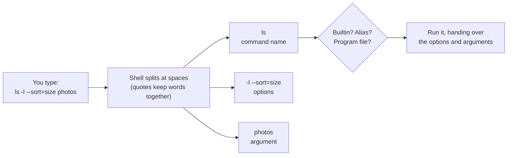

# 02 · Anatomy of a command

**What you'll build:** a practice folder full of files (some hidden, one with a space in its name), and the skill to read *any* command by splitting it into its name, options and arguments.
**Time:** ~45 min · **Builds on:** [01 · What is Linux and the terminal](../01-what-is-linux-and-the-terminal) · **Needs:** nothing extra

**Like you're 5:** a command is a sentence. The command name is the verb ("show"), options are the adverbs that say *how* ("show in detail, include hidden things"), and arguments are the nouns that say *what* ("this folder").

## Why this matters
Every tool you'll meet later (`docker`, `git`, `kubectl`, `pip`, `ollama`, `ssh`) follows the same grammar you learn here. Once you can split `docker run -it --name lab ubuntu:24.04 bash` into verb, adverbs and nouns, you can read commands in documentation, error messages and AI chat answers instead of copying them blindly. Reading before running is the single habit that keeps servers safe.

## What you'll learn
- **Command name**: the first word; it's the program (or shell feature) that runs.
- **Options (flags)**: switches that change *how* the command works: short ones like `-l`, long ones like `--all`, and ones that take a value like `--sort=size`.
- **Arguments**: the things the command works *on*, such as file and folder names.
- **Spaces and quotes**: spaces separate the pieces, so a name with a space needs `"quotes"` or a `\` backslash.
- **Builtins, programs and aliases**: `type` tells you what a command really is; `;` and `&&` run several commands on one line.

## Before you start
- Finish [lesson 01](../01-what-is-linux-and-the-terminal): you need a terminal, the course files in `~/Learning`, and a ✅ from its check.
- No install, no API key.
- This lesson's `setup.sh` creates `~/linux-practice/02`. It touches nothing else. Run it again any time to start fresh.

## Run it
1. Go to the course folder (every lesson starts here):
   ```bash
   cd ~/Learning/linux-from-zero
   ```
2. Build the practice folder:
   ```bash
   bash part-1-first-steps/02-anatomy-of-a-command/setup.sh
   ```
   ```
   Practice folder ready: /home/sam/linux-practice/02
   ```
   (Your user name replaces `sam` everywhere in this course.)
3. Go into it:
   ```bash
   cd ~/linux-practice/02
   ```
   Your prompt now ends in `~/linux-practice/02$`.
4. A command with **no options and no arguments**: list what's here.
   ```bash
   ls
   ```
   ```
    README.md   big-file.log   notes.txt   photos  'shopping list.txt'
   ```
   | Piece | Meaning |
   |---|---|
   | `ls` | "list": show the names of the files and folders in the current folder |

   `ls` puts quotes around `'shopping list.txt'` to show you its name has a space in it. The quotes are not part of the name. In your terminal, folders like `photos` are usually blue.

5. Add a **short option**: one dash and one letter.
   ```bash
   ls -l
   ```
   ```
   total 124
   -rw-r--r-- 1 sam sam     47 Oct 22 04:15  README.md
   -rw-r--r-- 1 sam sam 108893 Oct 22 04:15  big-file.log
   -rw-r--r-- 1 sam sam     34 Oct 22 04:15  notes.txt
   drwxr-xr-x 2 sam sam   4096 Oct 22 04:15  photos
   -rw-r--r-- 1 sam sam     20 Oct 22 04:15 'shopping list.txt'
   ```
   | Piece | Meaning |
   |---|---|
   | `ls` | list |
   | `-l` | **l**ong format: one line per item with details |

   How to read one long line (lesson 11 explains the first column fully):

   | Column | Example | Meaning |
   |---|---|---|
   | 1 | `-rw-r--r--` | first letter `-` = file, `d` = directory (folder); the rest are permissions (who may read/write/run) |
   | 2 | `1` | number of links (ignore for now) |
   | 3 | `sam` | the owner |
   | 4 | `sam` | the group |
   | 5 | `34` | size in **bytes** (one byte is about one letter) |
   | 6 | `Oct 22 04:15` | when it was last changed (yours shows today) |
   | 7 | `notes.txt` | the name |

   `total 124` is the disk space used by the listed files, in 1 KB blocks. You can ignore it.

6. Show **hidden** files. Any name that starts with a dot `.` is hidden from a plain `ls`.
   ```bash
   ls -a
   ```
   ```
    .    .hidden-treasure.txt   README.md      notes.txt  'shopping list.txt'
    ..   .settings              big-file.log   photos
   ```
   | Piece | Meaning |
   |---|---|
   | `-a` | **a**ll: include names that start with `.` |

   `.` means "this folder" and `..` means "the folder above". Every folder has these two. Settings files are usually hidden this way (like `.bashrc` in your home folder).

7. **Combine** short options: `-l -a` can be squeezed into `-la`. Both mean the same thing.
   ```bash
   ls -la
   ```
   ```
   total 140
   drwxr-xr-x 3 sam sam   4096 Oct 22 04:15  .
   drwxr-xr-x 3 sam sam   4096 Oct 22 04:15  ..
   -rw-r--r-- 1 sam sam     31 Oct 22 04:15  .hidden-treasure.txt
   -rw-r--r-- 1 sam sam     21 Oct 22 04:15  .settings
   -rw-r--r-- 1 sam sam     47 Oct 22 04:15  README.md
   -rw-r--r-- 1 sam sam 108893 Oct 22 04:15  big-file.log
   -rw-r--r-- 1 sam sam     34 Oct 22 04:15  notes.txt
   drwxr-xr-x 2 sam sam   4096 Oct 22 04:15  photos
   -rw-r--r-- 1 sam sam     20 Oct 22 04:15 'shopping list.txt'
   ```
   | Piece | Meaning |
   |---|---|
   | `-la` | `-l` (long) and `-a` (all) together. Order doesn't matter: `-al` is the same |

8. A **long option**: two dashes and a whole word. Easier to read, longer to type.
   ```bash
   ls --all
   ```
   ```
    .    .hidden-treasure.txt   README.md      notes.txt  'shopping list.txt'
    ..   .settings              big-file.log   photos
   ```
   | Piece | Meaning |
   |---|---|
   | `--all` | the long name of `-a`. Many options have both a short and a long name |

   **On a Mac:** the built-in `ls` has no long options; `ls --all` fails with `ls: unrecognized option`. Use `ls -a`.

9. Make sizes **human-readable**:
   ```bash
   ls -lh
   ```
   ```
   total 124K
   -rw-r--r-- 1 sam sam   47 Oct 22 04:15  README.md
   -rw-r--r-- 1 sam sam 107K Oct 22 04:15  big-file.log
   -rw-r--r-- 1 sam sam   34 Oct 22 04:15  notes.txt
   drwxr-xr-x 2 sam sam 4.0K Oct 22 04:15  photos
   -rw-r--r-- 1 sam sam   20 Oct 22 04:15 'shopping list.txt'
   ```
   | Piece | Meaning |
   |---|---|
   | `-h` | **h**uman-readable: `108893` bytes becomes `107K` (K = kilobytes, M = megabytes, G = gigabytes). Only useful together with `-l` |

10. **Sort** by size, biggest first:
    ```bash
    ls -lS
    ```
    ```
    total 124
    -rw-r--r-- 1 sam sam 108893 Oct 22 04:15  big-file.log
    drwxr-xr-x 2 sam sam   4096 Oct 22 04:15  photos
    -rw-r--r-- 1 sam sam     47 Oct 22 04:15  README.md
    -rw-r--r-- 1 sam sam     34 Oct 22 04:15  notes.txt
    -rw-r--r-- 1 sam sam     20 Oct 22 04:15 'shopping list.txt'
    ```
    | Piece | Meaning |
    |---|---|
    | `-S` | sort by **S**ize. Capital `S`! Options are case-sensitive: `-s` (small) means something else (show block sizes) |

    Add `-r` (**r**everse) to get smallest first: `ls -lSr`. Use `-t` to sort by **t**ime, newest first: `ls -lt`.

11. An option that **takes a value**:
    ```bash
    ls -l --sort=size
    ```
    It prints the same list as `ls -lS`.

    | Piece | Meaning |
    |---|---|
    | `--sort` | a long option that needs to know *how* to sort |
    | `=` | joins the option to its value (no spaces around it) |
    | `size` | the value: sort by size (other values: `time`, `name`, `extension`, `none`) |

    Short options take values with a space instead, like `head -n 5 file` ("first **n**umber 5 lines", lesson 05). (**On a Mac:** `--sort` doesn't exist; use `-S`.)

12. Add an **argument**: tell `ls` *what* to list.
    ```bash
    ls -l photos
    ```
    ```
    total 8
    -rw-r--r-- 1 sam sam 33 Oct 22 04:15 cat.jpg
    -rw-r--r-- 1 sam sam 33 Oct 22 04:15 dog.jpg
    ```
    | Piece | Meaning |
    |---|---|
    | `ls -l` | list, long format |
    | `photos` | the argument: list *inside the folder* `photos` instead of the current folder |

    The usual order is `command -options arguments`. Linux's `ls` also accepts `ls photos -l`, but a Mac's `ls` would treat `-l` as a file name there, so always put options first.

13. See how **spaces split** a command. Try this on purpose:
    ```bash
    ls -l shopping list.txt
    ```
    ```
    ls: cannot access 'shopping': No such file or directory
    ls: cannot access 'list.txt': No such file or directory
    ```
    The shell cut the name at the space, so `ls` got **two** arguments, `shopping` and `list.txt`, and neither exists. Read error messages left to right: **who** complains (`ls:`), **what** it tried (`cannot access 'shopping'`), **why** (`No such file or directory`).

14. Fix it with **quotes** (or a backslash):
    ```bash
    ls -l "shopping list.txt"
    ```
    ```
    -rw-r--r-- 1 sam sam 20 Oct 22 04:15 'shopping list.txt'
    ```
    | Piece | Meaning |
    |---|---|
    | `"shopping list.txt"` | double quotes glue everything inside into ONE argument, space included |
    | `'shopping list.txt'` | single quotes do the same (lesson 14 shows how they differ) |
    | `shopping\ list.txt` | a backslash `\` means "the next character is just a character", so the space doesn't split |

    Pressing **Tab** after typing `ls -l sh` adds the backslash for you.

15. Make a **mistake** in the option and read the error:
    ```bash
    ls -z
    ```
    ```
    ls: invalid option -- 'z'
    Try 'ls --help' for more information.
    ```
    The program tells you how to get help: `ls --help` (lesson 06).

16. Run **two commands** on one line:
    ```bash
    echo one; echo two
    ```
    ```
    one
    two
    ```
    Then the "only if it worked" version:
    ```bash
    cd photos && ls
    ```
    ```
    cat.jpg  dog.jpg
    ```
    | Piece | Meaning |
    |---|---|
    | `;` | "then": run the first command, then the second, no matter what |
    | `&&` | "and if that worked": run the second only if the first succeeded |
    | `cd photos` | move into the `photos` folder (lesson 03) |

    Try `cd nowhere && ls`: you get `bash: cd: nowhere: No such file or directory` and `ls` never runs. Go back up with `cd ..` (".." = the folder above).

17. Ask the shell **what a command really is**:
    ```bash
    type cd
    ```
    ```
    cd is a shell builtin
    ```
    ```bash
    type ls
    ```
    ```
    ls is aliased to `ls --color=auto'
    ```
    ```bash
    type -a ls
    ```
    ```
    ls is aliased to `ls --color=auto'
    ls is /usr/bin/ls
    ls is /bin/ls
    ```
    | Piece | Meaning |
    |---|---|
    | `type` | "what kind of command is this name?" |
    | `cd` | a **builtin**: part of the shell itself, not a separate file |
    | `ls` | an **alias** (a nickname: typing `ls` really runs `ls --color=auto`, which adds colours), which points to a **program file** |
    | `-a` | show **a**ll matches, not just the first |
    | `/usr/bin/ls` | the program file on disk. `/bin` is a shortcut to `/usr/bin` on Ubuntu, so it's listed twice |

    `which ls` prints just the file path: `/usr/bin/ls`. (On a Mac, `ls` is `/bin/ls` and has no alias.)

18. Write a **comment**. Everything after `#` is ignored by the shell:
    ```bash
    echo hi # this part is a comment
    ```
    ```
    hi
    ```
    | Piece | Meaning |
    |---|---|
    | `#` | "comment starts here": a note for humans. Scripts are full of them |

19. Go back to the course folder and take the quiz:
    ```bash
    cd ~/Learning/linux-from-zero
    bash part-1-first-steps/02-anatomy-of-a-command/check.sh
    ```
    It asks five questions. Find each answer by running a command (open a second terminal window or tab for that), then type it and press Enter.

### What you should see
With all five right:
```
Lesson 02 quiz. Keep a second terminal open to run commands in.

1. How many HIDDEN files are in ~/linux-practice/02? (names starting with a dot; don't count . and ..)
> ✅ Correct: 2

2. How many bytes is notes.txt?
> ✅ Correct: 34

3. Which file in ~/linux-practice/02 is the biggest? (type its name)
> ✅ Correct: big-file.log

4. Is cd a shell builtin or a program file on disk? (type: builtin or file)
> ✅ Correct: builtin

5. What is the full path of the ls program file?
> ✅ Correct: /usr/bin/ls

Result: 5 of 5 correct.
You can read any command now. On to lesson 03!
```
A wrong answer shows a hint, for example:
```
1. How many HIDDEN files are in ~/linux-practice/02? (names starting with a dot; don't count . and ..)
> ❌ Not quite (you typed: '3')
   hint: ls -a ~/linux-practice/02 shows hidden files
```
Your dates and times in `ls -l` will be different (they show when *you* ran setup). The order of names can differ slightly too (some systems sort capital letters first).

## How it works
**The shell splits your line into words, then runs the first word.**



1. **Splitting.** The shell cuts your line at every space (one or many, it doesn't matter). Quotes and backslashes stop it cutting. This is why `ls -l shopping list.txt` gave two errors.
2. **Finding the command.** The shell checks, in this order: is the first word an **alias** (a nickname you or Ubuntu set up in `~/.bashrc`)? A **builtin** (a command built into the shell, like `cd`, `echo`, `type`)? Otherwise, it looks for a **program file** with that name in a list of folders (`/usr/bin` and friends; lesson 14 calls this list `PATH`). If nothing matches: `command not found`.
3. **Options are just words starting with `-`.** The shell doesn't understand them; it passes them to the program, and the program decides what they mean. That's why options differ between programs, and between GNU (Linux) and BSD (Mac) versions of the same program.
4. **Option conventions** most programs follow:

   | Form | Example | Rule |
   |---|---|---|
   | short | `-l` | one dash, one letter |
   | combined short | `-la`, `-lhS` | several one-letter options after one dash |
   | long | `--all` | two dashes, a word |
   | long with value | `--sort=size` | `=` joins option and value |
   | short with value | `-n 5` | value is the next word |
   | end of options | `--` | "everything after this is an argument, even if it starts with `-`" (handy for a file called `-weird.txt`) |

5. **`;` vs `&&`.** Every command reports back "it worked" or "it failed" when it ends (its **exit code**, Part 3). `;` ignores that report; `&&` checks it. There is also `||` ("only if it failed").
6. **`setup.sh`** uses `printf` (print exactly this text), `>` (save into a file, lesson 08) and a `while` loop (Part 3) to write 2,000 lines into `big-file.log`. You'll be able to read every line of it by the end of Part 3.

## If something goes wrong
- **`No such file or directory` for `setup.sh`** → you're not in the course folder. Run `cd ~/Learning/linux-from-zero` first, then the `bash part-1...` line. Use Tab to complete the long path.
- **`ls: cannot access '...': No such file or directory`** → a typo, a missing quote around a name with spaces, or you're in a different folder than you think. Run `pwd` to check where you are.
- **`ls: unrecognized option '--all'` or `--sort`** → you're on a Mac (BSD `ls`). Use `-a` and `-S`.
- **`bash: LS: command not found`** → capital letters. Commands are case-sensitive.
- **The quiz says `❌ ~/linux-practice/02 does not exist`** → run setup first (step 2).

## Try this
1. List the `photos` folder *and* the hidden files of the practice folder in one command (two arguments).
2. Show the practice folder sorted by time with the oldest first, sizes human-readable.
3. Use `type` on `echo`, `pwd`, `ll` and `whoami`. Which are builtins, which are aliases, which are files? What does the `ll` alias actually run?

<details><summary>Solutions</summary>

1. `ls -a ~/linux-practice/02 ~/linux-practice/02/photos` (or from inside the folder: `ls -a . photos`). `ls` prints a heading for each argument.
2. `ls -lhtr` (long, human, time, reverse). All the files were created at the same moment, so you'll see little difference; try it again in your home folder (`ls -lhtr ~`).
3. `echo is a shell builtin`, `pwd is a shell builtin`, `ll is aliased to 'ls -alF'`, `whoami is /usr/bin/whoami`. `ll` runs `ls -alF`: long, all, and `-F` adds a symbol after each name (`/` for folders, `*` for runnable programs). On a Mac there is no `ll` alias (`type ll` says not found).
</details>

## Check yourself
1. Split `ls -lh --sort=time Documents` into command name, options and arguments.
2. Why does `ls my file.txt` fail when a file called `my file.txt` exists? Give two fixes.
3. What is the difference between `cd photos; ls` and `cd photos && ls` when `photos` doesn't exist?
4. You find the command `rm -rf -- -old-folder` online. What does the lone `--` do?

<details><summary>Answers</summary>

1. Command name: `ls`. Options: `-l`, `-h` (combined as `-lh`) and `--sort=time` (a long option with a value). Argument: `Documents`.
2. The shell splits at the space, so `ls` looks for two files, `my` and `file.txt`. Fixes: `ls "my file.txt"` or `ls my\ file.txt`.
3. With `;`, `ls` runs anyway and lists the *current* folder (which can mislead you). With `&&`, `ls` doesn't run, because `cd` failed.
4. It marks the end of options, so `-old-folder` is treated as a name, not as options `-o -l -d ...`.
</details>

## Learn more (optional)
**Read the official docs**
- GNU Bash manual, "Shell Syntax" (how the shell splits and quotes): https://www.gnu.org/software/bash/manual/html_node/Shell-Syntax.html
- `ls` manual page: https://man7.org/linux/man-pages/man1/ls.1.html
- GNU Coreutils manual (all the basic commands): https://www.gnu.org/software/coreutils/manual/
- POSIX utility conventions (where `-a`, `--` and friends come from): https://pubs.opengroup.org/onlinepubs/9699919799/basedefs/V1_chap12.html

**Watch**
- NetworkChuck, Linux for hackers (episodes on basic commands): https://www.youtube.com/results?search_query=networkchuck+linux+for+hackers
- freeCodeCamp, Linux command line full course: https://www.youtube.com/results?search_query=freecodecamp+linux+command+line+full+course
- "ls command explained" walkthroughs: https://www.youtube.com/results?search_query=linux+ls+command+options+explained

## Next
→ [03 · Moving around the filesystem](../03-moving-around-the-filesystem)
