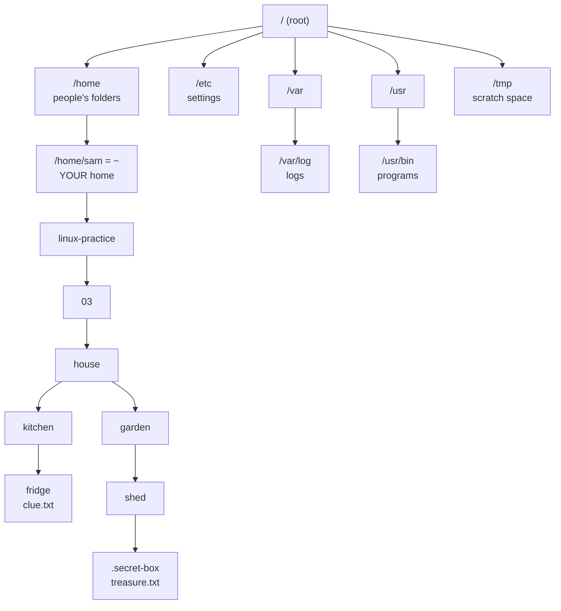

# 03 · Moving around the filesystem

**What you'll build:** a "house" of folders with a treasure hunt in it. You'll follow clues from room to room with `cd`, using every kind of path, and find a treasure hidden in a secret box.
**Time:** ~50 min · **Builds on:** [02 · Anatomy of a command](../02-anatomy-of-a-command) · **Needs:** nothing extra

**Like you're 5:** the filesystem is a big house. `/` is the front door, folders are rooms, rooms have smaller rooms inside, and a **path** is the directions: "front door → kitchen → fridge".

## Why this matters
On a server you can't see folders in a window; you move around by typing. Config files live in `/etc`, logs in `/var/log`, your app in `/home/you/app` or `/opt/app`, and every tool (Docker volumes, Python virtual environments, systemd services, `ssh` keys in `~/.ssh`) asks you for paths. Getting lost is the most common beginner problem, and `pwd`, `cd` and `ls` are the cure.

## What you'll learn
- **The tree**: every file on Linux lives under one top folder, `/` (called "root"). There are no drive letters like `C:`.
- **Absolute paths** start at `/` (or `~`) and work from anywhere; **relative paths** start from where you are now.
- **Special names**: `~` (your home), `.` (here), `..` (one folder up), `-` (the folder you were in before).
- **`pwd`, `cd`, `ls`, `tree`, `cat`**: where am I, go there, what's here, draw it, read it.
- **Important system folders**: `/home`, `/etc`, `/var/log`, `/tmp`, `/usr/bin`, `/root`, `/mnt`.

## Before you start
- Finish [lesson 02](../02-anatomy-of-a-command).
- `tree` was installed in [lesson 01](../01-what-is-linux-and-the-terminal), Step 3. If `tree` says `command not found`: `sudo apt install -y tree` (Mac: `brew install tree`).
- No API key. `setup.sh` only creates `~/linux-practice/03`.

## Run it
1. Go to the course folder:
   ```bash
   cd ~/Learning/linux-from-zero
   ```
2. Build the house:
   ```bash
   bash part-1-first-steps/03-moving-around-the-filesystem/setup.sh
   ```
   ```
   Practice folder ready: /home/sam/linux-practice/03
   Start with:  cd ~/linux-practice/03/house  and  cat START-HERE.txt
   ```
3. Visit the very top of the tree:
   ```bash
   cd /
   ```
   | Piece | Meaning |
   |---|---|
   | `cd` | change directory: move into a folder |
   | `/` | the **root** folder: the top of everything. (`/` *between* names is a separator; `/` *alone or at the start* is the root) |

   Your prompt now shows `sam@laptop:/$`.
4. Look around:
   ```bash
   ls
   ```
   ```
   bin   dev  home  lib64  mnt  proc  run   srv  tmp  var
   boot  etc  lib   media  opt  root  sbin  sys  usr
   ```
   These are the main rooms of every Linux computer. (WSL and desktops show a few extra, such as `snap` or `lost+found`.) The table in "How it works" says what each is for.
5. Jump straight into the house with an **absolute path**:
   ```bash
   cd ~/linux-practice/03/house
   ```
   | Piece | Meaning |
   |---|---|
   | `~` | your home folder, `/home/sam` (on a Mac `/Users/sam`) |
   | `/linux-practice/03/house` | then down into `linux-practice`, `03`, `house` |

   It's absolute because it starts from a fixed place (`~`), so it works from anywhere.
6. Check where you are:
   ```bash
   pwd
   ```
   ```
   /home/sam/linux-practice/03/house
   ```
   `pwd` always prints the full absolute path, with `~` spelled out.
7. See what's in this room, then read the starting note:
   ```bash
   ls
   ```
   ```
   START-HERE.txt  attic  bedroom  garden  kitchen  living-room
   ```
   ```bash
   cat START-HERE.txt
   ```
   ```
   Welcome, explorer!
   Your first clue is in the kitchen, inside the fridge.
   Try:  cd kitchen/fridge   then   ls   then   cat clue.txt
   ```
   | Piece | Meaning |
   |---|---|
   | `cat` | print a file's contents (lesson 05 has much more) |
   | `START-HERE.txt` | a **relative path**: the file `START-HERE.txt` right here |

8. Draw the whole house as a tree:
   ```bash
   tree
   ```
   ```
   .
   ├── START-HERE.txt
   ├── attic
   │   └── old-toys
   │       ├── clue.txt
   │       └── teddy.txt
   ├── bedroom
   │   ├── bed
   │   └── wardrobe
   │       ├── shirt.txt
   │       └── socks.txt
   ├── garden
   │   └── shed
   │       └── tools
   │           └── hammer.txt
   ├── kitchen
   │   ├── cupboard
   │   │   └── cereal.txt
   │   └── fridge
   │       ├── cheese.txt
   │       ├── clue.txt
   │       └── milk.txt
   └── living-room
       └── sofa
           ├── clue.txt
           ├── coins.txt
           └── remote.txt

   14 directories, 13 files
   ```
   | Piece | Meaning |
   |---|---|
   | `tree` | draw folders and files as a tree, starting at `.` (here) |

   Notice what's **missing**: the treasure. It's hidden. Keep reading.
9. Go **down** two rooms with a relative path:
   ```bash
   cd kitchen/fridge
   ```
   ```bash
   ls
   ```
   ```
   cheese.txt  clue.txt  milk.txt
   ```
   ```bash
   cat clue.txt
   ```
   ```
   Clue 1: well done!
   The next clue is under the sofa in the living room.
   You are in house/kitchen/fridge. Go UP two folders, then down:
     cd ../../living-room/sofa
   ```
   | Piece | Meaning |
   |---|---|
   | `kitchen/fridge` | relative path: from here, into `kitchen`, then into `fridge`. No `/` at the start, so it begins where you are |

10. Go **up** two and down again:
    ```bash
    cd ../../living-room/sofa
    ```
    ```bash
    pwd
    ```
    ```
    /home/sam/linux-practice/03/house/living-room/sofa
    ```
    | Piece | Meaning |
    |---|---|
    | `..` | the folder one level up (the "parent"). From `fridge`, `..` is `kitchen` |
    | `../..` | up, then up again: `house` |
    | `../../living-room/sofa` | up two, then down into `living-room`, then `sofa` |

    ```bash
    cat clue.txt
    ```
    ```
    Clue 2: great!
    The next clue is in the attic, in the old-toys box.
    This time use an ABSOLUTE path (one that starts from your home folder):
      cd ~/linux-practice/03/house/attic/old-toys
    ```
11. Follow the clue with an absolute path, and read it:
    ```bash
    cd ~/linux-practice/03/house/attic/old-toys
    cat clue.txt
    ```
    ```
    Clue 3: almost there!
    The treasure is in a HIDDEN box in the garden shed.
    Go to the shed, then list EVERYTHING (hidden things too):
      cd ~/linux-practice/03/house/garden/shed
      ls -a
    ```
    **Use Tab!** Type `cd ~/li`, press **Tab**, type `0`, Tab, `3`, Tab, `h`, Tab... The shell completes each name. If nothing happens, press Tab twice to see the choices. Tab also prevents typos.
12. Go to the shed and look, first normally, then at everything:
    ```bash
    cd ~/linux-practice/03/house/garden/shed
    ls
    ```
    ```
    tools
    ```
    ```bash
    ls -a
    ```
    ```
    .  ..  .secret-box  tools
    ```
    There it is: `.secret-box` starts with a dot, so plain `ls` (and `tree`) hide it.
13. Open the box and read the treasure:
    ```bash
    cd .secret-box
    cat treasure.txt
    ```
    ```
    You found the treasure!
    The secret word is: PENGUIN
    (The quiz in check.sh will ask you for it.)
    ```
    Run `pwd` here and remember the result: the quiz asks for this path.
14. Jump **back and forth**:
    ```bash
    cd ..
    pwd
    ```
    ```
    /home/sam/linux-practice/03/house/garden/shed
    ```
    ```bash
    cd -
    ```
    ```
    /home/sam/linux-practice/03/house/garden/shed/.secret-box
    ```
    | Piece | Meaning |
    |---|---|
    | `cd -` | go back to the folder you were in just before (like a TV remote's "last channel" button). It prints where it took you |

15. Go **home** from anywhere:
    ```bash
    cd
    pwd
    ```
    ```
    /home/sam
    ```
    `cd` with nothing after it and `cd ~` both take you home.
16. Peek into some system rooms **without** going there, by giving `ls` a path:
    ```bash
    ls /var/log
    ```
    ```
    alternatives.log  apt  bootstrap.log  btmp  dpkg.log  faillog  lastlog  wtmp
    ```
    ```bash
    ls /root
    ```
    ```
    ls: cannot open directory '/root': Permission denied
    ```
    `/var/log` holds logs (yours will list more files). `/root` is the admin's home: normal users may not look inside. That's permissions at work (lesson 11).
17. List a folder *and everything inside it* without `tree`:
    ```bash
    ls -R ~/linux-practice/03/house/kitchen
    ```
    ```
    /home/sam/linux-practice/03/house/kitchen:
    cupboard  fridge

    /home/sam/linux-practice/03/house/kitchen/cupboard:
    cereal.txt

    /home/sam/linux-practice/03/house/kitchen/fridge:
    cheese.txt  clue.txt  milk.txt
    ```
    | Piece | Meaning |
    |---|---|
    | `-R` | **R**ecursive: list this folder, then every folder inside it, and so on. (Capital R!) |

18. Draw a tree including hidden things:
    ```bash
    tree -a ~/linux-practice/03/house/garden
    ```
    ```
    /home/sam/linux-practice/03/house/garden
    └── shed
        ├── .secret-box
        │   └── treasure.txt
        └── tools
            └── hammer.txt

    4 directories, 2 files
    ```
    | Piece | Meaning |
    |---|---|
    | `-a` | all, including hidden (same idea as `ls -a`) |
    | `~/linux-practice/03/house/garden` | which folder to start drawing from |

19. Take the quiz:
    ```bash
    cd ~/Learning/linux-from-zero
    bash part-1-first-steps/03-moving-around-the-filesystem/check.sh
    ```

### What you should see
```
Lesson 03 quiz. Keep a second terminal open to explore in.

1. What is the secret word in the treasure file?
> ✅ Correct: penguin

2. What is the ABSOLUTE path of the treasure file? (start with / or ~)
> ✅ Correct: /home/sam/linux-practice/03/house/garden/shed/.secret-box/treasure.txt

3. You are in ~/linux-practice/03/house/kitchen/fridge. Which cd command, using only .., takes you to the house folder?
> ✅ Correct: cd ../..

4. Which top-level folder holds most system settings (config) files? (full path)
> ✅ Correct: /etc

5. What does 'cd -' do? Type a, b or c.  a) go home  b) go back to the previous folder  c) go to /
> ✅ Correct: b

Result: 5 of 5 correct.
You can find your way around any Linux computer. On to lesson 04!
```
Watch the prompt during the hunt: the part between `:` and `$` always shows where you are, with `~` meaning `/home/sam`.

## How it works
**One tree, one root.** Windows has a tree per drive (`C:\`, `D:\`). Linux has a single tree starting at `/`. Extra disks and USB sticks are attached somewhere inside it (for example under `/mnt` or `/media`); WSL attaches your Windows `C:` drive at `/mnt/c`.



1. **Absolute vs relative.** The shell looks at the first character of a path:
   - starts with `/` → start at the root (`/etc/os-release`);
   - starts with `~` → start at your home (`~/linux-practice`);
   - anything else → start **here**, wherever `pwd` says you are (`kitchen/fridge`, `../cupboard`).

   A relative path is like "two doors down the hall": it only makes sense if you know where you're standing. An absolute path is like a full postal address: it works from anywhere.
2. **`.` and `..` are real entries** in every folder (you saw them in `ls -a`). `.` points to the folder itself, `..` to its parent. So `cd ..` is just "go into the entry called `..`". `./clue.txt` and `clue.txt` mean the same file; you'll need the `./` form to run programs in the current folder (Part 3).
3. **`~` is replaced by the shell** before the command runs: `cd ~/linux-practice` becomes `cd /home/sam/linux-practice`. `cd -` uses a note the shell keeps of your previous folder.
4. **Hidden files** are simply files whose names start with `.`. Nothing else is special about them. Settings files use this trick to stay out of your way (`~/.bashrc`, `~/.ssh`, `~/.config`).
5. **Important folders** (the "Filesystem Hierarchy Standard"):

   | Folder | What lives there |
   |---|---|
   | `/` | the root of everything |
   | `/home` | one folder per person (`/home/sam`). Mac: `/Users` |
   | `/root` | the admin (root) user's home. Not inside `/home` |
   | `/etc` | system settings (config files): `/etc/hosts`, `/etc/ssh/`, `/etc/nginx/` |
   | `/var/log` | log files: what programs and the system did |
   | `/tmp` | temporary files; often emptied on restart |
   | `/usr/bin` (and `/bin`) | programs: `ls`, `cat`, `python3`... |
   | `/usr/sbin` (and `/sbin`) | admin programs |
   | `/opt` | extra software installed by hand |
   | `/mnt`, `/media` | other disks; WSL's `C:` is `/mnt/c` |
   | `/dev` | devices (disks, terminals) shown as files |
   | `/proc`, `/sys` | live information from the kernel, shown as files |

6. **Case matters, spaces need quotes.** `Kitchen` and `kitchen` are different folders. To enter a folder with a space in its name: `cd "My Folder"` or `cd My\ Folder` (lesson 02).

## If something goes wrong
- **`bash: cd: kitchen/fridge: No such file or directory`** → you're not where you think. Run `pwd`. Relative paths start from *your current folder*; go to `~/linux-practice/03/house` first, or use the absolute path.
- **`bash: cd: clue.txt: Not a directory`** → `cd` only goes into folders. Use `cat clue.txt` to read a file.
- **`tree: command not found`** → `sudo apt install -y tree` (Mac: `brew install tree`), or use `ls -R`.
- **The prompt is very long** → that's just a deep folder. `cd` (alone) takes you home.
- **On WSL, `cd C:\Users`** fails → Linux uses `/` not `\`, and no drive letters: `cd /mnt/c/Users`.

## Try this
1. From inside `~/linux-practice/03/house/kitchen/fridge`, get to the `cupboard` folder with one `cd` and a relative path. Then go to `bedroom/wardrobe` with one relative `cd`.
2. Without moving (stay in your home folder), list the contents of the attic's `old-toys` folder, and print the hammer file with `cat`.
3. Explore the real system: go to `/etc`, find the file that holds your computer's name (hint: it's called exactly what the command from lesson 01 is called) and print it. Then go to `/usr/bin` and count roughly how many programs there are with `ls | wc -l` (lesson 08 explains `|`).

<details><summary>Solutions</summary>

1. `cd ../cupboard` (up to `kitchen`, down to `cupboard`). Then `cd ../../bedroom/wardrobe` (up to `kitchen`, up to `house`, down twice). Check with `pwd`.
2. `ls ~/linux-practice/03/house/attic/old-toys` → `clue.txt  teddy.txt`. `cat ~/linux-practice/03/house/garden/shed/tools/hammer.txt` → `A heavy hammer.`
3. `cd /etc` then `cat hostname` (prints your computer name, e.g. `laptop`). `cd /usr/bin` then `ls | wc -l` prints a number (several hundred to a few thousand). Go home with `cd`.
</details>

## Check yourself
1. You're in `/home/sam/linux-practice`. Write an absolute and a relative path to `/home/sam/linux-practice/03/house/garden`.
2. What's the difference between `cd /tmp` and `cd tmp`?
3. Why didn't `tree` show the treasure, and how did you find it?
4. You type `cd ..` while in `/`. Where do you end up?

<details><summary>Answers</summary>

1. Absolute: `/home/sam/linux-practice/03/house/garden` (or `~/linux-practice/03/house/garden`). Relative: `03/house/garden`.
2. `cd /tmp` goes to the `tmp` folder at the root of the system. `cd tmp` looks for a folder called `tmp` inside your current folder.
3. Its folder `.secret-box` starts with a dot, so it's hidden. `ls -a` (or `tree -a`) shows hidden names.
4. Still in `/`. The root has no parent; its `..` points to itself.
</details>

## Learn more (optional)
**Read the official docs**
- Filesystem Hierarchy Standard (what each folder is for): https://refspecs.linuxfoundation.org/FHS_3.0/fhs/index.html
- `hier` manual page (the same, short): https://man7.org/linux/man-pages/man7/hier.7.html
- `cd` and other builtins, GNU Bash manual: https://www.gnu.org/software/bash/manual/html_node/Bourne-Shell-Builtins.html
- `tree` manual page: https://linux.die.net/man/1/tree
- Working across Windows and Linux file systems (WSL): https://learn.microsoft.com/en-us/windows/wsl/filesystems

**Watch**
- Linux file system explained: https://www.youtube.com/results?search_query=linux+file+system+explained+for+beginners
- NetworkChuck, Linux file system and navigation: https://www.youtube.com/results?search_query=networkchuck+linux+file+system
- freeCodeCamp, Linux command line full course (navigation chapter): https://www.youtube.com/results?search_query=freecodecamp+linux+command+line+full+course

## Next
→ [04 · Creating, copying, moving, deleting](../04-creating-copying-moving-deleting)
