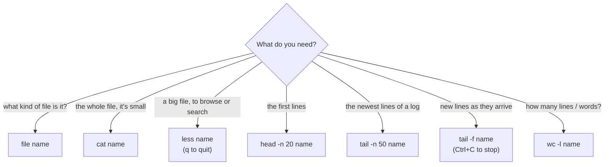

# 05 · Reading files

**What you'll build:** a practice folder with a server log, a CSV table, a poem, a 300-line story and three mystery files. You'll read them all: whole, page by page, just the start, just the end, live as they grow, and you'll count their lines and words.
**Time:** ~50 min · **Builds on:** [04 · Creating, copying, moving, deleting](../04-creating-copying-moving-deleting) · **Needs:** nothing extra

**Like you're 5:** `cat` tips the whole toy box onto the floor, `less` lets you look through it one page at a time, `head` takes the toys from the top, `tail` takes them from the bottom, and `wc` counts them.

## Why this matters
When something breaks on a server, the answer is almost always in a log file. You'll read the last lines of logs (`tail`), watch them live while you test an API (`tail -f`), peek at the first rows of a huge dataset before training a model (`head data.csv`), and count rows (`wc -l`). Opening a 5 GB file in a normal editor can freeze your machine; these tools read it instantly.

## What you'll learn
- **`cat`**: print a whole (small) file; `-n` adds line numbers.
- **`less`**: a page-by-page viewer with search, for big files. Quit with `q`.
- **`head` and `tail`**: the first or last lines; `-n N` chooses how many; `tail -f` **follows** a file that's still growing.
- **`wc`**: count lines, words and bytes (`-l`, `-w`, `-c`).
- **`file`**: tells you what a file really is, whatever its name says.

## Before you start
- Finish [lesson 04](../04-creating-copying-moving-deleting).
- No install, no API key. `setup.sh` only creates `~/linux-practice/05`.

## Run it
1. Go to the course folder and build the practice files:
   ```bash
   cd ~/Learning/linux-from-zero
   bash part-1-first-steps/05-reading-files/setup.sh
   ```
   ```
   Practice folder ready: /home/sam/linux-practice/05
   ```
2. Go there and look:
   ```bash
   cd ~/linux-practice/05
   ls -l
   ```
   ```
   total 52
   -rw-r--r-- 1 sam sam  6632 Oct 22 09:02 app.log
   -rw-r--r-- 1 sam sam   327 Oct 22 09:02 grow.sh
   -rw-r--r-- 1 sam sam    33 Oct 22 09:02 mystery1
   -rw-r--r-- 1 sam sam    67 Oct 22 09:02 mystery2
   -rw-r--r-- 1 sam sam    32 Oct 22 09:02 mystery3
   -rw-r--r-- 1 sam sam   371 Oct 22 09:02 poem.txt
   -rw-r--r-- 1 sam sam   391 Oct 22 09:02 sales.csv
   -rw-r--r-- 1 sam sam 17099 Oct 22 09:02 story.txt
   ```
3. Print a small file in full:
   ```bash
   cat poem.txt
   ```
   ```
   The terminal is quiet, the cursor blinks slow,
   it waits for a word, for a place it should go.
   I type in a command and I press on the key,
   and the computer, politely, replies back to me.
   A folder, a file, a log full of lines,
   each one has a story, a time and some signs.
   So read them with care, from the head to the tail,
   and the server will tell you the end of the tale.
   ```
   | Piece | Meaning |
   |---|---|
   | `cat` | "concatenate" (join together): print the files you name, one after another |
   | `poem.txt` | the file to print |

4. Add line numbers:
   ```bash
   cat -n poem.txt
   ```
   ```
        1	The terminal is quiet, the cursor blinks slow,
        2	it waits for a word, for a place it should go.
        3	I type in a command and I press on the key,
        4	and the computer, politely, replies back to me.
        5	A folder, a file, a log full of lines,
        6	each one has a story, a time and some signs.
        7	So read them with care, from the head to the tail,
        8	and the server will tell you the end of the tale.
   ```
   | Piece | Meaning |
   |---|---|
   | `-n` | **n**umber every line (the numbers are only on screen, not in the file) |

   `cat poem.txt sales.csv` prints both files back to back: that's the "concatenate" part.
5. Look at the **start** of a file:
   ```bash
   head app.log
   ```
   ```
   2026-03-14 09:00:00 INFO  api: GET /products/1 200
   2026-03-14 09:00:30 INFO  api: GET /products/2 200
   2026-03-14 09:01:00 INFO  api: GET /products/3 200
   2026-03-14 09:01:30 INFO  api: GET /products/4 200
   2026-03-14 09:02:00 INFO  api: GET /products/5 200
   2026-03-14 09:02:30 INFO  api: GET /products/6 200
   2026-03-14 09:03:00 WARN  api: slow response (818 ms) on /search
   2026-03-14 09:03:30 INFO  api: GET /products/8 200
   2026-03-14 09:04:00 INFO  api: GET /products/9 200
   2026-03-14 09:04:30 ERROR payment-service: card declined for order 1009
   ```
   | Piece | Meaning |
   |---|---|
   | `head` | print the first lines of a file: 10 unless you say otherwise |

   A log line, piece by piece: date `2026-03-14`, time `09:04:30`, **level** (`INFO` = normal, `WARN` = something odd, `ERROR` = something failed), which part of the app wrote it (`payment-service`), and the message.
6. Choose how many lines:
   ```bash
   head -n 4 sales.csv
   ```
   ```
   date,region,product,units,price
   2026-03-01,north,laptop,3,999
   2026-03-01,south,phone,10,499
   2026-03-02,east,tablet,4,329
   ```
   | Piece | Meaning |
   |---|---|
   | `-n 4` | an option with a value: **n**umber of lines = 4 |
   | `sales.csv` | a **CSV** file ("comma-separated values"): a table as plain text. Line 1 is the **header** (column names); every other line is one row; commas separate the columns |

7. Look at the **end** of the log (where the newest events are):
   ```bash
   tail -n 3 app.log
   ```
   ```
   2026-03-14 09:58:30 INFO  api: GET /products/1 200
   2026-03-14 09:59:00 WARN  api: slow response (1154 ms) on /search
   2026-03-14 09:59:30 ERROR payment-service: card declined for order 1119
   ```
   | Piece | Meaning |
   |---|---|
   | `tail` | print the last lines (10 by default) |
   | `-n 3` | just the last 3 |

   Logs grow at the bottom, so `tail` is the first command to run when something just broke.
8. **Count** lines, words and bytes:
   ```bash
   wc app.log
   ```
   ```
    120  912 6632 app.log
   ```
   ```bash
   wc -l app.log
   ```
   ```
   120 app.log
   ```
   | Piece | Meaning |
   |---|---|
   | `wc` | "word count". With no options it prints three numbers: lines, words, bytes |
   | `-l` | only **l**ines (the one you'll use most: "how many rows/log entries?") |
   | `-w` | only **w**ords |
   | `-c` | only bytes (think **c**haracters; exactly right for plain English text) |

   With several files you also get a total: `wc -l *.txt` → `8 poem.txt`, `300 story.txt`, `308 total`.
9. Read a **long** file page by page:
   ```bash
   less -N story.txt
   ```
   | Piece | Meaning |
   |---|---|
   | `less` | a viewer that shows one screen at a time and never changes the file |
   | `-N` | show line **N**umbers on the left |

   Your terminal fills with the story. Now use these keys (no Enter needed, except after a search):

   | Key | What it does |
   |---|---|
   | **Space** or **f** | next page (forward) |
   | **b** | back one page |
   | **↓ / ↑** or **j / k** | one line down / up |
   | **G** | jump to the end; **g** jumps to the start |
   | **/dragon** then **Enter** | search forward for "dragon" (highlights it) |
   | **n** / **N** | next / previous match |
   | **q** | quit and get your prompt back |
   | **h** | help screen (press q to leave it) |

   Search for `/dragon` now and note the line number on the left: the quiz asks for it. Then press **q**.
10. Find out what a file **really** is:
    ```bash
    file mystery1 mystery2 mystery3 sales.csv grow.sh
    ```
    ```
    mystery1:  PNG image data, 16 x 16, 8-bit/color RGBA, non-interlaced
    mystery2:  gzip compressed data, from Unix, original size modulo 2^32 47
    mystery3:  ASCII text
    sales.csv: CSV ASCII text
    grow.sh:   Bourne-Again shell script, ASCII text executable
    ```
    | Piece | Meaning |
    |---|---|
    | `file` | look at the first bytes of each file (its "magic number") and say what kind of file it is. Names and extensions can lie; the content doesn't |

    `mystery2` is compressed with **gzip** (`.gz` files). Read it without unpacking it: `zcat mystery2` → `This text was hidden inside a compressed file.` (On a Mac use `gzcat`.)
11. See why you should **not** `cat` a non-text file:
    ```bash
    cat mystery1
    ```
    ```
    �PNG

       IHDR         ��a
    ```
    Pictures, programs and zip files are bytes, not letters, so `cat` prints garbage (a big one can even mess up your terminal's colours). If that happens, type `reset` and press Enter. Run `file` first when you're not sure.
12. Watch a file **grow**, live. Start the little writer script in the background, then follow its log:
    ```bash
    bash grow.sh &
    ```
    ```
    [1] 2481
    ```
    ```bash
    tail -f growing.log
    ```
    ```
    09:02:34 visitor number 1 arrived
    09:02:35 visitor number 2 arrived
    09:02:36 visitor number 3 arrived
    09:02:37 visitor number 4 arrived
    09:02:38 visitor number 5 arrived
    09:02:39 visitor number 6 arrived
    ```
    | Piece | Meaning |
    |---|---|
    | `bash grow.sh` | run the script, which adds one line to `growing.log` every second, 30 times |
    | `&` | run it in the **background**, so you get your prompt back straight away. `[1] 2481` is its job number and process ID (lesson 13) |
    | `tail -f` | **f**ollow: print the last lines, then keep waiting and print every new line as it arrives |

    A new line appears every second. `tail -f` never stops by itself: press **Ctrl + C** to quit it. (The script stops on its own after 30 seconds; later you may see `[1]+  Done   bash grow.sh`.)
13. Take the quiz:
    ```bash
    cd ~/Learning/linux-from-zero
    bash part-1-first-steps/05-reading-files/check.sh
    ```

### What you should see
```
Lesson 05 quiz. Keep a second terminal open in ~/linux-practice/05.

1. How many lines does app.log have?
> ✅ Correct: 120

2. What time is on the LAST line of app.log? (like 09:15:00)
> ✅ Correct: 09:59:30

3. How many words are in poem.txt?
> ✅ Correct: 79

4. What kind of file is mystery1? (one word, the first word 'file' says after the colon)
> ✅ Correct: png

5. On which line number of story.txt is the word 'dragon'?
> ✅ Correct: 217

Result: 5 of 5 correct.
You can read any file, big or small. On to lesson 06!
```
Your `ls -l` dates and the times in `growing.log` will be your own. Everything else (log lines, counts, the poem) is the same for everyone, because `setup.sh` writes the same files every time.

## How it works
**Which tool for which job?**



1. **Text files are just lines.** Every line ends with an invisible "new line" character (`\n`). `head`, `tail` and `wc -l` simply count those characters, which is why they're instant even on huge files: `head` stops reading after 10 lines, and `tail` jumps to the end of the file and reads backwards.
2. **`cat` reads everything at once.** Perfect for short files, bad for a 2 GB log (your screen floods for minutes; press Ctrl + C to stop). Use `less` for anything longer than a screen.
3. **`less` is a pager.** It loads only what it shows, so it opens huge files fast. The same keys work in `man` pages (lesson 06) and in many other tools (`git log`, `journalctl`). Fun fact: an older tool is called `more`; `less` was written as a better one ("less is more").
4. **`tail -f` keeps the file open** and checks for new data. That's how you watch a web server's log while you click around your app. Use `tail -F` (capital) for logs that get **rotated** (renamed and replaced with a fresh file every night): it notices and re-opens the new file.
5. **`head -n` / `tail -n` extras:** `tail -n +119 app.log` means "start *at* line 119" (prints lines 119 and 120). `head -c 20` prints the first 20 bytes.
6. **`file` and magic numbers.** Most file formats begin with a fixed signature: PNG images start with the bytes `\x89PNG`, gzip with `\x1f\x8b`, scripts with `#!`. `file` compares the first bytes to a big list of signatures. That's how `setup.sh` could fake a PNG with a single `printf` line.
7. **GNU vs Mac:** `tac` (print a file upside down, last line first) exists only on Linux; on a Mac use `tail -r`. `zcat` is `gzcat` on a Mac. Everything else in this lesson is the same.

## If something goes wrong
- **The screen is full of story and the prompt is gone** → you're inside `less`. Press `q`.
- **`cat` printed strange symbols and now the terminal looks broken** → type `reset` and press Enter (even if you can't see what you type).
- **`tail -f` "hangs"** → that's its job: it waits for new lines. Press **Ctrl + C**.
- **`head: invalid number of lines: ‘app.log’`** → you wrote `head -n app.log`. `-n` needs a number right after it: `head -n 5 app.log`.
- **`cat: app.log: No such file or directory`** → you're not in `~/linux-practice/05` (run `pwd`), or setup wasn't run.

## Try this
1. Print the first line (the header) of `sales.csv`, then count how many **data rows** it has (all lines minus the header).
2. Using `less app.log`, search for `ERROR` and press `n` to jump from error to error. What's the first ERROR's order number? How many ERROR lines are there (count them while pressing `n`)?
3. Print lines 5 to 8 of `poem.txt` using only `tail` with a `+` number. Then print the poem upside down.

<details><summary>Solutions</summary>

1. `head -n 1 sales.csv` → `date,region,product,units,price`. `wc -l sales.csv` → `13 sales.csv`, so 13 − 1 = **12** data rows.
2. In `less app.log`, type `/ERROR` and Enter. The first is `card declined for order 1009` (at 09:04:30). Pressing `n` walks through all **12** ERROR lines (every 10th line). Lesson 09 counts them in one command with `grep -c ERROR app.log`.
3. `tail -n +5 poem.txt` prints from line 5 to the end (lines 5–8). Upside down: `tac poem.txt` on Linux, `tail -r poem.txt` on a Mac.
</details>

## Check yourself
1. Your web app just crashed. Which command shows the 50 newest lines of `/var/log/myapp.log`?
2. Why is `less` better than `cat` for a 3 GB file?
3. A file is called `photo.jpg`, but `file photo.jpg` says `ASCII text`. What's going on?
4. `wc -l data.csv` says `1001 data.csv`. How many data rows are there, if the file has a header line?

<details><summary>Answers</summary>

1. `tail -n 50 /var/log/myapp.log` (and `tail -f` to keep watching).
2. `less` loads only the part you're looking at and lets you page and search; `cat` dumps all 3 GB onto your screen.
3. The name lies: the file contains plain text, not a picture. `file` looks at the content, not the name.
4. 1,000 (1,001 lines minus 1 header line).
</details>

## Learn more (optional)
**Read the official docs**
- `cat`: https://man7.org/linux/man-pages/man1/cat.1.html
- `less`: https://man7.org/linux/man-pages/man1/less.1.html
- `head`: https://man7.org/linux/man-pages/man1/head.1.html
- `tail`: https://man7.org/linux/man-pages/man1/tail.1.html
- `wc`: https://man7.org/linux/man-pages/man1/wc.1.html
- `file`: https://man7.org/linux/man-pages/man1/file.1.html

**Watch**
- Linux cat, less, head, tail explained: https://www.youtube.com/results?search_query=linux+cat+less+head+tail+commands
- How to read log files with tail -f: https://www.youtube.com/results?search_query=linux+tail+-f+log+files+tutorial
- freeCodeCamp, Linux command line full course: https://www.youtube.com/results?search_query=freecodecamp+linux+command+line+full+course

## Next
→ [06 · Getting help](../06-getting-help)
