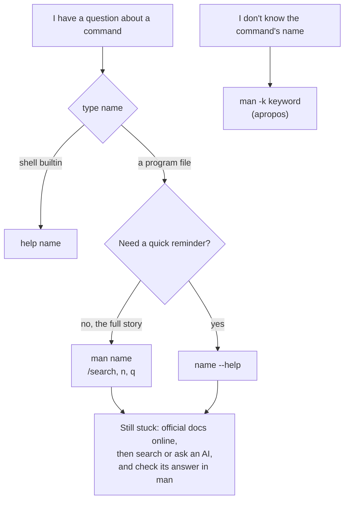

# 06 · Getting help

**What you'll build:** the habit and the skill to answer your own questions: you'll read a manual page, decode its SYNOPSIS line, search inside it, find a command when you don't know its name, and get help for shell builtins. A quiz checks you can look things up.
**Time:** ~40 min · **Builds on:** [05 · Reading files](../05-reading-files) · **Needs:** nothing extra (Docker users: the `unminimize` step from lesson 01)

**Like you're 5:** every toy in the box comes with its own little instruction booklet. `man` opens the booklet, `--help` reads the short note on the lid, and `man -k` asks the librarian "which toy can do *this*?".

## Why this matters
Nobody remembers every option. Professionals look things up all day, and the fastest place to look is already on the machine: it works on a server with no browser, it matches the exact version installed (a blog post may describe a different one), and it's what AI assistants are summarising when they answer. Knowing how to read a man page also lets you double-check an AI's suggested command before you run it.

## What you'll learn
- **`man`**: the built-in manual. One page per command, file format or system call, grouped in numbered **sections**.
- **`--help`**: a short summary printed by most programs themselves.
- **`help`**: the help for shell **builtins** like `cd`, which have no program file and often no man page.
- **`man -k` / `apropos`** and **`whatis`**: find commands by keyword, or get a one-line description.
- **Reading a SYNOPSIS**: what `[ ]`, `...`, `|` and CAPITALS mean.

## Before you start
- Finish [lesson 05](../05-reading-files). The keys you learnt in `less` work in `man`.
- **Docker users:** if `man ls` prints `This system has been minimized...`, run `sudo unminimize`, answer `y`, wait, then try again (lesson 01, Option D, step 4). Also run `sudo apt install -y manpages` once: it adds the overview pages (like `man 7 hier`) that the container leaves out.
- No setup script, no API key. This lesson only reads.

## Run it
1. Open the manual page for `ls`:
   ```bash
   man ls
   ```
   | Piece | Meaning |
   |---|---|
   | `man` | "manual": open the manual page for the name that follows |
   | `ls` | which page to open |

   It opens in the `less` viewer (lesson 05). The top looks like this:
   ```
   LS(1)                            User Commands                           LS(1)

   NAME
          ls - list directory contents

   SYNOPSIS
          ls [OPTION]... [FILE]...

   DESCRIPTION
          List  information  about  the FILEs (the current directory by default).
          Sort entries alphabetically if none of -cftuvSUX nor --sort  is  speci‐
          fied.

          Mandatory  arguments  to  long  options are mandatory for short options
          too.

          -a, --all
                 do not ignore entries starting with .

          -A, --almost-all
   ```
   `LS(1)` means "the page about `ls`, in section 1 (user commands)".
2. **Search inside the page.** Type `/size` and press **Enter**. Press `n` to jump to the next match until you reach:
   ```
          -S     sort by file size, largest first
   ```
   That's the option you used in lesson 02. Press `q` to quit.
3. Read the page **parts** in this order (most pages have the same headings):

   | Heading | What it tells you |
   |---|---|
   | NAME | the command and a one-line description |
   | SYNOPSIS | how to type it (the grammar, see step 4) |
   | DESCRIPTION | what it does, then usually every option |
   | EXAMPLES | ready-made commands (not every page has them; scroll with `G` to the end to check) |
   | SEE ALSO | related commands |

4. **Decode a SYNOPSIS.** `ls [OPTION]... [FILE]...` reads as "`ls`, then optionally some options, then optionally some files":

   | Symbol | Meaning | In `ls [OPTION]... [FILE]...` |
   |---|---|---|
   | `[ ]` | optional: you may leave it out | `[FILE]`: you may name a file, or not |
   | `...` | may be repeated | `[FILE]...`: one file, two files, many files |
   | CAPITALS or *underlined* | replace with your own value | `FILE` → `notes.txt` |
   | `a\|b` | choose one of these | in `help cd`: `[-L\|-P]` = `-L` or `-P` |
   | **bold** or plain words | type exactly as shown | `ls` |

5. Get the **quick** version from the program itself:
   ```bash
   ls --help
   ```
   ```
   Usage: ls [OPTION]... [FILE]...
   List information about the FILEs (the current directory by default).
   Sort entries alphabetically if none of -cftuvSUX nor --sort is specified.

   Mandatory arguments to long options are mandatory for short options too.
     -a, --all                  do not ignore entries starting with .
     -A, --almost-all           do not list implied . and ..
         --author               with -l, print the author of each file
     -b, --escape               print C-style escapes for nongraphic characters
         --block-size=SIZE      with -l, scale sizes by SIZE when printing them;
                                e.g., '--block-size=M'; see SIZE format below
   ```
   (It's long. The whole thing scrolls past; scroll up in your terminal, or page through it with `ls --help | less`, where `|` sends the output into `less`; lesson 08 explains `|`.)

   | Piece | Meaning |
   |---|---|
   | `--help` | a long option almost every program understands: "print a short usage summary and stop". It runs nothing else, so it's always safe |

   "Mandatory arguments to long options are mandatory for short options too" means: if `--block-size=SIZE` needs a value, so does its short form.
6. Try `man` on a **builtin**:
   ```bash
   type cd
   ```
   ```
   cd is a shell builtin
   ```
   Builtins live inside bash, so use bash's own `help`:
   ```bash
   help cd
   ```
   ```
   cd: cd [-L|[-P [-e]] [-@]] [dir]
       Change the shell working directory.

       Change the current directory to DIR.  The default DIR is the value of the
       HOME shell variable. If DIR is "-", it is converted to $OLDPWD.
   ```
   | Piece | Meaning |
   |---|---|
   | `help` | a bash builtin that explains other builtins |
   | `cd` | which builtin |

   Now you know where `cd -` (lesson 03) comes from: "If DIR is `-`, it is converted to `$OLDPWD`" (the previous folder). Run `help` alone to list all builtins. (In zsh on a Mac, `help` doesn't exist; use `man zshbuiltins` or `run-help cd`.)
7. **Find a command when you don't know its name**: search all one-line descriptions for words.
   ```bash
   man -k "copy files"
   ```
   ```
   cp (1)               - copy files and directories
   git-checkout-index (1) - Copy files from the index to the working tree
   install (1)          - copy files and set attributes
   ```
   | Piece | Meaning |
   |---|---|
   | `-k` | "keyword": search the NAME lines of all man pages instead of opening one |
   | `"copy files"` | the words to look for (quotes keep the two words together as one search) |

   `apropos "copy files"` does exactly the same ("apropos" is French for "about").
8. Get **one-line descriptions**, and see that one name can have several pages:
   ```bash
   whatis ls passwd
   ```
   ```
   ls (1)               - list directory contents
   passwd (1)           - change user password
   passwd (1ssl)        - OpenSSL application commands
   passwd (5)           - the password file
   ```
   | Piece | Meaning |
   |---|---|
   | `whatis` | print only the NAME line of each page (same as `man -f`) |
   | `passwd (1)` | the `passwd` *command* (section 1) |
   | `passwd (5)` | the `/etc/passwd` *file* format (section 5) |

9. Open a page from a **specific section**:
   ```bash
   man 5 passwd
   ```
   ```
   PASSWD(5)               File Formats and Configuration               PASSWD(5)

   NAME
          passwd - the password file

   DESCRIPTION
          /etc/passwd contains one line for each user account, with seven fields
          delimited by colons (“:”). These fields are:
   ```
   | Piece | Meaning |
   |---|---|
   | `5` | section 5: file formats and config files. Without it, `man passwd` opens the first match, section 1 (the command) |

   Press `q`. You'll use this page in lesson 12.
10. See what happens with a page that doesn't exist:
    ```bash
    man nosuchthing
    ```
    ```
    No manual entry for nosuchthing
    ```
11. Take the quiz. Use `man`, `--help` and `help` in a second terminal to find each answer:
    ```bash
    cd ~/Learning/linux-from-zero
    bash part-1-first-steps/06-getting-help/check.sh
    ```

### What you should see
```
Lesson 06 quiz. Look each answer up in a second terminal; don't guess!

1. Which ls option sorts by file size, largest first? (like -x)
> ✅ Correct: -S

2. Which manual SECTION number is about file formats and config files?
> ✅ Correct: 5

3. cd is a shell builtin, so 'man cd' doesn't help. Which command shows cd's help? (two words)
> ✅ Correct: help cd

4. Which cp option asks before overwriting a file? (like -x)
> ✅ Correct: -i

5. Which command finds manual pages by a keyword in their description? (either name)
> ✅ Correct: man -k

6. In a SYNOPSIS line like 'ls [OPTION]... [FILE]...', what do the square brackets mean? a) required b) optional c) repeat it
> ✅ Correct: b

Result: 6 of 6 correct.
You can teach yourself any command now. On to lesson 07!
```
For questions 1 and 4 capitals count, because `-S` and `-s` are different options. A lowercase `-s` gets `❌ Not quite (you typed: '-s'). Capitals matter here.`

## How it works
**Where to look, in order:**



1. **Man pages are files on disk**, stored compressed under `/usr/share/man`. `man` finds the page, formats it for your terminal's width, and hands it to `less`. That's why the same keys work: Space, `b`, `/search`, `n`, `g`, `G`, `q`.
2. **Sections** keep same-named pages apart:

   | Section | What's in it | Example |
   |---|---|---|
   | 1 | user commands | `man 1 passwd` (the command) |
   | 2 | system calls (for programmers) | `man 2 open` |
   | 3 | library functions (for programmers) | `man 3 printf` |
   | 4 | special files in `/dev` | `man 4 null` |
   | 5 | file formats and config files | `man 5 passwd` (the file `/etc/passwd`) |
   | 7 | overviews and conventions | `man 7 hier` (the folder tree), `man 7 glob` |
   | 8 | admin commands (often need `sudo`) | `man 8 useradd` |

   In text you'll see `passwd(5)`: it means "the `passwd` page in section 5".
3. **`--help` is written by the program**, so it's always there (even in a minimal Docker image with no man pages) and always matches the installed version. Man pages are longer and better organised.
4. **Builtins** (`cd`, `echo`, `type`, `export`, `alias`, `history`...) are part of bash. `help` reads bash's own built-in documentation. The full story is in `man bash` (a very long page; search it with `/`).
5. **`man -k` searches a small database** of NAME lines (built by `mandb`). If it says `nothing appropriate` for something that should exist, the database may be out of date: `sudo mandb` rebuilds it.
6. **GNU vs Mac:** Mac man pages describe the BSD versions, so options listed in `man ls` on a Mac differ from Linux ones. That's the man page doing its job: always trust the page on the machine you're using. GNU tools also have longer manuals called **info** pages (`info coreutils`; install with `sudo apt install info`).
7. **Online and AI help, wisely.** The same man pages are online at man7.org. Community "cheat sheets" like `tldr` (`sudo apt install tldr`, then `tldr tar`) show the most common examples. AI assistants are great at explaining, but they sometimes invent options: before running a suggested command, check each option in `man` or `--help`. You now know how.

## If something goes wrong
- **`This system has been minimized by removing packages and content...`** (Docker) → run `sudo unminimize`, answer `y`, then `man ls` again.
- **`No manual entry for cd`** → `cd` is a builtin: use `help cd`. For other names, check spelling, or the page may not be installed (`sudo apt install man-db manpages`).
- **`bash: man: command not found`** → `sudo apt install -y man-db`.
- **You're stuck inside a man page** → press `q`. If you typed `/` by accident, press Esc or Enter first, then `q`.
- **`man -k` prints `nothing appropriate`** → try fewer or different words (`man -k copy`), or rebuild the index with `sudo mandb`.

## Try this
1. Find out from the manual what `wc -L` does, and try it on `~/linux-practice/05/poem.txt`.
2. You want to know which command shows how much disk space is used and free. Find it with `man -k` (hint: man pages call it "space usage"), then read its `--help` to find the option for human-readable sizes and run it.
3. Read `man 7 hier` (the folder tree from lesson 03). Search for `/var/log` and `/tmp`. What does it say lives in each? Then find out with `help` what the builtin `pwd`'s `-P` option does.

<details><summary>Solutions</summary>

1. `man wc`, then `/-L` → `-L, --max-line-length  print the maximum display width`. `wc -L ~/linux-practice/05/poem.txt` prints `50 /home/sam/linux-practice/05/poem.txt`: the longest line is 50 characters wide. (On a Mac, `wc -L` doesn't exist: the page there won't list it.)
2. `man -k "space usage"` lists `df (1) - report file system space usage` and `du (1) - estimate file space usage`. `df` is the one for free space. `df --help` shows `-h, --human-readable  print sizes in powers of 1024 (e.g., 1023M)`. Run `df -h` (lesson 22 explains its columns).
3. `man 7 hier`, `/var/log` → "Miscellaneous log files"; `/tmp` → "temporary files which may be deleted with no notice, such as by a regular job or at system boot up". `help pwd` → `-P` prints the physical directory, without any symbolic links.
</details>

## Check yourself
1. Why does `man cd` not work, and what do you use instead?
2. Explain this SYNOPSIS in plain words: `cp [OPTION]... SOURCE... DIRECTORY`.
3. You want the format of `/etc/passwd`, but `man passwd` shows the `passwd` command. What do you type?
4. An AI assistant tells you to run `ls --sort-size`. How do you check whether that's right before running it?

<details><summary>Answers</summary>

1. `cd` is a shell builtin, not a program file, so there's no separate man page for it. Use `help cd`.
2. `cp`, then optionally some options, then one or more source files (required, since there are no brackets), and finally a destination directory (required).
3. `man 5 passwd` (section 5 is file formats).
4. Run `ls --help` (or `man ls` and search `/sort`). You'll find `--sort=WORD` with `size` as a value (and `-S`), so the correct command is `ls --sort=size`; `--sort-size` would fail with `unrecognized option`.
</details>

## Learn more (optional)
**Read the official docs**
- `man` manual page (how man works, the sections): https://man7.org/linux/man-pages/man1/man.1.html
- `man-pages(7)`, the conventions every page follows: https://man7.org/linux/man-pages/man7/man-pages.7.html
- All Linux man pages online: https://man7.org/linux/man-pages/
- Bash builtins (what `help` covers): https://www.gnu.org/software/bash/manual/html_node/Shell-Builtin-Commands.html
- tldr pages (community examples): https://tldr.sh

**Watch**
- How to read Linux man pages: https://www.youtube.com/results?search_query=how+to+read+linux+man+pages
- NetworkChuck, Linux for hackers (man and help): https://www.youtube.com/results?search_query=networkchuck+linux+for+hackers+man+pages
- freeCodeCamp, Linux command line full course: https://www.youtube.com/results?search_query=freecodecamp+linux+command+line+full+course

## Next
→ [07 · Editing files with nano and vim](../07-editing-files-with-nano-and-vim)
