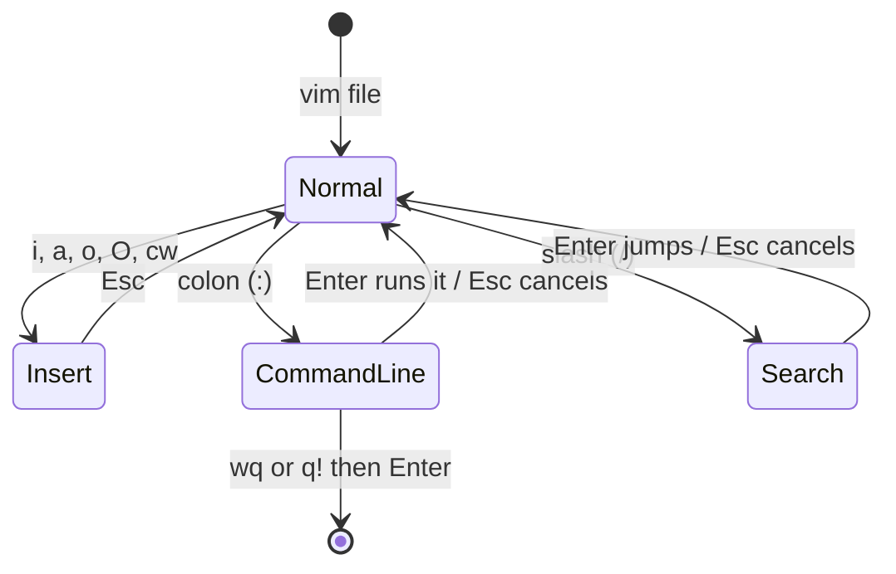

# 07 · Editing files with nano and vim

**What you'll build:** you'll fix a shopping list with **nano** (the friendly editor) and change a real-looking app settings file with **vim** (the powerful editor found on every server), then a check script confirms every edit.
**Time:** ~60 min · **Builds on:** [06 · Getting help](../06-getting-help) · **Needs:** nothing extra (`nano` and `vim` were installed in lesson 01)

**Like you're 5:** nano is a notebook with the instructions printed at the bottom of every page. vim is a magic pen with two modes: in one mode it *writes*, in the other mode every key is a *spell* (delete a line, jump to the end, undo). You press **Esc** to put the pen back into spell mode.

## Why this matters
On a server there's no VS Code and no mouse. When you need to change a port in a config file, fix an nginx setting, edit a `.env` file with an API key, or write a quick script, you open it in a terminal editor. nano is easy for beginners; vim (or its little sister `vi`) is installed on almost every Linux machine, including tiny Docker images and rescue systems, and many tools (`git commit`, `crontab -e`, `sudo visudo`) open it for you. If you can't at least save and quit vim, you can get stuck.

## What you'll learn
- **nano**: open, type, search (`Ctrl+W`), cut and paste lines (`Ctrl+K`, `Ctrl+U`), save (`Ctrl+O`) and exit (`Ctrl+X`). `^` in nano's menu means **Ctrl**, `M-` means **Alt**.
- **vim modes**: **Normal mode** (keys are commands), **Insert mode** (keys type text, `i` to enter, `Esc` to leave) and **Command-line mode** (`:` commands like `:w` save, `:q` quit).
- **vim moves and edits**: `/search`, `n`, `gg`, `G`, `dd`, `yy`, `p`, `cw`, `o`, `u` (undo), `:%s/old/new/` (replace).
- **Escape hatches**: `:q!` quits vim without saving; `Ctrl+X`, then `N`, quits nano without saving.

## Before you start
- Finish [lesson 06](../06-getting-help).
- Check both editors are there: `nano --version` (should say `GNU nano, version 7.2` or similar) and `vim --version` (should say `VIM - Vi IMproved 9.1` or similar). Missing? `sudo apt install -y nano vim`.
- **On a Mac:** the built-in `nano` is really `pico`, a different editor. Install the real one with `brew install nano` (lesson 01, Option B). `vim` is built in.
- No API key. `setup.sh` only creates `~/linux-practice/07`.

## Run it
### Part A · nano
1. Go to the course folder:
   ```bash
   cd ~/Learning/linux-from-zero
   ```
2. Build the practice files:
   ```bash
   bash part-1-first-steps/07-editing-files-with-nano-and-vim/setup.sh
   ```
   ```
   Practice folder ready: /home/sam/linux-practice/07
   ```
3. Go there:
   ```bash
   cd ~/linux-practice/07
   ```
4. Open the shopping list in nano:
   ```bash
   nano shopping-list.txt
   ```
   | Piece | Meaning |
   |---|---|
   | `nano` | a simple text editor that runs inside the terminal |
   | `shopping-list.txt` | the file to open. If it doesn't exist yet, nano creates it when you save |

   Your terminal turns into the editor:
   ```
     GNU nano 7.2                    shopping-list.txt
   Shopping list
   - aples
   - bred
   - milk
   - chocolate cake (too much sugar, delete this line)


                                   [ Read 5 lines ]
   ^G Help      ^O Write Out ^W Where Is  ^K Cut       ^T Execute   ^C Location
   ^X Exit      ^R Read File ^\ Replace   ^U Paste     ^J Justify   ^/ Go To Line
   ```
   The two bottom lines are your cheat sheet. `^O` means **Ctrl + O**. You can move with the arrow keys and type anywhere, like in any editor. No mouse needed.
5. Fix `aples`. Search for it: press **Ctrl + W**, type `aples`, press **Enter**. The cursor jumps to the `a` of `aples`. Press **→** (right arrow) once, then type `p`. The line now reads `- apples`, and a `*` appears after the file name at the top: "changed, not saved yet".

   | Keys | Meaning |
   |---|---|
   | **Ctrl + W** | "Where is": search forward for text |
   | **→** | move the cursor one character right |
   | typing a letter | inserts it where the cursor is |

6. Fix `bred` the same way: **Ctrl + W**, `bred`, **Enter**, then **→** three times (the cursor is now on the `d`), type `a`. It reads `- bread`.
7. Delete the chocolate line: **Ctrl + W**, `chocolate`, **Enter**, then **Ctrl + K**. The whole line disappears.

   | Keys | Meaning |
   |---|---|
   | **Ctrl + K** | cut the whole line the cursor is on (it's kept in memory) |
   | **Ctrl + U** | paste ("uncut") the last cut line(s) where the cursor is. Cut + move + paste = move a line |

8. Add a new item at the end: press **Alt + /** (jump to the last line; on a Mac, Esc then `/`), then type `- bananas`.
9. Save and leave:
   - Press **Ctrl + O** ("Write Out" = save). The bottom asks:
     ```
     File Name to Write: shopping-list.txt
     ```
     Press **Enter** to keep the same name. nano confirms `[ Wrote 5 lines ]`.
   - Press **Ctrl + X** to exit. You're back at your prompt.

   (If you press Ctrl + X *before* saving, nano asks `Save modified buffer?`: press `Y` then Enter to save, or `N` to throw your changes away.)
10. Check the result from the prompt:
    ```bash
    cat shopping-list.txt
    ```
    ```
    Shopping list
    - apples
    - bread
    - milk
    - bananas
    ```

### Part B · vim
11. Open the settings file in vim:
    ```bash
    vim app.conf
    ```
    | Piece | Meaning |
    |---|---|
    | `vim` | "Vi IMproved": a powerful terminal editor, an improved version of the classic `vi` |
    | `app.conf` | the file to open |

    ```
    # app.conf - settings for a pretend AI API
    app_name = mood-api
    port = 8000
    debug = true
    log_level = info
    model = small
    delete_me = this line should not be here
    ~
    ~
    "app.conf" 7L, 160B                                           1,1           All
    ```
    The `~` lines mean "past the end of the file". The bottom line says the file has 7 lines (`7L`) and 160 bytes, and the cursor is on line 1, column 1. **You're in Normal mode: keys are commands, not text.** Don't type words yet!
12. Turn on line numbers. Type `:set number` and press **Enter** (the `:` jumps to the bottom line, where you type a command):
    ```
      1 # app.conf - settings for a pretend AI API
      2 app_name = mood-api
      3 port = 8000
      4 debug = true
      5 log_level = info
      6 model = small
      7 delete_me = this line should not be here
    ```
13. Change the port. Type `/8000` and press **Enter** (search; the cursor jumps to `8000`). Then type `cw` ("change word"): `8000` disappears and the bottom shows `-- INSERT --`. Type `8080`, then press **Esc** to go back to Normal mode.

    | Keys | Mode | Meaning |
    |---|---|---|
    | `/8000` **Enter** | Normal | search forward for `8000` (`n` = next match, `N` = previous) |
    | `cw` | Normal → Insert | **c**hange **w**ord: delete from the cursor to the end of the word, then start typing |
    | `8080` | Insert | typed as text |
    | **Esc** | Insert → Normal | stop typing; keys are commands again. When in doubt, press Esc |

14. Change `debug`: `/true` **Enter**, then `cw`, type `false`, press **Esc**. Line 4 reads `debug = false`.
15. Delete the extra line: `/delete_me` **Enter**, then `dd`.

    | Keys | Meaning |
    |---|---|
    | `dd` | **d**elete the whole line (it's kept, so `p` would paste it back below the cursor) |

16. Add a new line at the end: press `G` (capital: go to the last line), then `o` (open a new line below and enter Insert mode), type `workers = 4`, press **Esc**.

    | Keys | Meaning |
    |---|---|
    | `G` | go to the last line (`gg` = first line, `5G` = line 5) |
    | `o` | open a new line **below** and start typing (`O` = above) |

17. Save and quit: type `:wq` and press **Enter**. Just before quitting, vim shows `"app.conf" 7L, 132B written`.

    | Keys | Meaning |
    |---|---|
    | `:` | start a command at the bottom line |
    | `w` | **w**rite (save) |
    | `q` | **q**uit |
    | `:q!` | quit and **throw away** changes (the `!` means "yes, I'm sure"). Your emergency exit |

18. Check the result:
    ```bash
    cat app.conf
    ```
    ```
    # app.conf - settings for a pretend AI API
    app_name = mood-api
    port = 8080
    debug = false
    log_level = info
    model = small
    workers = 4
    ```
19. Run the check:
    ```bash
    cd ~/Learning/linux-from-zero
    bash part-1-first-steps/07-editing-files-with-nano-and-vim/check.sh
    ```

### What you should see
After Part A and Part B (before the Try this exercises):
```
Checking your edits in ~/linux-practice/07 ...

nano (shopping-list.txt):
✅ 'aples' is fixed to 'apples'
✅ 'bred' is fixed to 'bread'
✅ the chocolate cake line is gone
✅ '- bananas' was added

vim (app.conf):
✅ port is 8080
✅ debug is false
✅ the delete_me line is gone
✅ 'workers = 4' was added

Try this:
❌ 1. haiku.txt with exactly 3 (non-empty) lines not found
   hint: nano haiku.txt, type 3 lines, Ctrl+O Enter, Ctrl+X
❌ 2. model is not large
   hint: in vim: :%s/small/large/ Enter, then :wq Enter
❌ 3. the last line of app.conf is not '# reviewed'
   hint: in vim: G (go to last line), o (open a line below), type it, Esc, :wq

Result: 8 of 11 checks passed.
Fix the ❌ lines, then run the check again. (setup.sh starts you over.)
```
After the Try this exercises: `Result: 11 of 11 checks passed.` and `You can edit files in any terminal, even over SSH. Part 1 done!`

## How it works
**nano has one mode; vim has three.** In nano every letter you type goes into the file and commands use Ctrl/Alt. In vim the same key does different things depending on the mode, which is why beginners "get stuck": they type words while in Normal mode and trigger random commands.



1. **nano key cheat sheet** (`^` = Ctrl, `M-` = Alt):

   | Keys | Action |
   |---|---|
   | `^O` then Enter | save (Write Out); `^S` saves without asking the name |
   | `^X` | exit (asks to save if there are changes) |
   | `^W` | search; `M-W` finds the next match |
   | `^\` (or `M-R`) | search and replace |
   | `^K` / `^U` | cut line / paste |
   | `M-U` / `M-E` | undo / redo |
   | `^/` (or `^_`) | go to a line number |
   | `M-\` / `M-/` | go to the first / last line |
   | `^G` | full help (`^X` to leave it) |

   Start nano with `nano -l file` to show line numbers.
2. **vim cheat sheet** (all in Normal mode unless marked):

   | Keys | Action |
   |---|---|
   | `i` / `a` | insert before / after the cursor (enter Insert mode) |
   | `o` / `O` | new line below / above, then insert |
   | `A` | insert at the end of the line |
   | **Esc** | back to Normal mode |
   | `h j k l` (or arrows) | left, down, up, right |
   | `w` / `b` | next / previous word |
   | `0` / `$` | start / end of the line |
   | `gg` / `G` / `42G` | first line / last line / line 42 |
   | `x` | delete one character |
   | `dd` / `3dd` | delete (cut) one line / three lines |
   | `yy` / `p` | copy ("yank") a line / paste below |
   | `cw` | change word |
   | `u` / **Ctrl + R** | undo / redo |
   | `/text` then `n`, `N` | search forward, next, previous |
   | `:w` / `:q` / `:wq` / `:q!` | save / quit / save and quit / quit without saving |
   | `:%s/old/new/g` | replace `old` with `new` on every line (`%` = all lines, `g` = every match on a line, not just the first) |
   | `:set number` | show line numbers |
   | `:help` | built-in help (`:q` to close it) |

3. **Commands combine like a little language:** an action (`d` delete, `c` change, `y` copy) plus a movement (`w` word, `$` to end of line, `G` to end of file). `dw` deletes a word, `d$` deletes to the end of the line, `dG` deletes to the end of the file, `yG` copies to the end. Put a number in front to repeat: `3dd`. That's why vim users can edit so fast without a mouse.
4. **Why does vim make a `.app.conf.swp` file?** While you edit, vim keeps your changes in a hidden **swap file** so they survive a crash. It's deleted when you quit normally. If vim or the terminal was killed, you'll see the `E325: ATTENTION` message next time (see below).
5. **Which editor opens automatically?** Tools like `git commit` and `crontab -e` open the editor named in the `EDITOR` variable (lesson 14). On Ubuntu you can choose your default with `sudo update-alternatives --config editor`, or just for you with `export EDITOR=nano` in `~/.bashrc`.
6. **The 30-minute vim course:** run `vimtutor`. It's an interactive lesson inside vim itself, and the best way to learn it.

## If something goes wrong
- **"I'm stuck in vim and can't get out!"** → press **Esc** two or three times, then type `:q!` and press **Enter**. That quits without saving. (`:wq` instead saves first.)
- **vim shows `E37: No write since last change (add ! to override)`** → you typed `:q` with unsaved changes. Use `:wq` to save and quit, or `:q!` to quit without saving.
- **Letters you type in vim do strange things (lines vanish, the cursor jumps)** → you're in Normal mode. Press **Esc**, then `u` a few times to undo, then `i` before typing text.
- **vim shows `E325: ATTENTION  Found a swap file by the name ".app.conf.swp"`** → an earlier vim session on this file was killed (or is still open in another window). If no other vim has the file open, press `E` (edit anyway), then after saving and quitting delete the leftover with `rm .app.conf.swp`. nano's version of this is `File ... is being edited by sam (with nano 7.2, PID 93); open anyway?`: close the other nano first.
- **nano shows `[ Error writing shopping-list.txt: Permission denied ]`** → you're not allowed to change that file (system files need `sudo nano /etc/...`, lesson 12). Press Ctrl+X, then N to exit without saving.
- **On a Mac, `nano` looks different and the menu says `pico`** → `brew install nano`, then open a new terminal.

## Try this
1. With nano, create a new file `haiku.txt` in `~/linux-practice/07` and write a three-line poem in it. Save and exit.
2. With vim, open `app.conf` and replace `small` with `large` using one `:%s` command. Save and quit.
3. With vim, add `# reviewed` as the very last line of `app.conf`. Then run the check again.

<details><summary>Solutions</summary>

1. `nano haiku.txt`, type for example:
   ```
   The cursor blinks on
   I type and the server hums
   a log line appears
   ```
   then **Ctrl + O**, **Enter**, **Ctrl + X**. Check with `cat haiku.txt`.
2. `vim app.conf`, type `:%s/small/large/` and press **Enter** (the bottom line confirms the change), then `:wq` **Enter**. `cat app.conf` shows `model = large`.
3. `vim app.conf`, press `G`, then `o`, type `# reviewed`, press **Esc**, then `:wq` **Enter**.
</details>

## Check yourself
1. In vim you type `hello` and nothing appears on screen, but the cursor jumps around. What happened, and how do you fix it?
2. What do `^X` and `M-U` mean in nano's menus?
3. What's the difference between `:wq` and `:q!` in vim?
4. In vim, what would `dG` do if your cursor is on line 3 of a 10-line file?

<details><summary>Answers</summary>

1. You were in Normal mode, so `h`, `e`, `l`, `l`, `o` were commands (move left, end of word, right, right, open a line). Press Esc, undo with `u` as needed, then press `i` to enter Insert mode and type.
2. `^X` is **Ctrl + X** (exit). `M-U` is **Alt + U** (undo).
3. `:wq` saves the file, then quits. `:q!` quits and throws away every unsaved change.
4. It deletes from line 3 to the end of the file (lines 3 to 10). `u` undoes it.
</details>

## Learn more (optional)
**Read the official docs**
- GNU nano documentation: https://www.nano-editor.org/docs.php
- nano cheat sheet (official): https://www.nano-editor.org/dist/latest/cheatsheet.html
- Vim documentation: https://www.vim.org/docs.php
- Vim help files online (the same as `:help`): https://vimhelp.org/
- `vimtutor` (run it in your terminal): https://vimhelp.org/usr_01.txt.html#vimtutor

**Watch**
- Fireship, Vim in 100 seconds: https://www.youtube.com/results?search_query=fireship+vim+in+100+seconds
- freeCodeCamp, Vim tutorial for beginners: https://www.youtube.com/results?search_query=freecodecamp+vim+tutorial+for+beginners
- NetworkChuck, nano and vim: https://www.youtube.com/results?search_query=networkchuck+vim+nano+linux
- nano editor basics: https://www.youtube.com/results?search_query=gnu+nano+editor+tutorial+beginners

## Next
You finished Part 1! → [Part 2 · Power tools](../../part-2-power-tools), starting with [08 · Redirection and pipes](../../part-2-power-tools/08-redirection-and-pipes)
