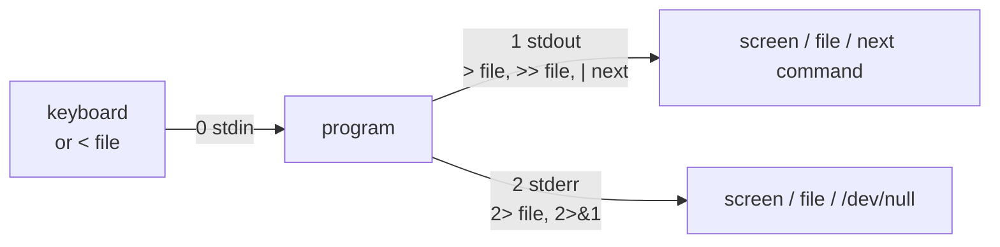

# 08 · Redirection and pipes

**What you'll build:** you'll run a pretend AI server script that prints both normal messages and errors, and send each kind wherever you want: into files, into the bin (`/dev/null`), into the next command, or to the screen and a file at the same time.
**Time:** ~60 min · **Builds on:** [07 · Editing files with nano and vim](../../part-1-first-steps/07-editing-files-with-nano-and-vim) · **Needs:** nothing extra

**Like you're 5:** every command has one mouth for normal words, one mouth for complaints, and one ear. `>` points the mouth into a bucket (a file), `|` is a garden hose from one command's mouth to the next command's ear, `2>` catches only the complaints, and `tee` is a T-shaped pipe that sends water two ways at once.

## Why this matters
This is the superpower of the command line: small tools snapped together like Lego. You'll save a server's output to a log (`> app.log 2>&1`), count errors in a log (`grep ERROR app.log | wc -l`), keep secrets out of the screen (`2> /dev/null`), and watch a long AI training run while also saving it (`python train.py 2>&1 | tee train.log`). Every Dockerfile, cron job, CI pipeline and systemd service you'll write later uses these symbols.

## What you'll learn
- **Three streams**: every program has **stdin** (0, its input), **stdout** (1, normal output) and **stderr** (2, error messages). By default all three are your terminal.
- **`>` and `>>`**: send stdout to a file, replacing it or adding to the end.
- **`<`**: feed a file into a command's stdin.
- **`|` (pipe)**: connect one command's stdout to the next command's stdin.
- **`2>`, `2>&1`, `&>`, `/dev/null` and `tee`**: handle errors separately, merge them, throw output away, or copy it to a file *and* the screen.

## Before you start
- Finish [Part 1](../../part-1-first-steps).
- No install, no API key. `setup.sh` only creates `~/linux-practice/08`.
- This lesson uses `sort`, `uniq` and `grep` in a simple way to show pipes. Lessons 09 and 10 cover them in depth.

## Run it
1. Go to the course folder and build the practice files:
   ```bash
   cd ~/Learning/linux-from-zero
   bash part-2-power-tools/08-redirection-and-pipes/setup.sh
   ```
   ```
   Practice folder ready: /home/sam/linux-practice/08
   ```
2. Go there and run the pretend server:
   ```bash
   cd ~/linux-practice/08
   bash noisy.sh
   ```
   ```
   OK: loaded 3 models
   ERROR: model 'giant' not found
   OK: server ready on port 8000
   ERROR: GPU not available, using CPU
   OK: answered 42 questions
   ```
   It looks like one stream of text, but it isn't: the `OK` lines came out of **stdout** and the `ERROR` lines out of **stderr**. Your terminal shows both. The next steps pull them apart.
3. **`>`: save output into a file** instead of the screen:
   ```bash
   ls > files.txt
   ```
   Nothing appears: the output went into the file. Look inside:
   ```bash
   cat files.txt
   ```
   ```
   animals.txt
   files.txt
   noisy.sh
   server.log
   ```
   | Piece | Meaning |
   |---|---|
   | `ls` | list the folder |
   | `>` | send stdout into the file named next. **Creates** the file, or **empties and replaces** it if it exists |
   | `files.txt` | the file to write |

   (`files.txt` lists itself because the shell creates the empty file *before* `ls` runs. In a file, `ls` prints one name per line.)
4. **`>>`: add to the end** of a file:
   ```bash
   echo "first entry" > diary.txt
   echo "second entry" >> diary.txt
   cat diary.txt
   ```
   ```
   first entry
   second entry
   ```
   | Piece | Meaning |
   |---|---|
   | `>>` | **append**: add stdout to the end of the file (creates it if missing). Nothing is erased |

   Now see why `>` is dangerous. Run `echo "oops" > diary.txt` and `cat diary.txt`: only `oops` is left; the diary is gone. Put it back for the check:
   ```bash
   echo "first entry" > diary.txt
   echo "second entry" >> diary.txt
   ```
5. **`<`: take input from a file.** Compare:
   ```bash
   wc -l animals.txt
   ```
   ```
   10 animals.txt
   ```
   ```bash
   wc -l < animals.txt
   ```
   ```
   10
   ```
   | Piece | Meaning |
   |---|---|
   | `<` | connect the file to the command's **stdin** (its ear). `wc` reads the text without knowing any file name, so it prints only the number. Handy when you want just the number |

6. **`|`: the pipe.** Connect one command's output to the next one's input:
   ```bash
   sort animals.txt | uniq -c
   ```
   ```
         1 ant
         1 bee
         3 cat
         2 dog
         1 elephant
         1 fox
         1 zebra
   ```
   | Piece | Meaning |
   |---|---|
   | `sort animals.txt` | print the lines of `animals.txt` in A to Z order |
   | `\|` | **pipe**: everything `sort` prints goes straight into the stdin of the next command, not to the screen |
   | `uniq -c` | squash repeated neighbouring lines into one, and **c**ount how many there were (it needs sorted input, that's why `sort` comes first) |

   Another everyday pipe: how many programs are in `/usr/bin`?
   ```bash
   ls /usr/bin | wc -l
   ```
   ```
   406
   ```
   (Your number will be different: a desktop or WSL Ubuntu has well over a thousand.)
7. **Longer pipelines.** Snap more pieces on. Top 3 most common animals:
   ```bash
   sort animals.txt | uniq -c | sort -rn | head -n 3
   ```
   ```
         3 cat
         2 dog
         1 zebra
   ```
   | Piece | Meaning |
   |---|---|
   | `sort -rn` | sort again, this time by **n**umber, in **r**everse (biggest first) |
   | `head -n 3` | keep only the first 3 lines |

   Read a pipeline left to right, like a factory line: sort → count → sort by count → take the top 3. This exact shape answers "what's most common?" for logs, IP addresses, error types (lesson 10).
8. **`2>`: catch only the errors.**
   ```bash
   bash noisy.sh 2> errors.txt
   ```
   ```
   OK: loaded 3 models
   OK: server ready on port 8000
   OK: answered 42 questions
   ```
   ```bash
   cat errors.txt
   ```
   ```
   ERROR: model 'giant' not found
   ERROR: GPU not available, using CPU
   ```
   | Piece | Meaning |
   |---|---|
   | `2` | stream number 2 = stderr |
   | `2>` | send stderr into the file named next (stdout still goes to the screen) |

   `>` is really short for `1>` (stream 1 = stdout).
9. **Split both streams into two files:**
   ```bash
   bash noisy.sh > out.txt 2> err.txt
   ```
   Nothing on screen. `cat out.txt` shows the 3 `OK` lines; `cat err.txt` shows the 2 `ERROR` lines.
10. **`2>&1`: merge errors into normal output**, so both land in one file:
    ```bash
    bash noisy.sh > all.txt 2>&1
    cat all.txt
    ```
    ```
    OK: loaded 3 models
    ERROR: model 'giant' not found
    OK: server ready on port 8000
    ERROR: GPU not available, using CPU
    OK: answered 42 questions
    ```
    | Piece | Meaning |
    |---|---|
    | `> all.txt` | first: point stdout (1) at `all.txt` |
    | `2>&1` | then: point stderr (2) at **wherever stdout (1) points right now**. The `&` means "1 is a stream number, not a file called 1" |

    **Order matters.** The shell reads redirections left to right. Try the wrong order:
    ```bash
    bash noisy.sh 2>&1 > wrong.txt
    ```
    ```
    ERROR: model 'giant' not found
    ERROR: GPU not available, using CPU
    ```
    Here `2>&1` ran first, while stdout still pointed at the screen, so errors went to the screen; then only stdout moved to the file.
11. **`&>`: the short way** (bash and zsh only) to send both streams to one file:
    ```bash
    bash noisy.sh &> all2.txt
    wc -l all2.txt
    ```
    ```
    5 all2.txt
    ```
    | Piece | Meaning |
    |---|---|
    | `&>` | same as `> all2.txt 2>&1`. Plain `sh` scripts don't understand it, so scripts and docs often use the long form |

12. **`/dev/null`: the bin.** It's a special file that swallows everything written to it.
    ```bash
    bash noisy.sh 2> /dev/null
    ```
    ```
    OK: loaded 3 models
    OK: server ready on port 8000
    OK: answered 42 questions
    ```
    | Piece | Meaning |
    |---|---|
    | `/dev/null` | a "device" file: writing to it throws the data away; reading from it gives nothing |
    | `2> /dev/null` | hide error messages |
    | `> /dev/null 2>&1` | hide everything (common in scripts and cron jobs when only success/failure matters) |

13. **`tee`: screen *and* file at once.**
    ```bash
    bash noisy.sh | tee run.log
    ```
    ```
    ERROR: model 'giant' not found
    ERROR: GPU not available, using CPU
    OK: loaded 3 models
    OK: server ready on port 8000
    OK: answered 42 questions
    ```
    | Piece | Meaning |
    |---|---|
    | `\|` | send stdout into `tee` |
    | `tee` | copy its input to the screen AND into the file (like a T-shaped pipe) |
    | `run.log` | the file `tee` writes (replaced each time) |

    `cat run.log` shows only the 3 `OK` lines: the pipe carries stdout only, so the errors went straight to the screen (that's also why they appeared first here: the order of two separate streams on screen isn't guaranteed).
14. **Errors through the pipe, appended:**
    ```bash
    bash noisy.sh 2>&1 | tee -a run.log | grep -c ERROR
    ```
    ```
    2
    ```
    | Piece | Meaning |
    |---|---|
    | `2>&1 \|` | merge stderr into stdout *before* the pipe, so errors flow down it too (bash also accepts `\|&` for this) |
    | `tee -a` | **a**ppend to `run.log` instead of replacing it |
    | `grep -c ERROR` | **c**ount the lines containing `ERROR` (lesson 09) |

    `wc -l run.log` now says `8 run.log` (3 lines from step 13 + 5 new ones).
15. Check your work:
    ```bash
    cd ~/Learning/linux-from-zero
    bash part-2-power-tools/08-redirection-and-pipes/check.sh
    ```

### What you should see
After the steps (before Try this):
```
Checking ~/linux-practice/08 ...

Run it:
✅ files.txt holds the output of ls (step 3)
✅ diary.txt has exactly 2 lines, thanks to >> (step 4)
✅ errors.txt holds only the 2 ERROR lines (step 8)
✅ out.txt has the 3 OK lines and err.txt the 2 ERROR lines (step 9)
✅ all.txt has all 5 lines (step 10)
✅ run.log was saved by tee (step 13)

Try this:
❌ 1. sorted-animals.txt is missing or not sorted
   hint: sort < animals.txt > sorted-animals.txt
❌ 2. error-count.txt should contain just the number 3
   hint: grep ERROR server.log | wc -l > error-count.txt
❌ 3. quiet.txt should have 6 OK lines (it has 0 lines)
   hint: run twice: bash noisy.sh 2> /dev/null >> quiet.txt

Result: 6 of 9 checks passed.
Fix the ❌ lines (run setup.sh to start over), then run the check again.
```
After Try this: `Result: 9 of 9 checks passed.` and `You can send any output anywhere. On to lesson 09!`

## How it works
**Every program is a little box with three pipes attached.** The shell connects them before the program starts. Normally all three go to your terminal; redirection symbols re-plumb them.



A pipeline connects boxes in a row; every box runs at the same time, passing lines along as they're made:


1. **Symbol summary.** All of these are handled by the shell, not by the command:

   | Symbol | Meaning | Example |
   |---|---|---|
   | `>` (`1>`) | stdout to a file, replace it | `ls > list.txt` |
   | `>>` | stdout to a file, append | `date >> log.txt` |
   | `<` | file into stdin | `wc -l < list.txt` |
   | `\|` | stdout into the next command's stdin | `ls \| wc -l` |
   | `2>` | stderr to a file | `cmd 2> err.txt` |
   | `2>>` | stderr to a file, append | `cmd 2>> err.txt` |
   | `2>&1` | stderr to wherever stdout goes *now* | `cmd > all.txt 2>&1` |
   | `&>` | both to a file (bash/zsh) | `cmd &> all.txt` |
   | `\|&` | both into a pipe (bash) | `cmd \|& tee log` |
   | `/dev/null` | the bin | `cmd 2> /dev/null` |
   | `tee file` | stdin to screen and file | `cmd \| tee log` |
   | `<<EOF` | **here-document**: lines you type, until `EOF`, become stdin | `cat > note.txt <<EOF` |
   | `<<<` | **here-string**: one string becomes stdin | `wc -w <<< "one two three"` → `3` |

2. **Why have two output streams?** So you can save the useful results (`> results.txt`) while still seeing problems on screen, or hide noisy warnings (`2> /dev/null`) without hiding the answer. Well-behaved programs (and your own scripts in Part 3) print results to stdout and problems to stderr. In `noisy.sh`, `echo "ERROR: ..." >&2` is how a script writes to stderr.
3. **The file is opened before the command runs.** That's why `sort file.txt > file.txt` destroys `file.txt`: the shell empties it first, then `sort` reads an empty file. Write to a new name, then `mv` it over the old one. Safety net: `set -o noclobber` makes `>` refuse to overwrite (`bash: files.txt: cannot overwrite existing file`); use `>|` when you really mean it.
4. **The `sudo` trap.** `sudo echo hi > /etc/test.txt` fails with `bash: /etc/test.txt: Permission denied`, because the redirection is done by *your* shell (as you), not by `sudo`. The fix is to let a root program write the file:
   ```
   sam@laptop:~$ echo hi | sudo tee /etc/test.txt
   hi
   ```
   (`sudo tee -a` appends; add `> /dev/null` if you don't want the copy on screen.) You'll meet `sudo` properly in lesson 12.
5. **Pipes stream.** `tail -f app.log | grep ERROR` shows each new error the moment it's written. Each command in a pipeline is a separate running program (lesson 13 calls them processes).
6. **GNU vs Mac:** everything here is the same in macOS's zsh. Plain `sh` (for example `/bin/sh` scripts on Ubuntu, which is `dash`) lacks `&>`, `|&` and `<<<`: use `> file 2>&1` there.

## If something goes wrong
- **A file you needed is suddenly empty** → you used `>` instead of `>>`, or wrote to the file you were reading (`sort a.txt > a.txt`). Re-run `setup.sh` here; on real files, `set -o noclobber` protects you.
- **Errors still appear on screen even though you used `> file`** → `>` only catches stdout. Add `2>&1` *after* it: `cmd > file 2>&1`.
- **`bash: /etc/something: Permission denied` with `sudo ... > /etc/something`** → the redirect isn't run by sudo. Use `... | sudo tee /etc/something`.
- **`bash: nothere.txt: No such file or directory` with `<`** → the input file doesn't exist; the shell complains before the command even starts.
- **`uniq -c` counts the same word several times** → its input wasn't sorted. Put `sort |` before it.

## Try this
1. Using `<` and `>`, save the animals sorted A to Z into `sorted-animals.txt`.
2. Count the `ERROR` lines in `server.log` with a pipe (`grep` then `wc -l`), and save just the number into `error-count.txt`.
3. Run `noisy.sh` twice, throwing away the errors and **appending** the normal output to `quiet.txt` each time (so it ends with 6 lines).

Then run the check again.

<details><summary>Solutions</summary>

Run these in `~/linux-practice/08`:
1. `sort < animals.txt > sorted-animals.txt` (`sort animals.txt > sorted-animals.txt` works too).
2. `grep ERROR server.log | wc -l > error-count.txt`. `cat error-count.txt` → `3`. (`grep -c ERROR server.log > error-count.txt` gives the same.)
3. Run `bash noisy.sh 2> /dev/null >> quiet.txt` two times. `wc -l quiet.txt` → `6 quiet.txt`.
</details>

## Check yourself
1. What's the difference between `cmd > log.txt` and `cmd >> log.txt`?
2. A teammate runs `python train.py > train.log` but error messages still fill the screen and aren't in the log. Why, and what's the fix?
3. Why does `cmd 2>&1 > out.txt` still show errors on screen?
4. You want to watch a long job's output live *and* keep a copy. Which tool do you use, and what's the full command if you want errors in the copy too?

<details><summary>Answers</summary>

1. `>` replaces the whole file with the new output; `>>` adds the new output to the end and keeps what was there.
2. `>` only redirects stdout; errors go to stderr. Fix: `python train.py > train.log 2>&1` (or `&> train.log`).
3. Redirections run left to right. `2>&1` copied stdout's target at that moment (the screen), and only then was stdout moved to `out.txt`.
4. `tee`: `python train.py 2>&1 | tee train.log`.
</details>

## Learn more (optional)
**Read the official docs**
- Redirections, GNU Bash manual: https://www.gnu.org/software/bash/manual/html_node/Redirections.html
- Pipelines, GNU Bash manual: https://www.gnu.org/software/bash/manual/html_node/Pipelines.html
- `tee`: https://man7.org/linux/man-pages/man1/tee.1.html
- `stdin`/`stdout`/`stderr` (the three streams): https://man7.org/linux/man-pages/man3/stdin.3.html
- `/dev/null` (`null(4)`): https://man7.org/linux/man-pages/man4/null.4.html

**Watch**
- Linux pipes and redirection explained: https://www.youtube.com/results?search_query=linux+pipes+and+redirection+explained
- NetworkChuck, Linux for hackers (pipes and redirection): https://www.youtube.com/results?search_query=networkchuck+linux+pipes+redirection
- stdin, stdout, stderr explained: https://www.youtube.com/results?search_query=stdin+stdout+stderr+explained+linux

## Next
→ [09 · Finding files and text](../09-finding-files-and-text)
