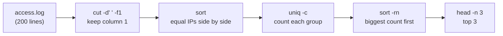

# 10 · Text processing: cut, sort, uniq, sed, awk

**What you'll build:** you'll answer real questions about a web server log and a sales table using only the terminal: who sends the most requests, which pages fail, how much each region earned. You'll also fill in a config template automatically with `sed`.
**Time:** ~75 min · **Builds on:** [09 · Finding files and text](../09-finding-files-and-text) · **Needs:** nothing extra

**Like you're 5:** think of a text file as a big table of Lego bricks in rows. `cut` picks out one column of bricks, `sort` lines them up, `uniq -c` counts bricks that look the same, `tr` repaints them, `sed` swaps one brick for another, and `awk` is a little robot that can do all of that and add up numbers too.

## Why this matters
Logs, CSV files and command outputs are all text in rows and columns. Before you load data into Python or a database, you'll often answer questions straight from the terminal: "which IP is hammering our AI API?", "how many 500 errors today?", "what's the average response time?". `sed` fills in config files in Dockerfiles and deploy scripts. These tools stream, so they handle files far too big for Excel.

## What you'll learn
- **`cut`**: keep only certain columns (`-d` sets the separator, `-f` picks fields) or characters (`-c`).
- **`sort` and `uniq`**: put lines in order (`-n` numbers, `-r` reverse, `-t`/`-k` sort by a column, `-u` unique) and count repeats (`uniq -c`, which needs sorted input).
- **`tr`**: translate or delete characters (`A-Z` to `a-z`, remove spaces).
- **`sed`**: the stream editor: find and replace (`s/old/new/g`), print or delete lines, edit files in place.
- **`awk`**: a mini language for columns: print fields (`$1`, `$NF`), filter rows (`$9 == 404`), add up numbers (`sum += $4` with `END`).

## Before you start
- Finish [lesson 09](../09-finding-files-and-text) and [08](../08-redirection-and-pipes) (pipes).
- No install, no API key. `setup.sh` only creates `~/linux-practice/10`.
- Ubuntu's `awk` is **mawk**, a Mac's is BSD awk, some Linux has **gawk**. Everything in this lesson works on all three.

## Run it
1. Go to the course folder and build the data:
   ```bash
   cd ~/Learning/linux-from-zero
   bash part-2-power-tools/10-text-processing-cut-sort-uniq-sed-awk/setup.sh
   ```
   ```
   Practice folder ready: /home/sam/linux-practice/10
   ```
2. Go there and look at the two main files:
   ```bash
   cd ~/linux-practice/10
   head -n 3 access.log
   ```
   ```
   198.51.100.23 - - [14/Mar/2026:10:00:13 +0000] "GET /api/chat HTTP/1.1" 200 137 73
   192.0.2.44 - - [14/Mar/2026:10:00:26 +0000] "GET /health HTTP/1.1" 200 174 126
   203.0.113.7 - - [14/Mar/2026:10:00:39 +0000] "GET /admin HTTP/1.1" 404 211 179
   ```
   Each line is one visit to a web server. Split at the spaces, the **fields** (columns) are:

   | Field | Example | Meaning |
   |---|---|---|
   | 1 | `203.0.113.7` | the visitor's IP address |
   | 2, 3 | `-` `-` | unused here |
   | 4 | `[14/Mar/2026:10:00:39` | date and time |
   | 5 | `+0000]` | time zone |
   | 6 | `"GET` | the HTTP method |
   | 7 | `/admin` | the path that was asked for |
   | 8 | `HTTP/1.1"` | protocol |
   | 9 | `404` | the **status code** (200 = OK, 404 = not found, 500 = server error) |
   | 10 | `211` | bytes sent back |
   | 11 | `179` | response time in milliseconds |

   ```bash
   head -n 4 sales.csv
   ```
   ```
   date,region,product,units,price
   2026-03-01,north,laptop,3,999
   2026-03-01,south,phone,10,499
   2026-03-02,east,tablet,4,329
   ```
   Here the fields are separated by commas: 1 = date, 2 = region, 3 = product, 4 = units, 5 = price.

### Part A · cut, sort, uniq, tr
3. **`cut`: keep some columns.**
   ```bash
   cut -d, -f2 sales.csv | head -n 4
   ```
   ```
   region
   north
   south
   east
   ```
   | Piece | Meaning |
   |---|---|
   | `cut` | cut each line into pieces and keep only some |
   | `-d,` | the **d**elimiter (separator) is a comma |
   | `-f2` | keep **f**ield 2. `-f3,4` keeps fields 3 and 4; `-f2-4` keeps 2 to 4 |
   | `\| head -n 4` | show just the first 4 lines (lesson 08) |

   For the log, the separator is a space (quoted, so the shell sees it): `cut -d' ' -f1 access.log` prints the IP addresses. `cut -c1-10 sales.csv` keeps **c**haracters 1 to 10 of each line (the date).
4. **`sort`: put lines in order.** Sort the sales by units (field 4), as numbers:
   ```bash
   sort -t, -k4 -n sales.csv | head -n 4
   ```
   ```
   date,region,product,units,price
   2026-03-05,south,laptop,1,999
   2026-03-03,west,laptop,2,999
   2026-03-01,north,laptop,3,999
   ```
   | Piece | Meaning |
   |---|---|
   | `sort` | sort lines (A to Z by default, comparing text) |
   | `-t,` | fields are separated by commas (sort's name for `-d`) |
   | `-k4` | sort by **k**ey (field) 4 onwards; `-k4,4` means exactly field 4 |
   | `-n` | compare as **n**umbers, so `10` comes after `9` (as text, `10` < `9` because `1` < `9`) |

   The header line sorts first because "units" isn't a number (it counts as 0). Skip it with `tail -n +2` ("from line 2"), and add `-r` for **r**everse (biggest first):
   ```bash
   tail -n +2 sales.csv | sort -t, -k4 -nr | head -n 3
   ```
   ```
   2026-03-03,south,headphones,15,79
   2026-03-05,north,headphones,12,79
   2026-03-01,south,phone,10,499
   ```
5. **`uniq`: squash and count repeats.** Which regions exist, and how many rows each?
   ```bash
   cut -d, -f2 sales.csv | tail -n +2 | sort | uniq -c
   ```
   ```
         3 east
         3 north
         3 south
         3 west
   ```
   | Piece | Meaning |
   |---|---|
   | `uniq` | remove a line if it's the same as the line just above it |
   | `-c` | **c**ount how many times each line repeated |
   | `sort` before it | **required**: `uniq` only compares neighbours, so equal lines must be next to each other |

   `sort -u` does sort + remove duplicates in one step (`cut -d, -f2 sales.csv | tail -n +2 | sort -u` → `east north south west`). `uniq -d` prints only the lines that repeat.
6. **`tr`: change or delete characters.** Look at the messy names, then clean them:
   ```bash
   cat names.txt
   ```
   ```
   Alice
   bob
     Carol
   ALICE
   dave  
   Bob
   alice
   Eve
   ```
   ```bash
   tr -d ' ' < names.txt | tr 'A-Z' 'a-z' | sort | uniq -c
   ```
   ```
         3 alice
         2 bob
         1 carol
         1 dave
         1 eve
   ```
   | Piece | Meaning |
   |---|---|
   | `tr` | **tr**anslate characters; it only reads stdin, so it needs `<` or a pipe |
   | `-d ' '` | **d**elete every space |
   | `'A-Z' 'a-z'` | turn each capital letter into the matching small letter |

   Without cleaning, `Alice`, `ALICE` and `alice` would be counted as three different names. Cleaning data like this is everyday work before training a model.
7. **The classic "top N" pipeline.** Who sends the most requests?
   ```bash
   cut -d' ' -f1 access.log | sort | uniq -c | sort -rn | head -n 3
   ```
   ```
        69 203.0.113.7
        50 198.51.100.23
        41 192.0.2.44
   ```
   Read it as a factory line: take the IPs → group equal ones together → count each → biggest count first → top 3. Swap the first step to ask other questions (top paths, top status codes, top error messages).

### Part B · sed (stream editor)
8. **Find and replace.** Look at the template:
   ```bash
   cat app.conf.template
   ```
   ```
   # Settings for the chat API
   port = {{PORT}}
   model = {{MODEL}}
   fallback_model = {{MODEL}}
   debug = false
   ```
   Replace the port placeholder:
   ```bash
   sed 's/{{PORT}}/8080/' app.conf.template
   ```
   ```
   # Settings for the chat API
   port = 8080
   model = {{MODEL}}
   fallback_model = {{MODEL}}
   debug = false
   ```
   | Piece | Meaning |
   |---|---|
   | `sed` | **s**tream **ed**itor: reads lines, changes them, prints them. The file itself is NOT changed |
   | `'...'` | single quotes so the shell leaves the sed program alone |
   | `s` | **s**ubstitute (find and replace) |
   | `/` | separates the parts: `s/find/replace/flags` |
   | `{{PORT}}` | what to find (a regex, like grep's) |
   | `8080` | what to put instead |

9. **Replace every match on a line with `g`.** Without it, only the first match on each line changes:
   ```bash
   echo "cat cat cat" | sed 's/cat/dog/'
   ```
   ```
   dog cat cat
   ```
   ```bash
   echo "cat cat cat" | sed 's/cat/dog/g'
   ```
   ```
   dog dog dog
   ```
   | Piece | Meaning |
   |---|---|
   | `g` | **g**lobal: replace all matches on the line, not just the first |

10. **Print or delete chosen lines.**
    ```bash
    sed -n '2,3p' app.conf.template
    ```
    ```
    port = {{PORT}}
    model = {{MODEL}}
    ```
    ```bash
    sed '/^#/d' app.conf.template
    ```
    ```
    port = {{PORT}}
    model = {{MODEL}}
    fallback_model = {{MODEL}}
    debug = false
    ```
    | Piece | Meaning |
    |---|---|
    | `-n` | don't print every line automatically |
    | `2,3p` | **p**rint lines 2 to 3 |
    | `/^#/` | the lines matching the regex `^#` (starting with `#`, i.e. comments) |
    | `d` | **d**elete those lines from the output |

    Several changes at once: `sed -e 's/{{PORT}}/8080/' -e 's/{{MODEL}}/claude-haiku-5-5/' app.conf.template` (`-e` = one more **e**dit; you'll save that into a file in Try this). Trim spaces at both ends of each line: `sed 's/^ *//; s/ *$//' names.txt`.
11. **Edit a file in place** (carefully, with a backup):
    ```bash
    cp names.txt names-copy.txt
    sed -i.bak 's/Eve/EVE/' names-copy.txt
    ls names-copy*
    ```
    ```
    names-copy.txt  names-copy.txt.bak
    ```
    | Piece | Meaning |
    |---|---|
    | `-i` | **i**n place: write the result back into the file instead of the screen |
    | `.bak` | glued to `-i`: first save the original as `names-copy.txt.bak` |

    `tail -n 1 names-copy.txt names-copy.txt.bak` shows `EVE` in the new file and `Eve` in the backup. **On a Mac**, `-i` *must* have a backup suffix: `sed -i '' 's/a/b/' file` (empty = no backup) or `sed -i.bak ...`. Plain `sed -i 's/a/b/' file` works only on Linux. `-i.bak` works on both.

### Part C · awk (columns and maths)
12. **Print columns.** awk splits each line at spaces automatically; `$1` is field 1:
    ```bash
    awk '{print $1, $9}' access.log | head -n 3
    ```
    ```
    198.51.100.23 200
    192.0.2.44 200
    203.0.113.7 404
    ```
    | Piece | Meaning |
    |---|---|
    | `awk` | a small programming language for text in columns (named after its authors Aho, Weinberger, Kernighan) |
    | `'{ ... }'` | the program, in single quotes: the `{ }` part runs once for every line |
    | `print $1, $9` | print field 1 and field 9, with a space between (the comma) |
    | `$NF` | the last field (`NF` = **n**umber of **f**ields on this line) |
    | `$0` | the whole line |

13. **Filter rows** with a condition before the `{ }`:
    ```bash
    awk -F, '$4 > 8' sales.csv
    ```
    ```
    date,region,product,units,price
    2026-03-01,south,phone,10,499
    2026-03-03,south,headphones,15,79
    2026-03-05,north,headphones,12,79
    2026-03-06,west,phone,9,499
    ```
    | Piece | Meaning |
    |---|---|
    | `-F,` | the **F**ield separator is a comma |
    | `$4 > 8` | a **pattern**: only lines where field 4 is greater than 8. With no `{ }`, awk prints the whole line |

    (The header sneaks in because the text "units" compares as bigger than 8. Add `NR > 1 &&` to skip it, see next step.)
14. **Add things up.**
    ```bash
    awk -F, 'NR > 1 {sum += $4} END {print "units:", sum}' sales.csv
    ```
    ```
    units: 78
    ```
    | Piece | Meaning |
    |---|---|
    | `NR > 1` | only lines whose **N**umber of **R**ecord (line number) is above 1: skip the header |
    | `sum += $4` | add field 4 to a variable called `sum` (it starts at 0) |
    | `END { ... }` | run once, after the last line |
    | `print "units:", sum` | print some text and the total |

    Average response time of the web server (last field):
    ```bash
    awk '{total += $NF} END {printf "average response: %.1f ms\n", total / NR}' access.log
    ```
    ```
    average response: 446.0 ms
    ```
    `printf` prints with a format: `%.1f` = a number with 1 decimal, `\n` = new line. In `END`, `NR` is the total number of lines.
15. **Filter and pick** in one go, which pages failed with 500?
    ```bash
    awk '$9 == 500 {print $4, $7}' access.log | head -n 3
    ```
    ```
    [14/Mar/2026:10:03:41 /api/chat
    [14/Mar/2026:10:07:22 /health
    [14/Mar/2026:10:11:03 /admin
    ```
    `==` means "is equal to" (one `=` would *set* a value).
16. **Pretty tables** (optional): `column -t -s, sales.csv | head -n 4`
    ```
    date        region  product     units  price
    2026-03-01  north   laptop      3      999
    2026-03-01  south   phone       10     499
    2026-03-02  east    tablet      4      329
    ```
    `-t` = make a table, `-s,` = columns are separated by commas. (In a minimal Docker image: `sudo apt install -y bsdextrautils`.)
17. Take the quiz, answering with the tools above in a second terminal:
    ```bash
    cd ~/Learning/linux-from-zero
    bash part-2-power-tools/10-text-processing-cut-sort-uniq-sed-awk/check.sh
    ```

### What you should see
```
Lesson 10 quiz. Work in a second terminal, in ~/linux-practice/10.

1. How many DIFFERENT IP addresses appear in access.log?
> ✅ Correct: 5

2. Which IP address made the most requests?
> ✅ Correct: 203.0.113.7

3. How many requests got the status code 404?
> ✅ Correct: 38

4. Which path got the most 404s?
> ✅ Correct: /admin

5. How many units were sold in total in sales.csv?
> ✅ Correct: 78

Try this:
❌ 1. regions.txt should hold east, north, south, west (one per line, no header)
   hint: cut -d, -f2 sales.csv | tail -n +2 | sort -u > regions.txt
❌ 2. app.conf should have port = 8080 and both models = claude-haiku-5-5
   hint: sed -e 's/{{PORT}}/8080/' -e 's/{{MODEL}}/claude-haiku-5-5/' app.conf.template > app.conf
❌ 3. revenue.txt should have 4 lines like 'east 8306', biggest first
   hint: awk -F, 'NR > 1 {rev[$2] += $4 * $5} END {for (r in rev) print r, rev[r]}' sales.csv | sort -k2 -nr > revenue.txt

Result: 5 of 8 correct.
Use the hints, then run the check again.
```
After Try this: `Result: 8 of 8 correct.` and `You can turn raw text into answers. On to lesson 11!`

## How it works
**Every tool reads lines in, changes them, and writes lines out.** That's why they snap together with `|` in any order:



1. **Which tool when?**

   | You want to... | Reach for |
   |---|---|
   | keep a column, the separator is one simple character | `cut -d, -f2` |
   | keep columns separated by one or more spaces, or do maths | `awk '{print $2}'` |
   | order lines | `sort` (`-n`, `-r`, `-t`, `-k`, `-u`, `-h` for `2K`/`1G` sizes) |
   | count duplicates | `sort \| uniq -c` |
   | change single characters (case, delete) | `tr` |
   | find and replace text, delete lines | `sed` |
   | filter rows by a column's value, sum, average, group by | `awk` |

2. **Why `cut -d' '` sometimes fails and awk doesn't.** `cut` treats every single space as a separator, so two spaces in a row create an empty field. `awk` treats any run of spaces as one separator. For `ls -l` output or aligned text, use `awk`.
3. **awk's shape is `pattern { action }`.** For every line, if the pattern is true (or missing), run the action. `BEGIN { }` runs before the first line, `END { }` after the last. Variables need no declaring and start at 0 or empty. **Arrays** with words as keys let you group: `rev[$2] += $4 * $5` keeps one running total per region (that's Try this 3).
4. **sed's shape is `address command`.** The address picks lines (a number `3`, a range `2,5`, a regex `/ERROR/`, or nothing = all lines); the command says what to do (`s///` substitute, `d` delete, `p` print). `s` can use any separator, handy for paths: `sed 's|/usr/local|/opt|'`.
5. **Regex in sed:** same as grep (lesson 09). Use `-E` for extended regex (`+`, `?`, `|`, `( )`). `&` in the replacement means "what matched": `echo 'a 12' | sed -E 's/[0-9]+/<&>/'` prints `a <12>`.
6. **Never sed into the file you're reading:** `sed '...' f > f` empties `f` first (lesson 08). Use `-i.bak`, or write to a new file and `mv` it.
7. **GNU vs Mac:** `sed -i` needs a suffix on Mac (`-i ''`). `sort -h` and `sed`'s `\b` word boundaries are GNU extras. Mac's `awk` lacks gawk-only functions (`strftime`, `gensub`), which this lesson avoids. `column` exists on both.

## If something goes wrong
- **`uniq -c` shows the same value several times** → the input wasn't sorted. Put `sort |` in front.
- **Numbers sort as `1, 10, 12, 2, 3`** → you forgot `-n`. Text sorting compares character by character.
- **`cut` prints whole lines unchanged** → the delimiter is wrong (for example the file uses tabs or `;`). Look at the file with `head`, then set `-d` to match (tab is the default; `-d';'` for semicolons).
- **awk prints the wrong thing or `awk: line 1: syntax error ...`** → the awk program must be in **single** quotes. In double quotes, the shell replaces `$4` with an (empty) shell variable before awk sees it.
- **``sed: -e expression #1, char 13: unknown option to `s'``** → your text contains `/`. Use another separator: `sed 's|/old/path|/new/path|'`.
- **On a Mac, `sed -i 's/a/b/' file` says `invalid command code`** → use `sed -i '' 's/a/b/' file` or `sed -i.bak ...`.

## Try this
1. Save the list of regions (each once, A to Z, no header) into `regions.txt`.
2. Make a real config file: use `sed` on `app.conf.template` to set the port to `8080` and both models to `claude-haiku-5-5`, and save it as `app.conf`.
3. Work out the revenue (units × price) per region with `awk`, sorted biggest first, into `revenue.txt` (lines like `east 8306`).

All in `~/linux-practice/10`. Then run the check again.

<details><summary>Solutions</summary>

1. `cut -d, -f2 sales.csv | tail -n +2 | sort -u > regions.txt`
2. `sed -e 's/{{PORT}}/8080/' -e 's/{{MODEL}}/claude-haiku-5-5/' app.conf.template > app.conf` (no `g` needed: each line has at most one placeholder; `sed` already visits every line).
3. ```bash
   awk -F, 'NR > 1 {rev[$2] += $4 * $5} END {for (r in rev) print r, rev[r]}' sales.csv | sort -k2 -nr > revenue.txt
   ```
   `rev[$2]` is a box per region; `for (r in rev)` walks through the boxes in no particular order, so `sort -k2 -nr` orders them by the number in column 2. Result:
   ```
   east 8306
   west 8134
   north 7438
   south 7174
   ```
</details>

## Check yourself
1. Why must you `sort` before `uniq -c`?
2. What's the difference between `sed 's/a/b/'` and `sed 's/a/b/g'`?
3. In `awk -F, 'NR > 1 {sum += $4} END {print sum}' sales.csv`, what do `-F,`, `NR > 1` and `END` each do?
4. You have a log where field 9 is the status code. Write a pipeline that prints how many times each status code appears.

<details><summary>Answers</summary>

1. `uniq` only merges equal lines that are next to each other. Sorting puts all equal lines side by side.
2. Without `g`, only the first `a` on each line is replaced; with `g`, every `a` on every line.
3. `-F,` splits fields at commas; `NR > 1` skips line 1 (the header); `END` runs the final `print` once, after all lines are added up.
4. `awk '{print $9}' access.log | sort | uniq -c` (add `| sort -rn` for most common first).
</details>

## Learn more (optional)
**Read the official docs**
- `cut`: https://man7.org/linux/man-pages/man1/cut.1.html
- `sort`: https://man7.org/linux/man-pages/man1/sort.1.html
- `uniq`: https://man7.org/linux/man-pages/man1/uniq.1.html
- `tr`: https://man7.org/linux/man-pages/man1/tr.1.html
- GNU sed manual: https://www.gnu.org/software/sed/manual/sed.html
- GNU awk (gawk) manual, a friendly awk tutorial: https://www.gnu.org/software/gawk/manual/gawk.html
- POSIX awk specification (what works everywhere): https://pubs.opengroup.org/onlinepubs/9699919799/utilities/awk.html

**Watch**
- awk tutorial for beginners: https://www.youtube.com/results?search_query=awk+tutorial+for+beginners
- sed tutorial for beginners: https://www.youtube.com/results?search_query=sed+command+tutorial+beginners
- Linux text processing (cut sort uniq): https://www.youtube.com/results?search_query=linux+cut+sort+uniq+tutorial
- freeCodeCamp, bash scripting and text processing: https://www.youtube.com/results?search_query=freecodecamp+bash+text+processing

## Next
→ [11 · Permissions and ownership](../11-permissions-and-ownership)
