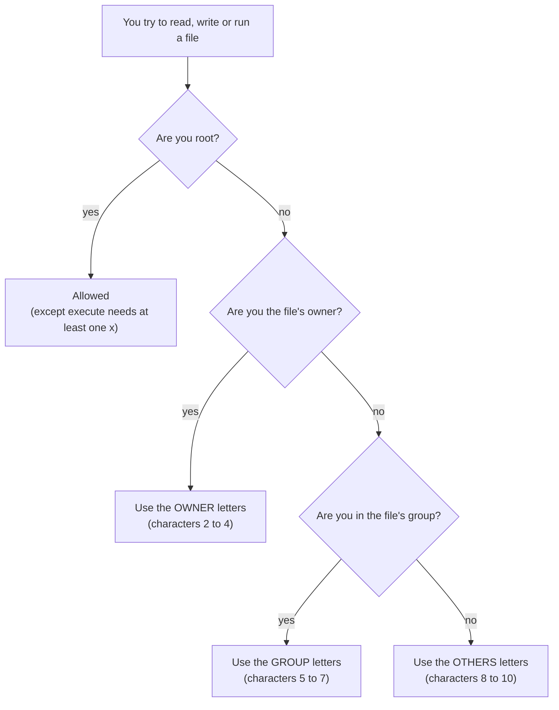

# 11 · Permissions and ownership

**What you'll build:** a practice folder where everything has the *wrong* permissions: a diary anyone can read, a script nobody can run, a folder you can't even enter. You'll fix each one with `chmod` (both the letter way and the number way), change an owner with `chown`, and see how `umask` decides the permissions of new files.
**Time:** ~70 min · **Builds on:** [10 · Text processing](../10-text-processing-cut-sort-uniq-sed-awk) · **Needs:** `sudo` for one step (your own password)

**Like you're 5:** every file is a room with three doors: one for its **owner**, one for the owner's **group** (the family), and one for **others** (everybody else). Each door has three locks: **r**ead (look inside), **w**rite (change things) and e**x**ecute (run it, or for a folder, walk in). `chmod` locks and unlocks them.

## Why this matters
"Permission denied" is the error you'll see most on servers. Your deploy script won't run until it has `x`; SSH refuses to use a private key unless only you can read it (`600`); a web server can't serve files it can't read; an `.env` file with API keys should never be readable by other users. Getting permissions right is also basic security: `chmod 777` "fixes" errors by opening the doors to everyone, which is how servers get hacked.

## What you'll learn
- **Owner, group, others** (`u`, `g`, `o`) and the three permissions **r**, **w**, **x**, read from the 10 characters at the start of `ls -l` (like `-rw-r--r--`).
- **What r, w, x mean for folders**: `r` = list names, `w` = create/delete files inside, `x` = enter it and reach the files inside.
- **`chmod` the letter way** (`u+x`, `go-r`, `a=r`, `u=rw,go=`) and **the number way** (`644`, `755`, `600`, `700`), with a table of all digits 0 to 7.
- **`chown` / `chgrp`**: change who owns a file (needs `sudo`), and **`umask`**: the "default locks" for new files.
- **Special bits** briefly: setuid (`s` on `/usr/bin/passwd`), setgid (`s` on a shared folder) and the sticky bit (`t` on `/tmp`).

## Before you start
- Finish [lesson 10](../10-text-processing-cut-sort-uniq-sed-awk).
- Practise as a **normal user**, not root. Root ignores most permissions, so nothing would ever be "denied". (Docker users: `su - ubuntu`, lesson 01.)
- No API key. `setup.sh` only creates `~/linux-practice/11`.

## Run it
1. Go to the course folder and build the practice files:
   ```bash
   cd ~/Learning/linux-from-zero
   bash part-2-power-tools/11-permissions-and-ownership/setup.sh
   ```
   ```
   Practice folder ready: /home/sam/linux-practice/11
   ```
2. Go there and look at the permissions:
   ```bash
   cd ~/linux-practice/11
   ls -l
   ```
   ```
   total 32
   -rw-r--r-- 1 sam sam   35 Oct 23 00:05 diary.txt
   -rw-r--r-- 1 sam sam   48 Oct 23 00:05 hello.sh
   drw------- 2 sam sam 4096 Oct 23 00:05 locked-folder
   drwxr-xr-x 2 sam sam 4096 Oct 23 00:05 private
   -rw------- 1 sam sam   33 Oct 23 00:05 public-notes.txt
   -r--r--r-- 1 sam sam   18 Oct 23 00:05 readonly.txt
   drwxrwxr-x 2 sam sam 4096 Oct 23 00:05 shared
   drwxr-xr-x 2 sam sam 4096 Oct 23 00:05 tools
   ```
   How to read `-rw-r--r-- 1 sam sam`:

   | Characters | Example | Meaning |
   |---|---|---|
   | 1st | `-` | type: `-` file, `d` directory, `l` symbolic link |
   | 2nd–4th | `rw-` | the **owner** (user, `u`) may read and write, not execute |
   | 5th–7th | `r--` | the **group** (`g`) may only read |
   | 8th–10th | `r--` | **others** (`o`, everyone else) may only read |
   | 3rd column | `sam` | the owner's name |
   | 4th column | `sam` | the group's name (on Ubuntu every user gets a private group with their own name) |

   A `-` in a permission slot means "not allowed".
3. See who **you** are, as far as permissions go:
   ```bash
   id
   ```
   ```
   uid=1001(sam) gid=1001(sam) groups=1001(sam),27(sudo)
   ```
   | Piece | Meaning |
   |---|---|
   | `id` | print your user ID, main group and all your groups |
   | `uid=1001(sam)` | your user number (on WSL and desktops usually `1000`) |
   | `groups=...,27(sudo)` | you're in the `sudo` group, so you may use `sudo` (lesson 12) |

   `groups` prints just the group names: `sam sudo` (yours may list more, like `adm` or `plugdev`).
4. Try to run the script:
   ```bash
   ./hello.sh
   ```
   ```
   bash: ./hello.sh: Permission denied
   ```
   `./` means "the file in this folder". It has no `x`, so it may not be run. Add **e**xecute for the **u**ser (owner):
   ```bash
   chmod u+x hello.sh
   ls -l hello.sh
   ```
   ```
   -rwxr--r-- 1 sam sam 48 Oct 23 00:05 hello.sh
   ```
   ```bash
   ./hello.sh
   ```
   ```
   Hello! I am running.
   ```
   | Piece | Meaning |
   |---|---|
   | `chmod` | "change mode": change permissions |
   | `u` | **who**: the user who owns it (`g` group, `o` others, `a` all three) |
   | `+` | **how**: add (`-` remove, `=` set exactly) |
   | `x` | **what**: execute (`r` read, `w` write) |
   | `hello.sh` | the file |

   Let everyone else run it too: `chmod go+x hello.sh` (now `-rwxr-xr-x`).
5. Make the diary private: **remove read** for group and others.
   ```bash
   chmod go-r diary.txt
   ls -l diary.txt
   ```
   ```
   -rw------- 1 sam sam 35 Oct 23 00:05 diary.txt
   ```
   | Piece | Meaning |
   |---|---|
   | `go` | the group and others (letters can be combined) |
   | `-r` | take away read permission |

6. Now the **number way**. Make the public notes readable by everyone:
   ```bash
   chmod 644 public-notes.txt
   ls -l public-notes.txt
   ```
   ```
   -rw-r--r-- 1 sam sam 33 Oct 23 00:05 public-notes.txt
   ```
   | Piece | Meaning |
   |---|---|
   | `644` | three digits: owner `6` = rw-, group `4` = r--, others `4` = r-- |

   Each digit is a sum: **r = 4, w = 2, x = 1**. So `6` = 4 + 2 = read + write, `5` = 4 + 1 = read + execute, `7` = 4 + 2 + 1 = everything. The full table:

   | Digit | Sum | Letters | Meaning |
   |---|---|---|---|
   | 0 | 0 | `---` | nothing |
   | 1 | 1 | `--x` | execute only |
   | 2 | 2 | `-w-` | write only |
   | 3 | 2 + 1 | `-wx` | write and execute |
   | 4 | 4 | `r--` | read only |
   | 5 | 4 + 1 | `r-x` | read and execute |
   | 6 | 4 + 2 | `rw-` | read and write |
   | 7 | 4 + 2 + 1 | `rwx` | read, write and execute |

7. See a **read-only** file protect itself (even from you):
   ```bash
   echo "more" >> readonly.txt
   ```
   ```
   bash: readonly.txt: Permission denied
   ```
   It's `444` (`r--r--r--`): no `w` for anyone. (As the owner you could `chmod u+w` it first; permissions protect against accidents, not against the owner.)
8. Fix the "private" folder: only you may enter or list it.
   ```bash
   ls -ld private
   ```
   ```
   drwxr-xr-x 2 sam sam 4096 Oct 23 00:05 private
   ```
   ```bash
   chmod 700 private
   ls -ld private
   ```
   ```
   drwx------ 2 sam sam 4096 Oct 23 00:05 private
   ```
   | Piece | Meaning |
   |---|---|
   | `ls -ld` | `-d` = show the folder itself, not what's inside it |
   | `700` | owner `rwx`, group and others nothing |

9. Explore a folder with **no `x`**:
   ```bash
   ls locked-folder
   ```
   ```
   secret.txt
   ```
   ```bash
   cd locked-folder
   ```
   ```
   bash: cd: locked-folder: Permission denied
   ```
   ```bash
   cat locked-folder/secret.txt
   ```
   ```
   cat: locked-folder/secret.txt: Permission denied
   ```
   With `r` but no `x`, you can read the folder's list of names, but you can't go in or open anything inside. Give it back:
   ```bash
   chmod 755 locked-folder
   cat locked-folder/secret.txt
   ```
   ```
   The password is: swordfish
   ```
10. See permissions as letters **and** numbers at once:
    ```bash
    stat -c '%A %a %U %G %n' hello.sh diary.txt public-notes.txt private locked-folder
    ```
    ```
    -rwxr-xr-x 755 sam sam hello.sh
    -rw------- 600 sam sam diary.txt
    -rw-r--r-- 644 sam sam public-notes.txt
    drwx------ 700 sam sam private
    drwxr-xr-x 755 sam sam locked-folder
    ```
    | Piece | Meaning |
    |---|---|
    | `stat` | show detailed information about files |
    | `-c '...'` | a custom format: `%A` letters, `%a` number, `%U` owner, `%G` group, `%n` name |

    **On a Mac**, `stat` is different: `stat -f '%Sp %Lp %Su %Sg %N' hello.sh`.
11. **`umask`: the default locks** for new files:
    ```bash
    umask
    ```
    ```
    0022
    ```
    ```bash
    touch new-file.txt
    mkdir new-folder
    ls -ld new-file.txt new-folder
    ```
    ```
    -rw-r--r-- 1 sam sam    0 Oct 23 00:05 new-file.txt
    drwxr-xr-x 2 sam sam 4096 Oct 23 00:05 new-folder
    ```
    | Piece | Meaning |
    |---|---|
    | `umask` | print the permissions that are **taken away** from every new file and folder |
    | `0022` | take away `w` (2) from group and others. New files start at `666`, folders at `777`, so you get `644` and `755` |

    Many Ubuntu logins use `0002` instead (new files `664`, folders `775`), so your listing may show `rw-rw-r--`. Both are normal.
12. **`chown`: change the owner** (only root may do this, so use `sudo`):
    ```bash
    sudo chown root diary.txt
    ls -l diary.txt
    ```
    ```
    -rw------- 1 root sam 35 Oct 23 00:05 diary.txt
    ```
    ```bash
    cat diary.txt
    ```
    ```
    cat: diary.txt: Permission denied
    ```
    Now `root` owns it and only the owner may read it, so *you* can't. Give it back:
    ```bash
    sudo chown sam:sam diary.txt
    ```
    | Piece | Meaning |
    |---|---|
    | `sudo` | run as root (asks for your password; lesson 12) |
    | `chown` | "change owner" |
    | `root` | the new owner |
    | `sam:sam` | `owner:group`: set both at once (use your own user name). `chgrp group file` changes only the group |

    Without `sudo`: `chown: changing ownership of 'diary.txt': Operation not permitted`. Normal users can't give files away.
13. Look at the **special bits** on real system files:
    ```bash
    ls -ld /tmp
    ls -l /usr/bin/passwd
    ```
    ```
    drwxrwxrwt 1 root root 4096 Oct 23 00:05 /tmp
    -rwsr-xr-x 1 root root 64152 May 30  2024 /usr/bin/passwd
    ```
    The `t` at the end of `/tmp` and the `s` in `passwd` are special bits, explained in "How it works".
14. Run the check:
    ```bash
    cd ~/Learning/linux-from-zero
    bash part-2-power-tools/11-permissions-and-ownership/check.sh
    ```

### What you should see
After the steps (before Try this):
```
Checking permissions in ~/linux-practice/11 ...

Run it:
✅ hello.sh is 755 (everyone may run it, only you may change it)
✅ diary.txt is 600 (only you may read and write)
✅ public-notes.txt is 644 (everyone may read, only you may write)
✅ private is 700 (only you may enter and list it)
✅ locked-folder is 755 (you can enter it again)

Try this:
❌ 1. report.txt should exist with 600
   hint: ( umask 077; touch report.txt )   then   ls -l report.txt
❌ 2. some tools/*.sh scripts are not executable
   hint: chmod u+x tools/*.sh
❌ 3. shared/ has no setgid bit
   hint: chmod g+s shared   then   ls -ld shared   (look for the s)

Result: 5 of 8 checks passed.
Fix the ❌ lines (setup.sh starts you over), then run the check again.
```
After Try this: `Result: 8 of 8 checks passed.` and `You speak rwx fluently. On to lesson 12!`

## How it works
**How Linux decides "allowed or denied".** For every file access, the kernel checks exactly one set of three letters:



1. **Only one set applies.** If you're the owner, only the owner letters count, even if "others" have more. To reach a file you also need `x` on **every folder on the way** (`/`, `/home`, `/home/sam`...). That's why `/home/sam` (`drwxr-x---`) keeps other users out of everything inside it.
2. **r, w, x on files vs folders:**

   | | On a file | On a folder |
   |---|---|---|
   | `r` | read the contents (`cat`) | list the names inside (`ls`) |
   | `w` | change the contents | create, delete and rename files inside (even files you can't write to!) |
   | `x` | run it as a program | enter it (`cd`) and reach files inside |

3. **`chmod` letter syntax**: `[who][+-=][what]`, several joined with commas: `chmod u=rw,go= file` (owner read+write, everyone else nothing = `600`). `a` means all three. `-R` changes a folder and everything inside: `chmod -R go-rwx private/` (careful: `-R` with numbers gives files `x` too; `X` (capital) adds `x` only to folders and already-runnable files: `chmod -R u=rwX,go=rX folder`).
4. **Numbers you'll use all the time:**

   | Mode | Letters | Typical use |
   |---|---|---|
   | `644` | `rw-r--r--` | normal files, web pages, configs without secrets |
   | `600` | `rw-------` | secrets: `~/.ssh/id_ed25519`, `.env`, API key files |
   | `755` | `rwxr-xr-x` | scripts and programs; normal folders |
   | `700` | `rwx------` | private folders: `~/.ssh` |
   | `775` / `664` | `rwxrwxr-x` / `rw-rw-r--` | team folders/files shared through a group |
   | `777` | `rwxrwxrwx` | **almost never**: anyone can change or replace it |

5. **umask** is subtracted (bit by bit) from `666` for files and `777` for folders. Files never get `x` from the default; you add it with `chmod`. `umask 077` makes everything you create private; `( umask 077; touch report.txt )` sets it only inside the brackets (a sub-shell), so your normal umask is untouched.
6. **Special bits** (a fourth, leading digit):

   | Bit | Number | Shows as | What it does | Real example |
   |---|---|---|---|---|
   | setuid | `4000` | `s` in owner's x slot | the program runs as its **owner**, not as you | `/usr/bin/passwd` (`-rwsr-xr-x`) runs as root so it can update the password file |
   | setgid | `2000` | `s` in group's x slot | on a folder: new files inside get the folder's **group** (great for team folders) | `chmod g+s shared` → `drwxrwsr-x` |
   | sticky | `1000` | `t` in others' x slot | on a folder: only a file's owner may delete it, even if everyone can write there | `/tmp` (`drwxrwxrwt`) |

   You'll rarely set these yourself (except setgid on shared folders), but you should recognise them. setuid programs are a favourite target for attackers, so never add it to scripts.
7. **Ownership.** Every file has one owner and one group. Only root can change the owner (`chown`); the owner can change the group to any group they belong to (`chgrp`). Files you create belong to you and your main group.
8. **GNU vs Mac:** `chmod`, `chown`, `umask`, and the letters in `ls -l` are the same. `stat` options differ (see step 10). Mac `ls -l` may add `@` (extended attributes) or `+` (access control lists) after the letters. Linux can show a `+` too when ACLs are set (`getfacl`/`setfacl`, beyond this lesson).

## If something goes wrong
- **`bash: ./script.sh: Permission denied`** → it has no `x`: `chmod u+x script.sh`. (Or run it through bash: `bash script.sh`, which only needs `r`.)
- **`chmod: changing permissions of 'x': Operation not permitted`** → you're not the owner. Check with `ls -l`; use `sudo` only if it's really a system file you're meant to change.
- **SSH says `WARNING: UNPROTECTED PRIVATE KEY FILE!` / `Permissions 0644 ... are too open`** → `chmod 600 ~/.ssh/id_ed25519` and `chmod 700 ~/.ssh` (lesson 24).
- **`rm: cannot remove 'x': Permission denied` although the file is yours** → deleting needs `w` on the **folder**, not the file. Check `ls -ld` of the folder.
- **Everything works as root but not as your user** → that's permissions doing their job. Fix the owner/mode; don't run your app as root to "solve" it.
- **`setup.sh` can't delete the old practice folder** → it fixes permissions first, but if you `sudo chown`ed something to root and left it, run `sudo chown -R $USER: ~/linux-practice/11` and try again.

## Try this
1. Create `report.txt` that is private (`600`) from the moment it's born, using `umask` instead of `chmod`.
2. Make all three scripts in `tools/` executable for yourself with **one** command, then run `./tools/deploy.sh`.
3. Turn `shared/` into a team folder: set the setgid bit so new files inside get the folder's group, and spot the `s` with `ls -ld`.

All in `~/linux-practice/11`, then run the check again.

<details><summary>Solutions</summary>

1. `( umask 077; touch report.txt )` then `ls -l report.txt` → `-rw------- 1 sam sam 0 ... report.txt`. The brackets run it in a sub-shell, so your normal umask stays `0022`.
2. `chmod u+x tools/*.sh` (the glob gives `chmod` all three names). `./tools/deploy.sh` prints `deploy done`.
3. `chmod g+s shared`, then `ls -ld shared` → `drwxrwsr-x 2 sam sam 4096 ... shared`: the group's `x` slot shows `s`. (Number way: `chmod 2775 shared`.)
</details>

## Check yourself
1. Translate `-rwxr-x---` into words, and into a number.
2. A folder is `drwxr--r--` and owned by `alice`. Can `bob` (in alice's group) `cd` into it? Can he `ls` it?
3. Why is `chmod 777 app.py` a bad way to fix "Permission denied"?
4. What does `umask 027` give new files and new folders?

<details><summary>Answers</summary>

1. A regular file; the owner may read, write and run it; the group may read and run it; others may do nothing. Number: `750`.
2. He can't `cd` in (the group has `r` but no `x`). `ls` still shows the names (that's what `r` allows), but `ls -l` can't show any details: without `x` he can't reach the files themselves, so it prints `?` marks and `Permission denied` errors.
3. It lets every user on the machine change or replace your code, which is a security hole. The real fix is usually `chmod u+x` (to run it) or fixing the owner with `chown`.
4. Files: 666 − 027 → `640` (`rw-r-----`). Folders: 777 − 027 → `750` (`rwxr-x---`).
</details>

## Learn more (optional)
**Read the official docs**
- `chmod`: https://man7.org/linux/man-pages/man1/chmod.1.html
- `chown`: https://man7.org/linux/man-pages/man1/chown.1.html
- `umask` (shell builtin), GNU Bash manual: https://www.gnu.org/software/bash/manual/html_node/Bourne-Shell-Builtins.html
- `stat`: https://man7.org/linux/man-pages/man1/stat.1.html
- `inode(7)`, where permission bits (including setuid, setgid, sticky) are defined: https://man7.org/linux/man-pages/man7/inode.7.html
- GNU Coreutils, "File permissions": https://www.gnu.org/software/coreutils/manual/html_node/File-permissions.html

**Watch**
- NetworkChuck, Linux file permissions: https://www.youtube.com/results?search_query=networkchuck+linux+file+permissions
- chmod explained (numbers and letters): https://www.youtube.com/results?search_query=chmod+explained+octal+symbolic
- Linux permissions for beginners: https://www.youtube.com/results?search_query=linux+permissions+rwx+for+beginners

## Next
→ [12 · Users, groups and sudo](../12-users-groups-and-sudo)
