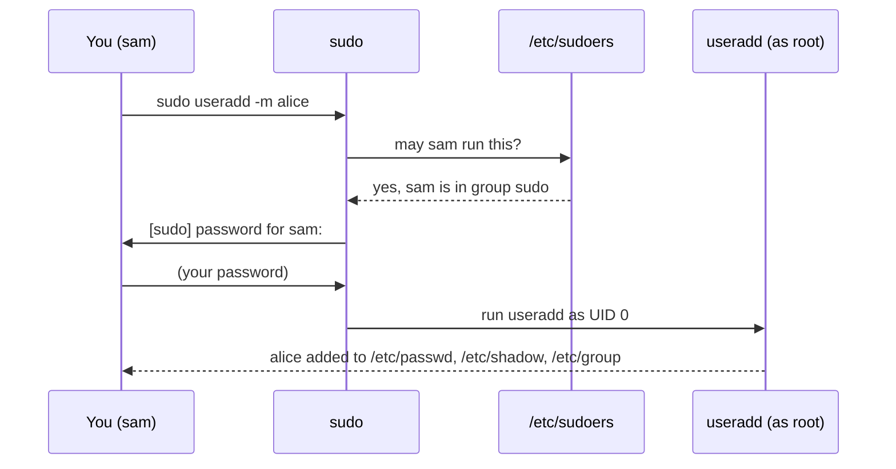

# 12 · Users, groups and sudo

**What you'll build:** on your practice Linux you'll create two teammates (`alice` and `bob`), a `team` group, a shared team folder where everyone's files automatically belong to the team, and a "service user" that can run an AI app but can never log in. Then you'll clean it all up.
**Time:** ~60 min · **Builds on:** [11 · Permissions and ownership](../11-permissions-and-ownership) · **Needs:** `sudo` (your password) on **WSL, Linux or the Docker container** from lesson 01. Not on a Mac's own terminal.

**Like you're 5:** a Linux computer is a school. Every person has a name badge (a **user**), people are in classes (**groups**), and the head teacher (**root**) has keys to every room. `sudo` is you asking the head teacher: "may I borrow your keys for this one job?"

## Why this matters
Servers are shared by people *and* programs. Good practice is that each app runs as its own user with only the permissions it needs (your AI API as user `aibot`, the database as `postgres`, the web server as `www-data`), so a bug or a hacker in one can't touch the rest. You'll use `sudo` every day to install software and edit system files, and you'll add teammates to servers and give them access through groups. Doing that right is a big part of "hardening" a server (lesson 26).

## What you'll learn
- **Users and IDs**: every user has a name and a number (**UID**); root is UID 0. Users are listed in `/etc/passwd`; their password hashes in `/etc/shadow`.
- **Groups**: named sets of users (`/etc/group`), used to share access. `id` and `groups` show yours.
- **`sudo`**: run one command as root (or as another user with `-u`), after typing *your* password. `sudo -l` shows what you may do.
- **Managing users**: `useradd`, `passwd`, `usermod -aG` (the `-a` matters!), `userdel -r`, `groupadd`, `groupdel`.
- **Service users**: system accounts with the shell `/usr/sbin/nologin` that run programs but can't log in.

## Before you start
- Finish [lesson 11](../11-permissions-and-ownership): you'll use `chgrp` and the setgid bit.
- **Do this lesson on a practice system**: WSL, a Linux VM, or the Docker container from [lesson 01](../../part-1-first-steps/01-what-is-linux-and-the-terminal) (Option D, as user `ubuntu`). It creates real users. The last step removes them again.
- **On a Mac:** users are managed with System Settings and `dscl`, not these commands. Use the Docker option for this lesson.
- No setup script and no API key. Replace `sam` with **your** user name wherever it appears.

## Run it
1. Who are you, and which groups are you in?
   ```bash
   id
   ```
   ```
   uid=1001(sam) gid=1001(sam) groups=1001(sam),27(sudo)
   ```
   | Piece | Meaning |
   |---|---|
   | `uid=1001(sam)` | your user number and name. Normal users start at 1000; system users are below 1000; root is 0 |
   | `gid=1001(sam)` | your **primary group**: new files you create get this group |
   | `groups=...` | every group you belong to. `sudo` = you're allowed to use the `sudo` command |

   (On WSL you'll see more groups, like `adm`, `dialout`, `plugdev`. That's normal.)
2. Look at the user list:
   ```bash
   head -n 3 /etc/passwd
   ```
   ```
   root:x:0:0:root:/root:/bin/bash
   daemon:x:1:1:daemon:/usr/sbin:/usr/sbin/nologin
   bin:x:2:2:bin:/bin:/usr/sbin/nologin
   ```
   ```bash
   getent passwd sam
   ```
   ```
   sam:x:1001:1001::/home/sam:/bin/bash
   ```
   | Piece | Meaning |
   |---|---|
   | `getent passwd sam` | "get entry": look up `sam` in the user database (works even when users come from a company directory, not just the file) |

   Each line has 7 fields separated by `:` (see `man 5 passwd`, lesson 06):

   | Field | `sam:x:1001:1001::/home/sam:/bin/bash` | Meaning |
   |---|---|---|
   | 1 | `sam` | user name |
   | 2 | `x` | "the password is in `/etc/shadow`" |
   | 3 | `1001` | UID |
   | 4 | `1001` | primary group's ID (GID) |
   | 5 | (empty) | comment, usually the full name |
   | 6 | `/home/sam` | home folder |
   | 7 | `/bin/bash` | the shell started at login (`/usr/sbin/nologin` = may not log in) |

3. Look at a group, and at who may read which file:
   ```bash
   grep sudo /etc/group
   ```
   ```
   sudo:x:27:ubuntu,sam
   ```
   (group name : password placeholder : GID : members.)
   ```bash
   ls -l /etc/passwd /etc/group /etc/shadow
   ```
   ```
   -rw-r--r-- 1 root root   531 Oct 22 04:08 /etc/group
   -rw-r--r-- 1 root root   925 Oct 22 04:08 /etc/passwd
   -rw-r----- 1 root shadow 599 Oct 22 04:08 /etc/shadow
   ```
   Everyone may read the user list, but not `/etc/shadow` (the password hashes):
   ```bash
   cat /etc/shadow
   ```
   ```
   cat: /etc/shadow: Permission denied
   ```
4. Borrow root's keys for one command:
   ```bash
   sudo whoami
   ```
   ```
   [sudo] password for sam:
   root
   ```
   | Piece | Meaning |
   |---|---|
   | `sudo` | "superuser do": run the rest of the line as root |
   | `[sudo] password for sam:` | type **your own** password (invisible). sudo remembers it for about 15 minutes |
   | `whoami` | the command that runs as root, so it prints `root` |

5. What may you do with sudo?
   ```bash
   sudo -l
   ```
   ```
   Matching Defaults entries for sam on laptop:
       env_reset, mail_badpass,
       secure_path=/usr/local/sbin\:/usr/local/bin\:/usr/sbin\:/usr/bin\:/sbin\:/bin\:/snap/bin,
       use_pty

   User sam may run the following commands on laptop:
       (ALL : ALL) ALL
   ```
   | Piece | Meaning |
   |---|---|
   | `-l` | **l**ist your sudo rights |
   | `(ALL : ALL) ALL` | as any user, as any group, any command: full admin. It comes from the rule `%sudo ALL=(ALL:ALL) ALL` in `/etc/sudoers` (`%sudo` = members of the group `sudo`) |

   (The test container used for this lesson also had a `NOPASSWD` line; yours probably won't.)
6. Create a user called `alice`:
   ```bash
   sudo useradd -m -s /bin/bash alice
   getent passwd alice
   ```
   ```
   alice:x:1002:1002::/home/alice:/bin/bash
   ```
   | Piece | Meaning |
   |---|---|
   | `useradd` | create a user (an admin command in `/usr/sbin`, so it needs `sudo`) |
   | `-m` | **m**ake a home folder `/home/alice` |
   | `-s /bin/bash` | set her login **s**hell |
   | `alice` | the new user name (lowercase, no spaces) |

   Ubuntu also has the friendlier `sudo adduser alice`, which asks for a password and full name step by step. `useradd` works on every Linux, so this course uses it.
7. Give alice a password (type it twice, nothing shows):
   ```bash
   sudo passwd alice
   ```
   ```
   New password:
   Retype new password:
   passwd: password updated successfully
   ```
   | Piece | Meaning |
   |---|---|
   | `passwd` | change a password. `passwd` alone changes **your** password; with a name (and sudo) it changes theirs |

8. Create a group:
   ```bash
   sudo groupadd team
   getent group team
   ```
   ```
   team:x:1003:
   ```
   No members yet (nothing after the last `:`).
9. Add alice **and yourself** to the group:
   ```bash
   sudo usermod -aG team alice
   sudo usermod -aG team sam
   id alice
   ```
   ```
   uid=1002(alice) gid=1002(alice) groups=1002(alice),1003(team)
   ```
   | Piece | Meaning |
   |---|---|
   | `usermod` | modify an existing user |
   | `-G team` | set the user's extra groups to `team` |
   | `-a` | **a**ppend: *add* the group, keep the others. **Never forget it**: `sudo usermod -G team sam` would remove you from `sudo` and every other group |

   Now compare:
   ```bash
   id
   ```
   ```
   uid=1001(sam) gid=1001(sam) groups=1001(sam),27(sudo)
   ```
   ```bash
   id sam
   ```
   ```
   uid=1001(sam) gid=1001(sam) groups=1001(sam),27(sudo),1003(team)
   ```
   The database says you're in `team`, but your **current shell** started before that, so it doesn't know yet. Group changes apply at your next login (close the terminal and open a new one; in Docker, `exit` then `su - ubuntu` again; on WSL, `wsl --shutdown` in PowerShell, then reopen Ubuntu). For one command, `sg team -c "command"` runs it with the new group right away.
10. (Optional, for later) To become another user completely: `su - alice` (asks for **alice's** password; `exit` to come back). `sudo -i` gives you a root shell (prompt ends in `#`; `exit` to leave). Use these sparingly: a root shell makes every typo powerful.
11. Make a **team folder** that the group may write in, where new files automatically belong to `team` (setgid, lesson 11):
    ```bash
    sudo mkdir -p /srv/team-practice
    sudo chgrp team /srv/team-practice
    sudo chmod 2775 /srv/team-practice
    ls -ld /srv/team-practice
    ```
    ```
    drwxrwsr-x 2 root team 4096 Oct 23 04:58 /srv/team-practice
    ```
    | Piece | Meaning |
    |---|---|
    | `/srv` | the standard place for data a server *serves* |
    | `chgrp team` | the folder's group becomes `team` |
    | `2775` | `2` = setgid, `775` = owner and group may do everything, others may read and enter |

12. Act **as alice** without knowing her password (you're an admin):
    ```bash
    sudo -u alice whoami
    ```
    ```
    alice
    ```
    ```bash
    sudo -u alice touch /srv/team-practice/hello-from-alice.txt
    ls -l /srv/team-practice
    ```
    ```
    total 0
    -rw-rw-r-- 1 alice team 0 Oct 23 04:58 hello-from-alice.txt
    ```
    | Piece | Meaning |
    |---|---|
    | `-u alice` | run the command as **u**ser alice instead of root |

    The file belongs to alice, and to group `team` (not `alice`) thanks to the setgid bit. Alice can't peek into your home, though: `sudo -u alice ls /home/sam` → `ls: cannot open directory '/home/sam': Permission denied`.
13. Run the check (as yourself, no sudo):
    ```bash
    cd ~/Learning/linux-from-zero
    bash part-2-power-tools/12-users-groups-and-sudo/check.sh
    ```
14. Do the **Try this** exercises below, run the check again, then **clean up** (this deletes the practice users, their homes, the group and the folder):
    ```bash
    sudo rm -r /srv/team-practice
    sudo userdel -r alice
    sudo userdel -r bob
    sudo userdel aibot
    sudo groupdel team
    getent passwd alice bob aibot
    ```
    ```
    userdel: alice mail spool (/var/mail/alice) not found
    userdel: bob mail spool (/var/mail/bob) not found
    ```
    | Piece | Meaning |
    |---|---|
    | `userdel` | delete a user |
    | `-r` | also **r**emove their home folder (the "mail spool not found" note is harmless) |
    | `groupdel` | delete a group |

    The final `getent` prints nothing: they're gone.

### What you should see
After steps 1–12 (before Try this):
```
Checking users and groups (you are: sam) ...

Run it:
✅ user alice exists
✅ alice has a home folder and bash as her shell
✅ group team exists
✅ alice and sam are both in team
✅ /srv/team-practice belongs to group team and has the setgid bit
✅ alice wrote hello-from-alice.txt in the team folder

Try this:
❌ 1. no service user aibot with shell /usr/sbin/nologin
   hint: sudo useradd --system --shell /usr/sbin/nologin aibot
❌ 2. bob should exist and be in team
   hint: sudo useradd -m -s /bin/bash -G team bob
❌ 3. no from-bob.txt with group team in /srv/team-practice
   hint: sudo -u bob touch /srv/team-practice/from-bob.txt   then   ls -l /srv/team-practice

Result: 6 of 9 checks passed.
Fix the ❌ lines, then run the check again.
```
After Try this: `Result: 9 of 9 checks passed.` and `You can manage users like an admin. Now do the Clean up step, then on to lesson 13!`

## How it works
**What happens when you type `sudo useradd ...`:**



1. **Users are numbers.** The kernel only knows UIDs and GIDs; names are looked up in `/etc/passwd` and `/etc/group`. Files store the numbers, which is why `ls -l` shows a number instead of a name after a user is deleted.
2. **root (UID 0) skips permission checks.** That's why you use `sudo` for one command at a time instead of logging in as root: you think before each powerful action, and every `sudo` use is logged (on Ubuntu in `/var/log/auth.log`, or `journalctl`).
3. **Who may sudo** is set in `/etc/sudoers` and files in `/etc/sudoers.d/`. On Ubuntu, members of the `sudo` group may; on Fedora/Red Hat it's the `wheel` group. **Only edit these with `sudo visudo`**, which checks your typing before saving: a broken sudoers file locks everyone out of sudo.
4. **Kinds of users:**

   | Kind | UID | Shell | Example |
   |---|---|---|---|
   | root | 0 | `/bin/bash` | the administrator |
   | system / service users | 1–999 | `/usr/sbin/nologin` | `www-data` (web server), `postgres`, your `aibot` |
   | normal users | 1000+ | `/bin/bash` | you, alice, bob |

   A service user owns an app's files and runs its process (lesson 25 runs an AI API as a service user under systemd). `--system` picks a UID below 1000 and doesn't make a home folder.
5. **Groups grant shared access.** Instead of giving files to many people, give them to a group and add people to it. The `docker` group, for example, lets members run Docker without sudo (handy, but it's as powerful as root).
6. **Related commands you'll meet:** `sudo -u USER cmd` (run as someone else), `sudo -i` / `su -` (root shell), `sudo -k` (forget the remembered password now), `passwd -l USER` (lock an account), `chage -l USER` (password expiry), `gpasswd -d USER GROUP` (remove someone from a group), `who` / `w` (who's logged in), `last` (login history).

## If something goes wrong
- **`sam is not in the sudoers file.`** → your user may not use sudo. On your own WSL/Linux, the first user normally can; in Docker, use the `ubuntu` user (it's in `sudo`). An admin can add you with `sudo usermod -aG sudo sam` (then log in again).
- **`sudo: 3 incorrect password attempts`** → type **your** password (not root's, not alice's). On WSL it's the one you chose when Ubuntu was first installed. Forgot it? In PowerShell: `wsl -u root`, then `passwd sam`.
- **`useradd: user 'alice' already exists`** → it's left over from an earlier try. Skip the step, or delete with `sudo userdel -r alice` and start again.
- **You're "in" a group but still get Permission denied** → your shell started before you joined. Log out and in again (or `sg team -c "..."`, or `newgrp team` for a new shell).
- **You ran `usermod -G` without `-a` and lost your groups** → re-add them: `sudo usermod -aG sudo sam` (if you lost `sudo` itself, you need root: `wsl -u root` on WSL, or `docker exec -u root -it linux-lab bash` in Docker).
- **`userdel: user alice is currently used by process 1234`** → something is still running as alice (maybe an `su - alice` shell). Exit it, or `sudo pkill -u alice` (lesson 13), then try again.

## Try this
1. Create a **service user** called `aibot` that can run programs but can't log in, then try to log in as it.
2. Create user `bob` *already in* the `team` group, in a single `useradd` command.
3. As bob, create `from-bob.txt` in the team folder and confirm its group is `team` without anyone running `chgrp`.

Run the check, then do the clean-up in step 14.

<details><summary>Solutions</summary>

1. `sudo useradd --system --shell /usr/sbin/nologin aibot`. `getent passwd aibot` → `aibot:x:999:999::/home/aibot:/usr/sbin/nologin`. `sudo -u aibot whoami` still works (programs can run as it), but `sudo su - aibot` says `This account is currently not available.`
2. `sudo useradd -m -s /bin/bash -G team bob` (`-G` on `useradd` sets the extra groups of a *new* user, so no `-a` needed). `id bob` shows `1003(team)`.
3. `sudo -u bob touch /srv/team-practice/from-bob.txt`, then `ls -l /srv/team-practice` → `-rw-rw-r-- 1 bob team 0 ... from-bob.txt`.
</details>

## Check yourself
1. What's the difference between `su -` and `sudo`?
2. Why is `sudo usermod -G docker sam` dangerous, and what should you type instead?
3. You added yourself to a group, but `id` doesn't show it. Why?
4. Why run an AI web app as a user like `aibot` instead of as root?

<details><summary>Answers</summary>

1. `su -` starts a shell as another user (root by default) and asks for **that** user's password. `sudo` runs one command as root (or another user) and asks for **your** password, checked against `/etc/sudoers`, and logs it.
2. Without `-a`, `-G` *replaces* all your extra groups with just `docker`, removing you from `sudo`. Use `sudo usermod -aG docker sam`.
3. Group membership is read when you log in. Your current shell keeps the old list until you log in again (or use `newgrp`/`sg`).
4. If the app has a bug or gets hacked, the attacker only gets `aibot`'s limited permissions instead of full control of the server (the "least privilege" rule).
</details>

## Learn more (optional)
**Read the official docs**
- `sudo`: https://www.sudo.ws/docs/man/sudo.man/
- `sudoers` (the rules file): https://www.sudo.ws/docs/man/sudoers.man/
- `useradd`: https://man7.org/linux/man-pages/man8/useradd.8.html
- `usermod`: https://man7.org/linux/man-pages/man8/usermod.8.html
- `passwd(5)`, the `/etc/passwd` format: https://man7.org/linux/man-pages/man5/passwd.5.html
- `group(5)`, the `/etc/group` format: https://man7.org/linux/man-pages/man5/group.5.html
- Ubuntu Server docs, user management: https://documentation.ubuntu.com/server/how-to/security/user-management/

**Watch**
- NetworkChuck, Linux users and groups / sudo: https://www.youtube.com/results?search_query=networkchuck+linux+users+groups+sudo
- Linux user management for beginners: https://www.youtube.com/results?search_query=linux+user+management+useradd+usermod+tutorial
- What is sudo? Explained: https://www.youtube.com/results?search_query=what+is+sudo+linux+explained

## Next
→ [13 · Processes and jobs](../13-processes-and-jobs)
