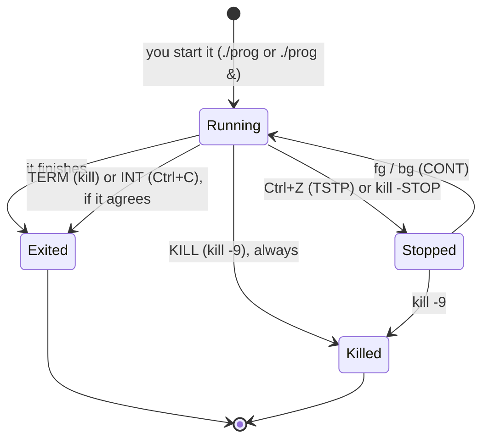

# 13 · Processes and jobs

**What you'll build:** four little practice programs: a counter, a "polite server" that shuts down cleanly, a "stubborn" program that refuses to stop, and a CPU hog. You'll start them in the foreground and background, pause and resume them, find them with `ps`, `pgrep` and `top`, and stop them with the right signal.
**Time:** ~60 min · **Builds on:** [12 · Users, groups and sudo](../12-users-groups-and-sudo) · **Needs:** nothing extra

**Like you're 5:** every program that is running is a **process**, like a child in a playground. Each child wears a number on their shirt (the **PID**). You can call a child to come in (foreground), let them play outside while you do something else (background), say "please stop now" (`kill`, polite) or carry them inside no matter what (`kill -9`).

## Why this matters
An AI API, a model server like Ollama, a training run, a database: on a server they're all processes. You'll need to see what's running and how much CPU and memory it uses (`top`), find a stuck or runaway process (`ps`, `pgrep`), stop it gracefully so it saves its work (`kill`) or forcefully when it hangs (`kill -9`), and keep a long job running after you close your SSH connection (`nohup`). "Port already in use" and "out of memory" problems both start with finding the right process.

## What you'll learn
- **Process and PID**: a running program, and the number the system gives it. Every process has a parent (**PPID**).
- **Seeing processes**: `ps`, `ps aux`, `ps -ef`, `pgrep -a`, `top` (and `htop`), plus `uptime` and `free -h` for the whole machine.
- **Jobs**: programs started from *this* shell. `&` (start in background), **Ctrl+Z** (pause), `jobs`, `bg`, `fg`, **Ctrl+C** (stop).
- **Signals**: messages sent to a process: `TERM` (15, "please stop", what `kill` sends), `INT` (2, Ctrl+C), `KILL` (9, can't be refused), `HUP`, `STOP`/`CONT`.
- **`kill`, `pkill`, `nohup`, `nice`**: send signals by PID or by name, keep jobs alive after logout, run jobs at low priority.

## Before you start
- Finish [lesson 12](../12-users-groups-and-sudo). Lesson 08's `>` and `2>&1` are used here too.
- No install, no API key. `setup.sh` only creates `~/linux-practice/13`.
- **Your PIDs will be different numbers** from the ones shown below. That's expected: use your own.

## Run it
1. Go to the course folder and build the practice programs:
   ```bash
   cd ~/Learning/linux-from-zero
   bash part-2-power-tools/13-processes-and-jobs/setup.sh
   ```
   ```
   Practice folder ready: /home/sam/linux-practice/13
   ```
2. Go there and list **your** processes in this terminal:
   ```bash
   cd ~/linux-practice/13
   ps
   ```
   ```
       PID TTY          TIME CMD
       161 pts/0    00:00:00 bash
       168 pts/0    00:00:00 ps
   ```
   | Piece | Meaning |
   |---|---|
   | `ps` | "process status": list processes started from this terminal |
   | `PID` | the process ID |
   | `TTY` | which terminal it belongs to (`pts/0` = the first terminal window) |
   | `TIME` | how much CPU time it has used |
   | `CMD` | the command. Your shell `bash` is a process too; `ps` sees itself |

   `echo $$` prints your shell's own PID (`$$` is a special shell variable).
3. List **every** process on the machine:
   ```bash
   ps aux | head -n 4
   ```
   ```
   USER         PID %CPU %MEM    VSZ   RSS TTY      STAT START   TIME COMMAND
   root           1  0.0  0.0   2708  1380 ?        Ss   09:59   0:00 sleep infinit
   sam           15  1.4  0.0   4764  3580 ?        Ss   10:00   0:00 bash /tmp/inn
   sam           38  100  0.0   8296  4256 ?        R    10:00   0:00 ps aux
   ```
   | Piece | Meaning |
   |---|---|
   | `a` | processes of **a**ll users |
   | `u` | **u**ser-oriented columns (owner, CPU %, memory %) |
   | `x` | also processes with no terminal (servers, background services) |
   | `%CPU` / `%MEM` | share of CPU and memory it uses |
   | `RSS` | real memory used, in KB |
   | `STAT` | state: `R` running, `S` sleeping (waiting), `T` stopped, `Z` zombie (finished, waiting for its parent to notice) |

   (No dashes in `aux`: an old BSD style that Linux `ps` also accepts. `ps -ef` is the other common style; it shows the **PPID**, the parent's PID.) On a real machine PID 1 is `systemd` (or `init`), the first process, parent of everything; in a Docker container it's whatever the container started with.
4. Start a program in the **foreground** and stop it with **Ctrl+C**:
   ```bash
   ./counter.sh
   ```
   ```
   count 1
   count 2
   count 3
   count 4
   ^C
   ```
   While it runs, your prompt is gone: the shell waits for it. **Ctrl+C** (shown as `^C`) sends the **INT** (interrupt) signal, which stops most programs.

   | Piece | Meaning |
   |---|---|
   | `./counter.sh` | run the program `counter.sh` in this folder (it's executable thanks to `chmod +x` in setup, lesson 11) |

5. **Pause** a job with **Ctrl+Z**, then let it continue in the **background**:
   ```bash
   ./counter.sh > /dev/null
   ```
   Press **Ctrl+Z**:
   ```
   ^Z
   [1]+  Stopped                 ./counter.sh > /dev/null
   ```
   ```bash
   jobs
   ```
   ```
   [1]+  Stopped                 ./counter.sh > /dev/null
   ```
   ```bash
   bg
   ```
   ```
   [1]+ ./counter.sh > /dev/null &
   ```
   ```bash
   jobs
   ```
   ```
   [1]+  Running                 ./counter.sh > /dev/null &
   ```
   | Piece | Meaning |
   |---|---|
   | `> /dev/null` | throw its output away so it doesn't print over your typing (lesson 08) |
   | **Ctrl+Z** | send the **TSTP** signal: pause ("stop") the foreground job and give you the prompt back |
   | `[1]` | the **job number** (only for this shell; different from the PID) |
   | `jobs` | list this shell's jobs. `+` marks the "current" job, `-` the one before it |
   | `bg` | continue the stopped job in the **b**ack**g**round |

6. Start a job **directly** in the background with `&`, and see PIDs with `jobs -l`:
   ```bash
   sleep 300 &
   ```
   ```
   [2] 179
   ```
   ```bash
   jobs -l
   ```
   ```
   [1]-   174 Running                 ./counter.sh > /dev/null &
   [2]+   179 Running                 sleep 300 &
   ```
   | Piece | Meaning |
   |---|---|
   | `sleep 300` | wait 300 seconds, doing nothing |
   | `&` | start it in the background: you get the prompt back at once. The shell prints the job number `[2]` and the PID `179` |
   | `-l` | also show the PIDs |

7. Stop a job by its **job number**, then bring the other one to the **foreground** and stop it:
   ```bash
   kill %2
   jobs
   ```
   ```
   [1]-  Running                 ./counter.sh > /dev/null &
   [2]+  Terminated              sleep 300
   ```
   ```bash
   fg %1
   ```
   ```
   ./counter.sh > /dev/null
   ```
   It's in the foreground again (no prompt). Press **Ctrl+C**. `jobs` now prints nothing.

   | Piece | Meaning |
   |---|---|
   | `kill` | send a signal (TERM by default) |
   | `%2` | job number 2 (a `%` means "job", no `%` means "PID") |
   | `fg %1` | bring job 1 to the **f**ore**g**round |

8. Run the **polite server** in the background and find it by name:
   ```bash
   ./polite-server.sh > server.out 2>&1 &
   pgrep -a -f polite-server
   ```
   ```
   41 bash ./polite-server.sh
   ```
   | Piece | Meaning |
   |---|---|
   | `pgrep` | "process grep": find PIDs by name |
   | `-a` | show the whole command line, not just the PID |
   | `-f` | match against the **f**ull command line (here the program is `bash` running the file `polite-server.sh`) |

   Look at it in detail:
   ```bash
   ps -o pid,ppid,stat,etime,cmd -p 41
   ```
   ```
       PID    PPID STAT     ELAPSED CMD
        41      15 S          00:02 bash ./polite-server.sh
   ```
   | Piece | Meaning |
   |---|---|
   | `-o pid,ppid,stat,etime,cmd` | choose the columns: PID, parent PID, state, elapsed time, command |
   | `-p 41` | only this PID (use yours!) |

9. Ask it **politely** to stop:
   ```bash
   kill 41
   cat server.out
   ```
   ```
   polite-server: running with PID 41 (stop me with: kill 41)
   polite-server: got TERM, saving work and shutting down cleanly
   ```
   Plain `kill` sends **TERM** (signal 15). Well-written servers catch it, finish what they're doing, save, and exit. That's why you always try plain `kill` first.
10. Meet the **stubborn** one:
    ```bash
    ./stubborn.sh
    ```
    ```
    stubborn: running with PID 186
    ```
    Press **Ctrl+C**:
    ```
    ^Cstubborn: ha! I ignore Ctrl+C
    ```
    It catches the signal and carries on. Press **Ctrl+Z** to pause it, then **force** it:
    ```
    ^Z
    [1]+  Stopped                 ./stubborn.sh
    ```
    ```bash
    kill -9 %1
    jobs
    ```
    ```
    [1]+  Killed                  ./stubborn.sh
    ```
    | Piece | Meaning |
    |---|---|
    | `-9` | send signal number 9, **KILL**. The kernel removes the process at once; it can't be caught or ignored, and the program gets no chance to save |

    `kill -l` lists all signals; `kill -l 9 15` → `KILL` and `TERM`.
11. Watch the whole machine live with **`top`**. Start the CPU hog in the background first:
    ```bash
    ./hog.sh &
    top
    ```
    ```
    top - 10:00:45 up 4 min,  0 user,  load average: 10.79, 4.04, 1.50
    Tasks:   6 total,   2 running,   3 sleeping,   0 stopped,   1 zombie
    %Cpu(s): 32.2 us,  5.5 sy,  0.0 ni,  8.9 id, 50.0 wa,  0.0 hi,  2.0 si,  1.4 st
    MiB Mem :  16091.2 total,  13690.3 free,   1274.8 used,   1399.2 buff/cache
    MiB Swap:      0.0 total,      0.0 free,      0.0 used.  14816.4 avail Mem

        PID USER      PR  NI    VIRT    RES    SHR S  %CPU  %MEM     TIME+ COMMAND
         84 sam       20   0    4764   3576   3312 R  90.0   0.0   0:04.17 bash
          1 root      20   0    2708   1380   1288 S   0.0   0.0   0:00.05 sleep
         15 sam       20   0    5280   4120   3288 S   0.0   0.0   0:00.08 bash
    ```
    The hog (`bash` running `hog.sh`) is at the top with about 90–100% CPU (100% = one full CPU core). Keys inside `top`: **P** sort by CPU, **M** sort by memory, **k** kill (asks for a PID), **q** quit. Press **q**, then stop the hog by name:
    ```bash
    pkill -f hog.sh
    ```
    | Piece | Meaning |
    |---|---|
    | `top` | a live, refreshing view of processes and machine load |
    | `load average` | how many processes wanted the CPU, averaged over 1, 5 and 15 minutes. Compare it with your number of cores (`nproc`) |
    | `pkill -f hog.sh` | send TERM to every process whose command line contains `hog.sh` (`pkill -9 -f ...` for KILL) |

    `htop` is a friendlier, colourful `top` (install it in lesson 15).
12. Run a job at **low priority** so it doesn't slow the machine:
    ```bash
    nice -n 10 ./hog.sh &
    ps -o pid,ni,cmd -p $(pgrep -f hog.sh)
    ```
    ```
        PID  NI CMD
         95  10 bash ./hog.sh
    ```
    | Piece | Meaning |
    |---|---|
    | `nice -n 10` | start the command with "niceness" 10. From -20 (greedy, root only) to 19 (very polite); normal is 0 |
    | `$(pgrep -f hog.sh)` | **command substitution**: run `pgrep` first and paste its output (the PID) here (lesson 14) |

    Stop it: `pkill -f hog.sh`. (`renice` changes the niceness of a running process.)
13. Look at the machine's overall health:
    ```bash
    uptime
    free -h
    ```
    ```
     10:01:24 up 4 min,  0 user,  load average: 14.68, 5.88, 2.22
                   total        used        free      shared  buff/cache   available
    Mem:            15Gi       1.4Gi        13Gi        39Mi       1.4Gi        14Gi
    Swap:             0B          0B          0B
    ```
    | Piece | Meaning |
    |---|---|
    | `uptime` | time, how long since the last boot, users, load averages |
    | `free -h` | memory: `available` is what new programs can still use. (**On a Mac**, `free` doesn't exist; use `top` or Activity Monitor) |

14. Take the quiz and check you cleaned up (do Try this 1 first, or see it as ❌):
    ```bash
    cd ~/Learning/linux-from-zero
    bash part-2-power-tools/13-processes-and-jobs/check.sh
    ```

### What you should see
After the steps and Try this 1:
```
Checking your processes ...

Clean-up:
✅ counter.sh is not running
✅ polite-server.sh is not running
✅ stubborn.sh is not running
✅ hog.sh is not running

Try this:
✅ 1. counter.log was written by a nohup background job

Quiz:

2. Which signal NUMBER can never be caught or ignored (the 'force kill')?
> ✅ Correct: 9

3. Which signal does a plain 'kill PID' send? (name or number)
> ✅ Correct: term

4. Which keys pause a running foreground job so you can type 'bg'?
> ✅ Correct: ctrl+z

Result: 8 of 8 checks passed.
You're in control of every process. On to lesson 14!
```
If a practice program is still running you'll see, for example, `❌ hog.sh is still running` with the `pkill` command to stop it.

## How it works
**A process's life, and the signals that move it between states:**



1. **Every process has a parent.** Your shell started `counter.sh`, so the shell is its parent (PPID). When a terminal closes, its shell sends **HUP** ("hang up") to its jobs, and they usually die. That's why long jobs on a server need `nohup` (ignore HUP) or, better, a service manager like systemd (lesson 25), or `tmux`/`screen` (terminal sessions that survive disconnects).
2. **Signals, the ones you'll use:**

   | Signal | Number | Sent by | Usual meaning | Can the program ignore it? |
   |---|---|---|---|---|
   | `HUP` | 1 | closing the terminal; `kill -HUP` | "your terminal is gone" / for servers: "reload your config" | yes |
   | `INT` | 2 | **Ctrl+C** | "interrupt, stop please" | yes |
   | `KILL` | 9 | `kill -9` | "die now" | **no** |
   | `TERM` | 15 | `kill` (default), `pkill`, `docker stop`, `systemctl stop` | "please shut down cleanly" | yes |
   | `STOP` | 19 | `kill -STOP` | pause | **no** |
   | `TSTP` | 20 | **Ctrl+Z** | pause (from the keyboard) | yes |
   | `CONT` | 18 | `fg`, `bg`, `kill -CONT` | continue | — |

   (Numbers can differ on other systems; names never do, so prefer `kill -TERM`, `kill -KILL`.) The practice scripts use bash's `trap 'commands' SIGNAL` to react to signals; you'll write traps yourself in lesson 20.
3. **Polite first, force last.** `kill PID` → wait a few seconds → `kill -9 PID` only if it's still there. `docker stop` and `systemctl stop` do exactly this: TERM, wait 10 seconds, then KILL.
4. **Jobs vs PIDs.** Job numbers (`%1`) belong to your current shell only; PIDs are system-wide. `kill %1` and `kill 174` hit the same process if job 1 has PID 174. `$!` holds the PID of the last background job: `sleep 60 & echo $!`.
5. **Keeping work alive:** `nohup ./job.sh > job.log 2>&1 &` starts it in the background, immune to HUP, with output in a file. `disown` detaches an already-running job from the shell. For servers you'll use systemd services (lesson 25).
6. **`/proc` is the kernel's live view**, shown as files: every running process has a folder `/proc/PID`. `cat /proc/$$/status` shows your shell's name, state, PID, PPID and memory. `ps` and `top` simply read these files.
7. **GNU vs Mac:** `ps aux`, `kill`, `pkill`, `pgrep`, jobs, `nice`, `nohup` all work the same. Mac `ps` doesn't support `-o cmd` (use `-o command`); Mac `top` sorts with `top -o cpu`; Mac has no `free` and no `/proc`.

## If something goes wrong
- **Ctrl+C does nothing** → the program ignores INT (like `stubborn.sh`). Press **Ctrl+Z**, then `kill -9 %1`. Or from a second terminal: `pkill -9 -f name`.
- **`bash: kill: (12345) - No such process`** → it already ended, or you typed the wrong PID. Check with `pgrep -a -f name`.
- **`kill: (1234) - Operation not permitted`** → it belongs to another user (maybe root). Use `sudo kill 1234`, but make sure it's the right process first.
- **`[1]+ Stopped` jobs pile up and `exit` says `There are stopped jobs.`** → `jobs` to see them, then `fg` and Ctrl+C, or `kill %1`, or type `exit` a second time to close anyway (they'll be killed).
- **A background job prints over your typing** → it's writing to the terminal. Redirect its output when starting it (`> file 2>&1 &`), or bring it back with `fg` and stop it.
- **`pgrep -f` also finds itself or your editor** → `-f` matches anything containing the text, including a `less counter.sh`. Read the `-a` output before killing; make the pattern more specific (`pgrep -af 'bash ./counter.sh'`).

## Try this
1. Start `counter.sh` with `nohup` in the background, writing to `counter.log`. Wait 5 seconds, check the log with `tail`, then stop it with `pkill`.
2. Start `sleep 1000 &`, find its PID two different ways (the `[1] PID` line and `pgrep`), check its parent is your shell (`ps -o pid,ppid,cmd`, compare with `echo $$`), then kill it.
3. Start `hog.sh` in the background, open `top`, press **k**, type the hog's PID, press Enter and accept signal 15. Did it disappear from the list?

<details><summary>Solutions</summary>

1. In `~/linux-practice/13`:
   ```bash
   nohup ./counter.sh > counter.log 2>&1 &
   sleep 5
   tail -n 3 counter.log
   pkill -f counter.sh
   ```
   `tail` shows lines like `count 3`, `count 4`, `count 5`.
2. `sleep 1000 &` prints `[1] 2345`. `pgrep -a sleep` → `2345 sleep 1000`. `ps -o pid,ppid,cmd -p 2345` shows a PPID equal to `echo $$`. Stop it with `kill 2345` (or `kill %1`).
3. `./hog.sh &`, `top`, **k**, type the PID, Enter, Enter (15 is the default). The line disappears within a few seconds. **q** to quit `top`. (If it doesn't, the hog ended by itself after its 60 seconds.)
</details>

## Check yourself
1. What's the difference between `kill 1234` and `kill -9 1234`, and which should you try first?
2. You start `python train.py` over SSH and close your laptop. Why does training stop, and what's one fix?
3. What do Ctrl+Z, `bg` and `fg` do?
4. `top` shows a load average of `8.0, 7.9, 7.5` on a machine where `nproc` says `4`. Is it busy?

<details><summary>Answers</summary>

1. `kill` sends TERM: the program may clean up and exit (or ignore it). `kill -9` sends KILL: the kernel ends it at once, no clean-up. Try plain `kill` first.
2. Closing the session sends HUP to the shell's jobs, which ends them. Fix: `nohup python train.py > train.log 2>&1 &` (or run it in `tmux`, or as a systemd service).
3. Ctrl+Z pauses the foreground job; `bg` lets it continue in the background; `fg` brings it back to the foreground.
4. Yes: about 8 processes want CPU time but there are only 4 cores, so work is waiting in line (overloaded for the last 15 minutes).
</details>

## Learn more (optional)
**Read the official docs**
- `ps`: https://man7.org/linux/man-pages/man1/ps.1.html
- `top`: https://man7.org/linux/man-pages/man1/top.1.html
- `kill`: https://man7.org/linux/man-pages/man1/kill.1.html
- `pgrep` / `pkill`: https://man7.org/linux/man-pages/man1/pgrep.1.html
- `signal(7)`, every signal explained: https://man7.org/linux/man-pages/man7/signal.7.html
- Job control, GNU Bash manual: https://www.gnu.org/software/bash/manual/html_node/Job-Control.html
- `proc(5)`, the `/proc` files: https://man7.org/linux/man-pages/man5/proc.5.html

**Watch**
- Linux processes explained (ps, top, kill): https://www.youtube.com/results?search_query=linux+processes+ps+top+kill+explained
- NetworkChuck, Linux processes: https://www.youtube.com/results?search_query=networkchuck+linux+processes
- bash job control (fg, bg, jobs): https://www.youtube.com/results?search_query=bash+job+control+fg+bg+jobs+tutorial

## Next
→ [14 · Environment variables and quoting](../14-environment-variables-and-quoting)
