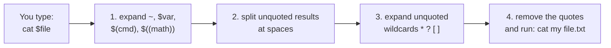

# 14 · Environment variables and quoting

**What you'll build:** you'll store values in shell variables, pass them to programs with `export` (the way API keys reach AI apps), install a little `hello-tool` program by adding its folder to your `PATH`, and learn exactly what single quotes, double quotes, backslashes and `$( )` do to a command.
**Time:** ~60 min · **Builds on:** [13 · Processes and jobs](../13-processes-and-jobs) · **Needs:** nothing extra

**Like you're 5:** a variable is a labelled jar: the label is the name (`FAVORITE_COLOR`), the sweet inside is the value (`blue`). `$FAVORITE_COLOR` means "open the jar and use what's inside". `export` puts the jar in your child's lunchbox so programs you start can open it too. Single quotes are a locked box: nothing inside gets opened.

## Why this matters
Every AI app you'll deploy reads its settings from **environment variables**: `ANTHROPIC_API_KEY`, `CLAUDE_MODEL`, `DATABASE_URL`, `PORT`. Docker (`-e`), Kubernetes, GitHub Actions and systemd all pass settings this way, so keys never sit inside your code. `PATH` decides which program runs when you type a name (the cause of many "command not found" and "wrong Python" problems). And quoting mistakes are the number one source of broken scripts, especially with file names that contain spaces.

## What you'll learn
- **Shell variables**: `name=value` (no spaces around `=`), read with `$name` or `${name}`.
- **Environment variables**: variables that are **exported** and so passed down to every program you start; see them with `env` / `printenv`.
- **`PATH`**: the list of folders the shell searches for commands; add your own folder to it.
- **One-off and permanent settings**: `VAR=value command` for one command; `~/.bashrc` (or `~/.zshrc` on a Mac) for every new terminal; `unset` to remove.
- **Quoting and expansion**: `'single'` (nothing expands), `"double"` (`$` still works, spaces are kept), `\` (escape one character), `$(command)` (insert a command's output), `$(( ))` (arithmetic).

## Before you start
- Finish [lesson 13](../13-processes-and-jobs).
- No install, no API key. `setup.sh` only creates `~/linux-practice/14`.
- **Do all steps and the check in the same terminal window.** Variables live inside one shell; a new window starts fresh.

## Run it
1. Go to the course folder and build the practice files:
   ```bash
   cd ~/Learning/linux-from-zero
   bash part-2-power-tools/14-environment-variables-and-quoting/setup.sh
   ```
   ```
   Practice folder ready: /home/sam/linux-practice/14
   ```
2. Go there and make your first variable:
   ```bash
   cd ~/linux-practice/14
   name=Sam
   echo "Hello, $name!"
   ```
   ```
   Hello, Sam!
   ```
   | Piece | Meaning |
   |---|---|
   | `name` | the variable's name (letters, digits, `_`; can't start with a digit) |
   | `=` | "store this". **No spaces around it** |
   | `Sam` | the value |
   | `$name` | **expansion**: the shell swaps `$name` for its value before running `echo` |

   With spaces it breaks, because the shell thinks `name` is a command:
   ```bash
   name = Sam
   ```
   ```
   bash: name: command not found
   ```
3. Use **braces** when letters follow the name:
   ```bash
   echo "Files for ${name}s team"
   ```
   ```
   Files for Sams team
   ```
   Without braces, `"Files for $names team"` prints `Files for  team`: the shell looked for a variable called `names`, which doesn't exist, and silently used nothing.

   | Piece | Meaning |
   |---|---|
   | `${name}` | the same as `$name`, with clear edges |

4. A plain variable is **not** passed to programs you start:
   ```bash
   FAVORITE_COLOR=blue
   echo $FAVORITE_COLOR
   ```
   ```
   blue
   ```
   ```bash
   bash show-env.sh
   ```
   ```
   show-env.sh sees FAVORITE_COLOR=''
   ```
   Your shell knows it, but the child program `show-env.sh` sees nothing.
5. **Export** it, and the child can see it:
   ```bash
   export FAVORITE_COLOR
   bash show-env.sh
   ```
   ```
   show-env.sh sees FAVORITE_COLOR='blue'
   ```
   | Piece | Meaning |
   |---|---|
   | `export` | mark the variable as part of the **environment**: copied into every program started from this shell from now on. `export NAME=value` sets and exports in one go |

   This is exactly how an AI app gets its key: `export ANTHROPIC_API_KEY=...`, then `python app.py`.
6. Look at the environment you already have:
   ```bash
   echo $HOME $USER $SHELL
   ```
   ```
   /home/sam sam /bin/bash
   ```
   ```bash
   printenv HOME
   ```
   ```
   /home/sam
   ```
   | Piece | Meaning |
   |---|---|
   | `printenv NAME` | print one environment variable (no `$` needed) |
   | `env` | print **all** environment variables (try `env \| less`, or `env \| sort`) |

   Variables you'll meet everywhere:

   | Variable | Holds |
   |---|---|
   | `HOME` | your home folder (what `~` means) |
   | `USER` | your user name |
   | `SHELL` | your login shell |
   | `PWD` | the current folder (`cd` updates it) |
   | `PATH` | where commands are searched for |
   | `LANG` | language and character set, like `C.UTF-8` or `en_US.UTF-8` |
   | `EDITOR` | the editor tools like `git commit` open (lesson 07) |

7. See your **PATH**, one folder per line:
   ```bash
   echo "$PATH" | tr ':' '\n'
   ```
   ```
   /usr/local/sbin
   /usr/local/bin
   /usr/sbin
   /usr/bin
   /sbin
   /bin
   ```
   | Piece | Meaning |
   |---|---|
   | `$PATH` | a list of folders joined by `:` |
   | `tr ':' '\n'` | turn every `:` into a new line, so it's readable (lesson 10) |

   Yours is probably longer (Ubuntu adds `/usr/games` and `/snap/bin`; WSL adds many `/mnt/c/...` Windows folders). When you type `ls`, the shell looks in these folders **in this order** and runs the first `ls` it finds.
8. Try a program that isn't on the PATH:
   ```bash
   hello-tool
   ```
   ```
   bash: hello-tool: command not found
   ```
   It exists, in `~/linux-practice/14/bin`, but that folder isn't in the list. You can still run it by its path:
   ```bash
   ./bin/hello-tool
   ```
   ```
   hello-tool: I was found through your PATH!
   Hello, stranger.
   ```
   (It's lying for now: it was found by its path.)
9. **Add the folder to PATH** (in front, so it wins):
   ```bash
   export PATH="$HOME/linux-practice/14/bin:$PATH"
   hello-tool
   ```
   ```
   hello-tool: I was found through your PATH!
   Hello, stranger.
   ```
   ```bash
   which hello-tool
   ```
   ```
   /home/sam/linux-practice/14/bin/hello-tool
   ```
   | Piece | Meaning |
   |---|---|
   | `PATH=...` | give PATH a new value |
   | `"$HOME/linux-practice/14/bin` | the new folder (in double quotes, so `$HOME` still expands) |
   | `:$PATH"` | then `:` and the **old** PATH. Forgetting `$PATH` here would wipe the list, and `ls` would stop working |
   | `which` | show which file a command name runs |

   This is what installers do when they say "add `~/.local/bin` to your PATH" (lesson 15).
10. Set a variable for **one command only**:
    ```bash
    GREETING_NAME=Alice hello-tool
    ```
    ```
    hello-tool: I was found through your PATH!
    Hello, Alice.
    ```
    ```bash
    echo "GREETING_NAME is now: '$GREETING_NAME'"
    ```
    ```
    GREETING_NAME is now: ''
    ```
    | Piece | Meaning |
    |---|---|
    | `GREETING_NAME=Alice hello-tool` | put the variable in the environment of this one command; your shell doesn't keep it. You'll see this pattern often: `CLAUDE_MODEL=claude-haiku-5-5 python app.py` |

11. Remove a variable:
    ```bash
    unset FAVORITE_COLOR
    bash show-env.sh
    ```
    ```
    show-env.sh sees FAVORITE_COLOR=''
    ```
    Set it again for the check: `export FAVORITE_COLOR=blue`.
12. **Quotes**: single, double, none:
    ```bash
    echo '$HOME is where the heart is'
    echo "$HOME is where the heart is"
    echo "It costs \$5"
    ```
    ```
    $HOME is where the heart is
    /home/sam is where the heart is
    It costs $5
    ```
    | Piece | Meaning |
    |---|---|
    | `'...'` | **single quotes**: everything inside is taken literally. No `$`, no `*`, no `~` |
    | `"..."` | **double quotes**: `$variables` and `$(commands)` still expand; spaces and `*` are kept as they are |
    | `\$` | backslash: "the next character is just a character" |

13. **Insert a command's output** and do maths:
    ```bash
    echo "Today is $(date +%A)"
    echo "Files here: $(ls | wc -l)"
    echo $((6 * 7))
    ```
    ```
    Today is Friday
    Files here: 4
    42
    ```
    | Piece | Meaning |
    |---|---|
    | `$( ... )` | **command substitution**: run the command inside and paste its output here |
    | `date +%A` | today's weekday name (`+` gives `date` a format) |
    | `$(( ... ))` | **arithmetic**: whole-number maths (`+ - * / %`) |

14. Why you should **quote variables** that hold file names:
    ```bash
    file="my file.txt"
    cat $file
    ```
    ```
    cat: my: No such file or directory
    cat: file.txt: No such file or directory
    ```
    ```bash
    cat "$file"
    ```
    ```
    This file has a space in its name.
    ```
    Without quotes, the shell splits the value at the space (**word splitting**) and `cat` gets two names. Rule of thumb: **always write `"$var"`** unless you have a reason not to. The same happens to extra spaces: with `greeting="hello     world"`, `echo $greeting` prints `hello world`, but `echo "$greeting"` keeps all five spaces.
15. Quotes also stop **wildcards** and **`~`**:
    ```bash
    echo *.txt
    echo "*.txt"
    echo ~ "~"
    ```
    ```
    my file.txt notes.txt
    *.txt
    /home/sam ~
    ```
16. Run the check (same terminal!):
    ```bash
    cd ~/Learning/linux-from-zero
    bash part-2-power-tools/14-environment-variables-and-quoting/check.sh
    ```

### What you should see
With `FAVORITE_COLOR` exported and PATH changed (before Try this):
```
Checking your environment ...

Run it:
✅ FAVORITE_COLOR is exported (I can see: blue)
✅ your PATH includes ~/linux-practice/14/bin
✅ hello-tool can be run by name from anywhere

Try this:
❌ 1. greeting.txt should contain 'Hello, Alice.'
   hint: cd ~/linux-practice/14 && GREETING_NAME=Alice hello-tool > greeting.txt
❌ 2. no file like 'report 2026.txt'
   hint: cd ~/linux-practice/14 && touch "report $(date +%Y).txt"

3. What does   echo '$HOME'   print (with SINGLE quotes)?
> ✅ Correct: $HOME

4. What does   echo "$((6 * 7)) apples"   print?
> ✅ Correct: 42 apples

Result: 5 of 7 checks passed.
Fix the ❌ lines, then run the check again (in the same terminal).
```
After Try this: `Result: 7 of 7 checks passed.` and `Your shell does exactly what you mean. On to lesson 15!` If you opened a new terminal in between, the first three lines turn ❌: variables and PATH changes live only in the shell where you made them (until you put them in `~/.bashrc`, see How it works).

## How it works
**The shell rewrites your line before running it**, in a fixed order. Quotes decide which rewrites happen:



| Inside... | `$var`, `$(cmd)` | spaces split? | `*` wildcards | `~` |
|---|---|---|---|---|
| nothing | expanded | **yes** | expanded | expanded |
| `"double quotes"` | expanded | no | no | no |
| `'single quotes'` | no | no | no | no |

1. **Environment = copied down, never up.** When a program starts, it gets a *copy* of its parent's exported variables. Changes a child makes (even `export` inside a script) never reach the parent. That's why `bash script.sh` can't change your current folder or variables; `source script.sh` (or `. script.sh`) runs it *inside* your shell instead.

   ```mermaid
   flowchart TD
       S["your shell<br/>name=Sam (not exported)<br/>FAVORITE_COLOR=blue (exported)"] -->|"starts, copying exported vars"| C1["bash show-env.sh<br/>sees FAVORITE_COLOR only"]
       S -->|"starts"| C2["python app.py<br/>sees FAVORITE_COLOR only"]
   ```

2. **Making settings permanent.** Every new interactive bash runs `~/.bashrc` first (zsh on a Mac runs `~/.zshrc`). Add lines to the end, then load them into the current shell with `source`:
   ```bash
   echo 'export EDITOR=nano' >> ~/.bashrc
   source ~/.bashrc
   ```
   Note the **single quotes**: you want the literal text in the file. For PATH: `echo 'export PATH="$HOME/.local/bin:$PATH"' >> ~/.bashrc`. To undo, open `~/.bashrc` in nano and delete the line. (Login shells, like SSH sessions, read `~/.profile` first, which on Ubuntu also loads `~/.bashrc`.)
3. **Secrets in variables, safely.** Keys in `~/.bashrc` are readable by anything running as you; prefer a `.env` file with `chmod 600` that only your app loads, or a secret manager in production. To type a key without it landing in your history or on screen:
   ```bash
   read -rs ANTHROPIC_API_KEY && export ANTHROPIC_API_KEY
   ```
   (`read` = read a line from the keyboard into a variable, `-s` = silent, `-r` = keep backslashes.) On Ubuntu, a command that starts with a space is also kept out of `history`.
4. **Defaults.** `${GREETING_NAME:-stranger}` (used inside `hello-tool`) means "the value of GREETING_NAME, or `stranger` if it's empty or unset". Scripts use this for optional settings: `model="${CLAUDE_MODEL:-claude-haiku-5-5}"`.
5. **`$` special variables** you've met: `$$` (this shell's PID), `$!` (last background job's PID), `$?` (exit code of the last command, lesson 18).
6. **GNU vs Mac:** quoting rules are identical in bash and zsh. Differences: the Mac's startup file is `~/.zshrc`; zsh does *not* word-split unquoted variables (so `cat $file` happens to work there), but quote anyway: scripts run in bash on servers.

## If something goes wrong
- **`bash: name: command not found` when setting a variable** → remove the spaces: `name=Sam`, not `name = Sam`.
- **Every command says `command not found` (even `ls`)** → you overwrote PATH, for example `export PATH="$HOME/bin"` without `:$PATH`. Fix this terminal with `export PATH="/usr/local/bin:/usr/bin:/bin"`, or just open a new terminal. If you put the mistake in `~/.bashrc`, run `/usr/bin/nano ~/.bashrc` and fix the line.
- **A program doesn't see your variable** → you set it without `export`, or in another terminal. `export NAME=value`, then start the program from that same terminal.
- **You edited `~/.bashrc` but nothing changed** → it's only read by new shells. Run `source ~/.bashrc` or open a new terminal.
- **`cat: my: No such file or directory`** → an unquoted variable or name containing a space. Use `"$file"`.
- **`>` appears instead of your prompt** → an unclosed quote. Press Ctrl+C and retype the line.

## Try this
1. Using a one-off variable, make `hello-tool` greet Alice and save its output to `~/linux-practice/14/greeting.txt`.
2. Create an empty file whose name is `report ` followed by the current year (like `report 2026.txt`) in `~/linux-practice/14`, using `$(date +%Y)`. Mind the space!
3. Predict, then check, what each line prints: `echo "$USER's home is $HOME"`, `echo '$USER'"'s"`, `echo "5 + 3 = $((5 + 3))"`.

<details><summary>Solutions</summary>

1. `cd ~/linux-practice/14 && GREETING_NAME=Alice hello-tool > greeting.txt` (`cat greeting.txt` shows `Hello, Alice.`).
2. `touch "report $(date +%Y).txt"`. Without the double quotes you'd get two files, `report` and `2026.txt`.
3. `sam's home is /home/sam` (the `'` inside double quotes is just a character); `$USER's` (single-quoted `$USER` stays literal, then the double-quoted `'s` is added); `5 + 3 = 8`.
</details>

## Check yourself
1. What's the difference between `NAME=value` and `export NAME=value`?
2. Why does `export PATH="$HOME/bin"` break your terminal, and what should it be?
3. What do `echo '$(whoami)'` and `echo "$(whoami)"` print, and why?
4. A script does `rm -rf $folder/*` and `folder` is empty. What gets deleted, and how do quotes plus `${folder:?}` help?

<details><summary>Answers</summary>

1. Both create a variable in your shell; `export` also passes it to every program you start from that shell.
2. It replaces the whole list with one folder, so the shell can't find `ls`, `cat`, etc. Use `export PATH="$HOME/bin:$PATH"` (new folder plus the old list).
3. `$(whoami)` literally (single quotes block everything), and your user name, like `sam` (double quotes allow command substitution).
4. `$folder/*` becomes `/*`: everything on the computer the user may delete. Writing `rm -rf "${folder:?}"/*` makes the shell stop with an error if `folder` is empty or unset, before `rm` ever runs (lesson 20).
</details>

## Learn more (optional)
**Read the official docs**
- Shell parameters and variables, GNU Bash manual: https://www.gnu.org/software/bash/manual/html_node/Shell-Parameters.html
- Quoting, GNU Bash manual: https://www.gnu.org/software/bash/manual/html_node/Quoting.html
- Shell expansions (the order shown above): https://www.gnu.org/software/bash/manual/html_node/Shell-Expansions.html
- `environ(7)`, the environment and common variables: https://man7.org/linux/man-pages/man7/environ.7.html
- Bash startup files (`.bashrc`, `.profile`): https://www.gnu.org/software/bash/manual/html_node/Bash-Startup-Files.html

**Watch**
- Linux environment variables explained: https://www.youtube.com/results?search_query=linux+environment+variables+explained
- The PATH variable explained: https://www.youtube.com/results?search_query=linux+PATH+variable+explained
- Bash quoting: single vs double quotes: https://www.youtube.com/results?search_query=bash+single+vs+double+quotes

## Next
→ [15 · Installing software](../15-installing-software)
