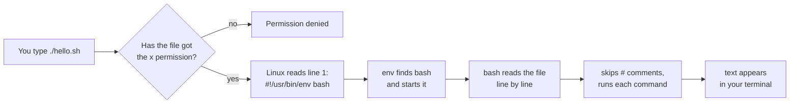

# 16 · Your first script

**What you'll build:** two small shell scripts (`hello.sh` and `morning-report.sh`), one script you write yourself, a repaired "broken" script, and your own command `morning-report` that works from any folder.
**Like you're 5:** a script is a recipe card. Instead of telling the cook every step out loud each time, you write the steps on a card once, then just say "make card number 1".
**Time:** ~45 min · **Builds on:** [15 · Installing software](../../part-2-power-tools/15-installing-software) · **Needs:** a Linux terminal (Ubuntu, WSL2, a VM or a Docker `ubuntu:24.04` container) and `nano`

## Why this matters
Every server you will ever run is set up, backed up and repaired by scripts. AI engineers use them every day: a script that installs a model server, one that downloads data every night, one that deploys an API. If you can type a command, you can already write a script: a script is just your commands saved in a file.

## What you'll learn
- **Shell script**: a text file full of commands that bash runs from top to bottom.
- **Shebang** (`#!`): the first line that tells Linux which program should run the file.
- **Execute permission** (`chmod +x`): the switch that turns a text file into something you can run.
- **`./`**: "the file right here in this folder", needed because Linux only searches special folders for commands.
- **PATH**: the list of folders Linux searches when you type a command name, and how to add your own `~/bin` to it.

## Before you start
- A terminal on Linux (see lesson 01 for the options). Everything here works on Ubuntu 24.04.
- `nano` (installed on Ubuntu by default; if not: `sudo apt install nano`).
- Optional but very useful: **shellcheck**, a free "spell checker" for scripts:
  ```bash
  sudo apt install shellcheck
  ```
  | Piece | Meaning |
  |---|---|
  | `sudo` | run the next command as the administrator (lesson 12) |
  | `apt install` | download and install a package (lesson 15) |
  | `shellcheck` | the package name: a tool that finds mistakes in shell scripts |
- No API key needed.

## Run it
1. From the course folder (`linux-from-zero`, wherever you cloned or downloaded this repo), go into this lesson's folder:
   ```bash
   cd part-3-shell-scripting/16-your-first-script
   ```
2. Look inside the first script. It is just text:
   ```bash
   cat hello.sh
   ```
   You see the shebang line `#!/usr/bin/env bash`, many `#` comments, and six commands.
3. Run it by handing it to bash. This works even if the file is not executable:
   ```bash
   bash hello.sh
   ```
4. Check its permissions, then run it directly with `./`:
   ```bash
   ls -l hello.sh
   ./hello.sh
   ```
   `ls -l` should show `-rwxr-xr-x`. The `x` letters mean "executable". If you downloaded the repo as a ZIP and see `-rw-r--r--` (no `x`), run `chmod +x *.sh` once in this folder.

   **Command, piece by piece**
   | Piece | Meaning |
   |---|---|
   | `.` | "this folder" (the folder you are standing in) |
   | `/` | folder separator |
   | `hello.sh` | the file name. `.sh` is just a label for humans; Linux does not care about it |
   | `./hello.sh` together | "run the file `hello.sh` that is in this folder" |
5. Run the bigger script:
   ```bash
   ./morning-report.sh
   ```
6. Create the practice folder (it only touches `~/linux-practice/16`):
   ```bash
   bash setup.sh
   ```
7. Write your own script with nano:
   ```bash
   nano ~/linux-practice/16/my-first.sh
   ```
   Type these 4 lines exactly, then save with **Ctrl + O**, **Enter**, and leave with **Ctrl + X**:
   ```bash
   #!/usr/bin/env bash
   # my-first.sh - my own script
   echo "Hi, I wrote this myself!"
   ls
   ```
8. Try to run it. It will fail, on purpose:
   ```bash
   ~/linux-practice/16/my-first.sh
   ```
   You get `Permission denied`. A new file is only "readable text" until you give it the execute permission.
9. Make it executable, then run it again:
   ```bash
   chmod +x ~/linux-practice/16/my-first.sh
   ~/linux-practice/16/my-first.sh
   ```
   **Command, piece by piece**
   | Piece | Meaning |
   |---|---|
   | `chmod` | "change mode": change a file's permissions (lesson 11) |
   | `+` | add a permission |
   | `x` | the execute permission ("you may run this") |
   | `~` | your home folder, for example `/home/sam` |
   | `~/linux-practice/16/my-first.sh` | the full path to your file, so you can run it from anywhere |
10. Now make `morning-report` a real command. Still in the lesson folder, copy the script into a personal `bin` ("binaries" = programs) folder, without the `.sh`:
    ```bash
    mkdir -p ~/bin
    cp morning-report.sh ~/bin/morning-report
    ```
11. Tell bash to look in `~/bin` for commands, for this and every future terminal:
    ```bash
    echo 'export PATH="$HOME/bin:$PATH"' >> ~/.bashrc
    source ~/.bashrc
    ```
    **Command, piece by piece**
    | Piece | Meaning |
    |---|---|
    | `echo '...'` | print the text between the single quotes, exactly as written (no `$` expansion yet) |
    | `export` | make the variable visible to programs you start (lesson 14) |
    | `PATH=` | set the variable `PATH`, the list of folders searched for commands |
    | `"$HOME/bin:$PATH"` | your `bin` folder, then `:` (the separator), then the old list. New folder first = searched first |
    | `>>` | append to the end of a file (never `>`, which would wipe your `.bashrc`) |
    | `~/.bashrc` | the settings file bash reads every time a terminal opens |
    | `source ~/.bashrc` | re-read the settings now, so you do not have to open a new terminal |
12. Go somewhere else and use your new command:
    ```bash
    cd ~
    morning-report
    which morning-report
    ```
13. Now repair a broken script. Go to the practice folder and try it:
    ```bash
    cd ~/linux-practice/16
    ./broken.sh
    ```
    `Permission denied`. You know this one: `chmod +x broken.sh`, then `./broken.sh` again.
14. It still fails with `/usr/bin/env: 'bash\r': No such file or directory`. Look at the invisible characters:
    ```bash
    cat -A broken.sh
    ```
    `cat -A` shows hidden characters: `$` marks each line end and `^M` is a **carriage return** (`\r`), which Windows puts at the end of every line. Bash thinks the program is called `bash\r`, which does not exist.
15. Remove the carriage returns and run it:
    ```bash
    sed -i 's/\r$//' broken.sh
    ./broken.sh
    ```
    **Command, piece by piece**
    | Piece | Meaning |
    |---|---|
    | `sed` | "stream editor": edits text line by line (lesson 10) |
    | `-i` | "in place": change the file itself instead of printing the result |
    | `'s/\r$//'` | the edit: `s` = substitute, `/\r$/` = a carriage return at the end of a line (`$` = end of line), `//` = replace it with nothing |
    | `broken.sh` | the file to edit |
16. Go back to the lesson folder and check your work. Use the full path to where you put the course; if you cloned the repo into your home folder, it is:
    ```bash
    cd ~/Learning/linux-from-zero/part-3-shell-scripting/16-your-first-script
    ./check.sh
    ```
    (Tip: `pwd` in step 1 shows you this full path. Lesson 17 shows how to save it in a variable.)

### What you should see
Step 3 (`bash hello.sh`), real output from Ubuntu 24.04:
```
Hello from my first script!
Today is:
Thu Oct 22 04:09:58 UTC 2026
You are logged in as:
learner
You are standing in this folder:
/home/learner/linux-from-zero/part-3-shell-scripting/16-your-first-script
```
Step 5 (`./morning-report.sh`), shortened:
```
==============================
      MORNING REPORT
==============================

--- Date and time ---
Thursday 22 October 2026, 04:09

--- Who and where ---
learner
myserver

--- How long the computer has been on ---
up 18 minutes
...
Have a great day!
```
Steps 8, 13 and 14 (the errors you fix):
```
bash: /home/learner/linux-practice/16/my-first.sh: Permission denied
bash: ./broken.sh: Permission denied
/usr/bin/env: 'bash\r': No such file or directory
```
`cat -A broken.sh` before and after the `sed` fix:
```
#!/usr/bin/env bash^M$
echo "I am fixed! Well done."^M$
```
```
#!/usr/bin/env bash$
echo "I am fixed! Well done."$
```
Step 16 (`./check.sh`) when everything is done:
```
Checking lesson 16...
  PASS  my-first.sh exists
  PASS  my-first.sh starts with #!
  PASS  my-first.sh is executable
  PASS  my-first.sh runs successfully
  PASS  broken.sh is fixed (executable, Unix line endings, runs)
  PASS  morning-report is on your PATH

Result: 6 passed, 0 failed.
All done. You can write and run scripts!
```
Your date, user name (`learner` here), computer name (`myserver`) and folders will be different. That is the point: the script asks the computer each time.

## How it works
What happens when you type `./hello.sh`:

1. **The shebang.** `#!` is pronounced "shebang" (from "hash" + "bang", programmer slang for `#` and `!`). When you run a file directly, Linux reads its first two characters. If they are `#!`, the rest of the line names the program that should read the file.

   | Piece | Meaning |
   |---|---|
   | `#!` | "run this file with the following program" |
   | `/usr/bin/env` | a small program whose job is to find other programs in your PATH |
   | `bash` | the program to find: the Bash shell |

   You will also see `#!/bin/bash`. It works on almost every Linux, but `#!/usr/bin/env bash` also works where bash lives somewhere else (for example on a Mac with a newer bash installed by Homebrew).
2. **Comments.** In `hello.sh`, every line starting with `#` (after line 1) is skipped by bash. Text after a `#` on a command line is a comment too: `pwd   # prints the folder` runs only `pwd`.
3. **Commands, top to bottom.** `echo "Hello from my first script!"` prints text; `date`, `whoami` and `pwd` run exactly as if you typed them. Bash finishes one line before starting the next.
4. **`bash hello.sh` vs `./hello.sh`.** With `bash hello.sh` you start bash yourself and give it the file to read, so the `x` permission and the shebang are not needed. With `./hello.sh` you ask Linux to run the file, so it needs both.
5. **Why `./`?** When you type a bare name like `ls`, bash looks only in the folders listed in `PATH`. Your current folder is not in that list (on purpose, so a file called `ls` planted in a folder cannot trick you). `./hello.sh` gives an exact location, so no search is needed. Try `echo $PATH` to see the list, with `:` between folders.
6. **`morning-report.sh`** is the same idea with more commands from Parts 1 and 2: `date "+%A %d %B %Y, %H:%M"` prints the date in a chosen format (`%A` weekday, `%d` day, `%B` month name, `%Y` year, `%H:%M` hours:minutes), `df -h ~ | tail -n 1` pipes the disk report into `tail` to keep only the last line, and `ls ~ | wc -l` counts items in your home. The `# shellcheck disable=SC2012` line is a note for shellcheck, telling it that this simple count is fine.
7. **Making a command.** Copying the script to `~/bin/morning-report` and putting `~/bin` in `PATH` means bash finds it like any other program. `which morning-report` shows where it was found. The name has no `.sh` because users of a command should not care what language it is written in.
8. **`setup.sh`** uses `printf` to write a file containing `\r\n` line endings on purpose, then `chmod -x` (minus = remove) to take away the execute permission. `check.sh` uses `if` tests you will learn in lesson 18; read its comments for now.

**Two handy safety checks before running any script:**
| Command | What it does |
|---|---|
| `bash -n script.sh` | `-n` = "no execute": only checks the grammar. Silent if OK |
| `shellcheck script.sh` | finds common mistakes and explains each one with a link |

## If something goes wrong
- **`bash: ./hello.sh: Permission denied`** → the file is not executable. Run `chmod +x hello.sh`. (Or run it with `bash hello.sh`.)
- **`hello.sh: command not found`** → you typed `hello.sh` without `./`. Bash searched only the PATH folders. Type `./hello.sh`.
- **`/usr/bin/env: 'bash\r': No such file or directory`** or **`/bin/bash^M: bad interpreter`** → the file has Windows line endings (it was edited in Notepad or copied from Windows). Fix: `sed -i 's/\r$//' file.sh`. In VS Code, click `CRLF` in the bottom bar and pick `LF`.
- **`morning-report: command not found` after step 12** → `~/bin` is not in PATH in this terminal. Run `source ~/.bashrc`, then `echo $PATH` and look for `/home/<you>/bin`. Check the line in `~/.bashrc` with `tail -n 3 ~/.bashrc`; it must use single quotes as shown.
- **The script runs but says `ls: cannot access ...` or prints nothing for a command** → a typo in a command name or option. Run the same line by hand in the terminal to see the error clearly, or run `shellcheck my-first.sh`.

## Try this
1. Add a line to `my-first.sh` that prints how many files are in `/etc` (hint: a pipe into `wc -l`). Run it.
2. Write `~/linux-practice/16/sysinfo.sh` that prints your kernel version (`uname -r`), the number of CPU cores (`nproc`) and your IP addresses (`hostname -I`). Make it executable, run it, and run `shellcheck` on it.
3. Turn `sysinfo.sh` into a command called `sysinfo` that works from any folder, then run `type sysinfo`. What does `type cd` say, and why is `cd` different?

<details><summary>Hints and solutions</summary>

1. Add `ls /etc | wc -l` (or `echo "Files in /etc:"` on the line above it).
2.
   ```bash
   #!/usr/bin/env bash
   # sysinfo.sh - kernel, CPU cores and IP addresses
   echo "Kernel version:"
   uname -r
   echo "CPU cores:"
   nproc
   echo "IP addresses:"
   hostname -I
   ```
   Then `chmod +x ~/linux-practice/16/sysinfo.sh`, `~/linux-practice/16/sysinfo.sh` and `shellcheck ~/linux-practice/16/sysinfo.sh` (no output = no problems found).
3. `cp ~/linux-practice/16/sysinfo.sh ~/bin/sysinfo`. `type sysinfo` prints `sysinfo is /home/<you>/bin/sysinfo`. `type cd` prints `cd is a shell builtin`: `cd` is built into bash itself, because a separate program could not change the folder of the bash that started it.
</details>

## Check yourself
1. What does the first line `#!/usr/bin/env bash` do, and why must it be line 1?
2. You run `./backup.sh` and get `Permission denied`. Give two different ways to run it.
3. Why does typing `hello.sh` (without `./`) say `command not found`, even though you are in the right folder?
4. A friend sends you a script from Windows and it fails with `bad interpreter`. What is wrong and how do you fix it?

<details><summary>Answers</summary>

1. It tells Linux which program should read the file (bash, found by `env`). Linux only looks at the first two characters of the file for `#!`, so it must be the very first line.
2. `chmod +x backup.sh` then `./backup.sh`; or skip the permission and run `bash backup.sh`.
3. Bash only searches the folders in `PATH` for bare command names, and the current folder is not one of them. `./` gives the exact location instead.
4. The file has Windows line endings (`\r\n`), so the shebang line ends with an invisible `\r`. Remove them with `sed -i 's/\r$//' script.sh` (or the `dos2unix` tool).
</details>

## Learn more (optional)
**Read the official docs**
- GNU Bash manual (the complete reference): https://www.gnu.org/software/bash/manual/bash.html
- `bash` man page: https://man7.org/linux/man-pages/man1/bash.1.html
- `chmod` man page: https://man7.org/linux/man-pages/man1/chmod.1.html
- ShellCheck (paste a script, get explanations): https://www.shellcheck.net/

**Watch**
- freeCodeCamp, full Bash scripting course: https://www.youtube.com/results?search_query=bash+scripting+full+course+freecodecamp
- NetworkChuck, "you need to learn Bash scripting": https://www.youtube.com/results?search_query=networkchuck+bash+scripting
- Fireship, Bash in 100 seconds: https://www.youtube.com/results?search_query=fireship+bash+in+100+seconds

## Next
→ [17 · Variables and arguments](../17-variables-and-arguments)
