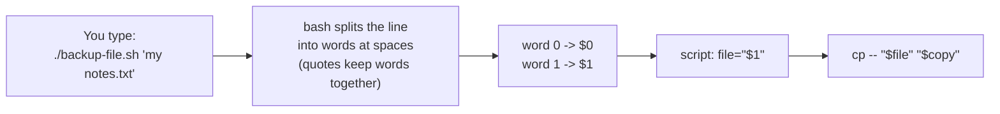

# 17 · Variables and arguments

**What you'll build:** scripts that remember things in variables, do maths, save a command's output, ask you questions, take extra words after their name (like `./backup-file.sh notes.txt`), plus your own `hello-name.sh`.
**Like you're 5:** a variable is a labelled lunch box. You put something in (`name="Sam"`), and later you open the box by saying its label with a `$` in front (`$name`). Arguments are the presents you hand to the script when you call it.
**Time:** ~60 min · **Builds on:** [16 · Your first script](../16-your-first-script) · **Needs:** nothing extra

## Why this matters
A script that always does exactly the same thing is only half useful. Real scripts take inputs: "deploy *this* version", "back up *that* folder", "download the model called *llama3*". Variables and arguments are how every installer, deploy script and data job you will meet gets its inputs. Quoting mistakes with variables are also the number one cause of scripts that break on file names with spaces.

## What you'll learn
- **Variable**: a named box: `name="Sam"` stores, `$name` reads.
- **Quoting**: double quotes `"..."` let `$` work; single quotes `'...'` keep everything literal; always quote your variables.
- **Command substitution** `$(...)` and **arithmetic** `$((...))`: put a command's output, or a sum, into a variable.
- **Arguments** `$1 $2 ... $# $@`: the words typed after a script's name, and how to count and loop over them safely.
- **Special variables** `$? $$ $! $0`: the exit code, this script's ID, the last background job's ID, the script's name.

## Before you start
- Finish lesson 16 (you can run scripts with `./`).
- Nothing to install. No API key needed.

## Run it
1. From the course folder (`linux-from-zero`), go into this lesson's folder:
   ```bash
   cd part-3-shell-scripting/17-variables-and-arguments
   ```
2. Run the variables tour and read it next to the file (`cat variables.sh` or open it in nano):
   ```bash
   ./variables.sh
   ```
3. Run the arguments demo with three arguments. Note the quotes around `big banana`:
   ```bash
   ./args.sh apple "big banana" cherry
   ```
   **Command, piece by piece**
   | Piece | Meaning |
   |---|---|
   | `./args.sh` | run the script in this folder; inside it this is `$0` |
   | `apple` | argument 1, becomes `$1` |
   | `"big banana"` | argument 2, becomes `$2`. The quotes glue two words into ONE argument |
   | `cherry` | argument 3, becomes `$3` |
   | (spaces) | separate the arguments from each other |
4. Run it again with no arguments and see the default value `World` kick in:
   ```bash
   ./args.sh
   ```
5. Meet the special variables:
   ```bash
   ./special-vars.sh
   ```
6. Create the practice files (two files with spaces in their names), then see why quotes matter:
   ```bash
   bash setup.sh
   ./quoting-demo.sh
   ```
7. Make a time-stamped backup of a file, then see what happens when you forget the argument:
   ```bash
   ./backup-file.sh ~/linux-practice/17/"my notes.txt"
   ls ~/linux-practice/17
   ./backup-file.sh
   ```
8. Let a script ask you questions (type a name and a whole number, pressing Enter after each):
   ```bash
   ./ask-name.sh
   ```
9. Write your own script:
   ```bash
   nano ~/linux-practice/17/hello-name.sh
   ```
   Type this, then save (**Ctrl + O**, **Enter**) and exit (**Ctrl + X**):
   ```bash
   #!/usr/bin/env bash
   # hello-name.sh - greets the first name you give it
   name="${1:-friend}"
   echo "Hello, $name!"
   echo "You gave me $# argument(s)."
   ```
10. Make it executable and try it three ways:
    ```bash
    chmod +x ~/linux-practice/17/hello-name.sh
    ~/linux-practice/17/hello-name.sh Priya
    ~/linux-practice/17/hello-name.sh
    ~/linux-practice/17/hello-name.sh "Mary Ann" Ravi
    ```
11. Check your work:
    ```bash
    ./check.sh
    ```

### What you should see
Step 2 (real output):
```
Hello, Sam!
You live in New Delhi.
Plural: Sams
Double quotes: Sam
Single quotes: $name
Today is 2026-10-22, you are learner, this computer has 4 CPU cores.
7 boxes of 6 apples = 42 apples
17 / 5 = 3 remainder 2
count is now 2
Your home folder is /home/learner and your shell is /bin/bash
PI_ISH is locked at 3
```
Look at the two quote lines: same variable, different quotes, different result.

Step 3:
```
Script name ($0):        ./args.sh
First argument ($1):     apple
Second argument ($2):    big banana
Third argument ($3):     cherry
Number of arguments ($#): 3
All arguments, one per line ("$@"):
  - apple
  - big banana
  - cherry
All arguments glued into one string ("$*"): apple big banana cherry
Hello, apple!
After shift, $1 is now: big banana  and $# is 2
```
Step 5 (your numbers will differ):
```
$$  = 223   <- the process ID (PID) of THIS script while it runs
$!  = 224   <- the PID of the last thing started in the background (that sleep)
$?  = 0      <- exit code of the last command: 0 means success
$?  = 2      <- not 0 means something went wrong (lesson 18 explains the numbers)
$0  = ./special-vars.sh  <- how this script was called
$RANDOM  = 358 <- a new random number (0-32767) every time you read it
$SECONDS = 0     <- seconds since this script started
$USER    = learner  $PWD = /home/learner/linux-from-zero/part-3-shell-scripting/17-variables-and-arguments
```
Step 6:
```
--- Without quotes: cat $file ---
cat: my: No such file or directory
cat: notes.txt: No such file or directory

--- With quotes: cat "$file" ---
Buy milk. Call grandma. Learn bash variables.
```
Step 7:
```
Backed up '/home/learner/linux-practice/17/my notes.txt' to '/home/learner/linux-practice/17/my notes.txt.bak-20261022-041231'
my notes.txt
my notes.txt.bak-20261022-041231
shopping list.txt
./backup-file.sh: line 7: 1: Usage: ./backup-file.sh FILE   (give me the file to back up)
```
Step 8:
```
What is your name? Sam
How old are you? 41
Nice to meet you, Sam. Next year you will be 42.
```
Step 11, when everything is right:
```
Checking lesson 17...
  PASS  a backup of 'my notes.txt' exists
  PASS  hello-name.sh exists and is executable
  PASS  hello-name.sh Priya  ->  Hello, Priya!
  PASS  hello-name.sh (no name)  ->  Hello, friend!
  PASS  hello-name.sh "Mary Ann"  ->  Hello, Mary Ann!
  PASS  hello-name.sh counts its arguments (You gave me 3 argument(s).)

Result: 6 passed, 0 failed.
All done. Variables and arguments: mastered!
```

## How it works
How a value travels from your keyboard into a script:


### 1. Variables (`variables.sh`)
- `name="Sam"` creates a variable. **No spaces around `=`.** `name = "Sam"` means "run the command `name` with arguments `=` and `Sam`", which fails with `name: command not found`.
- Names may use letters, digits and `_`, and must not start with a digit. By habit, your own variables are lowercase (`count`) and environment variables are UPPERCASE (`HOME`, `PATH`).
- `$name` reads the value. `${name}` is the same but shows exactly where the name ends: `"${name}s"` gives `Sams`, while `"$names"` looks for a variable called `names` (empty).
- `today=$(date +%F)` is **command substitution**: bash runs `date +%F` and puts what it prints into `today`.
- `total=$(( apples * boxes ))` is **arithmetic expansion**. Bash only does whole numbers: `17 / 5` is `3`. (For decimals, use `bc` or Python.)
- `readonly PI_ISH=3` locks a variable; trying `PI_ISH=4` later prints `PI_ISH: readonly variable`.

**Quotes, piece by piece**
| You write | Bash does | Example result |
|---|---|---|
| `"$name"` | double quotes: expand `$`, `$(...)`, `$((...))`; keep spaces | `Sam` |
| `'$name'` | single quotes: nothing is special, print as written | `$name` |
| `$name` (no quotes) | expand, then **split at spaces** and expand `*` wildcards | `my notes.txt` becomes two words |
| `\$` | backslash: "this next character is not special" | `$` |

Rule of thumb: **put double quotes around every `$variable` and every `$(...)`** unless you have a reason not to. `quoting-demo.sh` shows the bug: `cat $file` became `cat my notes.txt` = two files that do not exist.

### 2. Arguments (`args.sh`)
| Symbol | Meaning | In `./args.sh apple "big banana" cherry` |
|---|---|---|
| `$0` | how the script was called | `./args.sh` |
| `$1`, `$2`, ... `$9`, `${10}` | argument number 1, 2, ... (use braces from 10 up) | `apple`, `big banana` |
| `$#` | how many arguments | `3` |
| `"$@"` | all arguments, each kept separate (use this one) | `apple` / `big banana` / `cherry` |
| `"$*"` | all arguments glued into one string with spaces | `apple big banana cherry` |
| `shift` | drop `$1`, move the rest left by one | `$1` becomes `big banana` |

- `printf '  - %s\n' "$@"` prints one line per argument: `printf` reuses its pattern for each argument, `%s` is "the text goes here" and `\n` is a new line. With no arguments it prints the pattern once with nothing in it, which is why you saw a lone `  - ` in step 4.
- `who="${1:-World}"`: **default value**. `:-` means "if `$1` is empty or missing, use `World`".

### 3. Special variables (`special-vars.sh`)
| Variable | Meaning | Typical use |
|---|---|---|
| `$?` | exit code of the last command: `0` = success, anything else = failure | `if` decisions (lesson 18) |
| `$$` | the process ID (PID) of the running script | unique temp file names, logs |
| `$!` | the PID of the last command started in the background with `&` | `kill "$!"`, `wait "$!"` |
| `$0` | the script's name as called | usage messages |
| `$RANDOM` | a random number 0 to 32767 | simple random picks |
| `$SECONDS` | seconds since the script started | timing |
| `$HOME`, `$USER`, `$PWD` | home folder, user name, current folder (environment variables) | paths |

`sleep 30 &` starts `sleep` in the background (the `&`), so the script carries on at once; `kill "$!"` stops it. `ls /no/such/folder 2> /dev/null` sends the error message (`2>` = errors) into `/dev/null`, a "black hole" file that throws away whatever you write to it.

### 4. A real tool (`backup-file.sh`)
| Piece | Meaning |
|---|---|
| `file="${1:?Usage: ...}"` | `:?` = "if `$1` is missing, print this message and stop the script with an error" |
| `stamp=$(date +%Y%m%d-%H%M%S)` | `%Y` year, `%m` month, `%d` day, `%H` hour, `%M` minute, `%S` second |
| `copy="$file.bak-$stamp"` | glue text and variables together into the new name |
| `cp -- "$file" "$copy"` | copy; `--` means "no options after this point", so a file named `-r` is treated as a file |

### 5. Asking questions (`ask-name.sh`)
| Piece | Meaning |
|---|---|
| `read` | wait for a line of typing, store it in a variable |
| `-r` | raw: do not treat `\` as special (always add it) |
| `-p "What is your name? "` | show this prompt first |
| `name` | the variable to store the answer in |

## If something goes wrong
- **`name: command not found`** on a line like `name = "Sam"` → remove the spaces around `=`: `name="Sam"`.
- **`cat: my: No such file or directory`** → a variable holding a name with spaces was used without quotes. Write `"$file"`.
- **A variable prints as empty** → check the spelling (bash names are case-sensitive: `$Name` is not `$name`), and check you used double, not single, quotes. For a variable followed by letters, use `${name}`.
- **`syntax error: invalid arithmetic operator (error token is ".5")`** in `$(( ))` → the value is not a whole number (`4.5`). Bash maths is whole numbers only. Watch out: an empty value or a word does not give an error, it silently counts as `0`, so `ask-name.sh` with age `ten` says you will be `1`. A cousin: **`08: value too great for base`** means a number starting with `0` was read as octal (base 8); write `$((10#08))` to force base 10.
- **`$1` is empty inside your script** → you ran it without arguments, or with `bash script.sh` and forgot to add them after the name: `bash script.sh Priya`.

## Try this
1. Change `variables.sh` so `city` holds your own city, and add a line that prints how many characters your name has. (Hint: `${#name}` gives the length of `$name`.)
2. Write `~/linux-practice/17/area.sh` that takes a width and a height as arguments and prints the area, with defaults of 1. `./area.sh 4 5` should print `Area: 20`.
3. Write `~/linux-practice/17/count-lines.sh FILE` that prints `FILE has N lines`, stops with a usage message if no file is given, and works on `"shopping list.txt"`. (Hint: `wc -l < "$file"` prints only the number.)

<details><summary>Solutions</summary>

1. Add `echo "Your name has ${#name} letters."` (for `Sam` it prints 3).
2.
   ```bash
   #!/usr/bin/env bash
   # area.sh WIDTH HEIGHT - prints the area of a rectangle
   width="${1:-1}"
   height="${2:-1}"
   echo "Area: $(( width * height ))"
   ```
3.
   ```bash
   #!/usr/bin/env bash
   # count-lines.sh FILE - prints how many lines a file has
   file="${1:?Usage: count-lines.sh FILE}"
   lines=$(wc -l < "$file")
   echo "$file has $lines lines"
   ```
   `~/linux-practice/17/count-lines.sh ~/linux-practice/17/"shopping list.txt"` prints `... shopping list.txt has 3 lines`. `wc -l < "$file"` feeds the file in through `<` (lesson 08), so `wc` prints only the number, without the name.
</details>

## Check yourself
1. What is the difference between `echo "$name"` and `echo '$name'`?
2. A user runs `./deploy.sh "my app" prod`. What are `$1`, `$2` and `$#`?
3. Why is `for f in "$@"` safer than `for f in $*` when arguments contain spaces?
4. What does `out=$(ls /etc | wc -l)` store in `out`?

<details><summary>Answers</summary>

1. Double quotes expand the variable and print its value (`Sam`); single quotes print the characters `$name` literally.
2. `$1` is `my app` (one argument, thanks to the quotes), `$2` is `prod`, and `$#` is `2`.
3. `"$@"` keeps each argument as its own word, so `my app` stays together. Unquoted `$*` glues everything and splits again at every space, so `my app` becomes `my` and `app`.
4. The number of entries in `/etc`: `$(...)` runs the pipeline and stores its output.
</details>

## Learn more (optional)
**Read the official docs**
- Bash manual, Shell Parameters (variables, `$1`, `$@`, special parameters): https://www.gnu.org/software/bash/manual/html_node/Shell-Parameters.html
- Bash manual, Quoting: https://www.gnu.org/software/bash/manual/html_node/Quoting.html
- Bash manual, Shell Expansions (`$(...)`, `$((...))`, `${var:-default}`): https://www.gnu.org/software/bash/manual/html_node/Shell-Expansions.html

**Watch**
- freeCodeCamp, Bash scripting for beginners: https://www.youtube.com/results?search_query=freecodecamp+bash+scripting+tutorial+for+beginners
- NetworkChuck, Bash variables and arguments: https://www.youtube.com/results?search_query=networkchuck+bash+scripting+variables+arguments

## Next
→ [18 · Decisions and exit codes](../18-decisions-and-exit-codes)
