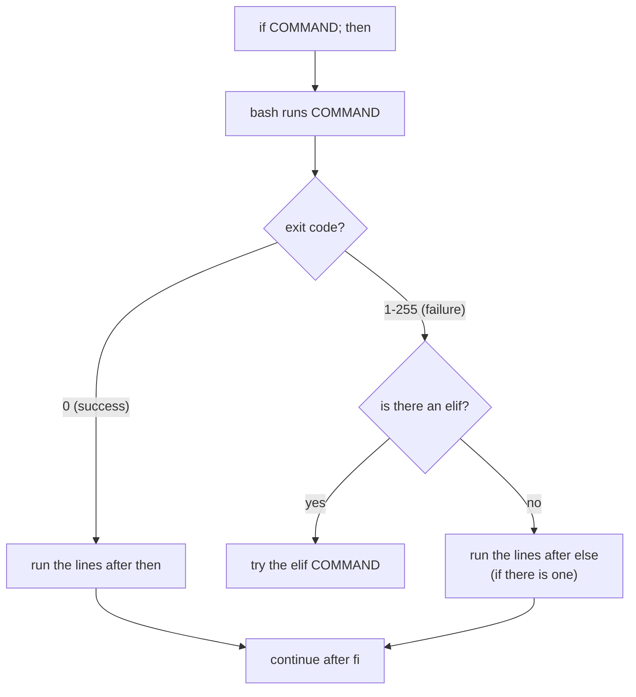

# 18 · Decisions and exit codes

**What you'll build:** scripts that make choices: one that inspects any path, one that compares numbers and text, a real disk-space alarm that answers OK / WARNING / CRITICAL with the right exit code, and a quiz that tests whether you can predict exit codes.
**Like you're 5:** every command comes back from its job and holds up a card. Card `0` means "I did it!". Any other number means "I had a problem", and the number says which problem. `if` is you reading the card and choosing what to do next.
**Time:** ~60 min · **Builds on:** [17 · Variables and arguments](../17-variables-and-arguments) · **Needs:** nothing extra

## Why this matters
Servers are run by scripts that check things and react: "if the disk is over 90 % full, send an alert", "if the model file is missing, download it", "if the health check fails, restart the API". Exit codes are also how every automation tool (cron, systemd, GitHub Actions, Docker, Kubernetes) decides whether a step worked. A CI pipeline turns red because a command returned a non-zero exit code.

## What you'll learn
- **Exit code**: the number (0 to 255) every command returns; `0` means success, `$?` shows the last one.
- **`if` / `elif` / `else` / `fi`**: run different commands depending on whether a test succeeded.
- **Tests `[[ ... ]]`**: ask questions about files (`-f`, `-d`, `-x`), text (`==`, `-z`) and numbers (`-lt`, `-ge`).
- **`&&` and `||`**: "and then" and "or else" on one line.
- **`exit N`**: make your own script return a meaningful code so other tools can react.

## Before you start
- Finish lesson 17 (you know `$1`, `$#` and `$?`).
- Nothing to install. No API key needed.

## Run it
1. From the course folder (`linux-from-zero`), go into this lesson's folder:
   ```bash
   cd part-3-shell-scripting/18-decisions-and-exit-codes
   ```
2. See the exit codes of many common commands:
   ```bash
   ./exit-codes.sh
   ```
3. Look at `$?` yourself, right after a command:
   ```bash
   ls /etc/hostname
   echo $?
   ls /nope
   echo $?
   ```
   `$?` changes after every command, even after `echo`. Read it immediately, or save it: `code=$?`.
4. Inspect different kinds of paths, and print the script's exit code after each:
   ```bash
   ./check-file.sh /etc ; echo "exit code: $?"
   ./check-file.sh /etc/hostname ; echo "exit code: $?"
   ./check-file.sh /nope ; echo "exit code: $?"
   ./check-file.sh ; echo "exit code: $?"
   ```
   **Command, piece by piece**
   | Piece | Meaning |
   |---|---|
   | `./check-file.sh /etc` | run the script with one argument, `/etc` |
   | `;` | "then, whatever happened, run the next command" |
   | `echo "exit code: $?"` | print the exit code of `check-file.sh` |
5. Compare numbers, text and an email pattern:
   ```bash
   ./compare.sh 7 12 sam@example.com
   ./compare.sh 12 12 "not an email"
   ```
6. Run the disk alarm with the default limits (80 % / 90 %), then with your own:
   ```bash
   ./disk-alert.sh ; echo "exit code: $?"
   ./disk-alert.sh 50 60 ; echo "exit code: $?"
   ./disk-alert.sh ten ; echo "exit code: $?"
   ```
7. See `&&`, `||` and `!` in action:
   ```bash
   ./and-or.sh
   ```
8. Take the quiz. For each command, type the exit code you expect and press Enter:
   ```bash
   ./check.sh
   ```

### What you should see
Step 2 (real output):
```
true                     -> 0
false                    -> 1
ls /etc/hostname         -> 0
ls /no/such/file         -> 2
grep root /etc/passwd    -> 0   (found)
grep zebra /etc/passwd   -> 1   (not found)
grep root /no/such/file  -> 2   (error)
no-such-command          -> 127  (command not found)
/etc/hostname            -> 126  (found, but not executable)
sleep killed by kill     -> 143  (128 + signal 15)
( exit 42 )              -> 42   (you choose the number with exit)
```
Step 4:
```
'/etc' is a folder with 130 items.
exit code: 0
'/etc/hostname' is a file.
  It is 9 bytes.
  You can read it.
  You can NOT change it.
  You can NOT run it.
exit code: 0
'/nope' does not exist.
exit code: 1
Usage: ./check-file.sh PATH
exit code: 2
```
Step 5:
```
7 is smaller than 12
7 is odd
As text, '7' and '12' are different
'sam@example.com' looks like an email address
12 and 12 are equal
12 is even
As text, '12' and '12' are the same
12 starts with the digit 1
'not an email' does NOT look like an email address
```
Step 6 (on our test machine the disk was 86 % full; your numbers will differ):
```
WARNING - / is 86% full (limit 80%)
exit code: 1
CRITICAL - / is 86% full (limit 60%)
exit code: 2
UNKNOWN - limits must be whole numbers, got 'ten' and '90'
exit code: 3
```
Step 7:
```
1. Folder is ready, so this line runs.
2. ls failed, so the 'or else' part runs.
3. Now working in: /home/learner/linux-practice/18
4. The root user exists.
5. No zebra in /etc/passwd (! turned 'not found' into success).
6. grep failed but 'grep | sort' gives 0 because sort (the last command) worked. Lesson 20 fixes this.
```
Step 8 ends with:
```
Score: 8 / 8
PASS - you can read exit codes like a pro.
```

## How it works
How `if` decides:

**The big secret:** `if` does not look at "true" or "false". It runs a command and looks at its **exit code**. `[[ -f file ]]` is simply a command that exits with `0` when the test is true and `1` when it is false. So `if grep -q root /etc/passwd; then` works too: no brackets needed.

### 1. Exit codes (`exit-codes.sh`)
| Code | Meaning | Example from step 2 |
|---|---|---|
| `0` | success | `true`, `ls /etc/hostname` |
| `1` | general failure / "no" | `false`; `grep` found nothing |
| `2` | misuse or serious trouble (each tool defines it) | `ls` of a missing file; `grep` could not read the file |
| `126` | found, but cannot be executed (no `x` permission) | running `/etc/hostname` |
| `127` | command not found | `no-such-command`; a typo |
| `128 + N` | killed by signal number N | `143` = 128 + 15 (TERM, from `kill`) |
| `130` | 128 + 2: stopped with **Ctrl + C** (signal INT) | press Ctrl + C during `sleep 100` |
| `137` | 128 + 9: killed with `kill -9`, often by the system when memory runs out | lesson 27 |
| `255` | exit code out of range, or `ssh` could not connect | `exit -1` gives 255 |

Codes only go from 0 to 255: `exit 256` wraps round to `0`. `wait "$!"` waits for a background job and returns its exit code. `( exit 42 )` runs `exit 42` inside parentheses, which start a mini copy of bash (a **subshell**), so only that copy ends.

### 2. `if` / `elif` / `else` (`check-file.sh`)
**`if`, piece by piece**
| Piece | Meaning |
|---|---|
| `if` | start a decision |
| `[[ ! -e "$target" ]]` | the test command: "does `$target` NOT exist?" |
| `;` | end of the test command (or put `then` on the next line instead) |
| `then` | the commands to run when the test succeeded (exit code 0) |
| `elif [[ -d "$target" ]]; then` | "otherwise, if it is a folder, then..." (as many as you like) |
| `else` | "in every other case..." (optional) |
| `fi` | end of the decision (`if` backwards) |

`echo "Usage: $0 PATH" >&2` sends the message to the **error stream** (stderr, stream 2) instead of normal output (stdout, stream 1). That keeps error messages out of files when someone writes `./check-file.sh > report.txt`. `exit 2` stops the script at once with code 2. `stat -c %s` prints a file's size in bytes (on a Mac it is `stat -f %z`).

### 3. The `[[ ]]` tests table
Always leave a **space after `[[` and before `]]`**: they are words, not decoration.

| Test | True when... | Example |
|---|---|---|
| `-e PATH` | the path exists (anything) | `[[ -e /etc ]]` |
| `-f PATH` | it is a regular file | `[[ -f notes.txt ]]` |
| `-d PATH` | it is a directory (folder) | `[[ -d ~/bin ]]` |
| `-s PATH` | it is a file bigger than 0 bytes | `[[ -s log.txt ]]` |
| `-r` / `-w` / `-x PATH` | you may read / write / execute it | `[[ -x deploy.sh ]]` |
| `-L PATH` | it is a symbolic link | `[[ -L /bin ]]` |
| `A -nt B` | file A is newer than file B | `[[ app.py -nt app.pyc ]]` |
| `-z "$s"` | the text is empty (zero length) | `[[ -z "$1" ]]` |
| `-n "$s"` | the text is not empty | `[[ -n "$API_KEY" ]]` |
| `"$a" == "$b"` | the texts are the same | `[[ "$answer" == "yes" ]]` |
| `"$a" != "$b"` | the texts differ | `[[ "$env" != "prod" ]]` |
| `"$a" == pat*` | the text matches a wildcard pattern (pattern unquoted) | `[[ "$file" == *.txt ]]` |
| `"$a" =~ regex` | the text matches a regular expression | `[[ "$v" =~ ^[0-9]+$ ]]` |
| `A -eq B`, `-ne` | numbers equal, not equal | `[[ $# -eq 0 ]]` |
| `A -lt B`, `-le` | less than, less or equal | `[[ "$a" -lt "$b" ]]` |
| `A -gt B`, `-ge` | greater than, greater or equal | `[[ "$used" -ge 90 ]]` |
| `! TEST` | NOT: flips the answer | `[[ ! -d "$dir" ]]` |
| `T1 && T2`, `T1 \|\| T2` | AND, OR inside the brackets | `[[ -f a && -r a ]]` |

**Three kinds of brackets:**
| Form | What it is | Use it for |
|---|---|---|
| `[[ ... ]]` | bash's modern test command | files and text (use this by default) |
| `[ ... ]` | the old POSIX `test` command; needs more quoting | scripts for plain `sh` (`#!/bin/sh`) |
| `(( ... ))` | maths test: `<`, `>`, `==`, `>=` work like in school | numbers: `(( used >= crit ))` |

Careful: inside `[[ ]]`, `<` and `>` compare text alphabetically (`"10" < "9"` is true!). For numbers, use `-lt`/`-gt` or `(( ))`.

### 4. A real monitor (`disk-alert.sh`)
1. `warn="${1:-80}"` sets defaults (lesson 17).
2. `if ! [[ "$warn" =~ ^[0-9]+$ && ... ]]` rejects anything that is not digits: `^` = start, `[0-9]+` = one or more digits, `$` = end.
3. `df --output=pcent "$folder" | tail -n 1 | tr -d ' %'` turns `Use%` / ` 86%` into `86`. `tr -d` = "translate: delete these characters".
4. The `if / elif` chain checks the worst case first (critical), then warning, then OK, and `exit`s with 2, 1 or 0. Monitoring tools like Nagios and Icinga read exactly these codes, so this little script could plug straight into them.

### 5. `&&`, `||` and `!` (`and-or.sh`)
| Form | Reads as | Runs B when... |
|---|---|---|
| `A && B` | "A, and if that worked, B" | A exited 0 |
| `A \|\| B` | "A, or else B" | A exited non-zero |
| `A ; B` | "A, then B" | always |
| `! A` | "the opposite of A" | flips 0 to 1 and non-zero to 0 |
| `cd dir \|\| exit 1` | "go there or stop" | the safety pattern for every script |

`A && B || C` looks like if/then/else, but if `B` fails, `C` runs too. Use it only when `B` is a simple `echo`. Finally, a **pipeline**'s exit code is the exit code of its **last** command: `grep zebra /etc/passwd | sort` "succeeds" because `sort` did. Lesson 20's `set -o pipefail` fixes that.

### 6. The quiz (`check.sh`)
It stores the questions in a list (an **array**, `questions=( ... )`), loops over them (lesson 19), runs each with `bash -c "$cmd"` (run text as a command), saves `real=$?` immediately, and compares it with your guess.

## If something goes wrong
- **`[[: command not found`** or **`syntax error near unexpected token`** → your script is being run by `sh`, not bash (you typed `sh script.sh` or the shebang is `#!/bin/sh`). Use `bash script.sh` or `#!/usr/bin/env bash`.
- **`[[-f: command not found`** or **`unexpected token ']]'`** → missing spaces: write `[[ -f "$x" ]]`, with a space after `[[` and before `]]`.
- **`integer expression expected`** → you used `-lt`/`-gt` on something that is not a whole number (an empty variable, `4.5`, a word). Check the input first, as `disk-alert.sh` does.
- **Your `if` always takes the same branch** → you echoed something before reading `$?`, so `$?` now belongs to `echo`. Save it straight after the command: `cmd; code=$?`.
- **`then` errors like `syntax error near unexpected token 'then'`** → you forgot the `;` before `then` on the same line, or wrote `fi` as `end`. The shape is `if TEST; then ... fi`.

## Try this
1. Run `sleep 100`, press **Ctrl + C**, then `echo $?`. Explain the number with the table.
2. Add an `-L` check to `check-file.sh` so that `./check-file.sh /bin` says it is a symbolic link (on Ubuntu `/bin` points to `/usr/bin`). Put it as the first `elif`, because `-d` would also be true for a link to a folder.
3. Write `~/linux-practice/18/need-file.sh FILE` that exits `0` and prints `ready` if FILE exists and is not empty; prints `empty` and exits `1` if it exists but is empty; and prints `missing` and exits `2` if it does not exist. Test all three cases with `touch`, `echo hi >` and a missing name.

<details><summary>Solutions</summary>

1. `130` = 128 + 2. Ctrl + C sends signal number 2 (INT, "interrupt").
2. Add before `elif [[ -d "$target" ]]`:
   ```bash
   elif [[ -L "$target" ]]; then              # -L = symbolic link
     echo "'$target' is a symbolic link to $(readlink "$target")."
   ```
   `readlink` prints where a link points (`usr/bin`).
3.
   ```bash
   #!/usr/bin/env bash
   # need-file.sh FILE - 0 = ready, 1 = empty, 2 = missing
   file="${1:?Usage: need-file.sh FILE}"
   if [[ -s "$file" ]]; then
     echo "ready"; exit 0
   elif [[ -e "$file" ]]; then
     echo "empty"; exit 1
   else
     echo "missing"; exit 2
   fi
   ```
   Test: `cd ~/linux-practice/18 && touch e.txt && echo hi > f.txt`, then run it on `f.txt`, `e.txt` and `nope.txt`, each followed by `; echo $?`.
</details>

## Check yourself
1. What does `if` actually check: the words true/false, or something else?
2. `grep -q error app.log` returns `1`. Did `grep` break?
3. Why should a script print usage errors with `>&2` and `exit` with a non-zero code?
4. What is wrong with `if [[ $count > 9 ]]` when `count=10`?

<details><summary>Answers</summary>

1. The exit code of the command after `if`: `0` runs the `then` part, anything else does not.
2. No. For `grep`, `1` means "searched fine, found no match". `2` would mean a real error (like an unreadable file).
3. So other programs (cron, CI, other scripts) can tell it failed by the exit code, and so the error does not get mixed into normal output that may be saved or piped.
4. Inside `[[ ]]`, `>` compares text alphabetically, and `"10"` sorts before `"9"`, so it is false. Use `[[ $count -gt 9 ]]` or `(( count > 9 ))`.
</details>

## Learn more (optional)
**Read the official docs**
- Bash manual, Conditional Constructs (`if`, `case`, `[[ ]]`): https://www.gnu.org/software/bash/manual/html_node/Conditional-Constructs.html
- Bash manual, Bash Conditional Expressions (the full tests list): https://www.gnu.org/software/bash/manual/html_node/Bash-Conditional-Expressions.html
- Bash manual, Exit Status: https://www.gnu.org/software/bash/manual/html_node/Exit-Status.html
- `test` man page: https://man7.org/linux/man-pages/man1/test.1.html

**Watch**
- freeCodeCamp, Bash scripting course (if statements section): https://www.youtube.com/results?search_query=freecodecamp+bash+scripting+if+statements
- Exit codes explained: https://www.youtube.com/results?search_query=linux+exit+codes+explained+bash

## Next
→ [19 · Loops and functions](../19-loops-and-functions)
