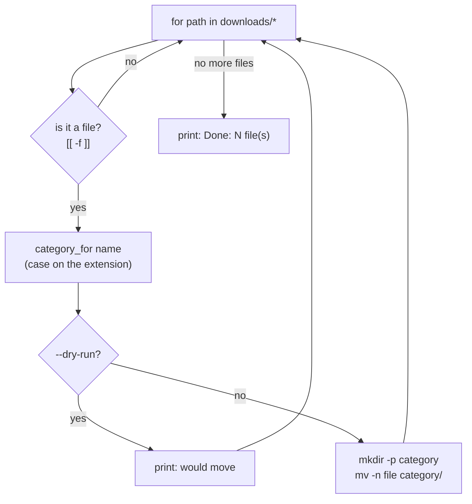

# 19 · Loops and functions

**What you'll build:** a tour of every kind of loop, a set of example functions, an interactive menu, and a real tool, `organize.sh`, that tidies a messy downloads folder by moving every file into `images/`, `documents/`, `models/` and friends.
**Like you're 5:** a loop is a washing machine: you put in a pile of socks and it does the same thing to each one until the pile is empty. A function is a Lego piece you build once, give a name, and snap in wherever you need it.
**Time:** ~75 min · **Builds on:** [18 · Decisions and exit codes](../18-decisions-and-exit-codes) · **Needs:** nothing extra

## Why this matters
Computers are great at doing the same thing 10,000 times without getting bored. Loops are how you resize every image in a dataset, check every server in a list, or retry a download until it works. Functions keep long scripts readable: deploy scripts for AI services are mostly a list of well-named functions like `install_python`, `download_model`, `start_server`.

## What you'll learn
- **`for` loop**: do something for each word, file or number in a list.
- **`while` / `until` loop**: repeat while (or until) a test succeeds, including reading a file line by line.
- **`case`**: pick one of many choices by matching patterns, neater than a long `if / elif` chain.
- **Function**: a named block of commands with its own arguments (`$1`, `$#`) and `local` variables.
- **Return values**: `echo` + `$(...)` to hand back data, `return 0/1` to hand back success or failure.

## Before you start
- Finish lesson 18 (`if`, `[[ ]]`, exit codes).
- Bash 4 or newer (Ubuntu has bash 5; check with `bash --version`). macOS ships bash 3.2, where `${1,,}` in `organize.sh` does not work: install a newer one with `brew install bash` or use Ubuntu/WSL/Docker.
- No API key needed.

## Run it
1. From the course folder (`linux-from-zero`), go into this lesson's folder:
   ```bash
   cd part-3-shell-scripting/19-loops-and-functions
   ```
2. Create the messy practice folder (14 files of different types) and a server list:
   ```bash
   bash setup.sh
   ```
3. Tour the loops:
   ```bash
   ./loops.sh
   ```
4. Tour the functions:
   ```bash
   ./functions.sh
   ```
5. Play with the menu. Type `1`, Enter, then `banana`, Enter, then `q`, Enter:
   ```bash
   ./menu.sh
   ```
6. Ask the organizer what it *would* do, without changing anything:
   ```bash
   ./organize.sh --dry-run
   ```
7. Happy with the plan? Do it for real, then look at the result:
   ```bash
   ./organize.sh
   ls -R ~/linux-practice/19/downloads
   ```
   `ls -R` = list **R**ecursively: every folder and everything inside it.
8. Check your work:
   ```bash
   ./check.sh
   ```
9. Want to do it again? `bash setup.sh` makes the folder messy again.

### What you should see
Step 3 (real output):
```
== 1. for: go through a list of words ==
I like apple
I like banana
I like cherry

== 2. for: go through files that match a pattern ==
Found a text file: notes.txt

== 3. for: count with numbers ==
1 2 3 4 5 
10 7 4 1 

== 4. while: repeat as long as a test succeeds ==
Lap 1
Lap 2
Lap 3

== 5. while read: go through a file line by line ==
Would check server: web-1.example.com
Would check server: web-2.example.com
Would check server: db-1.example.com

== 6. until: repeat until a test succeeds (the opposite of while) ==
Try number 1
Try number 2
Try number 3

== 7. break and continue ==
1 3 5 7 
```
Step 4:
```
Hello from a function!
Hello from a function!
Hi, Priya!
Hi, Ravi!
Hi, Ravi!
Inside paint(): colour is red
Outside, colour is still blue (local kept it safe)
7 squared is 49
3 is odd
4 is even
[08:56:54] Starting the job
[08:56:54] Job finished
```
Step 5 (part):
```
What would you like to see?
  1) date and time
  2) disk space
  3) who am I
  q) quit
Your choice: banana
Sorry, 'banana' is not on the menu.
...
Your choice: q
Bye!
```
Step 6 (`--dry-run`, nothing is moved):
```
Organizing: /home/learner/linux-practice/19/downloads  (dry run: yes)
  would move  README.md  ->  documents/
  would move  backup.zip  ->  archives/
  would move  cat.gif  ->  images/
  ...
  would move  tinyllama.Q4_K_M.gguf  ->  models/
  would move  train.py  ->  code/
Done: 14 file(s) handled.
```
Step 7 (part of `ls -R`):
```
/home/learner/linux-practice/19/downloads:
archives
audio
code
data
documents
images
models
other

/home/learner/linux-practice/19/downloads/images:
cat.gif
holiday photo.png
photo1.JPG
```
Step 8:
```
Checking lesson 19...
  PASS  no loose files left in downloads/
  PASS  all 14 files are in the right folders

Result: 2 passed, 0 failed.
All done. Your loops and functions work!
```

## How it works
How `organize.sh` thinks, for each file:


### 1. Loops (`loops.sh`)
**`for`, piece by piece**
| Piece | Meaning |
|---|---|
| `for` | start a loop |
| `fruit` | the loop variable: each round it holds the next item (no `$` here) |
| `in apple banana cherry` | the list of items |
| `; do` | "here comes the body" |
| `echo "I like $fruit"` | the body: runs once per item |
| `done` | end of the loop |

The kinds of lists you can loop over:
| List | Gives | Example |
|---|---|---|
| words | each word | `for f in a b c` |
| `*.txt` | each matching file name (a **glob**) | `for file in ~/data/*.csv` |
| `{1..5}` | 1 2 3 4 5 (**brace expansion**) | `for i in {1..100}` |
| `"$@"` | each argument of the script | `for arg in "$@"` |
| `$(command)` | each word the command prints | `for u in $(cut -d: -f1 /etc/passwd)` |
| `(( i = 0; i < 5; i++ ))` | C-style counting: start; keep going while; change | `for (( i = 10; i > 0; i -= 3 ))` |

If a glob like `*.txt` matches nothing, bash leaves the text `*.txt` as it is, so `loops.sh` checks `[[ -e "$file" ]] || continue` to skip that case.

**`while read`, piece by piece** (the standard way to go through a file line by line)
| Piece | Meaning |
|---|---|
| `while` | repeat while the next command succeeds |
| `IFS=` | do not trim spaces from the start and end of each line (IFS = "internal field separator") |
| `read -r server` | read one line into `$server`; `read` fails at the end of the file, which stops the loop |
| `do ... done` | the body, run once per line |
| `< ~/linux-practice/19/servers.txt` | feed the file into the whole loop |

`until (( tries == 3 ))` is the mirror image of `while`: it repeats as long as the test **fails**. `continue` skips to the next round; `break` leaves the loop. In step 7 of `loops.sh`, even numbers are skipped and the loop stops after 7, so you see `1 3 5 7`.

### 2. Functions (`functions.sh`)
**A function, piece by piece**
| Piece | Meaning |
|---|---|
| `greet()` | the function's name; `()` says "this is a function" (always empty) |
| `{` ... `}` | the commands inside the function |
| `local name="${1:-stranger}"` | `$1` here is the **function's** first argument; `local` keeps `name` inside the function |
| `greet "Ravi" 2` | calling it: name first, then its arguments, just like a command |

- A function must be defined **above** the line that calls it, because bash reads top to bottom.
- Without `local`, a variable set inside a function changes the one outside too. `paint()` shows `local` keeping `colour="blue"` safe.
- Two ways to give something back:

  | Want to give back... | Inside the function | Outside |
  |---|---|---|
  | data (a number, a name) | `echo "$answer"` | `result=$(square 7)` |
  | yes/no (success/failure) | `return 0` or `return 1` | `if is_even "$n"; then` |

  `return` only takes 0 to 255 and is meant for success/failure, not for data.
- `log()` uses `$*` to join all its arguments into one message, adding a time stamp. You will reuse this in lesson 20.

### 3. `case` (`menu.sh` and `organize.sh`)
**`case`, piece by piece**
| Piece | Meaning |
|---|---|
| `case "$choice" in` | compare `$choice` with the patterns below |
| `1\|date)` | a pattern; `\|` means "or"; `)` ends the pattern |
| `*.jpg\|*.png)` | patterns can use wildcards: `*` = anything |
| `;;` | end of this choice; nothing else is checked after a match |
| `*)` | catch-all: matches anything, so put it last |
| `esac` | end of the case ("case" backwards, like `fi`) |

`while true; do ... done` loops forever; the `q` choice uses `break` to escape.

### 4. The organizer (`organize.sh`)
1. `for arg in "$@"; do case "$arg" in --dry-run) ... *) ...` reads the options in any order.
2. `category_for()` lowercases the name with `${1,,}` (so `photo1.JPG` counts as `.jpg`) and `case` turns the extension into a folder name. It `echo`es the answer and the main loop catches it with `$(category_for ...)`.
3. `move_file()` either prints `would move` (dry run) or runs `mkdir -p` and `mv -n -- "$path" "$target/"`. `-n` = "no clobber": never overwrite an existing file. `--` = "no more options", so a file called `-rf` is safe.
4. The main loop `for path in "$folder"/*` visits every item, skips folders with `[[ -f "$path" ]] || continue`, and counts files with `moved=$(( moved + 1 ))`.

Always offer a `--dry-run` in scripts that move or delete things. It is the "measure twice, cut once" of scripting.

## If something goes wrong
- **`syntax error near unexpected token 'done'`** → a missing `do` (write `for x in list; do`) or a missing `;;` in a `case`.
- **The loop never stops** → in a `while`, nothing changes the thing being tested. Make sure the counter goes up (`count=$(( count + 1 ))`). Press **Ctrl + C** to stop it.
- **`bad substitution`** on `${1,,}` → you are running an old bash (macOS 3.2) or `sh`. Run it with bash 4+ (`bash --version`).
- **A loop over files breaks names like `holiday photo.png` into two** → you used `for f in $(ls)`. Use a glob: `for f in folder/*` and always quote `"$f"`.
- **`command not found` when calling a function** → the call comes before the definition in the file. Move the function above the place you use it.

## Try this
1. In `loops.sh`, add a loop that prints the 7 times table from `7 x 1 = 7` to `7 x 10 = 70`.
2. Add a `4) top 5 biggest files in /etc` choice to `menu.sh`. (Hint: `ls -S /etc | head -n 5`; `-S` sorts by size.)
3. Write a function `retry` that runs a command up to 3 times, waiting 1 second between tries, and returns 0 as soon as it works or 1 after 3 failures. Test it with `retry ls /etc/hostname` and `retry ls /nope`.

<details><summary>Solutions</summary>

1.
   ```bash
   for i in {1..10}; do
     echo "7 x $i = $(( 7 * i ))"
   done
   ```
2. Add `echo "  4) top 5 biggest files in /etc"` to the list, and this choice above `q|Q|...`:
   ```bash
       4)
         ls -S /etc | head -n 5
         ;;
   ```
3.
   ```bash
   retry() {
     local attempt
     for attempt in 1 2 3; do
       if "$@"; then                 # "$@" = run all the function's arguments as a command
         return 0
       fi
       echo "Attempt $attempt failed, waiting 1 second..." >&2
       sleep 1
     done
     return 1
   }
   retry ls /etc/hostname && echo "worked"
   retry ls /nope || echo "gave up after 3 tries"
   ```
   This exact pattern (with longer waits) is used to wait for a model server or a database to start.
</details>

## Check yourself
1. What is the difference between `while` and `until`?
2. Why is `for f in *.txt` safer than `for f in $(ls *.txt)`?
3. A function needs to give back a file name. Should it use `return` or `echo`? Why?
4. In a `case`, what happens if two patterns could match the same value?

<details><summary>Answers</summary>

1. `while` repeats as long as its test succeeds; `until` repeats as long as its test fails (it stops when the test succeeds).
2. The glob gives each file name as one item, even with spaces. `$(ls ...)` produces text that bash splits at every space, so `holiday photo.txt` becomes two broken items.
3. `echo` it and catch it with `$(...)`. `return` only sets an exit code (a number 0 to 255) meant for success or failure.
4. Only the first matching pattern (from the top) runs, because `;;` ends the `case`.
</details>

## Learn more (optional)
**Read the official docs**
- Bash manual, Looping Constructs (`for`, `while`, `until`): https://www.gnu.org/software/bash/manual/html_node/Looping-Constructs.html
- Bash manual, Conditional Constructs (`case`): https://www.gnu.org/software/bash/manual/html_node/Conditional-Constructs.html
- Bash manual, Shell Functions: https://www.gnu.org/software/bash/manual/html_node/Shell-Functions.html
- BashFAQ 001, "How can I read a file line by line?": https://mywiki.wooledge.org/BashFAQ/001

**Watch**
- freeCodeCamp, Bash scripting (loops and functions): https://www.youtube.com/results?search_query=freecodecamp+bash+scripting+loops+functions
- NetworkChuck, Bash loops: https://www.youtube.com/results?search_query=networkchuck+bash+for+loop

## Next
→ [20 · Robust scripts](../20-robust-scripts)
