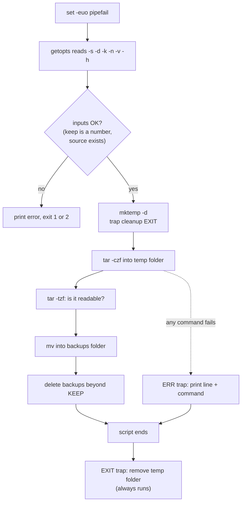

# 20 · Robust scripts

**What you'll build:** a side-by-side demo of a fragile script and a strict one, a here-document demo, and `backup.sh`: a professional-quality backup tool with options (`-s -d -k -n -v -h`), help text, automatic clean-up, error reporting with line numbers, and rotation of old backups. It doubles as a template for every serious script you will write.
**Like you're 5:** a fragile script is a toddler who keeps walking after tripping, straight into the road. A robust script is a careful grown-up: it stops at the first problem, says exactly what went wrong, and tidies its toys away even when the game ends early.
**Time:** ~90 min · **Builds on:** [19 · Loops and functions](../19-loops-and-functions) · **Needs:** nothing extra (`tar`, `gzip`, `mktemp` come with Ubuntu)

## Why this matters
Scripts that run on servers run while you sleep. A script that ignores one failed `cd` can delete the wrong folder; a typo in a variable name has wiped real servers (`rm -rf "$DIRR/"*` becomes `rm -rf /*`). Every deploy, backup and model-download script in production starts with the same few safety lines you learn here, and has a `-h` that tells the next person how to use it.

## What you'll learn
- **Strict mode** `set -euo pipefail`: stop on the first failed command, on an unset variable, and on a failure hidden inside a pipeline.
- **`trap`**: run clean-up code automatically when the script ends (`EXIT`), fails (`ERR`) or is interrupted (`INT`, `TERM`).
- **`getopts`**: read options like `-k 5 -n` the standard way, with a `usage` message.
- **Here-documents** `<<EOF`: write many lines of text (help messages, config files) straight from a script.
- **Debugging**: `bash -x` to watch every line run, and `shellcheck` to catch mistakes before they bite.

## Before you start
- Finish lesson 19 (functions, `case`, loops).
- Recommended: `sudo apt install shellcheck` (lesson 16).
- No API key needed.

## Run it
1. From the course folder (`linux-from-zero`), go into this lesson's folder:
   ```bash
   cd part-3-shell-scripting/20-robust-scripts
   ```
2. Create the practice project:
   ```bash
   bash setup.sh
   ```
3. Watch a fragile script make three mistakes and still claim success. (It only *prints* the dangerous command.)
   ```bash
   ./fragile.sh ; echo "exit code: $?"
   ```
4. Now the strict version, one mistake at a time:
   ```bash
   ./strict.sh error ; echo "exit code: $?"
   ./strict.sh unset ; echo "exit code: $?"
   ./strict.sh pipe ; echo "exit code: $?"
   ```
5. See the three kinds of here-documents:
   ```bash
   ./heredoc-demo.sh
   ```
6. Read the backup tool's help:
   ```bash
   ./backup.sh -h
   ```
7. Do a dry run first, then a real backup:
   ```bash
   ./backup.sh -n
   ./backup.sh
   ```
8. Run it three more times (wait a second between runs), and watch the oldest backup get deleted on the 4th run because only 3 are kept:
   ```bash
   ./backup.sh
   ./backup.sh
   ./backup.sh
   ```
9. Try it verbose and keeping only 2:
   ```bash
   ./backup.sh -v -k 2
   ```
   **Command, piece by piece**
   | Piece | Meaning |
   |---|---|
   | `./backup.sh` | run the tool |
   | `-v` | an option with no value: switch verbose mode on |
   | `-k 2` | an option with a value: keep 2 backups |
   | (order) | options can come in any order: `-k 2 -v` works the same |
10. Make it fail on purpose, three different ways, and read the messages:
    ```bash
    ./backup.sh -s /no/such/folder ; echo "exit code: $?"
    ./backup.sh -k zero ; echo "exit code: $?"
    ./backup.sh -d /etc ; echo "exit code: $?"
    ```
11. Watch every line run with bash's trace mode (first lines only):
    ```bash
    bash -x ./backup.sh -n 2>&1 | head -n 12
    ```
12. Check your work:
    ```bash
    ./check.sh
    ```

### What you should see
Step 3 (real output). The script fails three times and still exits `0`:
```
./fragile.sh: line 9: cd: /home/learner/linux-practice/20/no-such-folder: No such file or directory
Step 1: go into a folder that does not exist
        still running, now in: /home/learner/linux-from-zero/part-3-shell-scripting/20-robust-scripts
Step 2: use a variable with a typo (practice_dirr instead of practice_dir)
        would run: rm -rf /*
Step 3: a pipeline whose first command fails
grep: /home/learner/linux-practice/20/no-such-file.txt: No such file or directory
        exit code of the pipeline: 0 (looks like success!)
Step 4: the script reaches the end and reports success
        All good! (it is not...)
exit code: 0
```
Look at Step 2: `rm -rf /*` would try to delete your entire computer.

Step 4, each mistake stops the script at once:
```
About to cd into a folder that does not exist...
./strict.sh: line 19: cd: /home/learner/linux-practice/20/no-such-folder: No such file or directory
exit code: 1
About to use $practice_dirr (typo)...
./strict.sh: line 25: practice_dirr: unbound variable
exit code: 1
About to run: grep TODO missing-file | sort
grep: /home/learner/linux-practice/20/no-such-file.txt: No such file or directory
exit code: 2
```
Step 5:
```
== 1. <<EOF : variables and $(...) ARE expanded ==
Hello Sam, today is Thursday.
Your home is /home/learner.

== 2. <<'EOF' : quoted marker = text is kept EXACTLY (nothing expanded) ==
This is printed as-is: $name $(date) $HOME
Handy for writing scripts or config files that contain $ signs.

== 3. cat > file <<EOF : write a whole config file in one go ==
Wrote /home/learner/linux-practice/20/app.env:
# created by heredoc-demo.sh on 2026-10-22
APP_NAME=ai-api
APP_PORT=8000
OWNER=Sam

== 4. <<< : a here-STRING feeds one line of text into a command ==
SHOUT THIS PLEASE
```
Steps 7 and 8 (the 4th real run deletes the oldest backup):
```
[08:59:09] DRY RUN: would create /home/learner/linux-practice/20/backups/project-20261022-085909.tar.gz
[08:59:09] done. Backups now in /home/learner/linux-practice/20/backups:
[08:59:09] created /home/learner/linux-practice/20/backups/project-20261022-085909.tar.gz (4.0K)
...
[08:59:13] created /home/learner/linux-practice/20/backups/project-20261022-085913.tar.gz (4.0K)
[08:59:13] deleted old backup project-20261022-085909.tar.gz
[08:59:13] done. Backups now in /home/learner/linux-practice/20/backups:
project-20261022-085910.tar.gz
project-20261022-085912.tar.gz
project-20261022-085913.tar.gz
```
Step 9:
```
[08:59:14] source=/home/learner/linux-practice/20/project dest=/home/learner/linux-practice/20/backups keep=2 dry_run=false
[08:59:14] created /home/learner/linux-practice/20/backups/project-20261022-085914.tar.gz (4.0K)
[08:59:14] deleted old backup project-20261022-085910.tar.gz
[08:59:14] deleted old backup project-20261022-085912.tar.gz
[08:59:14] done. Backups now in /home/learner/linux-practice/20/backups:
project-20261022-085913.tar.gz
project-20261022-085914.tar.gz
[08:59:14] cleaned up /tmp/tmp.RZEY3jRxtw
```
Step 10. Note the last one: the `ERR` trap tells you the exact line and command that failed:
```
[08:59:14] ERROR: source folder '/no/such/folder' does not exist
exit code: 1
-k needs a whole number of 1 or more, got 'zero'
exit code: 2
mv: cannot move '/tmp/tmp.olHTMbW1GE/project-20261022-085925.tar.gz' to '/etc/project-20261022-085925.tar.gz': Permission denied
[08:59:25] FAILED at line 91: mv "$work_dir/$archive" "$dest_dir/"
exit code: 1
```
Step 11 (each `+` line is a command bash is about to run, with the variables already filled in):
```
+ set -euo pipefail
+ source_dir=/home/learner/linux-practice/20/project
+ dest_dir=/home/learner/linux-practice/20/backups
+ keep=3
+ dry_run=false
+ verbose=false
++ basename ./backup.sh
+ script_name=backup.sh
...
```
Step 12:
```
Checking lesson 20...
  PASS  backup.sh -h shows the help
  PASS  a wrong option (-z) exits with code 2
  PASS  a missing source folder makes backup.sh fail
  PASS  2 backup(s) in /home/learner/linux-practice/20/backups (3 or fewer kept)
  PASS  the newest backup contains project/notes.md

Result: 5 passed, 0 failed.
All done. Your scripts are robust now!
```

## How it works
The life of one `backup.sh` run:


### 1. Strict mode: `set -euo pipefail`
| Piece | Meaning | What it would have caught in `fragile.sh` |
|---|---|---|
| `set` | change bash's own settings for this script | |
| `-e` | **e**xit as soon as any command fails | the failed `cd` |
| `-u` | using an **u**nset variable is an error | `$practice_dirr` (the typo) |
| `-o pipefail` | a pipeline fails if any part fails | `grep missing-file \| sort` |

What `-e` does NOT stop on (on purpose): commands tested by `if`, `while` or `until`, commands on the left of `&&` / `||`, and commands after `!`. That is why `[[ -d "$x" ]] || die "..."` is fine. Two habits that go with `-u`: write `${1:-}` when an argument is optional, and `${VAR:-default}` for optional environment variables.

### 2. `trap`: automatic clean-up and error reports
**`trap`, piece by piece**
| Piece | Meaning |
|---|---|
| `trap cleanup EXIT` | when the script exits for **any** reason, run the function `cleanup` |
| `trap '...' ERR` | when a command fails (with `-e` this is just before the script stops), run the quoted commands |
| `$LINENO` | the line number where that happened |
| `$BASH_COMMAND` | the command that was running |
| `trap '...; exit 130' INT TERM` | on Ctrl + C (signal INT) or `kill` (signal TERM), log and exit with 130 (128 + 2) |

`work_dir=$(mktemp -d)` makes a new, empty, randomly named folder like `/tmp/tmp.RZEY3jRxtw`. The archive is built there, checked, and only then moved to the backups folder. Because of `trap cleanup EXIT`, the temp folder is deleted even if `tar` fails or you press Ctrl + C. You never end up with half-written backups.

### 3. `getopts`: reading options
**`while getopts "s:d:k:nvh" opt; do`, piece by piece**
| Piece | Meaning |
|---|---|
| `getopts` | bash's built-in option reader; each call reads the next option |
| `"s:d:k:nvh"` | the accepted letters. A `:` after a letter means "needs a value" (`-s FOLDER`) |
| `opt` | the variable that receives the letter found (`s`, `n`, ...) or `?` for an unknown one |
| `$OPTARG` | the value that came with the option, e.g. `2` in `-k 2` |
| `$OPTIND` | the number of the next argument to read |
| `shift $(( OPTIND - 1 ))` | after the loop: drop the options so `"$@"` holds only what is left |

The `case` inside the loop gives each letter a job; `*)` catches unknown options, prints `usage` to stderr and exits `2` ("wrong usage", the standard code). `getopts` handles single-letter options only; long ones like `--dry-run` need a `case` loop like `organize.sh` in lesson 19.

### 4. Helper functions every script should have
- `log()` prints a time-stamped message to **stderr** (`>&2`), so normal output stays clean for pipes.
- `info()` prints only when `-v` was given.
- `die()` logs `ERROR: ...` and `exit 1`. One line, `[[ -d "$source_dir" ]] || die "..."`, checks and reports.
- `usage()` prints the help with a **here-document**.

### 5. Here-documents (`heredoc-demo.sh`)
| Form | Meaning |
|---|---|
| `cat <<EOF` ... `EOF` | feed the lines in between into `cat`; `$var` and `$(cmd)` are filled in |
| `cat <<'EOF'` ... `EOF` | quoted marker: the text is kept exactly, `$` stays `$` |
| `cat > file <<EOF` | the same, but write the text into a file (a quick way to create config files) |
| `<<-EOF` | like `<<EOF`, but strips leading **tab** characters (not spaces) so you can indent it |
| `cmd <<< "text"` | a **here-string**: feed one line of text into a command |

`EOF` is just a habit ("end of file"); any word works, as long as the closing marker is alone on its line with nothing before or after it.

### 6. The work itself
- `tar -czf "$work_dir/$archive" -C "$(dirname "$source_dir")" "$name"`: `-c` create, `-z` gzip-compress, `-f` the archive name, `-C` "first go into this folder", so the archive contains `project/...` and not `/home/learner/linux-practice/20/project/...`.
- `tar -tzf` lists the archive; if it is broken, `tar` fails and strict mode stops the script before the bad file reaches your backups.
- Rotation: `shopt -s nullglob` makes an unmatched pattern an empty list. `backups=("$dest_dir/$name"-*.tar.gz)` puts all backups into an **array**; because names contain the date, they come out oldest first. `"${backups[@]:0:extra}"` takes the first `extra` items (the oldest), which are deleted.

### 7. Debugging tools
| Tool | What it does |
|---|---|
| `bash -x script.sh` | prints every command (with `+`) before running it; `++` = a command inside `$(...)` |
| `set -x` / `set +x` inside a script | turn tracing on / off for just one part |
| `bash -n script.sh` | grammar check only, runs nothing |
| `shellcheck script.sh` | finds bugs like missing quotes or an unchecked `cd`. `fragile.sh` silences it with `# shellcheck disable=...` lines on purpose; delete those lines and run shellcheck to see it catch both bugs |

## If something goes wrong
- **`unbound variable` for `$1`** → strict mode (`-u`) and the script was run without arguments. Use `${1:-}` or `${1:-default}` where an argument is optional.
- **The script stops silently with no message** → `-e` stopped it after a command that prints nothing on failure (like `grep -q`). Add the `ERR` trap from `backup.sh`, or run `bash -x script.sh` to see the last line run.
- **`... already exists; wait a second and try again`** → you ran `backup.sh` twice within one second; names only change once per second. Run it again.
- **Here-document error `warning: here-document at line N delimited by end-of-file`** → the closing `EOF` is not alone on its line (spaces before it, or a typo). It must be exactly `EOF` at the start of the line (or tabs only, with `<<-`).
- **`illegal option -- z`** → you passed an option the script does not know. Run `./backup.sh -h` for the list.

## Try this
1. Run `shellcheck fragile.sh` after deleting its two `# shellcheck disable=...` lines. Which two bugs does it find?
2. Add a `-q` (quiet) option to `backup.sh` that hides the `log` messages but still shows `ERROR`s. (Hint: add `q` to the getopts string, a `quiet=false` setting, and check it in `log()`; `die()` should print even when quiet.)
3. Write `~/linux-practice/20/safe-clean.sh` in strict mode that deletes `*.tmp` files in a folder given with `-d`, supports `-n` (dry run), shows help with `-h` using a here-document, and refuses to run when the folder is `/` or `$HOME`.

<details><summary>Hints and solutions</summary>

1. SC2164 (`cd` without `|| exit`) and SC2154 (`practice_dirr` is used but never assigned). Shellcheck finds both bugs without running the script.
2. Change the getopts string to `"s:d:k:nvqh"`, add `q) quiet=true ;;` and `quiet=false` with the other settings, then:
   ```bash
   log()  { if [[ "$quiet" != true ]]; then echo "[$(date +%H:%M:%S)] $*" >&2; fi; }
   die()  { echo "[$(date +%H:%M:%S)] ERROR: $*" >&2; exit 1; }
   ```
   Add `-q` to the help text too.
3.
   ```bash
   #!/usr/bin/env bash
   set -euo pipefail
   dir="" ; dry_run=false
   usage() {
     cat <<EOF
   Usage: $(basename "$0") -d FOLDER [-n] [-h]
   Delete *.tmp files in FOLDER. -n = dry run.
   EOF
   }
   while getopts "d:nh" opt; do
     case "$opt" in
       d) dir="$OPTARG" ;;
       n) dry_run=true ;;
       h) usage; exit 0 ;;
       *) usage >&2; exit 2 ;;
     esac
   done
   [[ -n "$dir" ]] || { usage >&2; exit 2; }
   [[ -d "$dir" ]] || { echo "No such folder: $dir" >&2; exit 1; }
   real=$(realpath "$dir")
   if [[ "$real" == "/" || "$real" == "$HOME" ]]; then
     echo "Refusing to clean $real" >&2; exit 1
   fi
   shopt -s nullglob
   for f in "$real"/*.tmp; do
     if [[ "$dry_run" == true ]]; then echo "would delete $f"; else rm -f -- "$f"; echo "deleted $f"; fi
   done
   ```
   `realpath` turns `~/../..` or `.` into the real full path, so tricks cannot sneak past the check. (In a real file, the here-document lines and `EOF` start at the left edge.)
</details>

## Check yourself
1. What does each letter in `set -euo pipefail` protect you from?
2. Why build the archive in a `mktemp -d` folder instead of directly in the backups folder?
3. In `getopts "s:d:k:nvh"`, why do `s`, `d` and `k` have a colon after them?
4. What is the difference between `<<EOF` and `<<'EOF'`?

<details><summary>Answers</summary>

1. `-e`: carrying on after a failed command. `-u`: typos and missing variables silently becoming empty. `-o pipefail`: a failure at the start of a pipeline being hidden by a later command that succeeds.
2. So a half-written or broken archive never lands among your good backups. It is checked first, then moved, and the `EXIT` trap deletes the temp folder whatever happens.
3. The colon means the option takes a value (`-s FOLDER`, `-k 2`), which getopts puts in `$OPTARG`.
4. With `<<EOF`, variables and `$(...)` inside the text are filled in. With `<<'EOF'` the text is used exactly as written.
</details>

## Learn more (optional)
**Read the official docs**
- Bash manual, The Set Builtin (`-e`, `-u`, `-x`, `pipefail`): https://www.gnu.org/software/bash/manual/html_node/The-Set-Builtin.html
- Bash manual, Bourne Shell Builtins (`trap`, `getopts`, `shift`): https://www.gnu.org/software/bash/manual/html_node/Bourne-Shell-Builtins.html
- Bash manual, Redirections (here-documents and here-strings): https://www.gnu.org/software/bash/manual/html_node/Redirections.html
- ShellCheck wiki (every warning explained): https://www.shellcheck.net/wiki/
- `tar` manual: https://www.gnu.org/software/tar/manual/tar.html

**Watch**
- Bash strict mode and error handling: https://www.youtube.com/results?search_query=bash+set+-euo+pipefail+explained
- freeCodeCamp, advanced Bash scripting: https://www.youtube.com/results?search_query=freecodecamp+advanced+bash+scripting
- Bash getopts tutorial: https://www.youtube.com/results?search_query=bash+getopts+tutorial

## Next
→ [21 · Scheduling with cron and timers](../21-scheduling-with-cron-and-timers)
