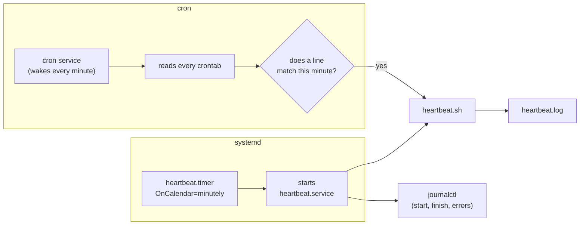

# 21 · Scheduling with cron and timers

**What you'll build:** a `heartbeat.sh` script that writes one health line (time, load, disk) to a log, scheduled to run every minute in two ways: with **cron** (the classic) and with a **systemd timer** (the modern way). Then you learn to read and write any schedule, like "every weekday at 09:00".
**Like you're 5:** cron is an alarm clock with a list of chores. Every minute it looks at the clock, looks at the list, and if a chore's time has come, it does that chore, even while you are asleep.
**Time:** ~60 min (plus a few minutes of waiting) · **Builds on:** [20 · Robust scripts](../20-robust-scripts) · **Needs:** Ubuntu with cron (installed by default). For the timer part: a Linux running systemd (a normal Ubuntu, a VM, or WSL2 with systemd switched on)

## Why this matters
Servers do a lot of work at night: backups at 02:30, log clean-up on Sundays, renewing HTTPS certificates, re-indexing documents for a RAG system, pulling fresh data before a model retrains. All of that is scheduled with cron or systemd timers. When "the nightly job didn't run", the person who can read a crontab line and a timer's logs is the one who fixes it.

## What you'll learn
- **cron and crontab**: the background service that runs jobs on a schedule, and your personal list of jobs.
- **The five time fields** `* * * * *`: minute, hour, day of month, month, day of week, plus `*` `,` `-` `/`.
- **The cron environment**: why jobs need full paths, output redirection, and `\%`.
- **systemd timers**: a `.timer` file (when) plus a `.service` file (what), with logs in `journalctl`.
- **Testing schedules**: `systemd-analyze calendar` and how to check that a job really ran.

## Before you start
- Finish lesson 20.
- Check cron is installed and running:
  ```bash
  systemctl is-active cron
  ```
  You want `active`. If cron is missing: `sudo apt install cron`. **WSL2** without systemd or a **Docker** container: start it with `sudo service cron start` (repeat after every restart).
- For the timer part, systemd must be running: `ls /run/systemd/system` must not say "No such file". On **WSL2**, switch systemd on by putting these two lines in `/etc/wsl.conf` (`sudo nano /etc/wsl.conf`), then running `wsl --shutdown` in Windows PowerShell and reopening Ubuntu:
  ```
  [boot]
  systemd=true
  ```
  Docker containers normally have no systemd: use cron there.
- No API key needed.

## Run it
1. From the course folder (`linux-from-zero`), go into this lesson's folder:
   ```bash
   cd part-3-shell-scripting/21-scheduling-with-cron-and-timers
   ```
2. Set up: this copies `heartbeat.sh` to `~/linux-practice/21/` (a fixed place for the schedulers to find it) and runs it once:
   ```bash
   bash setup.sh
   ```
3. Look at the example crontab with every field explained:
   ```bash
   cat crontab.example
   ```
4. **Part A: cron.** Install the every-minute job into your crontab:
   ```bash
   ./install-cron.sh
   ```
5. See your crontab yourself:
   ```bash
   crontab -l
   ```
   **Command, piece by piece**
   | Piece | Meaning |
   |---|---|
   | `crontab` | the tool that manages your personal cron table |
   | `-l` | **l**ist it (print it) |
   | `-e` | **e**dit it in a text editor (the normal way to add jobs by hand; the first time, it asks which editor: pick nano) |
   | `-r` | **r**emove your whole crontab without asking. Careful: `r` is next to `e` on the keyboard |
6. **Part B: a systemd timer** (skip if systemd is not running). Install the user timer:
   ```bash
   ./install-timer.sh
   ```
7. Wait two or three minutes (make a cup of tea), then watch the log grow. Lines come from `cron` and from `systemd`:
   ```bash
   tail -f ~/linux-practice/21/heartbeat.log
   ```
   `tail -f` = **f**ollow: keep printing new lines as they arrive. Press **Ctrl + C** to stop watching.
8. See the timer's schedule and its logs:
   ```bash
   systemctl --user list-timers
   journalctl --user -u heartbeat.service -n 6
   ```
9. Check your work:
   ```bash
   ./check.sh
   ```
10. Test calendar rules before you trust them:
    ```bash
    systemd-analyze calendar "Mon..Fri 09:00" "*:0/15" --iterations=2
    ```
11. **Clean up** (an every-minute job forever is not useful):
    ```bash
    ./remove-cron.sh
    ./remove-timer.sh
    ```

### What you should see
Step 2:
```
Ready: /home/learner/linux-practice/21/heartbeat.sh
First line of the log:
2026-10-22 13:57:26  load: 14.95 8.01 3.34  disk: 93%  started by: you
```
Step 4:
```
Installed. Your crontab is now:
* * * * * /home/learner/linux-practice/21/heartbeat.sh >> /home/learner/linux-practice/21/cron.log 2>&1
```
Step 6:
```
Created symlink /home/learner/.config/systemd/user/timers.target.wants/heartbeat.timer → /home/learner/.config/systemd/user/heartbeat.timer.

NEXT                        LEFT LAST PASSED UNIT            ACTIVATES
Thu 2026-10-22 13:58:00 UTC  32s -         - heartbeat.timer heartbeat.service

1 timers listed.
```
Step 7, after two minutes (real output from our test server; the load numbers were high because it was busy):
```
2026-10-22 13:57:26  load: 14.95 8.01 3.34  disk: 93%  started by: you
2026-10-22 13:58:00  load: 13.17 8.28 3.58  disk: 93%  started by: systemd
2026-10-22 13:58:01  load: 12.84 8.29 3.61  disk: 93%  started by: cron
2026-10-22 13:59:00  load: 13.97 9.25 4.20  disk: 93%  started by: systemd
2026-10-22 13:59:01  load: 13.97 9.33 4.25  disk: 93%  started by: cron
```
Look at the seconds: the systemd timer fires at `:00` exactly; cron usually starts a second later.

Step 8:
```
NEXT                        LEFT LAST                        PASSED UNIT            ACTIVATES
Thu 2026-10-22 14:00:00 UTC  53s Thu 2026-10-22 13:59:00 UTC 6s ago heartbeat.timer heartbeat.service

Oct 22 13:58:00 myserver systemd[142]: Starting heartbeat.service - Write one heartbeat line to ~/linux-practice/21/heartbeat.log...
Oct 22 13:58:00 myserver systemd[142]: Finished heartbeat.service - Write one heartbeat line to ~/linux-practice/21/heartbeat.log.
```
Step 9:
```
Checking lesson 21...
  PASS  heartbeat is scheduled (cron: yes, systemd timer: yes)
  PASS  5 automatic runs found in heartbeat.log
...
Result: 2 passed, 0 failed.
```
Step 10:
```
  Original form: Mon..Fri 09:00
Normalized form: Mon..Fri *-*-* 09:00:00
    Next elapse: Fri 2026-10-23 09:00:00 UTC
       From now: 19h left
   Iteration #2: Mon 2026-10-26 09:00:00 UTC
       From now: 3 days left

  Original form: *:0/15
Normalized form: *-*-* *:00/15:00
    Next elapse: Thu 2026-10-22 14:00:00 UTC
       From now: 2min 32s left
   Iteration #2: Thu 2026-10-22 14:15:00 UTC
       From now: 17min left
```

## How it works
Two ways to reach the same script:


### 1. The crontab line, field by field
`* * * * * /home/learner/linux-practice/21/heartbeat.sh >> /home/learner/linux-practice/21/cron.log 2>&1`

| Piece | Field | Meaning here |
|---|---|---|
| `*` (1st) | minute (0-59) | every minute |
| `*` (2nd) | hour (0-23) | every hour |
| `*` (3rd) | day of month (1-31) | every day |
| `*` (4th) | month (1-12 or `jan`-`dec`) | every month |
| `*` (5th) | day of week (0-7, 0 and 7 = Sunday, or `sun`-`sat`) | every weekday |
| `/home/.../heartbeat.sh` | command | the full path to the script |
| `>> .../cron.log` | | append normal output to a log |
| `2>&1` | | send errors (stream 2) to the same place as normal output (stream 1) |

**The four symbols**
| Symbol | Meaning | Example | Reads as |
|---|---|---|---|
| `*` | every value | `* * * * *` | every minute |
| `,` | a list | `0 9,13,17 * * *` | at 09:00, 13:00 and 17:00 |
| `-` | a range | `0 9 * * 1-5` | 09:00 Monday to Friday |
| `/` | a step | `*/10 * * * *` | every 10 minutes (:00, :10, :20...) |

**More examples to read aloud**
| Line | Means |
|---|---|
| `30 2 * * *` | every day at 02:30 |
| `0 */4 * * *` | every 4 hours, on the hour (00:00, 04:00, 08:00...) |
| `*/15 9-17 * * 1-5` | every 15 minutes from 09:00 to 17:45, Monday to Friday |
| `0 6 1 * *` | 06:00 on the 1st of every month |
| `0 3 * * 0` | Sundays at 03:00 |
| `@reboot` | once, each time the computer starts |
| `@daily` / `@hourly` / `@weekly` | shortcuts for `0 0 * * *` / `0 * * * *` / `0 0 * * 0` |

A gotcha: if you fill in **both** day of month and day of week (e.g. `0 9 1 * 1`), cron runs when **either** matches (the 1st of the month, and also every Monday).

### 2. Why cron jobs break (the cron environment)
Cron does not start your job the way your terminal does:
| Your terminal | Cron |
|---|---|
| your full `PATH` from `~/.bashrc` | a tiny `PATH`, often just `/usr/bin:/bin` |
| your current folder | your home folder |
| output appears on screen | output is mailed (usually lost) unless you redirect it |
| `%` is a normal character | `%` means "new line": write `\%` |

So: use **full paths** for scripts and files, set `PATH` at the top of the crontab or the script (`heartbeat.sh` does `export PATH=...`), and always add `>> some.log 2>&1` so you can read the errors. `heartbeat.sh` also guesses who ran it: systemd sets `$INVOCATION_ID`; `[[ -t 1 ]]` is true when output goes to a terminal (you); otherwise it was cron.

### 3. How `install-cron.sh` edits your crontab safely
```bash
{ crontab -l 2> /dev/null | grep -v -F "$script" || true ; echo "$line" ; } | crontab -
```
| Piece | Meaning |
|---|---|
| `{ ... ; }` | group commands so their outputs flow out together |
| `crontab -l 2> /dev/null` | print the current crontab; hide the "no crontab" message for new users |
| `grep -v -F "$script"` | drop old heartbeat lines: `-v` = keep lines that do NOT match, `-F` = match plain text, not a pattern |
| `\|\| true` | do not stop (strict mode) when grep finds no lines to keep |
| `echo "$line"` | add the new line |
| `\| crontab -` | install everything coming through the pipe as the new crontab (`-` = "read from the pipe") |

Running it twice gives one line, not two. Real deploy scripts install cron jobs exactly like this. (By hand, you would use `crontab -e`.)

### 4. The systemd timer, line by line
`heartbeat.service` (the **what**):
| Line | Meaning |
|---|---|
| `[Unit]` | general information about this unit |
| `Description=...` | a human description, shown in `status` and logs |
| `[Service]` | how to run it |
| `Type=oneshot` | run once and finish (not a server that stays running) |
| `ExecStart=%h/linux-practice/21/heartbeat.sh` | the command, with a full path; `%h` = your home folder |

`heartbeat.timer` (the **when**; same name, so it starts `heartbeat.service`):
| Line | Meaning |
|---|---|
| `[Timer]` | the schedule section |
| `OnCalendar=minutely` | a calendar rule (see the table below) |
| `Persistent=true` | if the computer was off at run time, run once when it is back (cron just skips it) |
| `AccuracySec=1s` | be precise to 1 second (the default allows up to 1 minute of drift to save power) |
| `[Install]` / `WantedBy=timers.target` | what `enable` hooks it into: the group of all timers, started at boot or login |

**OnCalendar rules** (format: `DayOfWeek Year-Month-Day Hour:Minute:Second`, `*` = any)
| Rule | Same as cron | Meaning |
|---|---|---|
| `minutely` | `* * * * *` | every minute |
| `hourly` / `daily` / `weekly` | `@hourly` / `@daily` / `@weekly` | start of every hour / day (00:00) / week (Monday 00:00) |
| `*-*-* 02:30:00` | `30 2 * * *` | every day at 02:30 |
| `Mon..Fri 09:00` | `0 9 * * 1-5` | weekdays at 09:00 |
| `*:0/15` | `*/15 * * * *` | every 15 minutes |
| `*-*-01 06:00` | `0 6 1 * *` | 06:00 on the 1st of each month |

Instead of `OnCalendar`, a timer can also count from an event: `OnBootSec=5min` (5 minutes after boot) or `OnUnitActiveSec=1h` (1 hour after the last run).

**The commands, piece by piece**
| Command | Meaning |
|---|---|
| `systemctl --user daemon-reload` | re-read unit files after you add or change one (`--user` = your personal systemd, no sudo) |
| `systemctl --user enable --now heartbeat.timer` | `enable` = start it at every login/boot; `--now` = and start it right now |
| `systemctl --user list-timers` | table of timers: NEXT run, time LEFT, LAST run, PASSED since |
| `journalctl --user -u heartbeat.service -n 6` | logs of that unit (`-u` = unit), the last 6 lines (`-n`) |
| `systemd-analyze calendar "RULE"` | show when a rule will fire next, without installing anything |
| `loginctl enable-linger $USER` | let your user timers run even when you are logged out (needed on servers) |

System-wide timers (for all users, run as root) live in `/etc/systemd/system/` and use `sudo systemctl` without `--user`. Lesson 25 covers systemd in depth.

### 5. cron or systemd timer?
| | cron | systemd timer |
|---|---|---|
| Setup | one line | two small files |
| Logs | only what you redirect | automatic, in `journalctl` |
| Missed runs (computer off) | skipped | `Persistent=true` catches up |
| Overlapping runs | can pile up | never: a running service is not started twice |
| Works in Docker / old WSL | yes (start `cron`) | no (needs systemd) |
| Testing a schedule | crontab.guru website | `systemd-analyze calendar` |

Rule of thumb: cron for quick personal jobs, timers for anything important on a server.

## If something goes wrong
- **The job never runs, and `cron.log` stays empty** → cron is not running: `systemctl is-active cron` (or `service cron status` in Docker/WSL), then `sudo service cron start`. Also check the line with `crontab -l` (exactly 5 time fields).
- **It works by hand but not from cron** → almost always `PATH` or a relative path. Read `~/linux-practice/21/cron.log`: a `command not found` there means you need full paths or a `PATH=` line. Remember `\%` instead of `%` in crontab lines.
- **`Failed to connect to bus` / `System has not been booted with systemd`** when using `systemctl --user` → systemd is not running (Docker, or WSL without `systemd=true`). Use cron instead, or switch systemd on as in "Before you start".
- **The timer runs while you are logged in but stops when you log out of a server** → run `loginctl enable-linger $USER` once.
- **The timer is active but the log shows nothing** → read the service's logs: `journalctl --user -u heartbeat.service -n 20`. A `Permission denied` means the script is not executable (`chmod +x ~/linux-practice/21/heartbeat.sh`).

## Try this
1. Write (on paper, then check on https://crontab.guru) the cron lines for: every day at 23:45; every 5 minutes; at 08:00 on Saturdays and Sundays.
2. Change the timer so it runs every 2 minutes, reinstall with `./install-timer.sh`, and confirm with `systemctl --user list-timers`.
3. Schedule the lesson 20 backup tool to run every day at 02:30 with cron, keeping 7 backups, with its messages saved to a log. Then test the exact command by hand first.

<details><summary>Solutions</summary>

1. `45 23 * * *` · `*/5 * * * *` · `0 8 * * 6,0` (or `0 8 * * sat,sun`).
2. In `systemd/heartbeat.timer`, change `OnCalendar=minutely` to `OnCalendar=*:0/2` (check it first with `systemd-analyze calendar "*:0/2"`). Then `./install-timer.sh` again: it copies the files, reloads and restarts.
3. Copy the tool somewhere stable: `mkdir -p ~/bin && cp ../20-robust-scripts/backup.sh ~/bin/`. Run `~/bin/backup.sh -k 7` once by hand. Then `crontab -e` and add:
   ```
   30 2 * * * /home/YOUR_NAME/bin/backup.sh -k 7 >> /home/YOUR_NAME/backup.log 2>&1
   ```
   (Replace `YOUR_NAME`; `echo $HOME` shows the right path.) `backup.sh` writes its messages to stderr, so `2>&1` is what puts them in the log.
</details>

## Check yourself
1. Read this line aloud: `0 */6 * * 1-5 /opt/scripts/sync.sh`.
2. A script works in your terminal but fails in cron with `python: command not found`. Why, and what are two fixes?
3. What do the `.timer` and the `.service` file each describe?
4. Your laptop is off at 02:30 when a nightly job should run. What happens with cron, and with a timer that has `Persistent=true`?

<details><summary>Answers</summary>

1. "At minute 0 of every 6th hour (00:00, 06:00, 12:00, 18:00), Monday to Friday, run `/opt/scripts/sync.sh`."
2. Cron runs with a tiny `PATH` that does not include where `python` lives. Fix: use the full path (`/usr/bin/python3`, or your venv's `/home/you/venv/bin/python`), or set `PATH=...` at the top of the crontab or the script.
3. The `.timer` says **when** (OnCalendar, Persistent...); the `.service` with the same name says **what** to run (ExecStart) and how.
4. Cron skips the run. The timer runs it once, soon after the laptop is back on.
</details>

## Learn more (optional)
**Read the official docs**
- `crontab(5)`, the crontab file format: https://man7.org/linux/man-pages/man5/crontab.5.html
- `crontab(1)`, the crontab command: https://man7.org/linux/man-pages/man1/crontab.1.html
- `systemd.timer`: https://www.freedesktop.org/software/systemd/man/latest/systemd.timer.html
- `systemd.time` (the OnCalendar format): https://www.freedesktop.org/software/systemd/man/latest/systemd.time.html
- crontab.guru, type a cron line and see it in plain English: https://crontab.guru/

**Watch**
- NetworkChuck, cron jobs: https://www.youtube.com/results?search_query=networkchuck+cron+jobs+linux
- systemd timers explained: https://www.youtube.com/results?search_query=systemd+timers+tutorial
- freeCodeCamp, Linux scheduling with cron: https://www.youtube.com/results?search_query=freecodecamp+cron+tutorial

## Next
→ [Part 4 · Servers and networking](../../part-4-servers-and-networking): start with [22 · Disks and the filesystem tree](../../part-4-servers-and-networking/22-disks-and-the-filesystem-tree)
