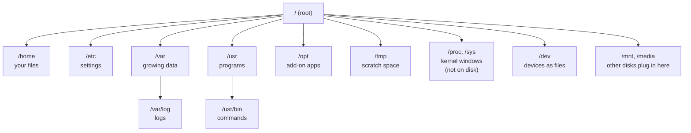
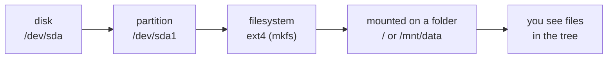

# 22 · Disks and the filesystem tree

**What you'll build:** a guided tour of every important top-level folder (`/etc`, `/var`, `/home`, `/usr`, `/opt`, `/tmp`, `/proc`...), a script that reads hardware facts from `/proc`, a disk report, a hunt for a hidden 60 MB "space hog", and your own pretend USB stick that you format, mount and unmount.
**Like you're 5:** Linux is one big tree. Everything hangs from the trunk `/`. Each big branch has one job: `/home` is everyone's bedroom, `/etc` is the instruction manuals, `/var/log` is the diary, `/tmp` is the scrap-paper tray. Disks are like extra toy boxes that you "plug into" a branch of the tree (that is called **mounting**).
**Time:** ~60 min · **Builds on:** [21 · Scheduling with cron and timers](../../part-3-shell-scripting/21-scheduling-with-cron-and-timers) · **Needs:** `sudo` for the pretend-disk part (steps 11-15)

## Why this matters
"Disk full" is the most common way a server dies: logs grow, Docker images pile up, someone downloads a 40 GB model into the wrong folder. AI work makes this worse because models and datasets are huge. Knowing where things live (`/var/log`, `/opt`, `~/.cache/huggingface`) and how to find what is eating space in 30 seconds is a basic server skill. You will also need to know where config files go when you deploy an app in lesson 28.

## What you'll learn
- **The filesystem tree (FHS)**: one tree starting at `/`, with standard folders for settings, logs, programs and temporary files.
- **"Everything is a file"**: disks (`/dev/sda`), processes and memory facts (`/proc`) show up as files you can read.
- **`df`**: how full each disk is; **`du`**: which folders use the space; **`lsblk`**: which disks exist.
- **Mounting**: attaching a disk's filesystem to a folder of the tree (`mount`, `umount`, `findmnt`, `/etc/fstab`).
- **Inodes**: the "file slots" a disk has; a disk can be full of tiny files while still having free gigabytes.

## Before you start
- Finish Part 3. You need `sudo` rights for steps 11-15 (lesson 12). In a Docker container, steps 11-15 only work if it was started with `--privileged`; you can skip them and read along.
- Optional but lovely: `sudo apt install ncdu` (an interactive disk-usage browser, see "Try this").
- No API key needed.

## Run it
1. From the course folder (`linux-from-zero`), go into this lesson's folder:
   ```bash
   cd part-4-servers-and-networking/22-disks-and-the-filesystem-tree
   ```
2. Take the tour of the tree:
   ```bash
   ./tour.sh
   ```
3. Look at the top of the tree yourself:
   ```bash
   ls -l /
   ```
   Lines starting with `l` are **symbolic links** (shortcuts): on Ubuntu, `bin -> usr/bin` means `/bin` is just another name for `/usr/bin`.
4. Read facts from `/proc` (these "files" are written by the kernel the moment you read them):
   ```bash
   ./proc-peek.sh
   head -n 3 /proc/meminfo
   ```
5. How full are the disks?
   ```bash
   df -hT
   ```
   **Command, piece by piece**
   | Piece | Meaning |
   |---|---|
   | `df` | "disk free": one line per mounted filesystem |
   | `-h` | human sizes: `49G` instead of `51290592` blocks |
   | `-T` | add a column with the filesystem **T**ype (`ext4`, `xfs`, `vfat`, `tmpfs`...) |
6. Which disks and partitions exist?
   ```bash
   lsblk
   ```
   `lsblk` = "list block devices". A **block device** is a disk-like thing that stores data in blocks.
7. Create the practice folder. It holds about 95 MB, and something in it is hogging space:
   ```bash
   bash setup.sh
   ```
8. First attempt at finding the hog:
   ```bash
   du -sh ~/linux-practice/22/*
   ```
   **Command, piece by piece**
   | Piece | Meaning |
   |---|---|
   | `du` | "disk usage": how much space files and folders really use |
   | `-s` | **s**ummary: one total per item, not every sub-folder |
   | `-h` | human sizes |
   | `~/linux-practice/22/*` | every item in the folder. But `*` skips names starting with `.` (hidden ones)! |

   The three folders add up to only about 37 MB. Where are the other 60 MB?
9. Ask `du` about everything, hidden files included, biggest first:
   ```bash
   du -ah ~/linux-practice/22 | sort -rh | head -n 5
   ```
   **Command, piece by piece**
   | Piece | Meaning |
   |---|---|
   | `du -a` | list **a**ll files too, not just folders (hidden ones included) |
   | `-h` | human sizes |
   | `\|` | pipe the list into the next command |
   | `sort -rh` | sort by **h**uman size (understands K, M, G), **r**everse = biggest first |
   | `head -n 5` | keep the top 5 lines |
10. Found it: `.cache/models/old-model.gguf`, an old AI model file. Delete it and run the full report:
    ```bash
    rm ~/linux-practice/22/.cache/models/old-model.gguf
    ./disk-report.sh ~/linux-practice/22
    ```
11. **Your pretend USB stick.** Make an empty 64 MB file to act as a disk:
    ```bash
    cd ~/linux-practice/22
    truncate -s 64M fake-disk.img
    ```
    `truncate -s 64M` sets the file's size to 64 MB without writing anything (a **sparse** file: `ls -lh` says 64M, `du -h` says 0).
12. Put a filesystem on it (like "formatting" a USB stick):
    ```bash
    mkfs.ext4 -L practice fake-disk.img
    ```
    | Piece | Meaning |
    |---|---|
    | `mkfs.ext4` | "make filesystem" of type ext4 (the usual Linux type) |
    | `-L practice` | give it a **L**abel (a name) |
    | `fake-disk.img` | the "disk" to format. On a real disk this would be e.g. `/dev/sdb1`; **formatting erases everything on it** |
13. Make an empty folder and attach (mount) the disk to it:
    ```bash
    mkdir -p mnt
    sudo mount -o loop fake-disk.img mnt
    df -hT mnt
    findmnt mnt
    ```
    | Piece | Meaning |
    |---|---|
    | `sudo` | mounting changes the whole system's tree, so it needs admin rights |
    | `mount` | attach a filesystem to a folder (the folder is then called a **mount point**) |
    | `-o loop` | **o**ption `loop`: treat a normal file as if it were a disk (a **loop device**, `/dev/loop0`) |
    | `fake-disk.img` | what to attach |
    | `mnt` | where to attach it |
    | `findmnt mnt` | show what is mounted there, from which device, with which options |
14. Use it like any folder:
    ```bash
    sudo chown "$USER" mnt
    echo hello > mnt/hello.txt
    ls -l mnt
    ```
    The new filesystem belongs to root at first, so `chown` (lesson 11) hands it to you. `lost+found` is a folder every ext4 filesystem has, where repair tools put recovered pieces.
15. Detach it (always do this before pulling out a real USB stick), then tidy up:
    ```bash
    sudo umount mnt
    ls mnt
    rm fake-disk.img
    ```
    The command is `umount` (no "n"). After it, `mnt` is an ordinary empty folder again: `hello.txt` lives inside the image file, not in `mnt`.
16. Go back to the lesson folder and check your work:
    ```bash
    cd -
    ./check.sh
    ```
    (`cd -` = go back to the previous folder, which was the lesson folder before step 11.)

### What you should see
Step 2 (first lines, real output):
```
THE LINUX FOLDER TREE - everything starts at / (the 'root')

/          the root: the top of the tree, every other folder hangs from here
             e.g. bin bin.usr-is-merged boot dev
/home      your files: one folder per user (/home/sam). Same idea as C:\Users on Windows
             e.g. learner ubuntu
/root      the home folder of the root (admin) user
             (not readable as learner)
/etc       settings (configuration) for the whole system and its programs: text files
             e.g. .pwd.lock .updated X11 adduser.conf
/var       'variable' data that grows: logs, caches, databases, websites
             e.g. .updated backups cache lib
...
```
Step 4 (real output):
```
CPU model:    Intel(R) Xeon(R) Processor @ 2.10GHz
CPU cores:    4
Memory total: 15.7 GiB
Memory free:  13.1 GiB available
Up for:       0 hours 5 minutes
Load average: 0.70 0.30 0.18   (1, 5 and 15 minutes; lesson 27)
Kernel:       6.18.44-fc-v140

This script is process number 376. The kernel keeps a folder about it: /proc/376
Name:	bash
State:	S (sleeping)
VmRSS:	    3344 kB
It was started with the command line: bash ./proc-peek.sh
```
Steps 5 and 6 on a typical small cloud server (yours will differ; a laptop often shows `nvme0n1` instead of `sda`, WSL shows `sdc` and Docker shows `overlay`):
```
Filesystem     Type   Size  Used Avail Use% Mounted on
/dev/sda1      ext4    49G   12G   37G  25% /
/dev/sda15     vfat   105M  6.1M   99M   6% /boot/efi
tmpfs          tmpfs  392M  1.1M  391M   1% /run
```
```
NAME    MAJ:MIN RM  SIZE RO TYPE MOUNTPOINTS
sda       8:0    0   50G  0 disk
├─sda1    8:1    0 49.9G  0 part /
├─sda14   8:14   0    4M  0 part
└─sda15   8:15   0  106M  0 part /boot/efi
```
Read it as: one disk `sda` (50 GB), split into 3 **partitions**; `sda1` is mounted at `/`, so the whole tree lives on it.

Step 8 (real output). The hidden `.cache` folder is missing from the list:
```
26M	/home/learner/linux-practice/22/downloads
11M	/home/learner/linux-practice/22/logs
8.0K	/home/learner/linux-practice/22/projects
```
Step 9:
```
96M	/home/learner/linux-practice/22
61M	/home/learner/linux-practice/22/.cache/models/old-model.gguf
61M	/home/learner/linux-practice/22/.cache/models
61M	/home/learner/linux-practice/22/.cache
26M	/home/learner/linux-practice/22/downloads
```
Step 13:
```
Filesystem     Type  Size  Used Avail Use% Mounted on
/dev/loop0     ext4   56M   24K   52M   1% /home/learner/linux-practice/22/mnt
TARGET                              SOURCE     FSTYPE OPTIONS
/home/learner/linux-practice/22/mnt /dev/loop0 ext4   rw,relatime
```
(64 MB of disk gives 56 MB of space: the filesystem keeps some for its own bookkeeping.)

Step 14:
```
total 20
-rw-rw-r-- 1 learner learner     6 Oct 22 18:57 hello.txt
drwx------ 2 root    root    16384 Oct 22 18:57 lost+found
```
Step 16:
```
Checking lesson 22...
  PASS  the 60 MB space hog is gone
  PASS  projects/notes.txt is still there (you only deleted the right thing)
  PASS  the practice folder is now 36 MB (was about 95 MB)
  PASS  no fake disk left mounted

Result: 4 passed, 0 failed.
All done. You can hunt down disk space like a sysadmin.
```

## How it works
### 1. The tree

| Folder | What lives there | You will meet it when... |
|---|---|---|
| `/` | the root: the top of everything | everything |
| `/home/<you>` (`~`) | your own files and hidden settings (`~/.bashrc`, `~/.ssh`, `~/.cache`) | every day |
| `/root` | the admin user's home | working as root |
| `/etc` | system-wide settings, plain text: `/etc/hosts`, `/etc/ssh/sshd_config`, `/etc/nginx/` | configuring servers (lessons 23-28) |
| `/var/log` | logs: `syslog`, `auth.log`, `nginx/access.log` | troubleshooting (lessons 25, 27) |
| `/var/lib` | programs' saved data: databases, Docker images (`/var/lib/docker`) | disks filling up |
| `/usr/bin`, `/usr/lib` | programs installed by `apt` and their libraries | `which python3` |
| `/usr/local` | programs you installed by hand | building from source |
| `/opt` | big self-contained apps, one folder each | deploying your API (lesson 28) |
| `/tmp` | temporary files, writable by everyone, cleared at reboot | scripts (`mktemp`) |
| `/dev` | devices as files: `/dev/sda` (a disk), `/dev/null` (the bin), `/dev/zero` (endless zeros) | disks, redirection |
| `/proc` | live kernel and process info: `/proc/meminfo`, `/proc/cpuinfo`, `/proc/<PID>/` | `free`, `top`, `ps` read from here |
| `/sys` | hardware and driver settings | rarely by hand |
| `/boot` | the kernel and boot loader files | kernel updates |
| `/mnt`, `/media` | mount points for extra disks and USB sticks | step 13 |
| `/run` | runtime info since boot: PID files, sockets | services (lesson 25) |

This layout is called the **Filesystem Hierarchy Standard (FHS)**, so the same folders exist on Ubuntu, Debian, Fedora and the servers of every cloud.

### 2. Everything is a file (`proc-peek.sh`)
`/proc` is a **virtual filesystem**: nothing in it is stored on a disk. When `proc-peek.sh` runs `grep -m 1 'model name' /proc/cpuinfo`, the kernel writes the answer on the spot. `awk '/^MemTotal/ {printf "%.1f GiB", $2/1024/1024}' /proc/meminfo` picks the `MemTotal` line, takes column 2 (kilobytes), and divides twice by 1024 to get GiB. `/proc/$$/` is a folder about the script's own process (`$$` = its PID, lesson 17). Tools like `free`, `top` and `ps` are just friendly readers of these files.

### 3. Disks, partitions, filesystems and mounting

- A **disk** (`/dev/sda`, `/dev/nvme0n1`, `/dev/vda` on many clouds) is split into **partitions** (`sda1`, `sda2`).
- Each partition is formatted with a **filesystem** (`ext4`, `xfs`, `vfat`): the system for organizing files on it.
- **Mounting** attaches a filesystem to a folder. Unlike Windows (`C:`, `D:`), Linux has one tree and disks appear as folders in it.
- `df` asks each **mounted filesystem** how full it is. `du` walks through **folders** adding up file sizes. If they disagree a lot, a deleted file is probably still held open by a program (lesson 27).

**Mounting at every boot: `/etc/fstab`.** `sudo mount` only lasts until reboot. Permanent mounts are listed in `/etc/fstab` ("filesystem table"), one per line. A typical line:
```
UUID=3f6c1a2e-8b1d-4c1e-9a0f-2b7d5e9c4a11  /mnt/data  ext4  defaults,nofail  0  2
```
| Field | Example | Meaning |
|---|---|---|
| 1. what | `UUID=3f6c...` | which filesystem; a UUID (unique ID, shown by `lsblk -f` or `blkid`) is safer than `/dev/sdb1`, because device names can change |
| 2. where | `/mnt/data` | the mount point (folder) |
| 3. type | `ext4` | the filesystem type |
| 4. options | `defaults,nofail` | `defaults` = normal read-write; `nofail` = still boot if this disk is missing |
| 5. dump | `0` | old backup tool flag; always `0` |
| 6. fsck order | `2` | check order at boot: `1` for `/`, `2` for other disks, `0` = never |

A mistake in `/etc/fstab` can stop a server from booting, so test a new line with `sudo mount -a` (mount everything listed) before rebooting. You do not need to change it for this course.

### 4. Inodes
Every file uses one **inode** (a record holding its size, owner, permissions and where its data is). A disk is created with a fixed number of them. `df -i` shows them: if `IUse%` reaches 100 %, you cannot create files even if `df -h` shows free space. Millions of tiny cache files can do this.

### 5. The scripts
- `tour.sh` uses a function `show DIR "purpose"`, `printf '%-10s %s\n'` to line up columns, and `find DIR -mindepth 1 -maxdepth 1 -printf '%f\n'` to list a few names inside each folder.
- `disk-report.sh` runs `df -hT -x tmpfs ...` (`-x` = exclude in-memory filesystems), `df -hi` (inodes), `du -xh --max-depth=1 FOLDER | sort -rh | head -n 11` (`-x` = stay on one disk) and `lsblk -e 7` (`-e 7` = hide loop devices, which snap packages create many of).
- `setup.sh` uses `head -c 60M /dev/zero > file` to write 60 MB of real zeros, and `mkdir -p "$practice"/{projects,downloads,logs,.cache/models}` (brace expansion) to make four folders in one command.

## If something goes wrong
- **`du` prints lots of `Permission denied`** → it cannot read other users' or system folders. Add `2>/dev/null` to hide them, or use `sudo du ...` when you really need the full picture.
- **`mount: ... must be superuser to use mount`** → add `sudo`. **`failed to setup loop device`** in Docker → the container was not started with `--privileged`; skip steps 11-15.
- **`umount: ... target is busy`** → something is still using the folder, often your own terminal standing inside it. `cd ~` and try again; `lsof +D ~/linux-practice/22/mnt` shows which program holds it.
- **`df` says 100 % but `du` cannot find the big files** → a program is still writing to a deleted file. `sudo lsof +L1` lists deleted-but-open files; restart that program (lesson 27).
- **`No space left on device` but `df -h` shows free space** → you are out of inodes: check `df -i` and look for folders with huge numbers of tiny files (`du --inodes -x / 2>/dev/null | sort -rn | head`).

## Try this
1. Find the 5 biggest items in your home folder, hidden ones included.
2. Use `ncdu` (`sudo apt install ncdu`) on `~/linux-practice/22` after re-running `bash setup.sh`. Arrow keys move, Enter opens a folder, `d` deletes, `q` quits. Delete the hog from inside ncdu.
3. Where do Python packages and Hugging Face models usually hide on your machine? Measure `~/.cache` and find its biggest sub-folders. Then find which folder under `/var` is the biggest (use `sudo`).

<details><summary>Hints and solutions</summary>

1. `du -ah ~ 2>/dev/null | sort -rh | head -n 6` (the first line is `~` itself). For folders only, one level deep: `du -h --max-depth=1 ~ | sort -rh | head`.
2. `ncdu ~/linux-practice/22` shows `.cache` at the top with a bar; Enter, Enter, then `d` and confirm.
3. `du -h --max-depth=1 ~/.cache 2>/dev/null | sort -rh | head`: `pip` (downloaded packages) and `huggingface` (models) are often the biggest. `sudo du -xh --max-depth=1 /var | sort -rh | head`: usually `/var/lib` (packages, Docker) or `/var/log`.
</details>

## Check yourself
1. You need to change nginx's settings. Which top-level folder do you look in first, and where would its logs be?
2. Why did `du -sh ~/linux-practice/22/*` miss 60 MB, and which command found it?
3. What is the difference between what `df` and `du` measure?
4. You mount a USB stick on `/mnt/usb` and copy files into it. Why must you `umount` before unplugging?

<details><summary>Answers</summary>

1. `/etc` (`/etc/nginx/`). Its logs are in `/var/log/nginx/`.
2. The shell's `*` does not match names that start with a dot, so `.cache` was left out. `du -ah ~/linux-practice/22 | sort -rh | head` lists everything, hidden files included.
3. `df` asks each mounted filesystem how much of the disk is used and free. `du` adds up the sizes of the files and folders you point it at.
4. Linux may still be holding some writes in memory. `umount` writes everything to the stick and detaches it safely; unplugging earlier can lose or corrupt data.
</details>

## Learn more (optional)
**Read the official docs**
- Filesystem Hierarchy Standard 3.0: https://refspecs.linuxfoundation.org/FHS_3.0/fhs/index.html
- `hier(7)`, the folder layout explained: https://man7.org/linux/man-pages/man7/hier.7.html
- `proc(5)`: https://man7.org/linux/man-pages/man5/proc.5.html
- `df(1)`: https://man7.org/linux/man-pages/man1/df.1.html · `du(1)`: https://man7.org/linux/man-pages/man1/du.1.html · `lsblk(8)`: https://man7.org/linux/man-pages/man8/lsblk.8.html
- `mount(8)`: https://man7.org/linux/man-pages/man8/mount.8.html · `fstab(5)`: https://man7.org/linux/man-pages/man5/fstab.5.html

**Watch**
- Linux filesystem hierarchy explained: https://www.youtube.com/results?search_query=linux+filesystem+hierarchy+explained
- NetworkChuck, Linux file system: https://www.youtube.com/results?search_query=networkchuck+linux+file+system
- Mounting disks in Linux: https://www.youtube.com/results?search_query=linux+mount+disk+fstab+tutorial

## Next
→ [23 · Networking basics](../23-networking-basics)
