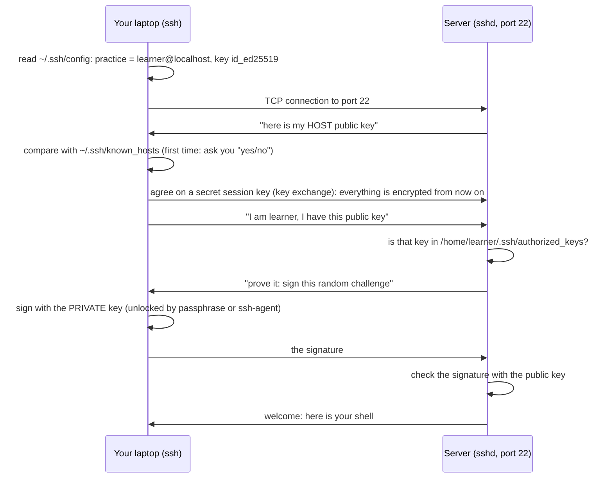
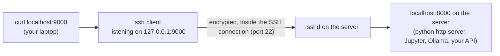

# 24 · SSH keys and remote servers

**What you'll build:** your own SSH key pair, password-free logins to a practice server, a `~/.ssh/config` "address book" so `ssh practice` is all you type, file copies with `scp` and `rsync` (through a safe `sync-project.sh` that dry-runs by default), and an SSH tunnel that lets you open a server's private web app on your own laptop.
**Like you're 5:** an SSH key pair is a padlock and its only key. You give copies of the **padlock** (the public key) to every server you want to visit, and they hang it on their door. You keep the one **key** (the private key) in your pocket and never give it to anyone. Only you can open those doors.
**Time:** ~90 min · **Builds on:** [23 · Networking basics](../23-networking-basics) · **Needs:** `sudo` (to install the SSH server), a password for your Linux user (you set one when you installed Ubuntu/WSL)

## Why this matters
Every cloud server, GPU box and customer machine you will ever work on is reached with SSH. Deploying your AI API (lesson 28), copying a model to a GPU server, opening a Jupyter notebook that runs on a remote machine, or checking logs at 2 a.m.: all SSH. Keys are also safer than passwords: a server that accepts only keys cannot be broken into by guessing passwords (lesson 26 switches passwords off).

## What you'll learn
- **SSH**: a secure (encrypted) remote terminal: `ssh user@host` gives you a shell on another computer.
- **Key pair**: a **private key** (secret, stays on your laptop) and a **public key** (safe to share, goes into the server's `~/.ssh/authorized_keys`).
- **Host keys and `known_hosts`**: how your computer checks it is talking to the real server, and what the scary "REMOTE HOST IDENTIFICATION HAS CHANGED" warning means.
- **`~/.ssh/config`**: nicknames and settings per server; **`ssh-agent`**: type your key's passphrase once per session.
- **Copying and tunnels**: `scp` and `rsync` to copy files, `ssh -L` to reach a port that only the server can see.

## Before you start
**Which server?** You need a computer to log into. Pick one:
- **A. Your own computer as the server (used in this lesson).** Install the SSH server and connect to `localhost`. Everything works exactly as with a remote machine.
- **B. A real cloud server** (AWS, GCP, Azure, Hetzner, DigitalOcean...). Replace `localhost` with its IP and `learner` with its user (often `ubuntu`). Cloud providers usually ask for your **public** key when you create the server, so you can skip step 7.

For option A, install and start the SSH server:
```bash
sudo apt update
sudo apt install openssh-server openssh-client rsync
sudo systemctl enable --now ssh
```
| Piece | Meaning |
|---|---|
| `openssh-server` | `sshd`, the program that waits for SSH logins (on port 22) |
| `openssh-client` | `ssh`, `scp`, `ssh-keygen`, `ssh-copy-id`, `ssh-agent` (usually already installed) |
| `rsync` | the smart copy tool (must be installed on both sides) |
| `systemctl enable --now ssh` | start the SSH service now and at every boot (lesson 25). On WSL without systemd or in Docker: `sudo service ssh start` |

Check it listens: `ss -tln | grep ':22 '` should show `0.0.0.0:22`. (On Ubuntu 24.04, `systemctl status ssh` may say `inactive` until the first login: a helper called `ssh.socket` holds port 22 and starts `sshd` on demand.)

You also need your user's **password** for the first login. If you do not know it (some WSL or Docker setups), set one with `sudo passwd $USER`. No API key needed.

## Run it
1. From the course folder (`linux-from-zero`), go into this lesson's folder:
   ```bash
   cd part-4-servers-and-networking/24-ssh-keys-and-remote-servers
   ```
2. Create a small project to copy later:
   ```bash
   bash setup.sh
   ```
3. Find your user name; it is the user you log in as on the "server":
   ```bash
   whoami
   ```
   In the examples below it is `learner`. **Replace `learner` with your own name everywhere.**
4. Make your key pair. Press **Enter** to accept the file name, then type a **passphrase** (a password that protects the key file; you can leave it empty for practice, but use one for real keys):
   ```bash
   ssh-keygen -t ed25519 -C "learner@laptop"
   ```
   **Command, piece by piece**
   | Piece | Meaning |
   |---|---|
   | `ssh-keygen` | "SSH key generator" |
   | `-t ed25519` | the key **t**ype: Ed25519, modern, short and strong (use it unless a server only accepts `rsa`; then `-t rsa -b 4096`) |
   | `-C "learner@laptop"` | a **C**omment stored in the public key, so you can tell keys apart later. Anything works |
   | (default file) | `~/.ssh/id_ed25519` (private) and `~/.ssh/id_ed25519.pub` (public) |
5. Look at what you made:
   ```bash
   ls -la ~/.ssh
   cat ~/.ssh/id_ed25519.pub
   ```
   The `.pub` file is one line: type, a long code, your comment. That is the padlock: safe to paste anywhere. **Never** show or send `id_ed25519` (no `.pub`).
6. First login with your password. SSH asks whether you trust the server: type `yes`. Then enter your password. Run two commands on the "server" and leave with `exit`:
   ```bash
   ssh learner@localhost
   whoami
   hostname
   exit
   ```
   **Command, piece by piece**
   | Piece | Meaning |
   |---|---|
   | `ssh` | the SSH client |
   | `learner` | the user name **on the server** |
   | `@` | "at" |
   | `localhost` | the server's address (a name or an IP like `203.0.113.10`) |
7. Install your public key on the server (it asks for the password one last time):
   ```bash
   ssh-copy-id -i ~/.ssh/id_ed25519.pub learner@localhost
   ```
   `ssh-copy-id` logs in and appends your public key to the server's `~/.ssh/authorized_keys` with the right permissions. `-i` = which **i**dentity (key) to install.
8. Log in again. No password this time (if you set a passphrase, SSH asks for that instead: it unlocks your key on your own computer, it is never sent to the server):
   ```bash
   ssh learner@localhost 'echo key login works'
   ```
   Text after the address is a command to run on the server; SSH prints its output and returns.
9. If you used a passphrase, let the **agent** remember it for this terminal session:
   ```bash
   eval "$(ssh-agent -s)"
   ssh-add
   ```
   | Piece | Meaning |
   |---|---|
   | `ssh-agent -s` | start the agent; it prints shell commands that set two variables (`SSH_AUTH_SOCK`, `SSH_AGENT_PID`) |
   | `eval "$(...)"` | run those printed commands in your current shell, so `ssh` can find the agent |
   | `ssh-add` | unlock your default key once and hand it to the agent |
   On Ubuntu desktops and macOS an agent usually runs already; then `ssh-add` alone is enough.
10. Create your SSH address book. Open the file:
    ```bash
    nano ~/.ssh/config
    ```
    Type this block (with **your** user name), save and exit, then lock the file down:
    ```
    Host practice
        HostName localhost
        User learner
        Port 22
        IdentityFile ~/.ssh/id_ed25519
        IdentitiesOnly yes
    ```
    ```bash
    chmod 600 ~/.ssh/config
    ```
    `ssh-config.example` in this folder has more examples, each line explained.
11. Use the nickname, and run a few commands remotely in one go:
    ```bash
    ssh practice 'hostname; uptime -p; df -h / | tail -1'
    ```
12. Copy files with `scp` ("secure copy"), both directions:
    ```bash
    echo hi > ~/linux-practice/24/hello.txt
    scp ~/linux-practice/24/hello.txt practice:/tmp/
    scp practice:/etc/hostname ~/linux-practice/24/
    ```
    **Command, piece by piece**
    | Piece | Meaning |
    |---|---|
    | `scp SOURCE DEST` | copy, like `cp`, but either side may be on another computer |
    | `practice:/tmp/` | `HOST:PATH` = a path on the server. The `:` is what makes it remote |
    | `practice:/etc/hostname` | copy **from** the server |
    | `~/linux-practice/24/` | to this local folder |
    | `scp -r` | (not used here) copy folders recursively |
13. Sync the whole project with `rsync`: first the dry run (default), then for real, then again after changing one file:
    ```bash
    ./sync-project.sh ~/linux-practice/24/project practice:linux-practice/24/deployed
    ./sync-project.sh ~/linux-practice/24/project practice:linux-practice/24/deployed --go
    echo 'print("v2")' > ~/linux-practice/24/project/app.py
    ./sync-project.sh ~/linux-practice/24/project practice:linux-practice/24/deployed --go
    ```
    A remote path without a leading `/` (`linux-practice/...`) starts in your home folder on the server.
14. **A tunnel.** Start a web server on the "server" that listens on `127.0.0.1:8000` only (private: nobody outside can reach it). Do this in a **second terminal** and leave it running:
    ```bash
    ssh practice
    cd ~/linux-practice/24/deployed
    python3 -m http.server 8000 --bind 127.0.0.1
    ```
    In the **first terminal**, open the tunnel (it stays open and prints nothing; that is normal):
    ```bash
    ssh -N -L 9000:localhost:8000 practice
    ```
    In a **third terminal** (or a browser at http://localhost:9000):
    ```bash
    curl -s http://localhost:9000/app.py
    ```
    **Command, piece by piece**
    | Piece | Meaning |
    |---|---|
    | `-L` | **L**ocal forward: open a port on my computer that leads through SSH to somewhere |
    | `9000` | the port on **my** computer |
    | `localhost:8000` | where to go **as seen from the server**: the server's own port 8000 |
    | `practice` | the server to tunnel through |
    | `-N` | do **N**ot open a shell, just keep the tunnel |

    Stop everything with **Ctrl + C** in each terminal (and `exit` in the second).
15. Check your work:
    ```bash
    ./check.sh
    ```

### What you should see
Step 4 (real output; your fingerprint and picture will differ):
```
Generating public/private ed25519 key pair.
Enter file in which to save the key (/home/learner/.ssh/id_ed25519):
Created directory '/home/learner/.ssh'.
Enter passphrase (empty for no passphrase):
Enter same passphrase again:
Your identification has been saved in /home/learner/.ssh/id_ed25519
Your public key has been saved in /home/learner/.ssh/id_ed25519.pub
The key fingerprint is:
SHA256:8CNSp5opUSYBPBvwAa8g8owQQoohROcLJ1WQ14CEU1g learner@laptop
The key's randomart image is:
+--[ED25519 256]--+
|#*OE=oo          |
|=%+= . .         |
|BoOo+ o .        |
|=*++.. =         |
|o +.. o S        |
|   . = . .       |
|  . +            |
|   .             |
|                 |
+----[SHA256]-----+
```
Step 5. Note the permissions: the folder is `drwx------` (700) and the private key `-rw-------` (600):
```
drwx------ 2 learner learner 4096 Oct 23 00:01 .
drwxr-x--- 1 learner learner 4096 Oct 23 00:01 ..
-rw------- 1 learner learner  411 Oct 23 00:01 id_ed25519
-rw-r--r-- 1 learner learner   96 Oct 23 00:01 id_ed25519.pub
ssh-ed25519 AAAAC3NzaC1lZDI1NTE5AAAAILkL7BB+v+ED524e44uY2/kQ91I6zw9pC4mnMYznIWOB learner@laptop
```
Step 6, the first time only:
```
The authenticity of host 'localhost (127.0.0.1)' can't be established.
ED25519 key fingerprint is SHA256:I43/K2Bx6Tr2g8iMWa0H18C9XE8KKKUhvIwnbytSUPM.
This key is not known by any other names.
Are you sure you want to continue connecting (yes/no/[fingerprint])? yes
Warning: Permanently added 'localhost' (ED25519) to the list of known hosts.
learner@localhost's password:
learner@myserver:~$ whoami
learner
learner@myserver:~$ hostname
myserver
learner@myserver:~$ exit
logout
Connection to localhost closed.
```
Look at the prompt: `learner@myserver` means you are now typing **on the server**. After `exit` you are back on your own computer.

Step 7:
```
/usr/bin/ssh-copy-id: INFO: Source of key(s) to be installed: "/home/learner/.ssh/id_ed25519.pub"
/usr/bin/ssh-copy-id: INFO: attempting to log in with the new key(s), to filter out any that are already installed
/usr/bin/ssh-copy-id: INFO: 1 key(s) remain to be installed -- if you are prompted now it is to install the new keys
learner@localhost's password:

Number of key(s) added: 1

Now try logging into the machine, with:   "ssh 'learner@localhost'"
and check to make sure that only the key(s) you wanted were added.
```
Step 8: `key login works`. Step 9: `Agent pid 662` and `Identity added: /home/learner/.ssh/id_ed25519 (learner@laptop)`.

Step 11:
```
myserver
up 4 minutes
/dev/sda1        49G   12G   37G  25% /
```
Step 13 (real output). The dry run lists what would be copied; the last run only sends the changed `app.py`:
```
DRY RUN (nothing is copied). Add --go to really sync.
sending incremental file list
created directory linux-practice/24/deployed
./
README.md
app.py
requirements.txt
data/
data/model.bin

sent 255 bytes  received 91 bytes  692.00 bytes/sec
total size is 204.88K  speedup is 592.14 (DRY RUN)
...
sending incremental file list
app.py

sent 304 bytes  received 49 bytes  706.00 bytes/sec
total size is 204.86K  speedup is 580.35
```
Step 14: `print("v2")`, fetched from a server that only listens on its own `127.0.0.1`. On your computer, `ss -tln` shows the tunnel's end:
```
LISTEN 0      128        127.0.0.1:9000      0.0.0.0:*
```
Step 15:
```
Checking lesson 24...
  PASS  you have an ed25519 key pair (id_ed25519 + id_ed25519.pub)
  PASS  your .ssh folder is 700 (only you can enter it)
  PASS  private key is 600 (only you can read it)
  PASS  your .ssh/config has a 'Host practice' block
  PASS  ssh practice logs in with your key, no password
  PASS  the project was synced to the server (deployed/app.py exists)

Result: 6 passed, 0 failed.
All done. You can work on remote servers safely!
```

## How it works
### 1. What happens when you type `ssh practice`

The private key never leaves your laptop. The server only ever sees a signature that proves you have it. That is why stealing `authorized_keys` from a server is useless to an attacker.

### 2. Two kinds of keys, four files
| File | Where | What it is | Permissions |
|---|---|---|---|
| `~/.ssh/id_ed25519` | your laptop | **your private key**. Secret. Protect with a passphrase | `600` (`-rw-------`) |
| `~/.ssh/id_ed25519.pub` | your laptop | your public key (the padlock) | `644` |
| `~/.ssh/authorized_keys` | the server, in the home of the user you log in as | the public keys allowed to log in, one per line | `600` |
| `~/.ssh/known_hosts` | your laptop | the **host keys** of servers you trust (proves the server is the real one) | `600` |
| `~/.ssh/config` | your laptop | your nicknames and settings | `600` |

SSH refuses keys whose files or folders are readable by others (`UNPROTECTED PRIVATE KEY FILE!`). `~/.ssh` itself must be `700`.

**Host keys** are the server's own key pair (in `/etc/ssh/ssh_host_*`). The fingerprint you accepted in step 6 is stored in `known_hosts`. If the server is rebuilt, or someone is pretending to be it, the key changes and SSH stops with `WARNING: REMOTE HOST IDENTIFICATION HAS CHANGED!`. If you know the server was rebuilt, remove the old entry with `ssh-keygen -R localhost` (use the host name or IP), then connect again. If you do not know why it changed, stop and ask.

### 3. `~/.ssh/config`, line by line
| Line | Meaning |
|---|---|
| `Host practice` | the nickname you type (`ssh practice`, `scp x practice:`, `rsync ... practice:`) |
| `HostName localhost` | the real address (name or IP) |
| `User learner` | the user on the server |
| `Port 22` | sshd's port (some servers use another one) |
| `IdentityFile ~/.ssh/id_ed25519` | which private key to use |
| `IdentitiesOnly yes` | offer only that key (prevents "Too many authentication failures") |
| `LocalForward 8000 localhost:8000` | (in the example file) open this tunnel automatically on every connection |
| `ServerAliveInterval 60` | send a keep-alive every 60 s so idle sessions are not cut |
| `Host *` | settings for every host; put it last, because for each setting the **first** value found wins |

`ssh -G practice` prints the final settings SSH would use, handy for debugging the config.

### 4. `scp` vs `rsync`
| | `scp` | `rsync` |
|---|---|---|
| Good for | one quick file | whole folders, again and again |
| Copies | everything, every time | only what changed (it compares) |
| Resumes after a break | no | yes (`--partial`) |
| Mirror deletes | no | `--delete` |
| Dry run | no | `--dry-run` / `-n` |

`sync-project.sh` builds the rsync options in an **array** `opts=( -a -v -z -h --delete --exclude ... )` so each one can carry a comment, and adds `--dry-run` with `opts+=(--dry-run)` unless you pass `--go`. The most important detail is the **trailing slash**: `rsync project/ server:deployed/` copies the *contents* of `project` into `deployed`; `rsync project server:deployed/` would create `deployed/project/`. `--delete` makes the server an exact mirror, which is why the dry run comes first.

### 5. Tunnels (port forwarding)

| Option | Direction | Typical use |
|---|---|---|
| `-L 9000:localhost:8000` | **local**: my port 9000 → the server's port 8000 | open a remote Jupyter, Grafana, or your API's `/docs` without exposing it to the internet |
| `-R 8080:localhost:3000` | **remote**: the server's port 8080 → my port 3000 | show a demo running on your laptop to the server's side |
| `-D 1080` | **dynamic**: a SOCKS proxy | browse "from" the server's network |

Only port 22 needs to be open on the server's firewall; everything else stays private (lesson 26).

## If something goes wrong
- **`ssh: connect to host localhost port 22: Connection refused`** → no SSH server is running there. Install and start it (`sudo systemctl enable --now ssh`, or `sudo service ssh start`), check with `ss -tln | grep ':22 '`. On a cloud server: check the port and the firewall / security group.
- **`Permission denied (publickey,password).`** → wrong user name, wrong password, or the key is not in the server's `authorized_keys`. Run `ssh -v practice` (verbose) and look for `Offering public key` and `Authentications that can continue`. Re-run `ssh-copy-id`.
- **`WARNING: UNPROTECTED PRIVATE KEY FILE!` / `bad permissions`** → `chmod 700 ~/.ssh && chmod 600 ~/.ssh/id_ed25519 ~/.ssh/config`. On the server, `authorized_keys` must be `600` and not writable by others, or key login is silently refused.
- **`WARNING: REMOTE HOST IDENTIFICATION HAS CHANGED!`** → the server's host key is different from last time. If you rebuilt or reinstalled the server, run `ssh-keygen -R HOSTNAME` and connect again. If not, do not continue: something may be intercepting your connection.
- **`bind [127.0.0.1]:9000: Address already in use`** when opening a tunnel → an old tunnel or program already uses port 9000 on your computer. Pick another port (`-L 9001:localhost:8000`) or find it with `ss -tlnp | grep 9000`.

## Try this
1. Run `ssh -v practice true` and find the lines where your key is offered and accepted. What does `-vvv` add?
2. Run a command on the server that counts its CPU cores and shows its free memory, without opening an interactive shell, and save the answer into a local file `server-info.txt`.
3. Add a second `Host` block called `practice-web` to your config that also opens the tunnel automatically (`LocalForward 9000 localhost:8000`). Start the web server on the "server" again and use only `ssh practice-web` to get the tunnel.

<details><summary>Hints and solutions</summary>

1. Look for `Offering public key: /home/learner/.ssh/id_ed25519 ED25519 ...` then `Server accepts key` and `Authenticated to localhost ... using "publickey"`. `-vvv` shows even more detail (the key exchange and every config line read).
2. `ssh practice 'nproc; free -h' > server-info.txt`: the commands run on the server, and the `>` (outside the quotes) runs on your laptop, saving the output locally.
3. Add to `~/.ssh/config`:
   ```
   Host practice-web
       HostName localhost
       User learner
       IdentityFile ~/.ssh/id_ed25519
       IdentitiesOnly yes
       LocalForward 9000 localhost:8000
   ```
   Then `ssh practice-web` gives you a shell and, as long as it is open, http://localhost:9000 reaches the server's port 8000.
</details>

## Check yourself
1. Which file must you never share, and which one is safe to paste into a cloud console?
2. Where does your public key end up on the server, and what does the server do with it during login?
3. What does `known_hosts` protect you against?
4. What is the difference between `rsync -a project/ server:app/` and `rsync -a project server:app/`?

<details><summary>Answers</summary>

1. Never share the private key `~/.ssh/id_ed25519`. The public key `~/.ssh/id_ed25519.pub` is safe to share.
2. In `~/.ssh/authorized_keys` of the user you log in as. At login, the server sends a challenge and checks your signature with that public key; if it matches, you are in.
3. Against connecting to a fake server (a "man in the middle"). SSH remembers each server's host key and warns loudly if it changes.
4. With the trailing slash, the *contents* of `project` go into `app/`. Without it, a folder `app/project/` is created.
</details>

## Learn more (optional)
**Read the official docs**
- `ssh(1)`: https://man7.org/linux/man-pages/man1/ssh.1.html
- `ssh_config(5)`, every config option: https://man7.org/linux/man-pages/man5/ssh_config.5.html
- `ssh-keygen(1)`: https://man7.org/linux/man-pages/man1/ssh-keygen.1.html
- `sshd(8)` (includes the `authorized_keys` format): https://man7.org/linux/man-pages/man8/sshd.8.html
- `rsync(1)`: https://download.samba.org/pub/rsync/rsync.1
- Ubuntu Server docs, OpenSSH server: https://ubuntu.com/server/docs

**Watch**
- NetworkChuck, SSH keys explained: https://www.youtube.com/results?search_query=networkchuck+ssh+keys
- How SSH works (handshake and keys): https://www.youtube.com/results?search_query=how+ssh+works+public+key+authentication
- SSH tunneling and port forwarding explained: https://www.youtube.com/results?search_query=ssh+tunneling+port+forwarding+explained
- rsync tutorial: https://www.youtube.com/results?search_query=rsync+tutorial+linux

## Next
→ [25 · Services and logs with systemd](../25-services-and-logs-with-systemd)
