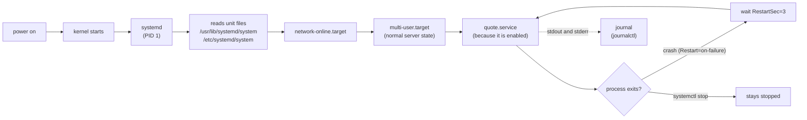

# 25 · Services and logs with systemd

**What you'll build:** a small Python web service (`quote-server.py`) turned into a real Linux **service**: it starts at boot, runs as its own safe user, restarts by itself when it crashes, and writes its logs to the system journal. You will control it with `systemctl`, read its logs with `journalctl`, change its settings with an override, and crash it on purpose to watch it come back.
**Like you're 5:** systemd is the school caretaker. In the morning it unlocks the building and switches everything on in the right order (that is booting). All day it watches the classrooms: if a heater breaks, it fixes it and writes it in the logbook. A **unit file** is the instruction card you give the caretaker for one machine.
**Time:** ~75 min · **Builds on:** [24 · SSH keys and remote servers](../24-ssh-keys-and-remote-servers) · **Needs:** `sudo` and a Linux that runs systemd (a normal Ubuntu, a VM, a cloud server, or WSL2 with systemd on)

## Why this matters
An AI API you start by hand in a terminal dies when you close the terminal, when the server reboots, or when it crashes at night. On a real server you run it as a systemd service: that is how nginx, PostgreSQL, Ollama, Docker and the SSH server you used in lesson 24 all run. "Check the service status and its logs" is the first thing anyone does when something breaks, and lesson 28 runs your AI API exactly this way.

## What you'll learn
- **systemd and units**: the first program Linux starts (PID 1), which starts and watches everything else, described by **unit files** (`.service`, `.timer`, `.socket`, `.target`...).
- **A service unit, line by line**: `[Unit]`, `[Service]`, `[Install]`, `ExecStart`, `User`, `Environment`, `Restart`, `WantedBy`.
- **`systemctl`**: start, stop, restart, enable at boot, see status, list failures, reload unit files.
- **`journalctl`**: read and follow logs for one service, filter by time and by priority.
- **Overrides**: change a unit's settings safely with a drop-in file (`systemctl edit`).

## Before you start
- Check systemd is running: `ps -p 1 -o comm=` should print `systemd`.
  - **WSL2**: switch systemd on as shown in [lesson 21](../../part-3-shell-scripting/21-scheduling-with-cron-and-timers) (`/etc/wsl.conf` with `[boot]` / `systemd=true`, then `wsl --shutdown`).
  - **Docker container**: normal containers have no systemd. Use a real Ubuntu VM instead. The easiest is Canonical's free **Multipass** (Windows, macOS, Linux: https://canonical.com/multipass): `multipass launch 24.04 --name lab`, then `multipass shell lab` gives you a full Ubuntu server with systemd in a minute. A small cloud server works too.
- `python3` and `curl` (on Ubuntu already; otherwise `sudo apt install python3 curl`).
- No API key needed.

## Run it
1. From the course folder (`linux-from-zero`), go into this lesson's folder:
   ```bash
   cd part-4-servers-and-networking/25-services-and-logs-with-systemd
   ```
2. Read the unit file (it is short, and every line has a comment):
   ```bash
   cat quote.service
   ```
3. Install it as a service. It needs root, because services are system-wide:
   ```bash
   sudo ./install.sh
   ```
4. Talk to the service:
   ```bash
   curl http://127.0.0.1:8077/
   curl http://127.0.0.1:8077/health
   ```
5. Ask systemd about it:
   ```bash
   systemctl status quote
   systemctl is-active quote
   systemctl is-enabled quote
   ```
   (`status` opens a pager when the output is long; press `q` to leave. Add `--no-pager` to avoid it.)
6. Read its logs, then follow them live. In a second terminal run `curl http://127.0.0.1:8077/` a few times and watch the lines appear; stop following with **Ctrl + C**:
   ```bash
   sudo journalctl -u quote -n 20
   sudo journalctl -u quote -f
   ```
7. Stop it, check, and start it again. Look at the log: `stop` sends a polite SIGTERM and the server says goodbye:
   ```bash
   sudo systemctl stop quote
   systemctl is-active quote
   sudo journalctl -u quote -n 3 -o cat
   sudo systemctl start quote
   ```
8. Change a setting the safe way, with an **override** (a small extra file; the original unit stays untouched):
   ```bash
   sudo systemctl edit quote
   ```
   An editor opens. In the empty space near the top (between the comment lines that say "Anything between here..."), type these two lines, then save and exit:
   ```
   [Service]
   Environment=GREETING=Namaste
   ```
   Then restart and see the change:
   ```bash
   sudo systemctl restart quote
   curl http://127.0.0.1:8077/
   systemctl cat quote
   ```
   `systemctl cat` shows the unit **and** your override (at the bottom, in `/etc/systemd/system/quote.service.d/override.conf`).
9. Crash it on purpose. `kill -s KILL` is like pulling the plug: the program gets no chance to say goodbye:
   ```bash
   sudo systemctl kill -s KILL quote
   systemctl status quote --no-pager
   ```
   Wait 3 seconds (`RestartSec=3`) and look again:
   ```bash
   systemctl status quote --no-pager
   sudo journalctl -u quote -n 6
   ```
10. Look around the whole system:
    ```bash
    systemctl list-units --type=service --state=running
    systemctl --failed
    ```
11. Check your work:
    ```bash
    ./check.sh
    ```
12. When you are done (or before lesson 28), remove it:
    ```bash
    sudo ./uninstall.sh
    ```

### What you should see
Step 3 (real output):
```
created system user: quote
Created symlink /etc/systemd/system/multi-user.target.wants/quote.service → /etc/systemd/system/quote.service.
● quote.service - Quote server (lesson 25 practice service)
     Loaded: loaded (/etc/systemd/system/quote.service; enabled; preset: enabled)
     Active: active (running) since Fri 2026-10-23 04:57:30 UTC; 1s ago
       Docs: https://www.freedesktop.org/software/systemd/man/latest/systemd.service.html
   Main PID: 400 (python3)
      Tasks: 1 (limit: 19284)
     Memory: 9.6M ()
     CGroup: /system.slice/quote.service
             └─400 /usr/bin/python3 /opt/quote/quote-server.py

Oct 23 04:57:30 myserver systemd[1]: Started quote.service - Quote server (lesson 25 practice service).
Oct 23 04:57:32 myserver python3[400]: quote-server starting on http://127.0.0.1:8077 (pid 400)
```
Step 4:
```
{"greeting": "Hello", "quote": "If it is not monitored, it is not in production.", "served_by": "quote", "pid": 400}
{"status": "ok"}
```
`"served_by": "quote"`: the program runs as the user `quote`, not as you and not as root.

Step 7:
```
inactive
Got signal 15, shutting down cleanly
quote.service: Deactivated successfully.
Stopped quote.service - Quote server (lesson 25 practice service).
```
Step 8:
```
{"greeting": "Namaste", "quote": "Restart on failure, then find out why it failed.", "served_by": "quote", "pid": 504}
```
and at the bottom of `systemctl cat quote`:
```
# /etc/systemd/system/quote.service.d/override.conf
[Service]
Environment=GREETING=Namaste
```
Step 9, right after the kill, then 3 seconds later:
```
     Active: activating (auto-restart) (Result: signal) since Fri 2026-10-23 04:57:33 UTC; 1s ago
    Process: 400 ExecStart=/usr/bin/python3 /opt/quote/quote-server.py (code=killed, signal=KILL)
```
```
     Active: active (running) since Fri 2026-10-23 04:57:36 UTC; 1s ago
```
and the journal tells the whole story:
```
Oct 23 04:57:51 myserver systemd[1]: quote.service: Sent signal SIGKILL to main process 504 (python3) on client request.
Oct 23 04:57:51 myserver systemd[1]: quote.service: Main process exited, code=killed, status=9/KILL
Oct 23 04:57:51 myserver systemd[1]: quote.service: Failed with result 'signal'.
Oct 23 04:57:54 myserver systemd[1]: quote.service: Scheduled restart job, restart counter is at 1.
Oct 23 04:57:54 myserver systemd[1]: Started quote.service - Quote server (lesson 25 practice service).
Oct 23 04:57:54 myserver python3[516]: quote-server starting on http://127.0.0.1:8077 (pid 516)
```
Step 10 (part; your list will differ):
```
  UNIT                        LOAD   ACTIVE SUB     DESCRIPTION
  cron.service                loaded active running Regular background program processing daemon
  dbus.service                loaded active running D-Bus System Message Bus
  quote.service               loaded active running Quote server (lesson 25 practice service)
  systemd-journald.service    loaded active running Journal Service
  systemd-logind.service      loaded active running User Login Management
```
Step 11:
```
Checking lesson 25...
  PASS  quote.service is active (running)
  PASS  quote.service is enabled (starts at boot)
  PASS  it runs as the unprivileged user 'quote' (PID 516)
  PASS  GET /health answers ok on port 8077
  PASS  systemd restarted it after a crash (1 time(s))

Result: 5 passed, 0 failed.
All done. You can run programs as proper services!
```

## How it works
### 1. From power button to your service

systemd is always process number 1. Everything it manages is a **unit**:
| Unit type | Describes | Example |
|---|---|---|
| `.service` | a program to run | `ssh.service`, `nginx.service`, `quote.service` |
| `.timer` | when to start a service | `heartbeat.timer` (lesson 21), `certbot.timer` |
| `.socket` | a port that starts a service on first use | `ssh.socket` (lesson 24) |
| `.target` | a group of units, a "stage" of the system | `multi-user.target`, `network-online.target` |
| `.mount` | a mounted filesystem | made from `/etc/fstab` (lesson 22) |

Unit files from packages live in `/usr/lib/systemd/system/`; **yours go in `/etc/systemd/system/`**, which wins if both exist.

### 2. `quote.service`, line by line
| Line | Meaning |
|---|---|
| `[Unit]` | general information and ordering |
| `Description=Quote server ...` | the name shown in `status` and in log lines |
| `Documentation=https://...` | where to read more (shown in `status`) |
| `After=network-online.target` | start **after** the network is up (ordering only) |
| `Wants=network-online.target` | and ask for the network to be brought up (a soft dependency) |
| `[Service]` | how to run the program |
| `Type=simple` | the `ExecStart` program is the service and stays in the foreground (most apps: uvicorn, python, node) |
| `User=quote` / `Group=quote` | run as this unprivileged account. If it is hacked, the attacker is "quote", not root |
| `WorkingDirectory=/opt/quote` | the folder it starts in (`/opt` = add-on apps, lesson 22) |
| `Environment=PORT=8077` | set an environment variable for the program (one per line, or several in quotes) |
| `EnvironmentFile=-/etc/quote.env` | read more `NAME=value` lines from a file; the `-` means "skip if missing". This is where secrets like API keys go (lesson 28) |
| `ExecStart=/usr/bin/python3 /opt/quote/quote-server.py` | the command. **Full paths only**: systemd does not use your `PATH` or `~` |
| `Restart=on-failure` | start it again if it exits with an error or is killed. (`always` = even after a clean exit; `no` = never) |
| `RestartSec=3` | wait 3 seconds before restarting (so a broken app does not restart 100 times a second) |
| `NoNewPrivileges=true` | the program and its children can never gain more rights (no `sudo` tricks) |
| `PrivateTmp=true` | give it its own private `/tmp` |
| `[Install]` | what `enable` does |
| `WantedBy=multi-user.target` | `enable` makes a link in `multi-user.target.wants/`, so the service starts at every boot |

The program itself only has to: run in the foreground, print logs to stdout (`print(..., flush=True)`), and exit cleanly on SIGTERM. `quote-server.py` does all three; `signal.signal(signal.SIGTERM, stop)` is the "goodbye" you saw in step 7.

### 3. `install.sh`
| Command | Meaning |
|---|---|
| `[[ $EUID -ne 0 ]]` | `$EUID` = the effective user ID; root is 0. Refuse to run without sudo |
| `useradd --system --no-create-home --shell /usr/sbin/nologin quote` | create a **system user**: a low ID, no home folder, and a "shell" that refuses logins. Nobody can log in as it |
| `install -d -m 755 /opt/quote` | make a directory with permissions 755 |
| `install -m 644 SRC DEST` | copy a file and set its permissions in one step |
| `systemctl daemon-reload` | re-read all unit files (needed after **every** change to a unit file) |
| `systemctl enable --now quote.service` | enable (start at boot) and start now |

### 4. `systemctl` cheat sheet
| Command | What it does |
|---|---|
| `systemctl status NAME` | state, PID, memory, the last log lines. Your first stop when debugging |
| `sudo systemctl start` / `stop` / `restart NAME` | start, stop (SIGTERM, then SIGKILL after 90 s), stop + start |
| `sudo systemctl reload NAME` | ask it to re-read its config without stopping (only for apps that support it, like nginx) |
| `sudo systemctl enable` / `disable NAME` | start / do not start at boot (add `--now` to also start/stop now) |
| `systemctl is-active` / `is-enabled` / `is-failed NAME` | one-word answers with matching exit codes, handy in scripts |
| `systemctl cat NAME` | print the unit file and any overrides |
| `sudo systemctl edit NAME` | create an override (drop-in) file; reloads automatically when you save |
| `sudo systemctl daemon-reload` | re-read unit files after editing them by hand |
| `systemctl list-units --type=service` | list loaded services (`--state=running`, `--all`) |
| `systemctl --failed` | everything that has failed |
| `systemctl list-timers` | all timers and when they run next |
| `sudo systemctl kill -s KILL NAME` | send a signal to the service's processes (here: simulate a crash) |
| `sudo systemctl reset-failed NAME` | forget a "failed" state |

**Reading `status`:** `Loaded:` says which file and whether it is `enabled`; `Active:` is the most important line: `active (running)`, `inactive (dead)` (stopped), `activating (auto-restart)` (waiting to restart) or `failed`; `Main PID` is the process systemd watches; `CGroup:` lists every process belonging to the service.

### 5. `journalctl` cheat sheet
Everything a service prints to stdout or stderr, plus systemd's own messages about it, goes into the **journal**.
| Command | Meaning |
|---|---|
| `journalctl -u quote` | logs of one **u**nit, oldest first, in a pager (`q` quits, `G` jumps to the end) |
| `-n 20` | only the last 20 lines |
| `-f` | **f**ollow: keep printing new lines (like `tail -f`) |
| `--since "10 min ago"` / `--since today` / `--since "2026-10-23 04:00"` | from a time |
| `-p warning` | only messages of priority warning and worse (`err`, `crit`...) |
| `-b` | only since the last boot (`-b -1` = the boot before) |
| `-o cat` | only the messages, without date and host |
| `--no-pager` | print everything at once (good in scripts) |
| `journalctl -xe` | the newest system-wide messages, with explanations |
| `journalctl --disk-usage` | how much space the journal uses |

On Ubuntu, members of the `adm` group (the first user usually is) can read all logs without `sudo`. Classic text logs also still exist in `/var/log/` (`syslog`, `auth.log`, `nginx/`).

## If something goes wrong
- **`Warning: The unit file ... changed on disk. Run 'systemctl daemon-reload'`** → you edited the unit file by hand. Run `sudo systemctl daemon-reload`, then `sudo systemctl restart quote`. (`systemctl edit` does the reload for you.)
- **`Active: activating (auto-restart) (Result: exit-code)` forever, or `failed`** → the program keeps crashing on start. Read why: `sudo journalctl -u quote -n 20`. For example a typo in `ExecStart` shows `can't open file '/opt/quote/typo.py': [Errno 2] No such file or directory` and `status=2/INVALIDARGUMENT`. A wrong program path shows `status=203/EXEC`.
- **`System has not been booted with systemd as init system (PID 1). Can't operate.`** → you are in Docker or WSL without systemd. See "Before you start".
- **`Address already in use`** in the journal → something else uses port 8077 (maybe you also started `quote-server.py` by hand). Find it: `sudo ss -tlnp | grep 8077`.
- **`journalctl` shows `No entries` or `Hint: You are currently not seeing messages from other users`** → add `sudo`, or add yourself to the `adm` group: `sudo usermod -aG adm $USER` and log in again.

## Try this
1. Make the server crash-proof against clean exits too: change `Restart=on-failure` to `Restart=always` with an override, then stop the process "cleanly" with `sudo systemctl kill -s TERM quote` and see whether it comes back. Compare with `on-failure`.
2. Move the settings into an environment file: create `/etc/quote.env` containing `GREETING=Bonjour` and `PORT=8078`, restart, and call the new port. Why does `PORT=8078` win over `Environment=PORT=8077` in the unit?
3. Add a memory limit to the service with an override (`MemoryMax=50M`) and check it with `systemctl status quote` (the `Memory:` line shows the limit) and `systemctl show -p MemoryMax quote`.

<details><summary>Hints and solutions</summary>

1. `sudo systemctl edit quote` and add `[Service]` / `Restart=always`. With `always`, a clean SIGTERM exit (code 0) is also restarted after 3 s; with `on-failure` it stays stopped (`inactive (dead)`), because exit code 0 is not a failure. (`systemctl stop` is never restarted, whatever the setting.)
2. ```bash
   printf 'GREETING=Bonjour\nPORT=8078\n' | sudo tee /etc/quote.env
   sudo systemctl restart quote
   curl http://127.0.0.1:8078/
   ```
   `EnvironmentFile=` is read after the `Environment=` lines, so for the same name the file's value wins. (`uninstall.sh` removes `/etc/quote.env` too.)
3. `sudo systemctl edit quote`, add `[Service]` / `MemoryMax=50M`, save. `systemctl show -p MemoryMax quote` prints `MemoryMax=52428800` (bytes). If the program used more, the kernel would kill it and systemd would restart it: a safety net for leaky AI apps.
</details>

## Check yourself
1. What is the difference between `systemctl start` and `systemctl enable`?
2. You edit `/etc/systemd/system/quote.service` with nano and restart, but nothing changes. What did you forget?
3. Why run a service as `User=quote` instead of root?
4. The service shows `activating (auto-restart)` again and again. Where do you look first, and with which command?

<details><summary>Answers</summary>

1. `start` runs it now (until stop or reboot). `enable` makes it start automatically at every boot. `enable --now` does both.
2. `sudo systemctl daemon-reload`: systemd keeps its own copy of unit files in memory until you tell it to re-read them.
3. Least privilege: if the program has a bug or is attacked, the damage is limited to what the `quote` user may do, instead of the whole system.
4. In its logs: `sudo journalctl -u quote -n 30` (or the last lines of `systemctl status quote`). The program's own error message is there.
</details>

## Learn more (optional)
**Read the official docs**
- `systemd.service`: https://www.freedesktop.org/software/systemd/man/latest/systemd.service.html
- `systemd.unit` (`[Unit]` and `[Install]` sections): https://www.freedesktop.org/software/systemd/man/latest/systemd.unit.html
- `systemd.exec` (`User=`, `Environment=`, sandboxing options): https://www.freedesktop.org/software/systemd/man/latest/systemd.exec.html
- `systemctl`: https://www.freedesktop.org/software/systemd/man/latest/systemctl.html
- `journalctl`: https://www.freedesktop.org/software/systemd/man/latest/journalctl.html

**Watch**
- systemd explained for beginners: https://www.youtube.com/results?search_query=systemd+explained+for+beginners
- Writing your own systemd service: https://www.youtube.com/results?search_query=create+systemd+service+linux+tutorial
- journalctl tutorial: https://www.youtube.com/results?search_query=journalctl+tutorial

## Next
→ [26 · Security basics: firewall and hardening](../26-security-basics-firewall-and-hardening)
