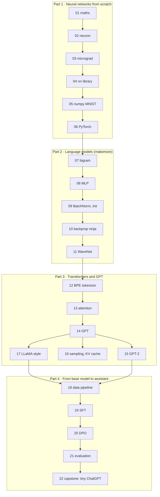

# LLM from Scratch 🧠

**Build a large language model with your own hands, starting from a single slope.** 22 lessons take you from "what is a derivative?" to training your own tiny ChatGPT: an autograd engine, a neural-network library, a digit reader, five generations of language models, a tokenizer, attention, GPT, GPT-2, LLaMA-style upgrades, instruction tuning, preference tuning, evaluation and a capstone. Nothing is a black box: you write every piece first, then use the professional tool for it.

**Like you're 5:** a big AI model is a huge Lego castle. Most courses hand you the finished castle. Here you first learn what one brick is, how two bricks click together, how to build a wall, then a tower, and only at the end the whole castle. When it wobbles, you'll know which brick to fix.

The course follows the order of Andrej Karpathy's **Neural Networks: Zero to Hero** lectures (https://www.youtube.com/playlist?list=PLAqhIrjkxbuWI23v9cThsA9GvCAUhRvKZ), but it is self-contained: every lesson has its own complete, tested code and explains every symbol in plain words. The videos are the perfect companion; each lesson tells you which part of which video to watch, and when.

## Who it's for
- You can write basic Python (variables, lists, loops, functions, running a `.py` file) and want to understand how LLMs really work, not just call them.
- You are an absolute beginner at maths for machine learning. Lesson 01 teaches all of it with small numbers; every formula in the course comes with a table explaining each symbol.
- You want depth. The [ai-engineer-journey](../ai-engineer-journey) course covers some of these topics faster and lighter (levels 2, 5 and 6); this course goes all the way down.

## Prerequisites
- **Python basics:** [ai-from-zero](../ai-from-zero) **Parts 1–3** (or equivalent): [00 · Start here](../ai-from-zero/00-start-here) installs Python and an editor, Parts 1–2 practise Python, Part 3 gives a first, friendly look at neural networks.
- **A laptop** with 8 GB of RAM (Windows, Mac or Linux). No GPU needed for Parts 1–2 or the default runs of Parts 3–4.
- **No API keys.** Everything runs locally. A few optional lessons download open data or weights.

## The 22 lessons

| Part | # | Lesson | Time |
|---|---|---|---|
| [**1 · Neural networks from scratch**](part-1-neural-networks-from-scratch) | 01 | [The maths you need, explained simply](part-1-neural-networks-from-scratch/01-the-math-you-need-explained-simply) | ~1.5 h |
| | 02 | [A neuron in plain Python](part-1-neural-networks-from-scratch/02-a-neuron-in-plain-python) | ~1.5 h |
| | 03 | [Micrograd: an autograd engine](part-1-neural-networks-from-scratch/03-micrograd-an-autograd-engine) | ~3 h |
| | 04 | [A neural-net library on micrograd](part-1-neural-networks-from-scratch/04-a-neural-net-library-on-micrograd) | ~2 h |
| | 05 | [A numpy network reads handwriting](part-1-neural-networks-from-scratch/05-numpy-network-reads-handwriting) | ~3 h |
| | 06 | [PyTorch tensors and autograd](part-1-neural-networks-from-scratch/06-pytorch-tensors-and-autograd) | ~2.5 h |
| [**2 · Language models step by step**](part-2-language-models-step-by-step) | 07 | [Bigram language model](part-2-language-models-step-by-step/07-bigram-language-model) | ~3 h |
| | 08 | [MLP language model](part-2-language-models-step-by-step/08-mlp-language-model) | ~3 h |
| | 09 | [Activations, BatchNorm and initialisation](part-2-language-models-step-by-step/09-activations-batchnorm-and-initialization) | ~3 h |
| | 10 | [Backprop ninja: manual gradients](part-2-language-models-step-by-step/10-backprop-ninja-manual-gradients) | ~4 h |
| | 11 | [WaveNet: a deeper character model](part-2-language-models-step-by-step/11-wavenet-deeper-character-model) | ~3 h |
| [**3 · Transformers and GPT**](part-3-transformers-and-gpt) | 12 | [BPE tokenizer from scratch](part-3-transformers-and-gpt/12-bpe-tokenizer-from-scratch) | ~3 h |
| | 13 | [Attention from scratch](part-3-transformers-and-gpt/13-attention-from-scratch) | ~3 h |
| | 14 | [Build GPT from scratch](part-3-transformers-and-gpt/14-build-gpt-from-scratch) | ~4 h |
| | 15 | [Reproduce GPT-2 small](part-3-transformers-and-gpt/15-reproduce-gpt2-small) | ~5 h |
| | 16 | [Sampling and the KV cache](part-3-transformers-and-gpt/16-sampling-and-the-kv-cache) | ~3 h |
| | 17 | [Modern LLM architecture, LLaMA style](part-3-transformers-and-gpt/17-modern-llm-architecture-llama-style) | ~4 h |
| [**4 · From base model to assistant**](part-4-from-base-model-to-assistant) | 18 | [Pretraining data pipeline](part-4-from-base-model-to-assistant/18-pretraining-data-pipeline) | ~3 h |
| | 19 | [Instruction tuning (SFT) from scratch](part-4-from-base-model-to-assistant/19-instruction-tuning-sft-from-scratch) | ~4 h |
| | 20 | [Preference tuning (DPO) from scratch](part-4-from-base-model-to-assistant/20-preference-tuning-dpo-from-scratch) | ~3 h |
| | 21 | [Evaluating your LLM](part-4-from-base-model-to-assistant/21-evaluating-your-llm) | ~3 h |
| | 22 | [Capstone: train your own tiny ChatGPT](part-4-from-base-model-to-assistant/22-capstone-train-your-own-tiny-chatgpt) | ~5 h |

**Total: about 8–10 weeks at 1 hour a day**, plus the videos (about 20 hours, best watched alongside).

## Map of the course


## Lesson ↔ video map
Karpathy's lectures, in playlist order, and where each one lives in this course. Every lesson's **Watch alongside** section lists the video's chapters next to the matching steps of the lesson.

| Video (Andrej Karpathy) | Length | Lessons |
|---|---|---|
| [L1 · The spelled-out intro to neural networks and backpropagation: building micrograd](https://www.youtube.com/watch?v=VMj-3S1tku0) | 2 h 25 | 01 (first 20 min), 02, **03**, **04**, 06 (the PyTorch part) |
| [L2 · The spelled-out intro to language modeling: building makemore](https://www.youtube.com/watch?v=PaCmpygFfXo) | 1 h 57 | **07** (and broadcasting for 06) |
| [L3 · Building makemore Part 2: MLP](https://www.youtube.com/watch?v=TCH_1BHY58I) | 1 h 15 | **08** |
| [L4 · Building makemore Part 3: Activations & Gradients, BatchNorm](https://www.youtube.com/watch?v=P6sfmUTpUmc) | 1 h 55 | **09** |
| [L5 · Building makemore Part 4: Becoming a Backprop Ninja](https://www.youtube.com/watch?v=q8SA3rM6ckI) | 1 h 55 | **10** (and the cross-entropy derivation in 05) |
| [L6 · Building makemore Part 5: Building a WaveNet](https://www.youtube.com/watch?v=t3YJ5hKiMQ0) | 56 min | **11** |
| [L7 · Let's build GPT: from scratch, in code, spelled out](https://www.youtube.com/watch?v=kCc8FmEb1nY) | 1 h 56 | 13, **14**, 16 |
| [L8 · Let's build the GPT Tokenizer](https://www.youtube.com/watch?v=zduSFxRajkE) | 2 h 13 | **12** |
| [L9 · Let's reproduce GPT-2 (124M)](https://www.youtube.com/watch?v=l8pRSuU81PU) | 4 h 01 | **15** (and ideas for 18, 21) |
| [Intro to Large Language Models](https://www.youtube.com/watch?v=zjkBMFhNj_g) (1 h talk) | 1 h | good overview before Part 3 |
| [Deep Dive into LLMs like ChatGPT](https://www.youtube.com/watch?v=7xTGNNLPyMI) | 3 h 31 | Part 4 (pretraining data, SFT, RLHF, evaluation) |

Lesson 05 (MNIST) has no Karpathy lecture: it pairs with **3Blue1Brown's neural networks playlist** (https://www.youtube.com/playlist?list=PLZHQObOWTQDNU6R1_67000Dx_ZCJB-3pi), whose first four chapters use exactly that digit-reading network. Lessons 17 and 19–22 go beyond the playlist; their READMEs point to other material (Karpathy's [nanochat](https://github.com/karpathy/nanochat) repository is the closest companion for the capstone).

Code that inspired the course, all on GitHub: [micrograd](https://github.com/karpathy/micrograd), [makemore](https://github.com/karpathy/makemore), [minbpe](https://github.com/karpathy/minbpe), [nanoGPT](https://github.com/karpathy/nanoGPT), [build-nanogpt](https://github.com/karpathy/build-nanogpt), [llm.c](https://github.com/karpathy/llm.c), [nanochat](https://github.com/karpathy/nanochat), and the lecture notebooks in [nn-zero-to-hero](https://github.com/karpathy/nn-zero-to-hero). A good companion book: Sebastian Raschka, *Build a Large Language Model (From Scratch)*, code at https://github.com/rasbt/LLMs-from-scratch.

## Set up once
Do this one time; every lesson then only needs `cd` into its folder.

1. Open a terminal (Windows: PowerShell; Mac: Terminal; Linux: any terminal) and go to the folder where you cloned or downloaded this repository, then into the course:
```bash
cd llm-from-scratch
```
2. Create a **virtual environment** (a private box of Python packages just for this course):
```bash
python -m venv .venv
```
| Piece | Meaning |
|---|---|
| `python` | start Python (`python3` on some Macs/Linux, `py` on some Windows setups) |
| `-m venv` | `-m` = "run a module as a program"; `venv` = Python's built-in virtual-environment tool |
| `.venv` | the folder to create it in; the leading dot hides it in most file browsers |

3. Turn it on (you'll see `(.venv)` at the start of your prompt):
```bash
source .venv/bin/activate          # Mac / Linux
.venv\Scripts\Activate.ps1         # Windows PowerShell
```
| Piece | Meaning |
|---|---|
| `source` | run the commands in a file inside your current shell (Mac/Linux) |
| `.venv/bin/activate` | the script that switches `python` and `pip` to the ones in `.venv` |
| `\` and `Scripts` | Windows uses backslashes and a `Scripts` folder instead of `bin` |

4. Install the packages for Parts 1 and 2:
```bash
pip install numpy torch matplotlib pytest
```
| Piece | Meaning |
|---|---|
| `pip install` | download and install Python packages from pypi.org |
| `numpy` | fast maths on arrays |
| `torch` | PyTorch (a few hundred MB). Linux without an NVIDIA GPU: `pip install torch --index-url https://download.pytorch.org/whl/cpu` is a smaller CPU-only build |
| `matplotlib` | optional pictures (`--plot` flags) |
| `pytest` | runs each lesson's tests |

Parts 3 and 4 add a few packages (`regex`, `tiktoken`, `transformers`); their part READMEs give the exact line.

5. Check it works:
```bash
python -c "import numpy, torch; print('numpy', numpy.__version__, '| torch', torch.__version__)"
```
`-c "..."` runs the Python code in quotes. You should see two version numbers. Every new terminal session: repeat step 3 before working.

## How each lesson is organised
Every lesson folder has a `README.md` with the same sections, so you always know where to look: **What you'll build** (plus a *Like you're 5* line) → **Why this matters** → **What you'll learn** → **Before you start** (installs) → **Run it** (numbered steps, each new command explained piece by piece) → **What you should see** (real output from running the code) → **How it works** (step by step, with diagrams, worked numeric examples before every formula, and a table explaining each symbol) → **If something goes wrong** → **Try this** (3 exercises with hints or solutions) → **Check yourself** (questions with answers) → **Watch alongside** (which video, which minutes) → **Learn more** (official docs, papers) → **Next**.

The code is complete and runs as-is; tests (`pytest -q`) include **gradient checks** that compare hand-derived gradients with numerical ones or with PyTorch. Generated files (downloaded data, pictures, model checkpoints) are created by the code and listed in [`.gitignore`](.gitignore) so they never end up in git.

## Hardware: CPU is enough for parts 1 and 2
- **Parts 1–2:** any laptop CPU. The longest default run takes a few minutes (lesson 04's pure-Python training about 3 min, lesson 11 about 2 min; the optional full lesson 11 run 6–8 min).
- **Parts 3–4:** every default run is sized for a laptop CPU (seconds to ~15 minutes) and automatically uses an NVIDIA (`cuda`) or Apple Silicon (`mps`) GPU if you have one.
- **When a GPU helps** (lesson 14 bigger settings, **lesson 15's full GPT-2 reproduction** and **lesson 22's larger capstone run**), these are good options:

| Option | Cost | Good for | How |
|---|---|---|---|
| [Google Colab](https://colab.research.google.com) | free tier (a T4 GPU when available, sessions time out) | trying bigger settings of lessons 14, 16, 17, 22 | upload or clone the repo in a notebook, *Runtime → Change runtime type → T4 GPU*, then run `!python script.py` |
| [Kaggle Notebooks](https://www.kaggle.com/docs/notebooks) | free weekly GPU quota (after phone verification) | the same, with longer sessions | *Settings → Accelerator → GPU*, then run the scripts in a notebook cell |
| [Lambda](https://lambda.ai) or [RunPod](https://www.runpod.io) | pay per hour (roughly $1–3/h per modern GPU, more for multi-GPU machines) | lesson 15's full 124M-parameter run and lesson 22's larger run | rent a machine, `ssh` in, `git clone` this repo, follow the lesson's cloud section; **shut the machine down when done** |

Prices and free quotas change; check each provider's page.

## Where this sits in the roadmap
- **Before:** [ai-from-zero](../ai-from-zero) Parts 1–3 (Python, first neural networks).
- **Alongside or before:** [ai-engineer-journey](../ai-engineer-journey) levels 2, 5 and 6 are lighter previews of Parts 1, 2 and 3.
- **After:** [forward-deployed-ai-engineer](../forward-deployed-ai-engineer) (or go back to whichever course you paused). Knowing how models work inside makes you far better at choosing, fine-tuning, evaluating and debugging them for real customers.

## Read the official docs
- Python virtual environments: https://docs.python.org/3/library/venv.html
- NumPy: https://numpy.org/doc/stable/
- PyTorch documentation: https://pytorch.org/docs/stable/index.html and tutorials: https://pytorch.org/tutorials/
- pytest: https://docs.pytest.org/en/stable/
