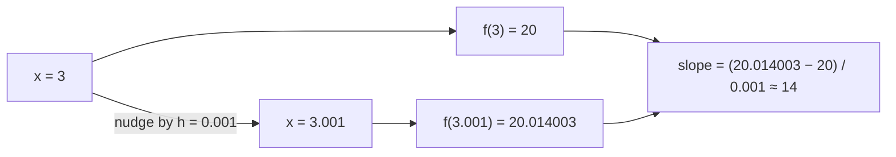
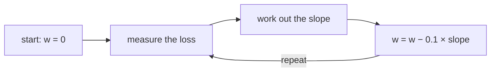

# 01 · The maths you need, explained simply

**What you'll build:** one Python file, `math_tour.py`, that shows you every bit of maths this course uses (slopes, the chain rule, walking downhill, vectors, matrices, exp and log) with tiny numbers you can check in your head.
**Like you're 5:** a derivative is how steep a slide is. If you know how steep every part of the slide is, you always know which way is down.
**Time:** ~1.5 h · **Builds on:** nothing (Python basics from [ai-from-zero](../../../ai-from-zero) help) · **Needs:** nothing extra (only `numpy`)

## Why this matters
Every neural network, from a 1-neuron toy to Claude or GPT, learns the same way: it measures how wrong it is, works out the *slope* of that wrongness for every knob, and nudges each knob downhill. That is calculus (slopes) plus linear algebra (lots of multiplications at once). You do not need a maths degree; you need the six ideas in this lesson, understood properly.

## What you'll learn
- **Derivative:** how much an output moves when you nudge an input a tiny bit (the slope).
- **Partial derivative:** with several inputs, one slope per input, measured while the others stay still.
- **Chain rule:** when steps are chained, their slopes multiply.
- **Gradient descent:** repeatedly stepping against the slope to reach the lowest point.
- **Vectors, matrices, broadcasting, exp and log:** the shapes and functions every later lesson uses.

## Before you start
- Set up the course once (see the [course README](../../README.md#set-up-once)), then:
```bash
pip install numpy
```
| Piece | Meaning |
|-------|---------|
| `pip` | Python's package installer (it downloads libraries from pypi.org) |
| `install` | the action: download and install |
| `numpy` | the package: fast maths on arrays (lists) of numbers |

- No API key needed.

## Run it
1. Open a terminal in the course folder `llm-from-scratch`.
2. Go into this lesson:
```bash
cd part-1-neural-networks-from-scratch/01-the-math-you-need-explained-simply
```
3. Run the tour:
```bash
python math_tour.py
```

**Command, piece by piece**

| Piece | Meaning |
|-------|---------|
| `cd` | "change directory": move into a folder |
| `part-1-.../01-...` | the folder path; `/` separates a folder from the folder inside it |
| `python` | start the Python interpreter (on some Macs/Linux it is `python3`) |
| `math_tour.py` | the file to run; `.py` means "Python source code" |

### What you should see
Real output (shortened in two places, marked `...`):
```
============================================================
1. Derivative = slope (nudge x, watch f move)
============================================================
f(3.0) = 20.0
nudge h = 1.0     -> f moved by  17.000000 -> slope = 17.0000
nudge h = 0.1     -> f moved by   1.430000 -> slope = 14.3000
nudge h = 0.01    -> f moved by   0.140300 -> slope = 14.0300
nudge h = 0.001   -> f moved by   0.014003 -> slope = 14.0030
nudge h = 0.0001  -> f moved by   0.001400 -> slope = 14.0003
exact slope from the rule 6x - 4 = 14.0
At x = -3 the slope is -22.0 (negative: f goes DOWN as x goes up)
At x = 2/3 the slope is 0.0 (zero: the bottom of the valley)
...
3. Chain rule: slopes multiply along a chain
x = 1.0, u = 2x+1 = 3.0, y = u^2 = 9.0
du/dx = 2.0, dy/du = 2u = 6.0
chain rule: dy/dx = dy/du * du/dx = 6.0 * 2.0 = 12.0
check by nudging x: 12.0004
...
4. Gradient descent: walk downhill to the lowest point
step  0: w = 0.0000  loss = 9.000000  slope = -6.0000
step  5: w = 2.0170  loss = 0.966368  slope = -1.9661
step 10: w = 2.6779  loss = 0.103763  slope = -0.6442
...
step 30: w = 2.9963  loss = 0.000014  slope = -0.0074
...
Surprise = -log(probability you gave the right answer):
  p = 1.0   -> -log(p) = 0.0000
  p = 0.9   -> -log(p) = 0.1054
  p = 0.5   -> -log(p) = 0.6931
  p = 0.1   -> -log(p) = 2.3026
  p = 0.01  -> -log(p) = 4.6052

softmax preview: scores [2.  1.  0.1] -> probabilities [0.659  0.2424 0.0986] sum = 1.0
```
Look at three things: the slope settles on **14** as the nudge `h` gets smaller; the chain-rule answer **12** matches the nudging check; and gradient descent walks `w` from 0 to almost exactly **3**.

## How it works
Read each section of `math_tour.py` next to its explanation below.

### 1. A derivative is a slope
Picture walking along the curve `f(x) = 3x² − 4x + 5`. At `x = 3` you are at height `f(3) = 27 − 12 + 5 = 20`. Take a tiny step `h = 0.001` to the right: the height becomes `20.014003`. You rose `0.014003` for a run of `0.001`, so the slope is `0.014003 / 0.001 = 14.003`. Smaller steps give `14.0003`, then `14.00003`... the number they are heading towards, **14**, is the **derivative** at `x = 3`.



The formula behind section 1:

$$f'(x) = \lim_{h \to 0} \frac{f(x+h) - f(x)}{h}$$

| Symbol | Plain words |
|--------|-------------|
| `f(x)` | "f of x": the output of the function f when the input is x |
| `f'(x)` | "f prime of x": the derivative (slope) of f at x. Also written `df/dx` |
| `h` | a tiny nudge added to x |
| `lim h→0` | "what the answer settles on as h gets closer and closer to 0" |
| fraction bar | divide: (how much f moved) / (how much x moved) = rise over run |

Rules of thumb you will use: the slope of `x²` is `2x`; of `3x` is `3`; of a constant (like `5`) is `0`. So `3x² − 4x + 5` has slope `6x − 4`, which at `x = 3` is `14`. A **negative** slope means "going right takes you down"; a **zero** slope means you are at a flat spot (here, the bottom of the valley at `x = 2/3`).

### 2. Several inputs: one slope each
`d = a·b + c` with `a = 2, b = −3, c = 10` gives `d = 4`. Nudge only `a` by `0.0001`: `d` changes by `−0.0003`, so the slope with respect to `a` is `−3`, which is just `b`. That makes sense: if you have `b` lots of `a`, one more `a` adds `b`. This is a **partial derivative**, written `∂d/∂a`.

| Symbol | Plain words |
|--------|-------------|
| `∂d/∂a` | "how much d changes if a nudges a little, with b and c held still" (the curly ∂ means "partial": other inputs frozen) |
| `∂d/∂a = b` | multiplication passes the *other* number back as the slope |
| `∂d/∂c = 1` | addition passes the slope through unchanged |

### 3. The chain rule
`y = (2x + 1)²` is really two steps: first `u = 2x + 1`, then `y = u²`. A bicycle analogy: if `u` moves **2** times as fast as `x`, and `y` moves **6** times as fast as `u` (at this point, because `2u = 6`), then `y` moves `2 × 6 = 12` times as fast as `x`. Slopes along a chain **multiply**:

$$\frac{dy}{dx} = \frac{dy}{du} \cdot \frac{du}{dx}$$

| Symbol | Plain words |
|--------|-------------|
| `dy/dx` | how much y changes per tiny change in x (the whole chain) |
| `dy/du` | the slope of the last step alone (here `2u = 6`) |
| `du/dx` | the slope of the first step alone (here `2`) |
| `·` | multiply |

A neural network is a very long chain of small steps. **Backpropagation** (lesson 03) is nothing more than the chain rule applied from the end of the chain back to the start.

### 4. Gradient descent
`loss(w) = (w − 3)²` is a valley with its bottom at `w = 3`. The script starts at `w = 0`, where the slope is `2(w − 3) = −6` (negative: going right goes down). The update rule is:

$$w \leftarrow w - \eta \cdot \frac{d\,\text{loss}}{dw}$$

| Symbol | Plain words |
|--------|-------------|
| `←` | "becomes": replace the old value with the new one |
| `η` (Greek "eta") | the **learning rate**: how big each step is (here `0.1`) |
| `d loss / dw` | the slope of the loss at the current w |
| `−` | step *against* the slope, i.e. downhill |

Worked example: step 0 is `w = 0 − 0.1 × (−6) = 0.6`. Then the slope is `−4.8`, so `w = 0.6 + 0.48 = 1.08`, and so on. The steps shrink as the slope flattens near the bottom. "**Gradient**" just means the list of all the partial derivatives when there are many knobs.



### 5–6. Vectors and matrices
- A **vector** is a list of numbers: `quantities = [2, 1, 3]`. Its **shape** is `(3,)`.
- The **dot product** multiplies pairs and adds them up. A shopping receipt: `2×0.5 + 1×2.0 + 3×1.2 = 6.6`. In numpy: `quantities @ prices`.

$$\mathbf{a} \cdot \mathbf{b} = \sum_{i=1}^{n} a_i b_i$$

| Symbol | Plain words |
|--------|-------------|
| bold **a**, **b** | vectors (lists of numbers) |
| `Σ` (Greek capital "sigma") | add them all up |
| `i = 1` to `n` | for every position from the first to the last |
| `aᵢ bᵢ` | the i-th number of a times the i-th number of b |

- A **matrix** is a table of numbers with shape `(rows, columns)`. In `W` (shape `(3, 2)`), each row is one neuron's two weights. `W @ x` does three dot products at once: one per neuron. That is a whole **layer** of neurons in one line.
- Shapes must line up: `(4, 2) @ (2, 3) → (4, 3)`. The inner numbers (2 and 2) must match; the outer ones (4 and 3) are the result's shape. Here 4 examples each get 3 neuron outputs. `W.T` is the **transpose**: rows become columns.

### 7. Broadcasting
`out` has shape `(4, 3)`, `bias` has shape `(3,)`. Numpy "stretches" `bias` into 4 identical rows and adds. This is **broadcasting**: it saves you writing loops. Rule: compare shapes from the right; sizes must be equal or 1 (or missing).

### 8. Sums, means and spread along an axis
`axis=0` adds *down* the columns (one answer per column); `axis=1` adds *across* each row. `keepdims=True` keeps the result as a column `(4, 1)` so it can broadcast back against the `(4, 3)` table. The **mean** is the average; the **standard deviation** (std) is the typical distance from the mean (here `2.0`). Lesson 09's BatchNorm is built from exactly these.

### 9. exp and log
- `exp(z)` = e (≈ 2.718) to the power z. It turns any number, even negative, into a positive one, and bigger inputs give much bigger outputs.
- `log` (natural log, "ln") undoes `exp`, and turns multiplication into addition: `log(0.5 × 0.2) = log(0.5) + log(0.2)`.
- **Surprise** `−log(p)`: if your model gave the right answer probability `p = 1`, surprise is 0. At `p = 0.5` it is `0.69`; at `p = 0.01` it is `4.6`. Averaging this surprise over many examples is exactly the **loss** of every language model in this course.
- **Softmax**: `exp` each score, then divide by the total, so the results are positive and add up to 1 (probabilities). Scores `[2, 1, 0.1]` become `[0.659, 0.242, 0.099]`.

## If something goes wrong
- **`ModuleNotFoundError: No module named 'numpy'`** → your virtual environment is not active, or numpy is not installed in it. Activate it (course README) and run `pip install numpy`.
- **`python: command not found`** → use `python3 math_tour.py` (Mac/Linux) or `py math_tour.py` (Windows).
- **`can't open file 'math_tour.py'`** → you are in the wrong folder. Run `pwd` (Mac/Linux) or `cd` (Windows) to see where you are, then `cd` into the lesson folder.
- **Your slope at h = 0.0001 shows extra digits like `14.000300000063`** → that is normal floating-point rounding: computers store decimals approximately.

## Try this
1. Change `x = 3.0` in section 1 to `x = 0.0`. What slope do you expect from the rule `6x − 4`? Check it.
   <details><summary>Solution</summary>The rule gives `6·0 − 4 = −4`, and the nudging loop settles on about `−3.9997` at `h = 0.0001`.</details>
2. In section 4, try `learning_rate = 1.1`. What happens, and why?
   <details><summary>Hint and answer</summary>Each step overshoots the bottom by more than it started, so `w` bounces further and further away (the loss grows). A learning rate that is too big makes training **diverge**. Try `0.9` too: it zig-zags but still arrives.</details>
3. Add a section that checks the chain rule on `y = exp(3x)` at `x = 0.5`. (The slope of `exp(u)` is `exp(u)`.)
   <details><summary>Solution</summary>

```python
x = 0.5
u = 3 * x
analytic = math.exp(u) * 3            # dy/du * du/dx
numeric = (math.exp(3 * (x + 1e-6)) - math.exp(u)) / 1e-6
print(analytic, numeric)              # both about 13.4451
```
</details>

## Check yourself
1. The slope of a function at some point is negative. If you increase the input a little, does the output go up or down?
2. `z = x · y` with `x = 4`, `y = 5`. What is `∂z/∂x`? What is `∂z/∂y`?
3. Why do we *subtract* `learning_rate × slope` in gradient descent?
4. What is the shape of `(32, 30) @ (30, 200)`?
<details><summary>Answers</summary>

1. Down. Negative slope means the output decreases as the input increases.
2. `∂z/∂x = y = 5` and `∂z/∂y = x = 4`: each input's slope is the other input.
3. The slope points uphill (the direction that increases the loss). Subtracting it moves downhill, reducing the loss.
4. `(32, 200)`: the inner 30s match and disappear; you get 32 rows (examples) by 200 columns (neurons). You will see exactly this in lesson 08.
</details>

## Watch alongside
- **Andrej Karpathy, "The spelled-out intro to neural networks and backpropagation: building micrograd"** (L1): https://www.youtube.com/watch?v=VMj-3S1tku0. Watch the chapters *"derivative of a simple function with one input"* (≈ 0:08) and *"derivative of a function with multiple inputs"* (≈ 0:14). They use the very same `3x² − 4x + 5` and `a·b + c` examples as sections 1 and 2. (Times are approximate; use the chapter list in the video description.) The rest of that video is lesson 03.
- **3Blue1Brown, "Essence of calculus"** for pictures of slopes and the chain rule: [YouTube search](https://www.youtube.com/results?search_query=3blue1brown+essence+of+calculus).
- **3Blue1Brown, "Essence of linear algebra"** for vectors and matrices as arrows and transformations: [YouTube search](https://www.youtube.com/results?search_query=3blue1brown+essence+of+linear+algebra).
- **StatQuest** explains gradient descent step by step: [YouTube search](https://www.youtube.com/results?search_query=statquest+gradient+descent+step+by+step).

## Learn more (optional)
**Read the official docs**
- NumPy for absolute beginners: https://numpy.org/doc/stable/user/absolute_beginners.html
- NumPy broadcasting: https://numpy.org/doc/stable/user/basics.broadcasting.html
- Python `math` module (exp, log): https://docs.python.org/3/library/math.html

Lighter preview of the same ideas: [ai-engineer-journey 2.1 · One neuron learns y = 2x](../../../ai-engineer-journey/level-2-neural-nets-from-scratch/01-one-neuron-learns-y-equals-2x).

## Next
→ [02 · A neuron in plain Python](../02-a-neuron-in-plain-python)
