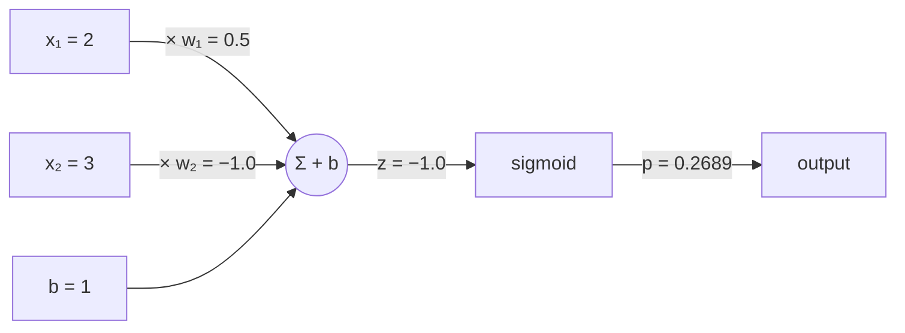
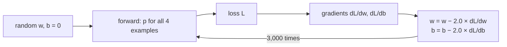

# 02 · A neuron in plain Python

**What you'll build:** a single artificial neuron in pure Python (no libraries), with its gradients worked out by hand using the chain rule, checked by nudging, and trained to learn the AND and OR gates. Then you watch it fail at XOR and see why.
**Like you're 5:** a neuron is a judge at a talent show. Each act gets points from several judges' opinions (the inputs), some opinions count more than others (the weights), and at the end the judge says "yes" or "no" (the activation).
**Time:** ~1.5 h · **Builds on:** [01 · The maths you need](../01-the-math-you-need-explained-simply) · **Needs:** nothing extra

## Why this matters
Every large model is made of billions of these simple units. GPT's feed-forward layers, the "attention" scores, the final "which word comes next" layer: all are weighted sums followed by a squashing function. If you can write one neuron and its gradient by hand, every later lesson is "the same thing, many times, done efficiently".

## What you'll learn
- **Weighted sum:** `z = w₁x₁ + w₂x₂ + b`, the neuron's raw score.
- **Activation function:** the sigmoid squashes `z` into 0..1 so it reads like a probability.
- **Loss:** one number that says how wrong the neuron is (here mean squared error).
- **Gradient by the chain rule, checked numerically:** the most important debugging habit in deep learning.
- **Linear separability:** why one neuron can learn AND/OR but never XOR.

## Before you start
- Nothing to install for `neuron.py` (plain Python). For the tests: `pip install pytest` (or `pip install -r requirements.txt`).

| Piece | Meaning |
|-------|---------|
| `pip install -r requirements.txt` | install every package listed in the file `requirements.txt`; `-r` means "read the list from this file" |
| `pytest` | a tool that finds files named `test_*.py` and runs the functions inside that start with `test_` |

- No API key needed.

## Run it
1. From the course folder `llm-from-scratch`:
```bash
cd part-1-neural-networks-from-scratch/02-a-neuron-in-plain-python
```
2. Run the neuron:
```bash
python neuron.py
```
3. Run the tests (they include a gradient check):
```bash
pytest -q
```

| Piece | Meaning |
|-------|---------|
| `pytest` | run all tests in this folder |
| `-q` | "quiet": print one dot per passing test instead of a long report |

### What you should see
```
1) One forward pass by hand
  z = 0.5*2 + (-1.0)*3 + 1 = -1.0
  p = sigmoid(-1.0) = 0.2689

2) Gradients by the chain rule vs by nudging (gradient check)
  loss = 0.265581
  dL/dw1: chain rule +0.016209   nudging +0.016209
  dL/dw2: chain rule +0.003518   nudging +0.003518
  dL/db : chain rule +0.140897   nudging +0.140897
  biggest difference: 5.6e-08  -> OK, they agree

3) Learning AND
  step     0  loss 0.28462
  step  1000  loss 0.00263
  step  2000  loss 0.00124
  step  3000  loss 0.00080
  learned w = [6.73, 6.73], b = -10.18
  [0, 0] -> 0.000 (target 0) right
  [0, 1] -> 0.031 (target 0) right
  [1, 0] -> 0.031 (target 0) right
  [1, 1] -> 0.964 (target 1) right

4) Learning OR
  ...
  learned w = [7.40, 7.40], b = -3.46
  [0, 0] -> 0.030 (target 0) right
  [0, 1] -> 0.981 (target 1) right
  [1, 0] -> 0.981 (target 1) right
  [1, 1] -> 1.000 (target 1) right

5) Learning XOR
  step     0  loss 0.27335
  step  1000  loss 0.25000
  step  2000  loss 0.25000
  step  3000  loss 0.25000
  learned w = [0.00, 0.00], b = 0.00
  [0, 0] -> 0.500 (target 0) can't decide (coin flip)
  [0, 1] -> 0.500 (target 1) can't decide (coin flip)
  [1, 0] -> 0.500 (target 1) can't decide (coin flip)
  [1, 1] -> 0.500 (target 0) can't decide (coin flip)
```
and from `pytest -q`: `4 passed`. Look at: the two gradient columns agreeing to 6 decimals; AND being learned with `b = −10.18` (both inputs are needed to beat that bias); and XOR's loss stuck at exactly `0.25`.

## How it works

### Step 1: the forward pass (`neuron()`)

Worked by hand: `z = 0.5·2 + (−1.0)·3 + 1 = 1 − 3 + 1 = −1`. Then `sigmoid(−1) = 1 / (1 + e¹) = 1 / 3.718 = 0.2689`.

$$z = \sum_{i} w_i x_i + b \qquad p = \sigma(z) = \frac{1}{1 + e^{-z}}$$

| Symbol | Plain words |
|--------|-------------|
| `xᵢ` | the i-th input number |
| `wᵢ` | the weight (importance) of the i-th input; a knob the neuron can learn |
| `b` | the bias: a knob that shifts the score up or down regardless of inputs |
| `Σᵢ` | add up over all inputs i |
| `σ` (Greek "sigma", small) | the sigmoid function |
| `e` | Euler's number ≈ 2.718; `e^(−z)` is `math.exp(-z)` |

The sigmoid turns very negative `z` into ≈ 0, `z = 0` into exactly 0.5, very positive `z` into ≈ 1. Other activations you'll meet: `tanh` (squashes to −1..1, lessons 03–11) and `ReLU` (`max(0, z)`, lessons 04–06).

### Step 2: the loss (`loss_and_grads()`)
For each example we compare the output `p` with the target `y` (0 or 1) and square the difference, then average:

$$L = \frac{1}{n}\sum_{k=1}^{n} (p_k - y_k)^2$$

| Symbol | Plain words |
|--------|-------------|
| `L` | the loss: one number, lower is better |
| `n` | how many examples (4 for AND) |
| `pₖ`, `yₖ` | the neuron's output and the correct answer for example k |
| `(…)²` | square it: makes every error positive and punishes big errors more |

### Step 3: the gradient by the chain rule
The knob `w₁` affects the loss through a chain: `w₁ → z → p → L`. So, by lesson 01's chain rule, multiply the three local slopes:

| Link | Local slope | Why |
|------|-------------|-----|
| `L = (p − y)²` → `dL/dp` | `2(p − y)` | slope of a square |
| `p = σ(z)` → `dp/dz` | `p(1 − p)` | a neat property of the sigmoid |
| `z = w₁x₁ + w₂x₂ + b` → `dz/dw₁` | `x₁` | if you add one to w₁, z grows by x₁ |
| `dz/db` | `1` | bias is added directly |

$$\frac{\partial L}{\partial w_1} = \frac{1}{n}\sum_k 2(p_k - y_k)\cdot p_k(1 - p_k)\cdot x_{1,k}$$

Worked example for one AND example `x = [1, 1], y = 1` with `w = [0.3, −0.2], b = 0.1`: `z = 0.2`, `p = 0.5498`, `dL/dp = 2(0.5498 − 1) = −0.9004`, `dp/dz = 0.5498 · 0.4502 = 0.2475`, so `dL/dz = −0.2229` and `dL/dw₁ = −0.2229 · 1`. The code does this for all 4 examples and averages (`/ n`). The line `dL_dz = 2 * (p - y) * p * (1 - p)` is exactly the first two links multiplied.

### Step 4: the gradient check (`numeric_grads()`)
To be sure the maths is right, nudge each knob by `h = 0.000001`, recompute the loss, and divide the change by `h` (lesson 01's slope). If the chain-rule answer and the nudged answer agree to ~6 decimals, the formula is right. **Always gradient-check new backward code**; you will do it again in lessons 03, 05, 06 and 10.

### Step 5: training (`train()`)

The learning rate `lr = 2.0` is large because sigmoid slopes are small (at most 0.25).

### Step 6: why XOR fails
One neuron says "yes" when `w₁x₁ + w₂x₂ + b > 0`. The border `w₁x₁ + w₂x₂ + b = 0` is a **straight line** across the 2-D input square. For AND, a line can cut off the corner `[1,1]`; for OR, it can cut off `[0,0]`. For XOR, the "yes" points `[0,1]` and `[1,0]` sit on opposite corners: no single straight line separates them from `[0,0]` and `[1,1]`. The best a single neuron can do is say 0.5 for everything, which gives exactly `(0.5)² = 0.25` loss. Lesson 04 adds a hidden layer and XOR becomes easy.
```
x2                         AND: line cuts off [1,1]      XOR: no straight line works
1 | [0,1]=0   [1,1]=1        0   \ 1                       1      0
0 | [0,0]=0   [1,0]=0        0    0 \                      0      1
    0          1  x1
```

## If something goes wrong
- **`OverflowError: math range error`** → you set weights or the learning rate so large that `math.exp(-z)` overflowed. Lower `lr` (e.g. 1.0) or start weights in −1..1.
- **Gradient check says MISMATCH after you edit the code** → your chain-rule formula and your forward pass no longer describe the same function. Check you changed both.
- **`ModuleNotFoundError: No module named 'pytest'`** → `pip install pytest` inside your active virtual environment.
- **Loss goes down very slowly** → normal for sigmoid + squared error when outputs are near 0 or 1 (the slope `p(1−p)` is tiny there). More steps or a larger `lr` help.

## Try this
1. Train on NAND (`[0,0]→1, [0,1]→1, [1,0]→1, [1,1]→0`). Does one neuron manage it?
   <details><summary>Solution</summary>

```python
NAND = [([0, 0], 1), ([0, 1], 1), ([1, 0], 1), ([1, 1], 0)]
w, b = train(NAND)
```
Yes: NAND is AND flipped, still separable by one line. Expect negative weights and a positive bias.</details>
2. Replace the learning rate `2.0` with `0.1` and with `20`. What changes?
   <details><summary>Hint</summary>0.1: the loss falls much more slowly (about 0.021 after 3,000 steps instead of 0.0008). 20: it reaches a much lower loss (about 0.00007) here, because sigmoid's slope is small; on harder problems such big steps diverge.</details>
3. Change the loss to **binary cross-entropy**, `L = −[y·log(p) + (1−y)·log(1−p)]`, and its gradient. Show that the chain rule simplifies `dL/dz` to `p − y`, and update `loss_and_grads` (keep the gradient check passing).
   <details><summary>Solution</summary>`dL/dp = −y/p + (1−y)/(1−p) = (p − y) / (p(1 − p))`. Multiply by `dp/dz = p(1−p)`: everything cancels to `p − y`. In code: `total += -(y*math.log(p) + (1-y)*math.log(1-p))` and `dL_dz = p - y`. This "cancels to p − y" trick is exactly why softmax + cross-entropy has the simple gradient you'll use in lessons 05–11.</details>

## Check yourself
1. A neuron has `w = [1, 1]`, `b = −1.5`. What is `z` for input `[1, 1]`, and is the sigmoid output above or below 0.5?
2. Why do we check gradients by nudging when we already have a formula?
3. What does the bias let a neuron do that weights alone cannot?
4. Why does XOR's loss get stuck at exactly 0.25?
<details><summary>Answers</summary>

1. `z = 1 + 1 − 1.5 = 0.5`, positive, so `sigmoid(0.5) ≈ 0.62`, above 0.5 ("yes"). Inputs `[0,1]` give `z = −0.5`, below 0.5. This neuron computes AND.
2. Hand-written formulas are easy to get subtly wrong; nudging is slow but almost impossible to get wrong, so it's a trustworthy referee.
3. Shift the dividing line away from the origin. Without `b`, input `[0, 0]` always gives `z = 0` and output 0.5.
4. The best single line cannot separate XOR, so the gradients pull the weights to 0 and every output to 0.5; each squared error is `0.5² = 0.25`, and so is their average.
</details>

## Watch alongside
- **Andrej Karpathy, micrograd (L1)**: https://www.youtube.com/watch?v=VMj-3S1tku0. The chapter *"manual backpropagation example #2: a neuron"* (≈ 0:52) builds a neuron with `tanh` and backpropagates through it by hand, exactly what you just did with `sigmoid`. (Times are approximate; use the video's chapter list.)
- **3Blue1Brown, "But what is a neural network?"**, the first video of the neural networks playlist: https://www.youtube.com/playlist?list=PLZHQObOWTQDNU6R1_67000Dx_ZCJB-3pi
- **StatQuest** on neural networks and the chain rule: [YouTube search](https://www.youtube.com/results?search_query=statquest+neural+networks+part+1+inside+the+black+box).

## Learn more (optional)
**Read the official docs**
- Python `math` module: https://docs.python.org/3/library/math.html
- pytest getting started: https://docs.pytest.org/en/stable/getting-started.html

Lighter preview: [ai-from-zero 11 · One neuron learns](../../../ai-from-zero/part-3-neural-networks/11-one-neuron-learns). Book: *Neural Networks from Scratch* (Kinsley & Kukieła), https://nnfs.io

## Next
→ [03 · Micrograd: an autograd engine](../03-micrograd-an-autograd-engine)
