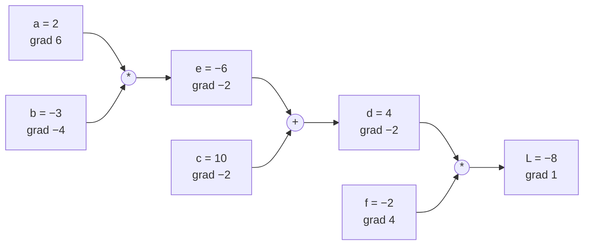
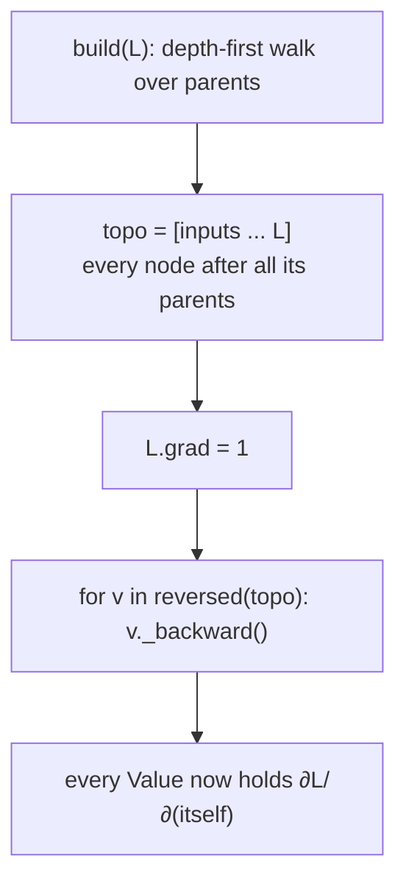

# 03 · Micrograd: an autograd engine

**What you'll build:** `engine.py`, a ~150-line "automatic gradient" engine. A `Value` remembers how it was computed, and one call to `.backward()` fills in the gradient of every number that led to the answer. You check it against hand calculations, against nudging, and against PyTorch.
**Like you're 5:** every number keeps a family tree. When the final score is in, the blame is passed down the tree: each parent gets its fair share, then passes some to its own parents.
**Time:** ~3 h (plus the 2.5 h video) · **Builds on:** [02 · A neuron in plain Python](../02-a-neuron-in-plain-python) · **Needs:** nothing extra (PyTorch optional, for the comparison)

## Why this matters
In lesson 02 you wrote the gradient formula by hand for one tiny neuron. A real model has millions of operations; nobody writes those by hand. PyTorch, JAX and TensorFlow all do what you build here: record the operations while computing (the **computation graph**), then walk the graph backwards applying the chain rule. Once you have built this, `loss.backward()` in every later lesson is no longer magic, and you can debug it when training goes wrong.

## What you'll learn
- **Computation graph:** each result stores its parents (`_prev`) and the operation that made it (`_op`).
- **Local derivative:** each operation only needs its own tiny slope rule (for `a*b`: the slope for `a` is `b`).
- **Backpropagation:** `child.grad` × local slope, added into each parent's `grad`: the chain rule as one line of code.
- **Topological order:** visit a node only after everything that uses it has passed its blame back.
- **Gradient accumulation:** why it is `+=` and not `=`, and why PyTorch needs `zero_grad()`.

## Before you start
- Nothing to install for `engine.py` and `demo.py`.
- Optional: `pip install torch` for the PyTorch comparison (PART 5 of the demo and one test). Without it, that part prints a note and is skipped.
- Tests: `pip install pytest` (or `pip install -r requirements.txt`).
- No API key needed.

## Run it
1. From the course folder `llm-from-scratch`:
```bash
cd part-1-neural-networks-from-scratch/03-micrograd-an-autograd-engine
```
2. Run the demo:
```bash
python demo.py
```
3. Run the gradient-check tests:
```bash
pytest -q
```

### What you should see
```
PART 1: a small expression  L = (a*b + c) * f
forward:  e = a*b = -6.0,  d = e + c = 4.0,  L = d*f = -8.0
by hand:  dL/da = 6.0, dL/db = -4.0, dL/dc = -2.0, dL/dd = -2.0, dL/de = -2.0, dL/df = 4.0
engine:   dL/da = 6.0, dL/db = -4.0, dL/dc = -2.0, dL/dd = -2.0, dL/de = -2.0, dL/df = 4.0
match!
after nudging every input along its grad, L went from -8.0 to -7.2865 (up, as predicted)

PART 2: one neuron  o = tanh(x1*w1 + x2*w2 + b)
o = 0.7071
  d o / d x1 = -1.5000
  d o / d w1 = +1.0000
  d o / d x2 = +0.5000
  d o / d w2 = +0.0000
  d o / d b  = +0.5000
  d o / d n  = +0.5000
Notice w2's grad is 0: x2 is 0, so wiggling w2 changes nothing.

Mermaid picture of this neuron (paste into https://mermaid.live):
flowchart LR
    n0["b | data 6.8814 | grad 0.5000"]
    n1["n | data 0.8814 | grad 0.5000"]
    n1_op(("+")) --> n1
    ...

PART 3: the same neuron, but tanh written as (e^(2n) - 1) / (e^(2n) + 1)
o = 0.7071;  grads x1 -1.5000, w1 +1.0000, x2 +0.5000, w2 +0.0000
Same numbers: a big operation or several small ones, the chain rule gives one answer.

PART 4: a value used more than once (why grads are ADDED with +=)
b = a + a -> db/da = 2.0  (with '=' instead of '+=' it would wrongly be 1.0)
f = (a*b)*(a+b) at a=-2, b=3 -> df/da = -3.0, df/db = -8.0

PART 5: check against PyTorch
PyTorch:    o = 0.7071; grads x1 -1.5000, w1 +1.0000, x2 +0.5000, w2 +0.0000
micrograd:  o = 0.7071; grads x1 -1.5000, w1 +1.0000, x2 +0.5000, w2 +0.0000
identical!
```
and `9 passed` from `pytest -q`. Paste the printed Mermaid text into https://mermaid.live to see your neuron's graph with every value and gradient.

## How it works

### The forward pass builds a graph
`L = (a*b + c) * f` with `a = 2, b = −3, c = 10, f = −2`:

Each arithmetic operator in `Value` (`__add__`, `__mul__`, ...) computes the number **and** creates a new `Value` that remembers its parents: `Value(self.data * other.data, (self, other), "*")`. Python calls `__mul__` when you write `a * b`; that is how ordinary-looking maths builds a graph.

### The backward pass, by hand (PART 1 of `demo.py`)
Start at the end and walk back. `grad` always means `∂L/∂(this value)`: "if this value nudged up by a tiny amount, how much would L move?"

| Step | Rule | Number |
|------|------|--------|
| `L.grad` | L changes 1:1 with itself | 1 |
| `d.grad` | `L = d·f`, slope for d is f | `−2 × 1 = −2` |
| `f.grad` | slope for f is d | `4 × 1 = 4` |
| `e.grad`, `c.grad` | `d = e + c`: "+" passes the grad through | `−2`, `−2` |
| `a.grad` | `e = a·b`: slope for a is b, times e's grad | `−3 × −2 = 6` |
| `b.grad` | slope for b is a, times e's grad | `2 × −2 = −4` |

$$\frac{\partial L}{\partial a} = \frac{\partial L}{\partial e}\cdot\frac{\partial e}{\partial a} = (-2)\cdot b = 6$$

| Symbol | Plain words |
|--------|-------------|
| `∂L/∂a` | how much L changes if a nudges a little (everything else frozen) |
| `∂L/∂e` | the "upstream" gradient that has already arrived at e from above |
| `∂e/∂a` | the "local" slope of the one operation that made e |
| `·` | multiply: chain rule |

**Prediction test:** if every input moves a tiny step in the direction of its grad (`v.data += 0.01 * v.grad`), L should go *up*. It does: −8 → −7.2865. Training does the opposite (moves *against* the grad) to push a loss *down*.

### Each operation's `_backward` (in `engine.py`)
| Operation | Forward | Local rule in `_backward` |
|-----------|---------|---------------------------|
| `a + b` | `a + b` | `a.grad += out.grad`, `b.grad += out.grad` |
| `a * b` | `a · b` | `a.grad += b · out.grad`, `b.grad += a · out.grad` |
| `a ** k` | `aᵏ` | `a.grad += k·aᵏ⁻¹ · out.grad` (power rule) |
| `a.exp()` | `eᵃ` | `a.grad += eᵃ · out.grad` |
| `a.log()` | `ln a` | `a.grad += (1/a) · out.grad` |
| `a.tanh()` | `t = tanh a` | `a.grad += (1 − t²) · out.grad` |
| `a.relu()` | `max(0, a)` | `a.grad += (1 if out > 0 else 0) · out.grad` |

Subtraction, division and negation are built from these: `a − b = a + (−1·b)`, `a / b = a · b⁻¹`. `__radd__`, `__rmul__` etc. make `2 * a` work when the plain number comes first.

### `backward()`: topological order, then reverse

Why the order matters: `a` may be used by several children. It must receive blame from **all** of them before it passes blame to its own parents. Reversed topological order guarantees that.

### PART 2: a neuron
`o = tanh(x1·w1 + x2·w2 + b)` with `b = 6.8813...` (chosen so `n = 0.8814` and `o = tanh(n) = 0.7071 = 1/√2`). Then `do/dn = 1 − o² = 1 − 0.5 = 0.5`, and the `+` nodes pass `0.5` to `b`, `x1*w1` and `x2*w2`. At the `*`: `w1.grad = x1 · 0.5 = 1.0`, `x1.grad = w1 · 0.5 = −1.5`, `w2.grad = x2 · 0.5 = 0` (x2 is 0, so w2 cannot matter).

### PART 3: granularity is your choice
Writing `tanh` as `(e²ⁿ − 1)/(e²ⁿ + 1)` builds a bigger graph out of `exp`, `+`, `−`, `**−1` and `*`, but gives identical gradients. You can make an operation as big or small as you like, as long as you know its local derivative. PyTorch's `tanh` is one big node; you could build it from pieces.

### PART 4: the `+=` rule
`b = a + a`: the `+` node sends `1 × b.grad` to `a` **twice**. With `=`, the second write would overwrite the first and give 1 instead of 2. So grads must **accumulate** (`+=`). The flip side: before each new backward pass you must reset grads to 0, which is what `model.zero_grad()` does in lesson 04 and `optimizer.zero_grad()` does in PyTorch.

### The tests (`test_engine.py`)
For six formulas mixing every operation, at 10 random points each, the engine's grads must equal the central-difference slope `(f(x+h) − f(x−h)) / 2h`. One more test compares a tricky expression with PyTorch. This is the same gradient-check idea as lesson 02, automated.

## If something goes wrong
- **`(install torch to compare with PyTorch: pip install torch)`** → not an error: torch isn't installed, so PART 5 was skipped. `pip install torch` to run it (and the PyTorch test stops being skipped).
- **`RecursionError: maximum recursion depth exceeded`** → `build()` is recursive and Python allows about 1,000 nested calls. Very long graphs (e.g. summing thousands of Values one by one) hit it. Add `import sys; sys.setrecursionlimit(10000)` at the top of your script, or keep graphs smaller.
- **`AssertionError: only plain-number powers`** → `v ** w` where `w` is a `Value` is not supported; use `(w * v.log()).exp()` for that.
- **Grads are twice as big as expected** → you called `backward()` twice on the same graph without resetting grads to 0 (accumulation!).
- **`math domain error` from `log`** → `log` of zero or a negative number; check what you feed it.

## Try this
1. Add a `sigmoid()` method to `Value` (forward `s = 1/(1+e^−x)`, local slope `s(1−s)`), and test it with the nudging check in `test_engine.py`.
   <details><summary>Solution</summary>

```python
def sigmoid(self):
    s = 1 / (1 + math.exp(-self.data))
    out = Value(s, (self,), "sigmoid")
    def _backward():
        self.grad += s * (1 - s) * out.grad
    out._backward = _backward
    return out
```
Then add one line to `FORMULAS` in `test_engine.py`: `"sigmoid": lambda a, b: (a * b).sigmoid(),` and run `pytest -q`. (`numeric_slope` wraps plain numbers in `Value` for you, so the same formula serves both sides of the check.)</details>
2. Break `engine.py` on purpose: change `self.grad += ...` to `self.grad = ...` in `__add__`. Which demo lines and tests now fail? Put it back.
   <details><summary>Answer</summary>PART 4 prints `db/da = 1.0` and `df/da = -6.0, df/db = -6.0` (wrong), PART 5 says `DIFFERENT?!` (PART 3's `e2n` is used twice through `+`), and three tests fail: `reused`, `test_grad_accumulates_when_value_is_reused` and `test_matches_pytorch` (its expression uses `x`, `z` and `q` more than once). The other six pass, because in those formulas no Value is used twice through a `+`. Bugs like this hide until a value is reused, which is why the tests include formulas that reuse values.</details>
3. Use the engine to do 20 steps of gradient descent on `loss = (w·3 − 6)²` starting at `w = 0` with learning rate 0.01. Where does `w` end?
   <details><summary>Solution</summary>

```python
from engine import Value
w = Value(0.0)
for _ in range(20):
    loss = (w * 3 - 6) ** 2
    w.grad = 0.0
    loss.backward()
    w.data -= 0.01 * w.grad
print(w.data)   # 1.962...: close to 2, the bottom of the valley (more steps -> closer)
```
</details>

## Check yourself
1. In `c = a * b` with `a = 3`, `b = 4`, and `c.grad = 2`, what are `a.grad` and `b.grad` after `c._backward()`?
2. Why do we set the output's grad to `1.0` before walking backwards?
3. Why must the walk be in *reverse* topological order?
4. What would go wrong if you trained without resetting grads to zero each step?
<details><summary>Answers</summary>

1. `a.grad = b × 2 = 8`, `b.grad = a × 2 = 6`.
2. `∂L/∂L = 1`: the output changes one-for-one with itself. It is the starting value the chain rule multiplies.
3. A node can only pass on its grad once it has received the full amount from every node that used it. Reverse topological order guarantees all users come first.
4. Each step's grads would add to all previous steps' grads, so updates would be based on a growing, stale sum and training would go wrong (often blowing up).
</details>

## Watch alongside
**Andrej Karpathy, "The spelled-out intro to neural networks and backpropagation: building micrograd"** (L1): https://www.youtube.com/watch?v=VMj-3S1tku0. This lesson follows its first two hours. Approximate times from the video's chapter list:

| Video chapter (≈ time) | Matches in this lesson |
|------------------------|------------------------|
| micrograd overview (≈ 0:00–0:08) | Why this matters |
| derivatives with one and multiple inputs (≈ 0:08–0:19) | lesson 01 sections 1–2 (recap) |
| starting the core Value object and its visualisation (≈ 0:19) | `Value.__init__`, `to_mermaid()` (he uses graphviz, we use Mermaid: no install) |
| manual backpropagation example #1: simple expression (≈ 0:32) | PART 1 "by hand" |
| preview of a single optimisation step (≈ 0:51) | PART 1 "nudging" line |
| manual backpropagation example #2: a neuron (≈ 0:52) | PART 2 |
| implementing the backward function for each operation (≈ 1:09) | the `_backward` table |
| implementing backward for a whole graph, topological sort (≈ 1:17) | `backward()` |
| fixing a backprop bug when one node is used multiple times (≈ 1:22) | PART 4 |
| breaking up a tanh, exercising more operations (≈ 1:27) | PART 3 |
| doing the same thing in PyTorch (≈ 1:39) | PART 5 |
| building a neural net library on micrograd (≈ 1:43 onwards) | **lesson 04** |

Also: the code that inspired this lesson, https://github.com/karpathy/micrograd, and 3Blue1Brown's chapter "What is backpropagation really doing?" in the neural networks playlist: https://www.youtube.com/playlist?list=PLZHQObOWTQDNU6R1_67000Dx_ZCJB-3pi

## Learn more (optional)
**Read the official docs**
- PyTorch autograd mechanics: https://pytorch.org/docs/stable/notes/autograd.html
- A gentle introduction to `torch.autograd`: https://pytorch.org/tutorials/beginner/blitz/autograd_tutorial.html
- Python data model (how `__add__`, `__mul__`, `__radd__` work): https://docs.python.org/3/reference/datamodel.html
- Mermaid flowcharts: https://mermaid.js.org/syntax/flowchart.html

Lighter preview: [ai-engineer-journey 2.6 · Micrograd autograd engine](../../../ai-engineer-journey/level-2-neural-nets-from-scratch/06-micrograd-autograd-engine).

## Next
→ [04 · A neural-net library on micrograd](../04-a-neural-net-library-on-micrograd)
