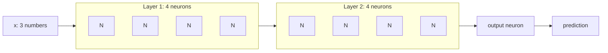
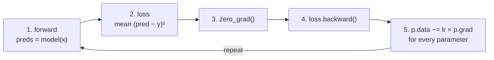

# 04 · A neural-net library on micrograd

**What you'll build:** `nn.py`, a tiny neural-network library (`Neuron`, `Layer`, `MLP`, `Module`) on top of your micrograd engine, then two training scripts: one solves XOR (which a single neuron could not), the other learns to separate the "two moons" dataset with 100% accuracy.
**Like you're 5:** a neuron is one Lego brick. A layer is a row of bricks side by side. An MLP is rows stacked into a tower. The engine from lesson 03 tells every brick how to wiggle to make the tower better.
**Time:** ~2 h · **Builds on:** [03 · Micrograd](../03-micrograd-an-autograd-engine) · **Needs:** nothing extra

## Why this matters
PyTorch's `nn.Module`, `nn.Linear` and `model.parameters()` are organised exactly like the 80 lines of `nn.py`. Once you have built them yourself, reading real model code (including GPT's in Part 3) becomes "oh, that's just a Module holding Layers". You also write the full **training loop** (forward, loss, zero grads, backward, update), which never changes from here to the capstone.

## What you'll learn
- **Module:** anything with `parameters()`; `zero_grad()` resets all their grads.
- **Layer and MLP:** many neurons side by side; layers chained so one layer's outputs are the next layer's inputs.
- **The training loop:** the five steps every model in this course repeats.
- **Hinge loss, L2 regularisation and learning-rate decay:** three standard training tools, used on a real 2-D dataset.
- **Hidden layers bend the boundary:** why XOR and the moons become learnable.

## Before you start
- Nothing to install to run the scripts (plain Python). For the tests: `pip install pytest` (or `pip install -r requirements.txt`).
- `engine.py` here is an exact copy of lesson 03's, so this folder works on its own.
- No API key needed.

## Run it
1. From the course folder `llm-from-scratch`:
```bash
cd part-1-neural-networks-from-scratch/04-a-neural-net-library-on-micrograd
```
2. Train the tiny examples (under a second):
```bash
python train_tiny.py
```
3. Train on the two moons (pure Python, so it takes **2–3 minutes**):
```bash
python train_moons.py
```
4. Run the tests:
```bash
pytest -q
```

### What you should see
`train_tiny.py`:
```
A) the video's tiny dataset
  MLP of [Layer of [tanhNeuron(3), tanhNeuron(3), tanhNeuron(3), tanhNeuron(3)], Layer of [...], Layer of [tanhNeuron(4)]]
  number of parameters: 41
  step   0  loss 0.78518
  step  10  loss 0.03868
  step  20  loss 0.01798
  step  30  loss 0.01144
  step  40  loss 0.00830
  step  50  loss 0.00648
  predictions: [0.923, -0.919, -0.931, 0.91]  targets: [1.0, -1.0, -1.0, 1.0]

B) XOR with a hidden layer (targets -1 = 'off', +1 = 'on')
  number of parameters: 17
  step   0  loss 1.09092
  step  50  loss 0.88973
  step 100  loss 0.63552
  step 150  loss 0.20045
  step 200  loss 0.06633
  [0.0, 0.0] -> -0.824 (target -1) right
  [0.0, 1.0] -> +0.716 (target +1) right
  [1.0, 0.0] -> +0.760 (target +1) right
  [1.0, 1.0] -> -0.697 (target -1) right
Two layers can bend the boundary, so XOR is solved.
```
`train_moons.py`:
```
model has 337 parameters
step   0  loss 0.9030  accuracy 50%
step  10  loss 0.2449  accuracy 90%
step  20  loss 0.1668  accuracy 92%
step  30  loss 0.1191  accuracy 95%
step  40  loss 0.0726  accuracy 97%
step  50  loss 0.0409  accuracy 100%
step  60  loss 0.0199  accuracy 100%
step  70  loss 0.0184  accuracy 100%
step  80  loss 0.0144  accuracy 100%
step  90  loss 0.0124  accuracy 100%
step  99  ...
+------------------------------------------------------------+
|............................................................|
|.....................o..................................... |
|..................o.o.....o..............................   |
|............o.o...o....ooo.o.ooo.......................     |
|............ooo.o.......o....oo..o.o................        |
|..........o..o......        .......oo............. x        |
|......o..........        x   ......o...........      x      |
|.....o..o.o....      xx       ...o............     xx       |
|.......oo......      x        ......oo......      x         |
|..............       x  x     .....o.o.o...                 |
|.........o....        x  x     ....o......    x  xx         |
|......o.o....                   .....o..      x  xx  x      |
|.............            xxx x    ...     x        x        |
|.............              xx xx          xxx x xx          |
|.............                    xx  x  x                   |
|................               x  x   x   x                 |
+------------------------------------------------------------+
o = top moon (-1)   x = bottom moon (+1)   dotted area = where the model says -1
```
(The picture is trimmed top and bottom here.) The dotted region hugs the top moon's curve: the network has learned a **curved** boundary. `pytest -q` prints `4 passed`.

## How it works

### `nn.py`: Neuron → Layer → MLP

1. **`Neuron(n_inputs)`** holds `n_inputs` weights (random in −1..1) and a bias (0), all `Value`s. Calling it computes `sum(wᵢ·xᵢ) + b` and applies `tanh`, `relu`, or nothing (`activation=None`, a "linear" neuron, used for the final output).
2. **`Layer(n_in, n_out)`** is a list of `n_out` neurons that all look at the same inputs. It returns a list of outputs (or a single `Value` if there is only one neuron).
3. **`MLP(n_in, [sizes])`** chains layers: `MLP(3, [4, 4, 1])` is 3 → 4 → 4 → 1. Parameter count: layer 1 has 4 × (3+1) = 16, layer 2 has 4 × (4+1) = 20, the output has 1 × (4+1) = 5, total **41**.
4. **`Module`** gives every class `zero_grad()` (set every parameter's grad to 0) and `parameters()` (collect every knob). PyTorch's `nn.Module` has the same two ideas.

### The training loop (`train()` in `train_tiny.py`)

Step 3 must come **before** step 4, because grads accumulate (`+=`, lesson 03).

### XOR is solved
With 4 hidden `tanh` neurons, each one draws its own straight line; the output neuron combines them. Two lines can fence off the two "on" corners of XOR, which a single line (lesson 02) cannot.

### `train_moons.py`: a real classification job
1. **`make_moons()`** creates 100 points on two interlocking half-circles plus random noise (`random.gauss`). Labels are −1 (top) and +1 (bottom). It is the same shape as scikit-learn's `make_moons`, written in plain Python so you need no extra library.
2. **The model**: `MLP(2, [16, 16, 1])` with `relu` hidden neurons and a linear output, 337 parameters. The output is a **score**: positive means "+1", negative means "−1".
3. **`loss_fn()`** uses two pieces:

$$L = \underbrace{\frac{1}{n}\sum_{k=1}^{n}\max(0,\; 1 - y_k s_k)}_{\text{hinge (max-margin) loss}} \;+\; \underbrace{\alpha \sum_{j} w_j^2}_{\text{L2 regularisation}}$$

| Symbol | Plain words |
|--------|-------------|
| `sₖ` | the model's score for point k |
| `yₖ` | the true label, −1 or +1 |
| `yₖ sₖ` | positive if the score has the right sign; large if confidently right |
| `max(0, 1 − yₖsₖ)` | zero once a point is right "by a margin" of 1; otherwise it grows the more wrong it is (this is `relu(1 − y·s)` in code) |
| `α` (alpha) | how strongly to punish big weights (`1e-4`) |
| `Σⱼ wⱼ²` | the sum of every parameter squared |

Worked example: a bottom-moon point (`y = +1`) with score `s = 0.3` gives hinge `max(0, 1 − 0.3) = 0.7`; with `s = 2.5` it gives `max(0, −1.5) = 0`, no more pushing. The **L2 term** keeps weights small, which keeps the boundary smooth instead of wiggling around single noisy points.

4. **Learning-rate decay**: `lr = 1.0 − 0.9 · step/100` starts with big steps (1.0) and ends with small ones (0.1), so training moves fast at first and settles gently.
5. **`ascii_plot()`** asks the model about a 60 × 22 grid of points and prints `.` where the score is negative, then draws the real points on top.

## If something goes wrong
- **`train_moons.py` seems frozen** → it is working: pure-Python autograd builds ~150,000 `Value`s per step. Expect 1–2 seconds per step, 2–3 minutes total. Lesson 05 shows how numpy makes this hundreds of times faster.
- **`RecursionError: maximum recursion depth exceeded`** → you made the dataset much bigger (e.g. 1,000 points), so the graph is too deep for the recursive `build()`. Add `import sys; sys.setrecursionlimit(10000)` at the top of the script.
- **Accuracy stuck at 50%** → a typo in the update (e.g. `+=` instead of `-=`) makes the model climb the loss. Check step 5.
- **`ModuleNotFoundError: No module named 'engine'`** → run the script from inside this lesson folder (where `engine.py` lives).

## Try this
1. In `train_tiny.py`, part A, change the learning rate from `0.1` to `0.5`, then `1.0`. What happens to the loss?
   <details><summary>Hint</summary>Bigger steps can speed things up, but with `tanh` everywhere the network can overshoot and bounce. Watch whether the loss still goes smoothly down.</details>
2. Make the moons network smaller: `MLP(2, [4, 1], ...)`. Does it still reach 100%?
   <details><summary>Hint</summary>Try it and look at the ASCII picture. A smaller network can only draw a simpler boundary; it usually still does well on this easy dataset but needs more steps. It also runs much faster (fewer Values).</details>
3. Add a `Module.save(path)` / `load(path)` pair that writes every parameter's `data` to a JSON file and reads it back.
   <details><summary>Solution</summary>

```python
import json

class Module:
    ...
    def save(self, path):
        with open(path, "w") as f:
            json.dump([p.data for p in self.parameters()], f)

    def load(self, path):
        with open(path) as f:
            for p, v in zip(self.parameters(), json.load(f)):
                p.data = v
```
The order of `parameters()` never changes for the same architecture, so a plain list is enough. PyTorch's `state_dict()` (lesson 06) is the same idea with names attached.</details>

## Check yourself
1. How many parameters does `MLP(2, [16, 16, 1])` have? Show the sum.
2. Why does the output layer have no `tanh`/`relu` in the moons model?
3. What does the hinge loss do for a point that is already correct with score 3?
4. What happens if you forget `model.zero_grad()`?
<details><summary>Answers</summary>

1. `16·(2+1) + 16·(16+1) + 1·(16+1) = 48 + 272 + 17 = 337`.
2. We want a raw score that can be any size and sign; the hinge loss uses its sign and size. A `relu` would make it never negative.
3. Nothing: `max(0, 1 − 1·3) = 0`, so its gradient is 0. Only points that are wrong, or right by less than the margin, push the boundary.
4. Each step's gradient is added to all previous ones, so the update uses a stale, growing sum and training goes off the rails.
</details>

## Watch alongside
- **Andrej Karpathy, micrograd (L1)**: https://www.youtube.com/watch?v=VMj-3S1tku0, from about **1:43** to the end. Approximate chapter times: *building out a neural net library (multi-layer perceptron) in micrograd* (≈ 1:43) = `nn.py`; *creating a tiny dataset, writing the loss function* (≈ 1:51) = `train_tiny.py` part A; *collecting all of the parameters of the neural net* (≈ 1:57) = `parameters()`; *doing gradient descent optimisation manually, training the network* (≈ 2:01) = the training loop, including the "forgot to zero_grad" bug he hits on camera; *summary* and *walkthrough of the full code of micrograd on github* (≈ 2:14–2:21) = the moons demo (`demo.ipynb` in his repo, which `train_moons.py` re-creates).
- The original code: https://github.com/karpathy/micrograd
- 3Blue1Brown, "Gradient descent, how neural networks learn" in the playlist: https://www.youtube.com/playlist?list=PLZHQObOWTQDNU6R1_67000Dx_ZCJB-3pi

## Learn more (optional)
**Read the official docs**
- PyTorch `nn.Module`: https://pytorch.org/docs/stable/generated/torch.nn.Module.html
- PyTorch "Build the neural network" tutorial: https://pytorch.org/tutorials/beginner/basics/buildmodel_tutorial.html
- scikit-learn `make_moons` (the dataset we re-create): https://scikit-learn.org/stable/modules/generated/sklearn.datasets.make_moons.html

Lighter preview: [ai-engineer-journey 2.4 · Your own mini framework](../../../ai-engineer-journey/level-2-neural-nets-from-scratch/04-mini-framework-layer-classes).

## Next
→ [05 · A numpy network reads handwriting](../05-numpy-network-reads-handwriting)
