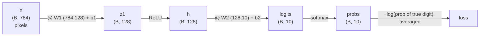
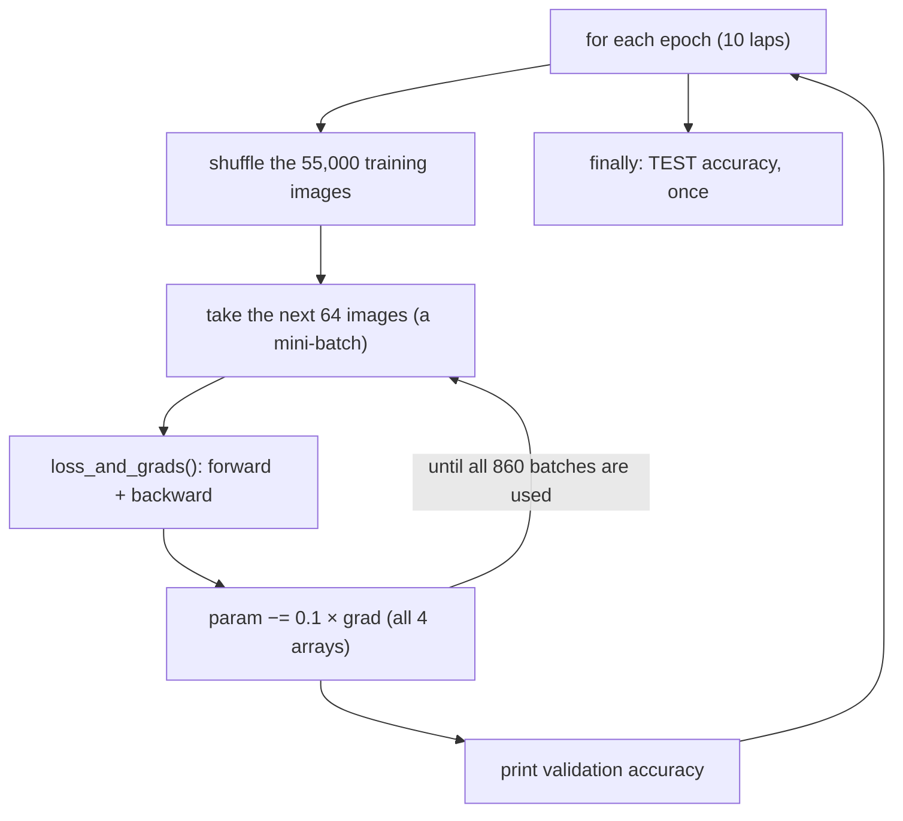

# 05 · A numpy network reads handwriting

**What you'll build:** a neural network that reads handwritten digits (0–9) at about **97.5% accuracy**, written with numpy only: your own data loader, forward pass, softmax + cross-entropy loss, hand-derived backward pass (checked numerically), and mini-batch training. It trains in under a minute on a laptop.
**Like you're 5:** you show a child 55,000 flashcards of handwritten numbers. Each time they guess wrong, you tell them the answer and they adjust a little. After a few rounds through the pile, they read new numbers they have never seen.
**Time:** ~3 h · **Builds on:** [04 · A neural-net library on micrograd](../04-a-neural-net-library-on-micrograd) · **Needs:** internet once (to download MNIST, 11 MB)

## Why this matters
Micrograd works one number at a time, so lesson 04's 337-parameter model took minutes. Real models do the same maths on whole **matrices** at once: this network has 101,770 parameters and trains on 55,000 images in seconds. Writing the vectorised backward pass yourself, especially the famous `probs − one_hot` gradient of softmax + cross-entropy, is exactly the maths inside the last layer of every language model in Parts 2–4, where the "classes" are characters or tokens instead of digits.

## What you'll learn
- **Vectorisation:** one matrix multiply processes a whole batch of 64 images at once.
- **Softmax + cross-entropy:** turn 10 scores into probabilities, and measure surprise at the right answer.
- **The backward pass in matrix form:** every gradient's shape matches its parameter's shape.
- **Mini-batch SGD, epochs, train/validation/test splits:** how real training is organised.
- **Gradient checking a whole network:** the habit from lessons 02–03, at scale.

## Before you start
```bash
pip install numpy pytest
```
| Package | What it's for |
|---------|---------------|
| `numpy` | all the maths |
| `pytest` | runs `test_numpy_net.py` |

**About the data.** MNIST is 70,000 28×28-pixel images of handwritten digits (60,000 for training, 10,000 for testing). `mnist.py` downloads the four original files the first time and stores them in `mnist_data/` next to the script. It tries three mirrors in order (the one PyTorch's torchvision uses, Google's copy, and a copy on GitHub) and checks each file's MD5 fingerprint, so a broken download is never used. The original site, yann.lecun.com, is often unreachable, so we don't rely on it.

**If the download fails** (no internet, a company firewall), download these four files by hand in a browser and put them in a folder called `mnist_data` inside this lesson folder (keep the `.gz` names; don't unzip them):
- https://ossci-datasets.s3.amazonaws.com/mnist/train-images-idx3-ubyte.gz
- https://ossci-datasets.s3.amazonaws.com/mnist/train-labels-idx1-ubyte.gz
- https://ossci-datasets.s3.amazonaws.com/mnist/t10k-images-idx3-ubyte.gz
- https://ossci-datasets.s3.amazonaws.com/mnist/t10k-labels-idx1-ubyte.gz

(The same files are also at `https://storage.googleapis.com/cvdf-datasets/mnist/` and `https://raw.githubusercontent.com/fgnt/mnist/master/` followed by the file name.) To keep them elsewhere, set the folder with an environment variable, e.g. `MNIST_DIR=/path/to/folder python numpy_net.py`.

No API key needed.

## Run it
1. From the course folder `llm-from-scratch`:
```bash
cd part-1-neural-networks-from-scratch/05-numpy-network-reads-handwriting
```
2. Download the data and look at the first digit:
```bash
python mnist.py
```
3. Train and test the network (about 10–60 seconds depending on your laptop):
```bash
python numpy_net.py
```
4. Optional: train longer, or with a bigger hidden layer:
```bash
python numpy_net.py --epochs 20 --hidden 256
```
| Piece | Meaning |
|-------|---------|
| `--epochs 20` | a **flag** (option) read by the script's `argparse`: 20 passes over the training data instead of the default 10 |
| `--hidden 256` | 256 hidden neurons instead of 128 |
| `--lr`, `--batch-size` | the other two flags: learning rate (default 0.1) and images per step (default 64) |

5. Run the tests (no download needed): `pytest -q`

### What you should see
`python mnist.py` (first run):
```
downloading train-images-idx3-ubyte.gz from https://ossci-datasets.s3.amazonaws.com/mnist/ ...
downloading train-labels-idx1-ubyte.gz from https://ossci-datasets.s3.amazonaws.com/mnist/ ...
downloading t10k-images-idx3-ubyte.gz from https://ossci-datasets.s3.amazonaws.com/mnist/ ...
downloading t10k-labels-idx1-ubyte.gz from https://ossci-datasets.s3.amazonaws.com/mnist/ ...
train: (60000, 784) images, (60000,) labels | test: (10000, 784), (10000,)
files are in .../05-numpy-network-reads-handwriting/mnist_data
first training label: 5
                =+*.*@@=
        ..-**@@@@@%*@@#:
       .@@@@@@@@@@---:.
        %@@@@@##@@
        -*=@@%  .*
           *@-
           +@#
            #@:
            .@%*=
             -@@@=
              .#@@+.
                -@@#
                 @@@:
              .+#@@%
            .+%@@@@#
           =%@@@@#-
         :%@@@@#-
       *%@@@@#-
    :*%@@@@@+
    +@@@%++
```
`python numpy_net.py`:
```
gradient check: worst relative error 5.6e-09 -> OK
train 55000, validation 5000, test 10000 images
101,770 parameters | loss before training 2.3030 (a fair 10-way guess gives -ln(1/10) = 2.3026)
epoch 1  train loss 0.4870  validation accuracy 94.12%  (1s)
epoch 2  train loss 0.2422  validation accuracy 95.54%  (2s)
epoch 3  train loss 0.1832  validation accuracy 96.22%  (3s)
epoch 4  train loss 0.1483  validation accuracy 96.24%  (3s)
epoch 5  train loss 0.1235  validation accuracy 97.14%  (5s)
epoch 6  train loss 0.1055  validation accuracy 97.36%  (6s)
epoch 7  train loss 0.0920  validation accuracy 97.74%  (6s)
epoch 8  train loss 0.0815  validation accuracy 97.78%  (7s)
epoch 9  train loss 0.0728  validation accuracy 97.82%  (8s)
epoch 10  train loss 0.0652  validation accuracy 97.90%  (9s)

TEST accuracy on 10,000 digits it has never seen: 97.53%
it got 247 wrong. Here is one of them:
                  ... +-.
               :*%@@@%@@@
            .+@@@@@@@@@@@
            :@@@@@@@%****
         +: :@%@*=:
        %@-  . .
       *@+
      +@@
     -@%.
     +@*
     @@@=.
     @@@@@+-=-..-.
     +@@@@@@@@@@@@*
      :%%@@@@@@@@@@=
         ::#@@@@@@@*
           =@@+:*@@*
           .@@@#@@@+
            *@@@@@*
             #@@%+
              -+
true label 5, model said 6 (92% sure); it gave the true label 4%
```
Check three numbers: the gradient check is tiny (`5.6e-09`), the loss before training is `2.3030`, almost exactly `ln 10` (a fair guess), and the test accuracy is about **97.5%**. The mistake it shows is a fair one: that 5 really does look like a 6.

## How it works

### Step 1: the data (`mnist.py`)
Each image is 28 × 28 = **784** pixels, each a number 0 (white) to 255 (black). `read_images()` skips the 16-byte header and reshapes the bytes into a table of shape `(count, 784)`: one row per image. `load_mnist()` divides by 255 so pixels are between 0 and 1 (neural nets train better on small numbers). The labels are just digits 0–9.

| Name | Shape | Meaning |
|------|-------|---------|
| `X_train` | (55000, 784) | training images, one row each (we keep the last 5,000 of the 60,000 aside) |
| `X_val` | (5000, 784) | **validation** images: checked after each epoch to watch progress |
| `X_test` | (10000, 784) | **test** images: used once, at the very end, for the honest score |

### Step 2: the network (`init_params()`, `forward()`)

`B` is the **batch size** (64 during training). Parameters: `784·128 + 128 + 128·10 + 10 = 101,770`.

- **ReLU** `max(0, z)` keeps positives and zeroes negatives. It is the simplest useful non-linearity and trains fast.
- **He initialisation**: `W1` starts as random numbers times `√(2/784)`. Lesson 09 explains why this scale keeps signals healthy; for now: not too big, not too small.
- **Small `W2` (× 0.01)** makes all 10 logits start near 0, so the first guess is "10% each", and the starting loss is `−ln(0.1) = 2.3026`. That is a free sanity check: if your first loss is far from 2.30, something is wrong.

### Step 3: softmax and cross-entropy (`softmax()`, `loss_and_grads()`)
Worked example with 3 classes. Logits `[2.0, 1.0, 0.1]`, true class 0:
1. exponentiate: `e² = 7.389`, `e¹ = 2.718`, `e⁰·¹ = 1.105`; total `11.212`
2. divide by the total: probs `[0.659, 0.242, 0.099]` (add up to 1)
3. loss = `−ln(0.659) = 0.417`. Had the true class been 2: `−ln(0.099) = 2.31` (much more surprised).

$$p_i = \frac{e^{z_i}}{\sum_{j} e^{z_j}} \qquad L = -\frac{1}{B}\sum_{k=1}^{B} \ln p_{k,\,y_k}$$

| Symbol | Plain words |
|--------|-------------|
| `zᵢ` | the logit (raw score) for class i |
| `e^{zᵢ}` | `np.exp(z_i)`: always positive |
| `Σⱼ e^{zⱼ}` | add up the exponentials of all classes (the normaliser) |
| `pᵢ` | probability of class i |
| `B` | number of images in the batch |
| `yₖ` | the true digit of image k |
| `p_{k, yₖ}` | the probability the model gave to the *correct* digit of image k: `probs[np.arange(B), y]` |
| `ln` | natural log (`np.log`) |

The code subtracts each row's maximum before `exp` (`logits − max`): this changes nothing in the result (it cancels in the fraction) but stops `exp(1000)` from overflowing to infinity.

### Step 4: the backward pass, derived
**The key result:** for softmax followed by cross-entropy, the gradient of the loss with respect to the logits is simply

$$\frac{\partial L}{\partial z_{k,i}} = \frac{1}{B}\left(p_{k,i} - \mathbb{1}[i = y_k]\right)$$

| Symbol | Plain words |
|--------|-------------|
| `𝟙[i = yₖ]` | "one-hot": 1 if class i is the true class, else 0 |
| `p − 𝟙` | the probabilities, with 1 subtracted at the true class |
| `1/B` | because the loss is an average over B images |

In words: *push the true class's score up by how much probability it was missing, and push every other class down by how much probability it wrongly got.* With the example above (true class 0): `[0.659 − 1, 0.242, 0.099] = [−0.341, 0.242, 0.099]`. Why it is that simple, in two lines: `L = −ln pᵧ = −zᵧ + ln Σⱼ e^{zⱼ}`. The slope of `−zᵧ` is −1 for the true class only, and the slope of `ln Σ e^{zⱼ}` with respect to `zᵢ` is `e^{zᵢ}/Σ e^{zⱼ} = pᵢ`. Add them: `pᵢ − 𝟙[i = y]`. (Lesson 10 does this derivation in full, step by step.)

Then the chain rule backwards through each layer, in matrix form. A rule that saves you every time: **a gradient always has the same shape as the thing it is the gradient of**, and you can find the right matrix product just by making the shapes fit.

| Code | Shapes | Why |
|------|--------|-----|
| `dlogits = (probs − one_hot) / B` | (B, 10) | the key result above |
| `dW2 = h.T @ dlogits` | (128, B) @ (B, 10) → (128, 10) | `logits = h @ W2`: each weight's grad sums input × upstream grad over the batch |
| `db2 = dlogits.sum(0)` | (10,) | `b2` was added to every row, so its grads add up over rows |
| `dh = dlogits @ W2.T` | (B, 10) @ (10, 128) → (B, 128) | blame sent back to the hidden layer |
| `dz1 = dh * (z1 > 0)` | (B, 128) | ReLU lets the gradient through only where it was "on" |
| `dW1 = X.T @ dz1`, `db1 = dz1.sum(0)` | (784, 128), (128,) | same pattern as layer 2 |

### Step 5: the gradient check (`gradient_check()`)
On a tiny network (6 inputs, 5 hidden, 4 classes) in float64, it nudges **every** parameter by ±`1e-5`, computes `(L(+h) − L(−h)) / 2h` (the **central difference**, more accurate than lesson 02's one-sided version), and reports the worst **relative error** `|numeric − ours| / (|numeric| + |ours|)`. Below ~`1e-6` means correct; `5.6e-09` is excellent.

### Step 6: training (`main()`)

**Mini-batch SGD** (stochastic gradient descent): instead of computing the exact gradient on all 55,000 images (slow), estimate it from 64 random ones (fast, a bit noisy) and take many more steps. An **epoch** is one full lap through the training data. The **validation** set is how you pick settings (epochs, learning rate) without peeking at the **test** set, which is touched only once so its score stays honest.

## If something goes wrong
- **`Could not download train-images-idx3-ubyte.gz`** → no internet or a firewall blocks all three mirrors. Download the four files by hand (see Before you start) into `mnist_data/`.
- **`the file was damaged (wrong fingerprint)`** → a download was cut off. The script tries the next mirror automatically; if all fail, delete `mnist_data/` and try again on a better connection.
- **Loss becomes `nan`** → the learning rate is too high for your change (e.g. `--lr 5`). Go back to `0.1`.
- **Accuracy stuck near 10%** → a bug in the update or the backward pass. Run `pytest -q`: the gradient check test will point at it.
- **`MemoryError` on a small machine** → evaluation runs in chunks of 10,000; lower `batch=10000` in `accuracy()` to `2000`.

## Try this
1. Run with `--hidden 32` and with `--hidden 512`. How do accuracy and speed change?
   <details><summary>Hint</summary>In our runs (10 epochs): 32 hidden neurons reached 96.4% test accuracy, 512 reached 97.6%, versus 97.5% for 128. Fewer neurons train faster but top out lower; more neurons are slower per epoch and help only a little here. More capacity helps, with diminishing returns.</details>
2. Print a **confusion count**: which true digit is most often mistaken for which other digit?
   <details><summary>Solution</summary>

Add at the end of `main()`:
```python
confusion = np.zeros((10, 10), dtype=int)
np.add.at(confusion, (y_test, preds), 1)      # row = true digit, column = predicted digit
np.fill_diagonal(confusion, 0)                # ignore the correct answers
t, p = np.unravel_index(confusion.argmax(), confusion.shape)
print(f"most common mistake: true {t} read as {p} ({confusion[t, p]} times)")
```
In our run: a true 7 read as 2, 23 times.</details>
3. Add **momentum**: keep a running "velocity" for every parameter, `v = 0.9·v + grad`, and update with `param −= lr·v`. Does it reach 97% in fewer epochs?
   <details><summary>Solution</summary>

Before the epoch loop: `velocity = {k: np.zeros_like(v) for k, v in params.items()}`. In the update:
```python
for name in params:
    velocity[name] = 0.9 * velocity[name] + grads[name]
    params[name] -= args.lr * velocity[name]
```
Use a learning rate of `0.02` with momentum (the velocity makes effective steps up to 10× bigger). In our run the test accuracy after epochs 1–4 was 94.1%, 96.0%, 96.5%, 97.0%: a little faster than plain SGD at `0.1`, not dramatically. Momentum matters more on bumpy, deep problems.</details>

## Check yourself
1. Why does the untrained network's loss start at about 2.30?
2. What is `dlogits` for one image whose probabilities are `[0.1, 0.7, 0.2]` and whose true class is 2 (ignore the `1/B`)?
3. `W1` has shape `(784, 128)`. What shape must `dW1` have, and which product of `X` (B, 784) and `dz1` (B, 128) gives it?
4. Why keep a validation set separate from the test set?
<details><summary>Answers</summary>

1. Small output weights make all 10 probabilities ≈ 0.1, and `−ln(0.1) = ln(10) ≈ 2.3026`.
2. `[0.1, 0.7, 0.2 − 1] = [0.1, 0.7, −0.8]`: push class 2 up, push classes 0 and 1 down.
3. `(784, 128)`, from `X.T @ dz1`: (784, B) @ (B, 128).
4. You make decisions based on validation results (how many epochs, which learning rate). If you made them on the test set, its score would be optimistic. The test set stays untouched until the end, so it measures how the model does on truly new data.
</details>

## Watch alongside
Karpathy's series has no MNIST lecture; these fit this lesson best:
- **3Blue1Brown, neural networks playlist**: https://www.youtube.com/playlist?list=PLZHQObOWTQDNU6R1_67000Dx_ZCJB-3pi. Chapters 1–4 use *exactly this task* (a 784-input network reading MNIST digits): chapter 1 (structure) = Step 2, chapter 2 (gradient descent) = Step 6, chapters 3–4 (backpropagation and its calculus) = Step 4.
- **Andrej Karpathy, makemore part 4 "Backprop Ninja"** (L5): https://www.youtube.com/watch?v=q8SA3rM6ckI, chapter *"exercise 2: cross entropy loss backward pass"* (≈ 1:26) derives the same `probs − one_hot` result. You will do that whole video in lesson 10; peeking now is fine.
- **sentdex, "Neural Networks from Scratch"** series builds the same pieces in numpy: [YouTube search](https://www.youtube.com/results?search_query=sentdex+neural+networks+from+scratch+softmax).

## Learn more (optional)
**Read the official docs**
- NumPy matrix multiplication `@` / `np.matmul`: https://numpy.org/doc/stable/reference/generated/numpy.matmul.html
- NumPy broadcasting: https://numpy.org/doc/stable/user/basics.broadcasting.html
- Python `argparse` tutorial (how the `--epochs` flags work): https://docs.python.org/3/howto/argparse.html
- The MNIST file format is described in the torchvision source of `MNIST`: https://pytorch.org/vision/stable/generated/torchvision.datasets.MNIST.html

Book: *Neural Networks from Scratch* (Kinsley & Kukieła), https://nnfs.io. Lighter preview: [ai-from-zero 14 · Read handwritten digits](../../../ai-from-zero/part-3-neural-networks/14-read-handwritten-digits) (the PyTorch version).

## Next
→ [06 · PyTorch tensors and autograd](../06-pytorch-tensors-and-autograd)
