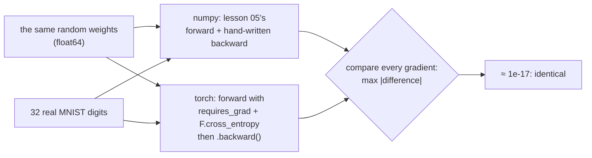
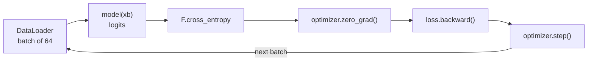

# 06 · PyTorch tensors and autograd

**What you'll build:** three scripts that bridge "from scratch" to the tool the rest of the course uses: a guided tour of PyTorch tensors and autograd, a proof that PyTorch computes **exactly** the gradients you derived by hand in lesson 05, and lesson 05's digit reader rebuilt the standard PyTorch way (`nn.Module`, `optim.SGD`, `DataLoader`, saving and loading).
**Like you're 5:** you built a bicycle from parts (lessons 03–05). PyTorch is a factory-made bicycle. Today you check the factory one has the same wheels and chain as yours, then ride it, because it is faster and works on a GPU.
**Time:** ~2.5 h · **Builds on:** [05 · A numpy network reads handwriting](../05-numpy-network-reads-handwriting) · **Needs:** PyTorch; internet once for MNIST (reused from lesson 05 if you already downloaded it)

## Why this matters
From lesson 07 on, every model is written in PyTorch, the framework used to train most open models (Llama, Mistral and nanoGPT, for example). A **tensor** is a numpy array that can live on a GPU and remembers how it was made, so `loss.backward()` does what your micrograd engine did, for arrays. Proving that PyTorch's gradients match yours to 17 decimal places means you never have to treat it as a black box.

## What you'll learn
- **Tensors:** creating, indexing, reshaping (`view`), matrix multiply, broadcasting, sums along a dimension.
- **Autograd:** `requires_grad=True`, `.backward()`, `.grad`, why grads accumulate, `torch.no_grad()`.
- **Gradient check against your own code:** numpy (lesson 05) vs PyTorch on the same weights and digits.
- **The standard training recipe:** `nn.Module` + `F.cross_entropy` + `optimizer.zero_grad() / loss.backward() / optimizer.step()`.
- **Devices and saving:** `cpu` / `cuda` / `mps`, and `state_dict()` save/load.

## Before you start
```bash
pip install numpy torch pytest
```
| Package | What it's for |
|---------|---------------|
| `torch` | PyTorch: tensors, autograd, `nn`, optimisers (a few hundred MB download) |
| `numpy` | the lesson 05 maths we compare against, and the MNIST loader |
| `pytest` | runs `test_lesson06.py` |

On Linux without an NVIDIA GPU, a smaller CPU-only build is enough: `pip install torch --index-url https://download.pytorch.org/whl/cpu`.

| Piece | Meaning |
|-------|---------|
| `--index-url URL` | download packages from this address instead of the default PyPI |
| `.../whl/cpu` | PyTorch's own server for CPU-only "wheels" (ready-to-install package files) |

`mnist.py` is a copy of lesson 05's loader; if `../05-numpy-network-reads-handwriting/mnist_data` exists it reuses those files instead of downloading again. No API key needed.

## Run it
1. From the course folder `llm-from-scratch`:
```bash
cd part-1-neural-networks-from-scratch/06-pytorch-tensors-and-autograd
```
2. The tensor tour (a few seconds):
```bash
python tensors_tour.py
```
3. Our gradients vs PyTorch's:
```bash
python compare_grads.py
```
4. Train the PyTorch digit reader (10 epochs; about 1–3 minutes on a laptop CPU):
```bash
python pytorch_net.py
```
   On a machine with an NVIDIA GPU (e.g. Google Colab, see the [course README](../../README.md#hardware-cpu-is-enough-for-parts-1-and-2)): `python pytorch_net.py --device cuda`. On an Apple Silicon Mac: `--device mps`.
5. Tests (no download needed): `pytest -q`

### What you should see
`python tensors_tour.py` (shortened):
```
--- 1. Making tensors ---
a = tensor([[1., 2., 3.],
        [4., 5., 6.]])
shape: torch.Size([2, 3])  dtype: torch.float32  device: cpu
...
--- 2. Indexing and reshaping ---
a[:, 1] (second column): [2.0, 5.0]
a.view(3, 2): [[1.0, 2.0], [3.0, 4.0], [5.0, 6.0]]  <- same 6 numbers, new shape
a[[1, 0, 1]] (pick rows by a list of indices): [[4.0, 5.0, 6.0], [1.0, 2.0, 3.0], [4.0, 5.0, 6.0]]

--- 3. Maths: element-wise, matrix multiply, broadcasting, sums ---
a @ a.T  (2x3 @ 3x2 -> 2x2): [[14.0, 32.0], [32.0, 77.0]]
a + bias (3,) is stretched to every row: [[101.0, 202.0, 303.0], [104.0, 205.0, 306.0]]
a.sum(): 21.0  a.sum(0): [5.0, 7.0, 9.0]  a.sum(1, keepdim=True): [[6.0], [15.0]]
softmax of row 0: tensor([0.0900, 0.2447, 0.6652])

--- 4. Autograd on one number (the same neuron as lesson 03) ---
o = 0.7071  do/dx1 = -1.5000  do/dw1 = 1.0000  do/db = 0.5000
o.grad_fn (the last operation PyTorch recorded): TanhBackward0

--- 5. Autograd on a whole tensor ---
x = [1.0, 2.0, 3.0]  y = sum(x^2) = 14.0  dy/dx = [2.0, 4.0, 6.0]

--- 6. Gradients ADD UP: zero them between steps ---
after a second backward, x.grad = [4.0, 8.0, 12.0]  (doubled! same += as micrograd)
after clearing and one backward: [2.0, 4.0, 6.0]
...
--- 8. Where can it run? (CPU, NVIDIA GPU, Apple GPU) ---
best device on this machine: cpu
```
`python compare_grads.py`:
```
loss   numpy 2.3212910370   torch 2.3212910370
d loss / d W1  shape (784, 128)  biggest difference 1.39e-17
d loss / d b1  shape (128,)      biggest difference 6.94e-18
d loss / d W2  shape (128, 10)   biggest difference 3.47e-17
d loss / d b2  shape (10,)       biggest difference 1.39e-17
Our hand-written backprop matches PyTorch autograd.
```
`python pytorch_net.py`:
```
DigitNet(
  (hidden): Linear(in_features=784, out_features=128, bias=True)
  (out): Linear(in_features=128, out_features=10, bias=True)
)
101,770 parameters on cpu
epoch 1  train loss 0.4820  validation accuracy 94.08%  (10s)
epoch 2  train loss 0.2401  validation accuracy 95.74%  (12s)
epoch 3  train loss 0.1791  validation accuracy 96.38%  (16s)
epoch 4  train loss 0.1429  validation accuracy 97.06%  (18s)
epoch 5  train loss 0.1196  validation accuracy 97.08%  (22s)
epoch 6  train loss 0.1029  validation accuracy 97.04%  (34s)
epoch 7  train loss 0.0902  validation accuracy 97.56%  (54s)
epoch 8  train loss 0.0800  validation accuracy 97.66%  (55s)
epoch 9  train loss 0.0720  validation accuracy 97.86%  (100s)
epoch 10  train loss 0.0647  validation accuracy 97.74%  (222s)

TEST accuracy: 97.45%
saved to digit_net.pt and loaded into a fresh model: test accuracy 97.45%
```
(The seconds were measured on a busy shared machine; on a quiet laptop each epoch takes a few seconds.) Look at the differences in `compare_grads.py`: `1e-17` is the limit of float64 precision, i.e. *identical*. And the PyTorch net lands at about **97.5%**, the same as your numpy net.

## How it works

### Part 1: tensors (`tensors_tour.py`)
| Idea | Code | Plain words |
|------|------|-------------|
| create | `torch.tensor([[1., 2.], ...])`, `zeros`, `arange`, `randn` | make tensors from lists, zeros, a counting range, or random normal numbers |
| shape / dtype / device | `a.shape`, `a.dtype`, `a.device` | size of each dimension; number type (`float32` = 32-bit decimals); where it lives |
| seeded randomness | `torch.Generator().manual_seed(42)` | same "random" numbers every run, so results are repeatable |
| indexing | `a[0]`, `a[:, 1]`, `a[rows]` | a row; a column (`:` = "all rows"); pick rows by a tensor of indices (used for embeddings in lesson 08) |
| reshape | `a.view(3, 2)`, `a.view(-1)` | same numbers, new shape; `-1` = "work it out" |
| matrix multiply | `a @ b` | as in numpy |
| reduce | `a.sum(0)`, `a.sum(1, keepdim=True)` | add down columns / across rows (PyTorch says `dim` where numpy says `axis`) |

### Part 2: autograd
- `requires_grad=True` tells PyTorch "record every operation on this tensor". Each result gets a `.grad_fn` (like micrograd's `_backward`), e.g. `TanhBackward0`.
- `y.backward()` walks the recorded graph backwards and fills `.grad`. Only works on a single number (a **scalar**), like a loss.
- `.grad` **accumulates** (the `+=` rule from lesson 03), so you clear it each step: `x.grad = None` or `optimizer.zero_grad()`.
- `with torch.no_grad():` switches recording off (faster, less memory) for evaluation and weight updates. `x.detach()` gives the same numbers without tracking.

### Part 3: the gradient check (`compare_grads.py`)

`F.cross_entropy(logits, y)` does softmax, log, picks the true class, and averages, all in one fast and numerically safe call. We use float64 (`torch.double`) so that tiny rounding differences of float32 (≈ 1e-7) cannot hide a real bug.

### Part 4: the PyTorch way (`pytorch_net.py`)
| Lesson 05 (numpy) | Lesson 06 (PyTorch) |
|-------------------|---------------------|
| `params["W1"]`, `params["b1"]` | `nn.Linear(784, 128)` holds `.weight` and `.bias` |
| `forward(params, X)` | `DigitNet.forward(x)`, called as `model(x)` |
| softmax + log + mean by hand | `F.cross_entropy(model(xb), yb)` |
| `loss_and_grads()` backward by hand | `loss.backward()` |
| `params[k] -= lr * grads[k]` | `optimizer.step()` (with `torch.optim.SGD`) |
| — (grads were new arrays each time) | `optimizer.zero_grad()` |
| shuffle + slice by hand | `DataLoader(TensorDataset(X, y), batch_size=64, shuffle=True)` |

Two details:
- `nn.Linear` stores its weight as `(out, in)` = `(128, 784)` and computes `x @ weight.T + bias`. Same maths as our `X @ W1`, just the transposed storage.
- `nn.init.kaiming_normal_` gives the same "He" scale as lesson 05; tiny output weights give the same 2.30 starting loss.


At the end, `torch.save(model.state_dict(), "digit_net.pt")` writes every weight tensor to a file, and `load_state_dict` puts them into a fresh model, which scores the same 97.45%. `model.eval()` / `model.train()` switch layers like BatchNorm (lesson 09) between their two behaviours; here they are good habits.

## If something goes wrong
- **`ModuleNotFoundError: No module named 'torch'`** → `pip install torch` inside your active virtual environment (check with `which python` / `where python`).
- **`AssertionError: Torch not compiled with CUDA enabled`** or **`CUDA error`** with `--device cuda` → you have no NVIDIA GPU or a CPU-only PyTorch. Use `--device cpu`, or run on Colab with a GPU runtime.
- **`RuntimeError: Trying to backward through the graph a second time`** → you called `.backward()` twice on the same graph. Recompute the forward pass before each backward.
- **`RuntimeError: mat1 and mat2 shapes cannot be multiplied (64x28 and 784x128)`** → images must be flattened to 784 numbers per row; check you didn't reshape them to 28×28.
- **Training is much slower than expected on a laptop** → close other heavy programs; PyTorch uses several CPU threads and competes with them.

## Try this
1. In `tensors_tour.py`, compute the gradient of `y = (x * 3).exp().sum()` for `x = [0., 1.]` and check it equals `3 · exp(3x)`.
   <details><summary>Solution</summary>

```python
x = torch.tensor([0.0, 1.0], requires_grad=True)
(x * 3).exp().sum().backward()
print(x.grad, 3 * torch.exp(3 * x.detach()))   # tensor([ 3.0000, 60.2566]) twice
```
</details>
2. Swap `torch.optim.SGD(model.parameters(), lr=args.lr)` for `torch.optim.Adam(model.parameters(), lr=1e-3)`. Compare the epoch-1 validation accuracy.
   <details><summary>Hint</summary>Adam adapts a separate step size for every parameter. It usually starts faster on this task (often above 95% after epoch 1). You'll use AdamW for every transformer in Part 3.</details>
3. Write `predict.py` that loads `digit_net.pt` and prints the model's top-3 guesses with probabilities for the first 5 test images.
   <details><summary>Solution</summary>

```python
import torch
import torch.nn.functional as F
from mnist import load_mnist
from pytorch_net import DigitNet

_, _, X_test, y_test = (torch.from_numpy(a) for a in load_mnist())
model = DigitNet()
model.load_state_dict(torch.load("digit_net.pt", map_location="cpu"))
model.eval()
with torch.no_grad():
    probs = F.softmax(model(X_test[:5]), dim=1)
for p, y in zip(probs, y_test[:5]):
    top = p.topk(3)
    print(f"true {y.item()}:", ", ".join(f"{i.item()} ({v:.0%})" for v, i in zip(top.values, top.indices)))
```
</details>

## Check yourself
1. What does `requires_grad=True` change about a tensor?
2. Why must you call `optimizer.zero_grad()` every step?
3. `compare_grads.py` reports differences around `1e-17`. Why is that "identical" and not "slightly different"?
4. `nn.Linear(784, 128).weight` has shape `(128, 784)`. Why does `model(x)` still work with `x` of shape `(64, 784)`?
<details><summary>Answers</summary>

1. PyTorch records every operation done with it, so `backward()` can later compute the gradient with respect to it (stored in `.grad`).
2. `backward()` adds into `.grad`; without clearing, each step would use the sum of all previous gradients.
3. float64 numbers carry about 16 significant digits. Two different but mathematically equal calculation orders round differently at the 16th–17th digit. Differences at that level are rounding, not a different formula.
4. `nn.Linear` computes `x @ weight.T + bias`: `(64, 784) @ (784, 128) → (64, 128)`.
</details>

## Watch alongside
- **Andrej Karpathy, micrograd (L1)**: https://www.youtube.com/watch?v=VMj-3S1tku0, chapter *"doing the same thing but in PyTorch: comparison"* (≈ 1:39) = Part 2 of the tour; and *"real stuff: diving into PyTorch, finding their backward pass for tanh"* (≈ 2:21) shows that PyTorch's `TanhBackward` is the same `1 − t²` rule you wrote.
- **Andrej Karpathy, makemore part 1 (L2)**: https://www.youtube.com/watch?v=PaCmpygFfXo, chapter *"efficiency! vectorized normalization of the rows, tensor broadcasting"* (≈ 0:36) is the best explanation of broadcasting you will find; watch it before lesson 07. (Times are approximate; use the chapter list in each video's description.)
- **PyTorch official "Learn the Basics"** tutorial series: https://pytorch.org/tutorials/beginner/basics/intro.html

## Learn more (optional)
**Read the official docs**
- PyTorch documentation home: https://pytorch.org/docs/stable/index.html
- Tensors: https://pytorch.org/docs/stable/tensors.html
- Autograd mechanics: https://pytorch.org/docs/stable/notes/autograd.html
- Broadcasting semantics: https://pytorch.org/docs/stable/notes/broadcasting.html
- `F.cross_entropy`: https://pytorch.org/docs/stable/generated/torch.nn.functional.cross_entropy.html
- Saving and loading models: https://pytorch.org/tutorials/beginner/saving_loading_models.html

Lighter previews: [ai-from-zero 13 · Same brain in PyTorch](../../../ai-from-zero/part-3-neural-networks/13-same-brain-in-pytorch), [ai-engineer-journey 2.5 · Same network in PyTorch](../../../ai-engineer-journey/level-2-neural-nets-from-scratch/05-same-network-in-pytorch-compare).

## Next
Part 1 complete: you can build, differentiate and train neural networks from first principles. Next, language models.
→ [Part 2 · Language models step by step](../../part-2-language-models-step-by-step) and its first lesson [07 · Bigram language model](../../part-2-language-models-step-by-step/07-bigram-language-model)
