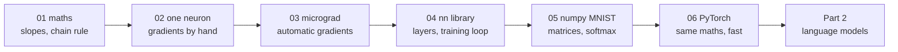

# Part 1 · Neural networks from scratch

Before you can build a language model you need to know, really know, how a neural network learns. In this part you start from slopes and the chain rule, build one neuron by hand, write your own automatic-gradient engine (the heart of PyTorch), grow it into a small neural-network library, then write a fast numpy network that reads handwriting, and finally prove that PyTorch computes exactly the gradients you derived.

**Like you're 5:** a neural network is a big machine full of knobs. It makes a guess, checks how wrong it was, and every knob asks "if I turn a little, does the mistake get smaller?". In this part you build that machine yourself, screw by screw.

## Lessons

| # | Lesson | What you build | Time | Watch alongside |
|---|---|---|---|---|
| 01 | [The maths you need, explained simply](01-the-math-you-need-explained-simply) | slopes, chain rule, gradient descent, vectors, matrices, exp/log, each tried with tiny numbers | ~1.5 h | [micrograd](https://www.youtube.com/watch?v=VMj-3S1tku0) (first 20 min) |
| 02 | [A neuron in plain Python](02-a-neuron-in-plain-python) | one neuron with hand-derived gradients and a gradient check; learns AND/OR, fails XOR | ~1.5 h | [micrograd](https://www.youtube.com/watch?v=VMj-3S1tku0) (≈ 0:52) |
| 03 | [Micrograd: an autograd engine](03-micrograd-an-autograd-engine) | a `Value` class that backpropagates automatically, checked against PyTorch | ~3 h | [micrograd](https://www.youtube.com/watch?v=VMj-3S1tku0) (to ≈ 1:43) |
| 04 | [A neural-net library on micrograd](04-a-neural-net-library-on-micrograd) | `Neuron`, `Layer`, `MLP`; solves XOR and the two-moons dataset | ~2 h | [micrograd](https://www.youtube.com/watch?v=VMj-3S1tku0) (≈ 1:43 to end) |
| 05 | [A numpy network reads handwriting](05-numpy-network-reads-handwriting) | MNIST at ~97.5% with numpy only; softmax + cross-entropy derived | ~3 h | [3Blue1Brown neural networks](https://www.youtube.com/playlist?list=PLZHQObOWTQDNU6R1_67000Dx_ZCJB-3pi) (ch. 1–4) |
| 06 | [PyTorch tensors and autograd](06-pytorch-tensors-and-autograd) | the bridge: tensors, autograd, your gradients = PyTorch's, the same net in PyTorch | ~2.5 h | [micrograd](https://www.youtube.com/watch?v=VMj-3S1tku0) (≈ 1:39) |

Total: about 14 hours of study, plus about 3 hours of video.



Do the lessons in order: each one reuses the previous one's ideas.

## Setup for this part
Use the virtual environment from the [course README](../README.md#set-up-once), then install everything this part needs:
```bash
pip install numpy torch pytest
```
| Package | Used for |
|---|---|
| `numpy` | lessons 01 and 05 (fast maths on arrays), the comparison in 06 |
| `torch` | lesson 06, and the optional PyTorch cross-checks in lesson 03 |
| `pytest` | the test files in lessons 02–06 (they include gradient checks) |

Lessons 02–04 use **plain Python only**: nothing to install to run them. Each lesson folder also has a `requirements.txt` with just what it needs. No API keys, no GPU.

**Data:** lesson 05 downloads MNIST (11 MB) once from a mirror, with fingerprint checks; lesson 06 reuses it. Instructions for a manual download are in lesson 05.

**Lighter previews.** The ai-engineer-journey course covers some of this more briefly: [Level 2 · Neural nets from scratch](../../ai-engineer-journey/level-2-neural-nets-from-scratch). If a lesson here feels steep, its preview is a gentler first pass.

## After this part you can
- Explain a derivative, a partial derivative and the chain rule with a worked example.
- Derive and gradient-check the backward pass of a small network by hand.
- Explain what `loss.backward()` does inside, because you built it.
- Write the training loop (forward, loss, zero grads, backward, update) without looking.
- Derive the softmax + cross-entropy gradient and vectorise a network with matrices.
- Use PyTorch tensors, autograd, `nn.Module` and optimisers, and trust them.

## Next part
→ [Part 2 · Language models step by step](../part-2-language-models-step-by-step): from a counting bigram model to a WaveNet, following Karpathy's makemore series.
