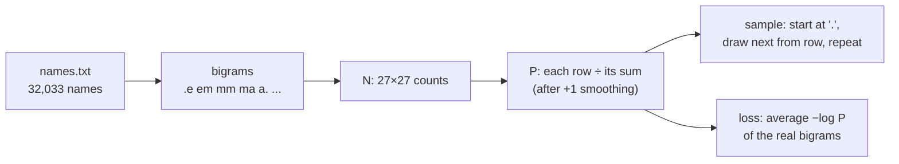
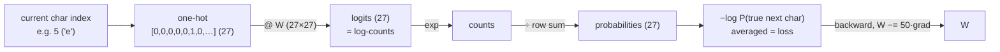

# 07 · Bigram language model

**What you'll build:** your first language model. It reads 32,033 real names and learns "which character tends to follow which", first by **counting**, then by training a tiny **neural network** that ends up learning the same thing. Both invent new names and both are scored with the loss every LLM uses: the average negative log likelihood.
**Like you're 5:** after reading lots of names you notice "after q almost always comes u". A bigram model is a big table of those hunches: for every letter, how likely each next letter is. To make up a name, you roll dice using the table, one letter at a time.
**Time:** ~3 h (plus the 2 h video) · **Builds on:** [06 · PyTorch tensors and autograd](../../part-1-neural-networks-from-scratch/06-pytorch-tensors-and-autograd) · **Needs:** internet once (names.txt, 228 KB) or nothing (offline fallback list)

## Why this matters
ChatGPT, Claude and Llama are **language models**: given the text so far, they output a probability for every possible next piece of text, then sample one. This lesson builds that whole loop at the smallest possible size: one character of context, 27 possible next characters. Everything after this (MLP, WaveNet, GPT) is "the same job, with more context and a better function". The loss you compute here, 2.45, is the number later lessons will beat.

## What you'll learn
- **Language model:** a model of `P(next character | previous characters)`.
- **Bigram counts → probabilities:** count pairs, normalise each row so it adds to 1 (with **smoothing**).
- **Sampling:** generate text by drawing the next character from the predicted probabilities (`torch.multinomial`).
- **Negative log likelihood (NLL):** the single number that scores a language model; lower is better.
- **The neural-net view:** one-hot input → one linear layer → softmax gives the same model, but can grow into GPT.

## Before you start
```bash
pip install torch matplotlib
```
| Package | What it's for |
|---------|---------------|
| `torch` | tensors for the 27×27 table, sampling, and the neural network |
| `matplotlib` | optional: draws the count table as a picture (`--plot`) |

**The data.** `names_data.py` loads `names.txt` (32,033 lowercase first names, one per line) from Karpathy's [makemore](https://github.com/karpathy/makemore) repository (MIT licence). The first run downloads it next to the script from `https://raw.githubusercontent.com/karpathy/makemore/master/names.txt`; later runs reuse the file. **Offline?** It falls back to a built-in list of 151 names so the code still runs (the numbers will differ from this README). You can also download the file in a browser and save it as `names.txt` in this folder.

No API key needed.

## Run it
1. From the course folder `llm-from-scratch`:
```bash
cd part-2-language-models-step-by-step/07-bigram-language-model
```
2. The counting model, with the picture of the count table:
```bash
python bigram_counts.py --plot
```
| Piece | Meaning |
|-------|---------|
| `--plot` | an on/off flag: when present, also save `bigram_counts.png` (needs matplotlib) |

3. Open `bigram_counts.png` to see the 27 × 27 count table.
4. The neural-network model (about a minute on a laptop CPU):
```bash
python bigram_nn.py
```

### What you should see
`python bigram_counts.py --plot`:
```
downloading names.txt from https://raw.githubusercontent.com/karpathy/makemore/master/names.txt ...
32033 names. First ten: ['emma', 'olivia', 'ava', 'isabella', 'sophia', 'charlotte', 'mia', 'amelia', 'harper', 'evelyn']
shortest: 2 letters, longest: 15 letters
most common bigrams: n.:6763, a.:6640, an:5438, .a:4410, e.:3983, ar:3264, el:3248, ri:3033

count table N has shape (27, 27); row '.' = how names START:
  a:4410  b:1306  c:1542  d:1690  e:1531  f:417  g:669  h:874  i:591  j:2422  k:2963  l:1572  m:2538  n:1146  o:394  p:515  q:92  r:1639  s:2055  t:1308  u:78  v:376  w:307  x:134  y:535  z:929
saved bigram_counts.png

row sums (should all be 1): [1.0, 1.0, 1.0, 1.0, 1.0] ...
P(next = 'a' | current = '.') = 0.1376

names invented by the bigram model:
  cexze
  momasurailezitynn
  konimittain
  llayn
  ka
  da
  staiyaubrtthrigotai
  moliellavo
  ke
  teda
names from a model that knows nothing (uniform): ['qvsaayxb', 'qrqmyqwu', 'znivanuk']

log likelihood of the whole dataset: -559951.56
average negative log likelihood (the LOSS): 2.4544   (over 228146 bigrams)
for comparison, the know-nothing model scores -ln(1/27) = 3.2958
loss of 'andrej': 3.0368  (least likely pair: 'ej' with p = 0.00274)
loss of 'emma': 2.5143  (least likely pair: 'mm' with p = 0.02534)
loss of 'andrejq': 3.4834  (least likely pair: 'jq' with p = 0.00034)
```
`python bigram_nn.py`:
```
228146 training examples, e.g. the first five pairs of 'emma':
  input '.' ( 0)  ->  target 'e' ( 5)
  input 'e' ( 5)  ->  target 'm' (13)
  input 'm' (13)  ->  target 'm' (13)
  input 'm' (13)  ->  target 'a' ( 1)
  input 'a' ( 1)  ->  target '.' ( 0)
one-hot inputs: shape (228146, 27); row 0 has a 1 at position 0
step   0  loss 3.7686
step  25  loss 2.5577
step  50  loss 2.5099
step  75  loss 2.4960
step 100  loss 2.4900
step 125  loss 2.4868
step 150  loss 2.4849
step 175  loss 2.4837
step 200  loss 2.4830

names invented by the neural bigram model:
  cexze
  momasurailezityha
  konimittain
  llayn
  ka
  da
  staiyaubrtthrigotai
  moliellavo
  ke
  teda

P(next='a' | '.'): counting 0.1376   network 0.1373
biggest difference between the two 27x27 probability tables: 0.0770
```
The names are bad ("cexze") but much better than random letters ("qvsaayxb"): they have name-like rhythm. Look at the loss: **2.4544** for counting, **2.483** for the network, both far below the know-nothing **3.2958**. And the network, with the same random seed, invents almost exactly the same names: it has learned (nearly) the same table.

## How it works

### Step 1: the data as pairs
Each name is wrapped in a special token `.` that means both "start" and "end". `emma` becomes `. e m m a .`, which gives 5 bigrams: `.e em mm ma a.`. Over all 32,033 names that is **228,146** bigrams. The `.` is how the model learns which letters start names (`.a` is common) and which end them (`n.` and `a.` are the two most common bigrams).

### Step 2: counting into a table (`bigram_counts.py`)
Characters become integers: `.` = 0, `a` = 1 ... `z` = 26 (`stoi` = "string to integer", `itos` = the reverse). `N[i, j]` counts how often character `j` follows character `i`. Row 0 (`.`) is the starting-letter histogram you see printed.


### Step 3: counts → probabilities, with smoothing
`P = (N + 1) / row sums`. For row `.`: `P[0, a] = (4410 + 1) / (32033 + 27) = 0.1376`. In code, `P /= P.sum(1, keepdim=True)` divides a `(27, 27)` table by a `(27, 1)` column of row totals: **broadcasting** stretches the column across all 27 columns. (`keepdim=True` matters: without it the sums would be shape `(27,)` and broadcasting would divide *columns* instead of rows, a classic silent bug that Karpathy demonstrates in the video.)

The **+1 smoothing** ("add-one" or Laplace smoothing) pretends every pair was seen once more than it was. Without it, any pair never seen in training (like `jq`) gets probability 0, and a name containing it gets an infinite loss. With it, `andrejq` scores 3.48 instead of infinity.

### Step 4: sampling
Start with `ix = 0` (`.`). Look up row `P[ix]`: 27 probabilities. `torch.multinomial(P[ix], 1, generator=g)` rolls a 27-sided weighted die. Print the letter, use it as the new `ix`, and repeat until the die lands on `.` (end). The fixed **seed** `2147483647` makes the "random" rolls identical every run, so you get exactly the names shown above (and the same as the video).

### Step 5: the loss, negative log likelihood
How good is the table? Ask it: "how probable did you think each real next character was?". A perfect model would say 1.0 every time. We multiply all those probabilities together (the **likelihood** of the data), but the product of 228,146 numbers below 1 is too small for a computer, so we add their logs instead (log turns × into +, lesson 01).

$$\text{NLL} = -\frac{1}{N}\sum_{k=1}^{N} \ln P(c_{k+1} \mid c_k)$$

| Symbol | Plain words |
|--------|-------------|
| `N` | number of bigrams (228,146) |
| `cₖ`, `cₖ₊₁` | a character and the one that actually followed it |
| `P(cₖ₊₁ \| cₖ)` | "probability of the next char given the current char": the table entry `P[cₖ, cₖ₊₁]` (the `\|` reads "given") |
| `ln` | natural log; each term is negative because probabilities are below 1 |
| `−` and `1/N` | flip the sign so lower is better, and average so it doesn't depend on dataset size |

Worked example, the name `emma` (5 bigrams): the code finds the probabilities of `.e, em, mm, ma, a.`, takes `−ln` of each and averages: **2.5143**. The least likely pair was `mm` (p = 0.025). A uniform model gives every character `1/27`, so its loss is `−ln(1/27) = 3.2958`. Any useful model must beat that.

### Step 6: the same model as a neural network (`bigram_nn.py`)

1. **Inputs and targets:** `xs` is every first character, `ys` every second character (as integers).
2. **One-hot encoding:** a neural net needs numbers to multiply, and the integer 5 doesn't mean "five times more than 1". So character 5 becomes a vector of 27 zeros with a 1 at position 5 (`F.one_hot`).
3. **One linear layer:** `logits = xenc @ W`. Because the input is one-hot, this simply **picks row 5 of W** (try it on paper). So `W` *is* a 27 × 27 table, just like `N`.
4. **Softmax:** `counts = logits.exp()`, `probs = counts / counts.sum(1, keepdim=True)`. Logits are interpreted as **log-counts**: exponentiate to get positive "counts", normalise to get probabilities. That pair of steps is **softmax**.
5. **Loss:** `−probs[torch.arange(num), ys].log().mean()` picks, for every example, the probability of the true next character: the same NLL as Step 5. Plus `0.01 * (W**2).mean()`, a **regularisation** term that pulls W toward 0. W = 0 means all logits equal means uniform probabilities, so this is the neural version of smoothing (more regularisation = more smoothing).
6. **Training:** 200 steps of gradient descent with learning rate 50 (this simple, smooth problem tolerates huge steps). The loss falls from 3.77 to 2.483. It cannot beat counting (2.454): counting is already the best possible bigram table, and the regularisation costs a little.

The tables end up nearly identical (`0.1376` vs `0.1373`); the biggest difference (0.077) is in rare rows like `q`, where the regularisation smooths more strongly than +1 counts. **Why bother with the network, then?** Counting only works for 1 character of context: with 10 characters there are 27¹⁰ ≈ 200 trillion combinations to count. The network approach scales: lesson 08 feeds 3 characters, lesson 11 feeds 8, and GPT feeds thousands, all trained with this same loss.

## If something goes wrong
- **`could not download (...); using the small built-in list of 151 names`** → you're offline or GitHub is blocked. The code still runs on the small list; for real results, download `names.txt` in a browser (link above) into this folder.
- **`ModuleNotFoundError: No module named 'matplotlib'`** → only needed for `--plot`: `pip install matplotlib`, or run without `--plot`.
- **Your names differ from the README** → you changed the seed, the order of random calls, or you are on the fallback list. Any change to the code before sampling changes the dice rolls.
- **Loss is `inf`** → you removed the `+ 1` smoothing and a test word contains an unseen pair (try `andrejq`).
- **`bigram_nn.py` loss goes up or becomes `nan`** → learning rate too high for your change; try 10 instead of 50.

## Try this
1. Remove the smoothing (`P = N.float()` instead of `(N + 1).float()`). What is the dataset loss now? What is the loss of `andrejq`?
   <details><summary>Answer</summary>The dataset loss barely changes (2.4540 instead of 2.4544: every pair that occurs in the data has a non-zero count), but `andrejq` gets `inf`: `jq` never occurs, so its probability is exactly 0 and `−log 0 = ∞`.</details>
2. Make smoothing much stronger: `N + 1000`. What happens to the loss and to the sampled names?
   <details><summary>Hint</summary>Every row is pushed toward uniform, so the loss rises (2.85 in our run, on the way to 3.30) and names look more like random letters. Smoothing trades "trust the data" against "never be certain".</details>
3. Build a **trigram** counting model (two characters of context). What loss does it reach?
   <details><summary>Solution</summary>

```python
N3 = torch.zeros((27, 27, 27), dtype=torch.int32)
for w in words:
    chs = [".", "."] + list(w) + ["."]
    for a, b, c in zip(chs, chs[1:], chs[2:]):
        N3[stoi[a], stoi[b], stoi[c]] += 1
P3 = (N3 + 1).float()
P3 /= P3.sum(2, keepdim=True)
nll, n = 0.0, 0
for w in words:
    chs = [".", "."] + list(w) + ["."]
    for a, b, c in zip(chs, chs[1:], chs[2:]):
        nll -= torch.log(P3[stoi[a], stoi[b], stoi[c]]).item()
        n += 1
print(nll / n)    # about 2.21 on the training data: better than 2.45
```
Note this is measured on the training data; with 27³ = 19,683 cells, many seen only a few times, it is starting to memorise. Lesson 08 introduces train/dev/test splits to measure honestly.</details>

## Check yourself
1. Why do we add a `.` token at the start and the end of every name?
2. What loss would a model get if it always gave the true next character probability 1? And probability 1/27?
3. Why does `xenc @ W` with a one-hot `xenc` just pick a row of `W`?
4. Why does the neural network's loss end slightly *above* the counting model's?
<details><summary>Answers</summary>

1. So the model learns which characters start names and when a name should end (and sampling knows when to stop).
2. `−ln 1 = 0`. `−ln(1/27) = ln 27 ≈ 3.2958`.
3. Each output is a dot product of the input with a column of W; with all zeros except one 1 at position i, every dot product just picks the i-th entry, so the result is row i of W.
4. Counting gives the exact best bigram table for this data (with +1 smoothing). The network can at best match it; the regularisation term and 200 steps of training leave it a little short (2.483 vs 2.454).
</details>

## Watch alongside
**Andrej Karpathy, "The spelled-out intro to language modeling: building makemore"** (L2): https://www.youtube.com/watch?v=PaCmpygFfXo. This lesson follows the whole video. Approximate times from its chapter list:

| Video chapter (≈ time) | Matches in this lesson |
|------------------------|------------------------|
| reading and exploring the dataset (≈ 0:03) | Step 1, first lines of output |
| exploring bigrams; counting them in a Python dictionary (≈ 0:06–0:12) | `counts` dict, "most common bigrams" |
| counting bigrams in a 2D torch tensor; visualising it (≈ 0:12–0:20) | Step 2, `--plot` |
| replacing `<S>`/`<E>` with a single `.` token (≈ 0:20) | Step 1 |
| sampling from the model (≈ 0:24) | Step 4 |
| vectorised normalisation of the rows, broadcasting (≈ 0:36) | Step 3 and the `keepdim` warning |
| the loss: negative log likelihood (≈ 0:50) | Step 5 |
| model smoothing with fake counts (≈ 1:00) | Step 3 (+1) |
| part 2, the neural network approach: dataset, one-hot, one linear layer, softmax (≈ 1:02–1:26) | Step 6, items 1–4 |
| vectorised loss; backward and update; putting it together (≈ 1:35–1:47) | Step 6, items 5–6 |
| notes: one-hot selects a row; smoothing as regularisation (≈ 1:47–1:54) | Step 6 last paragraphs |
| sampling from the neural net (≈ 1:54) | the second list of names |

Also: the makemore repo https://github.com/karpathy/makemore, and **3Blue1Brown, "But what is a GPT?"** (https://www.youtube.com/watch?v=wjZofJX0v4M) for where "predict the next token" leads.

## Learn more (optional)
**Read the official docs**
- `torch.multinomial`: https://pytorch.org/docs/stable/generated/torch.multinomial.html
- `torch.nn.functional.one_hot`: https://pytorch.org/docs/stable/generated/torch.nn.functional.one_hot.html
- `torch.Generator` (seeded randomness): https://pytorch.org/docs/stable/generated/torch.Generator.html
- Broadcasting semantics: https://pytorch.org/docs/stable/notes/broadcasting.html

Lighter preview: [ai-engineer-journey 5.2 · Next-letter predictor](../../../ai-engineer-journey/level-5-text-models/02-next-letter-predictor-bigram-name-generator).

## Next
→ [08 · MLP language model](../08-mlp-language-model)
