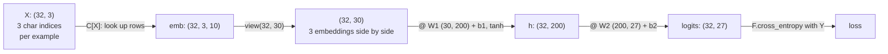

# 08 · MLP language model

**What you'll build:** a character-level language model that looks at the previous **three** characters, following the famous Bengio et al. (2003) design: each character gets a learned **embedding**, the embeddings go through a hidden layer of 200 neurons, and an output layer predicts the next character. It reaches a **dev loss of 2.17** (the bigram model scored 2.45) and invents far more name-like names.
**Like you're 5:** instead of guessing the next letter from just one letter, you look at the last three, like reading "ell" and guessing "a" (for Ella). And every letter gets a spot on a secret map where similar letters (like vowels) end up near each other.
**Time:** ~3 h (plus the 1¼ h video) · **Builds on:** [07 · Bigram language model](../07-bigram-language-model) · **Needs:** nothing extra (names.txt downloads automatically)

## Why this matters
This is the architecture that started neural language modelling, and two of its ideas are inside every modern LLM: **embeddings** (every token is a learned vector; GPT-2 has a 50,257 × 768 embedding table) and **training on mini-batches with a train/dev/test split**. You also learn the practical craft: finding a learning rate, spotting overfitting, decaying the learning rate. Those are the same knobs you will turn when training GPT in Part 3.

## What you'll learn
- **Context window (block size):** how many previous characters the model sees (3 here).
- **Embedding table:** a learned lookup table, one short vector per character (`C[X]`).
- **`view` and the hidden layer:** joining 3 embeddings of 10 numbers into 30 numbers, then a tanh layer.
- **`F.cross_entropy`, mini-batches, learning-rate search and decay:** efficient, practical training.
- **Train / dev / test splits:** measuring honestly, and noticing **underfitting** vs **overfitting**.

## Before you start
```bash
pip install torch matplotlib
```
`matplotlib` is only for `--plot`. `names_data.py` is the same helper as lesson 07 (downloads `names.txt` once, with an offline fallback). No API key needed.

## Run it
1. From the course folder `llm-from-scratch`:
```bash
cd part-2-language-models-step-by-step/08-mlp-language-model
```
2. (Optional) Find a good learning rate, the way the video does (a few seconds):
```bash
python mlp.py --find-lr
```
3. Train the full model: 200,000 steps, about a minute on a laptop CPU. Add `--plot` to save a picture of the letter embeddings:
```bash
python mlp.py --plot
```
4. Experiment with the flags: `--steps`, `--block-size`, `--emb`, `--hidden`, `--batch-size`. For example a quick run: `python mlp.py --steps 20000`.

### What you should see
`python mlp.py --find-lr` (end of the output):
```
learning rate -> average loss over the 100 steps around it
  lr 0.0014  loss 24.473
  lr 0.0028  loss 21.108
  lr 0.0056  loss 18.476
  lr 0.0112  loss 14.974
  lr 0.0225  loss 12.036
  lr 0.0448  loss 9.405
  lr 0.0895  loss 8.032
  lr 0.1788  loss 7.431
  lr 0.3569  loss 8.333
  lr 0.7126  loss 11.882
a good learning rate is where the loss is lowest before it shoots up (about 0.1)
```
`python mlp.py --plot`:
```
training examples made from 'emma':
  ... ---> e
  ..e ---> m
  .em ---> m
  emm ---> a
  mma ---> .

train (182625, 3)  dev (22655, 3)  test (22866, 3)
parameters: 11,897
step       0/200000  batch loss 27.8817  (5s)
step   20000/200000  batch loss 2.5847  (11s)
step   40000/200000  batch loss 2.0222  (16s)
step   60000/200000  batch loss 2.3168  (22s)
step   80000/200000  batch loss 2.2519  (28s)
step  100000/200000  batch loss 2.0234  (33s)
step  120000/200000  batch loss 1.9426  (39s)
step  140000/200000  batch loss 2.3213  (45s)
step  160000/200000  batch loss 2.2320  (51s)
step  180000/200000  batch loss 2.0826  (57s)

final loss  train 2.1276   dev 2.1702
(bigram model from lesson 07: about 2.45. Lower is better.)
test loss, looked at only once at the very end: 2.1670

names invented by the MLP:
  carlah
  amille
  khirmy
  kheety
  skandane
  mahuen
  den
  art
  kaeli
  nellara
  chaiir
  kaleigh
  ham
  jorn
  quinn
saved embeddings.png
```
Three things to notice: the **batch loss jumps around** (each batch is only 32 random examples), but the final **dev loss is 2.17**, well below the bigram's 2.45; train (2.13) and dev (2.17) are close, so the model is not overfitting; and the names (`amille`, `kaleigh`, `quinn`) now sound like names.

## How it works

### Step 1: the dataset (`build_dataset()`)
A window of 3 characters slides over each name (padded at the start with `.`). Every position gives one example: `X` = the 3 previous character indices, `Y` = the next character. `emma` gives 5 examples (printed at the top of the output). For all names: 228,146 examples, split by name into **80% train**, **10% dev** (also called validation), **10% test**, after shuffling with a fixed seed.

| Split | Used for |
|-------|----------|
| train (182,625 examples) | computing gradients and updating parameters |
| dev (22,655) | choosing settings (hidden size, embedding size, learning rate, steps) |
| test (22,866) | the honest final score, looked at once |

### Step 2: the network (`forward()`)

1. **Embedding table `C`** has shape `(27, 10)`: one row of 10 learned numbers per character. `C[X]` uses `X` (shape `(32, 3)`) as a list of row numbers and returns shape `(32, 3, 10)`. This is the same as one-hot × matrix (lesson 07), just much faster.
2. **`emb.view(emb.shape[0], -1)`** reshapes `(32, 3, 10)` into `(32, 30)`: the three vectors laid end to end. `view` doesn't copy any numbers; it only changes how the same memory is read (the video explains tensor storage at ≈ 0:18).
3. **Hidden layer:** `tanh(emb @ W1 + b1)`: 200 neurons, each looking at all 30 numbers.
4. **Output layer:** `h @ W2 + b2`: 27 logits.
5. **Loss:** `F.cross_entropy(logits, Y)` = softmax + negative log likelihood, the same as lesson 07, but fused into one call that is faster and safe with large logits.

Parameters: `C` 27·10 = 270, `W1` 30·200 = 6,000, `b1` 200, `W2` 200·27 = 5,400, `b2` 27: total **11,897**.

The model as a formula:

$$\text{logits} = \tanh\big([C_{x_1}; C_{x_2}; C_{x_3}]\, W_1 + b_1\big)\, W_2 + b_2$$

| Symbol | Plain words |
|--------|-------------|
| `x₁, x₂, x₃` | the three previous character indices |
| `C_{x}` | row `x` of the embedding table (that character's 10 numbers) |
| `[a; b; c]` | glue vectors end to end (concatenate): 3 × 10 = 30 numbers |
| `W₁, b₁` | hidden layer weights (30 × 200) and biases (200) |
| `tanh` | squashes each of the 200 values into −1..1 |
| `W₂, b₂` | output weights (200 × 27) and biases (27) |

### Step 3: why embeddings help (generalisation)
Bengio's insight: if the model has learned that `a` and `e` behave similarly (their embeddings are close), then what it learned after "...an" partly transfers to "...en", even if "...en" was rare in training. Counting tables cannot share knowledge like that. Open `embeddings.png` (the 10-D embeddings squashed to 2-D): `.`, `q` and some rare consonants sit far from the crowd, while common letters cluster. Train with `--emb 2 --plot` to see the learned 2-D map directly, as in the video.

### Step 4: training with mini-batches
Each step uses 32 random examples (`torch.randint`) instead of all 182,625. The gradient is noisier, but each step is ~5,000 times cheaper, so you can take many more steps. That trade is always worth it, and it is how every LLM is trained.

**Finding the learning rate (`--find-lr`):** try exponentially growing rates (`10 ** linspace(−3, 0)`: 0.001 up to 1) over 1,000 steps and watch the loss. Too small: the loss falls slowly. Too big: it shoots up. The best is just before the minimum turns upward, about **0.1** here. (The loss values are high because the model starts from a poor random initialisation; lesson 09 fixes that.)

**Learning-rate decay:** `lr = 0.1` for the first half, then `0.01`. Big steps get close quickly; small steps then settle into the bottom of the valley.

### Step 5: under- and overfitting
- **Underfitting:** train ≈ dev, both high: the model is too small or trained too briefly. Make it bigger or train longer.
- **Overfitting:** train much lower than dev: the model memorises the training names. Make it smaller, add data, or regularise.
- Here train 2.13, dev 2.17: close, so a bit more capacity could still help. The video gets there by growing the embedding (2 → 10) and the hidden layer (100 → 200 → 300).

### Step 6: sampling
Start with context `[0, 0, 0]` ("..."), run `forward`, softmax, `torch.multinomial` to draw the next character, slide the window, repeat until `.`. Same idea as lesson 07, with three characters of memory.

## If something goes wrong
- **First batch loss around 27 and you think it's a bug** → it isn't: random initial weights make wildly confident wrong guesses. A fair start would be 3.30; lesson 09 is all about fixing this.
- **`RuntimeError: shape '[32, 30]' is invalid for input of size ...`** → you changed `--block-size` or `--emb` and hard-coded 30 somewhere. The code uses `emb.view(emb.shape[0], -1)` to avoid exactly this.
- **Training is very slow** → check that the line `torch.set_num_threads(1)` is still at the top: for tiny matrices, one CPU thread is much faster than several fighting over them.
- **Loss becomes `nan`** → learning rate too high (e.g. you changed 0.1 to 1). Run `--find-lr` again.
- **Dev loss much higher than train** → you made the model large (e.g. `--hidden 2000`) and it overfits. Shrink it or train fewer steps.

## Try this
1. Train with `--emb 2 --plot` and open `embeddings.png`. Which letters end up close together?
   <details><summary>Hint</summary>Look for the vowels `a e i o u` grouping together, and `.` and `q` sitting far away from everything (they behave unlike any other character). In our run exactly that happened: the five vowels sat together in one corner, `q` alone at the bottom. The dev loss was 2.24: two numbers per letter are too few, so the video then grows the embedding to 10.</details>
2. Try `--block-size 5`. Does more context help? Compare the dev loss with 2.17.
   <details><summary>Hint</summary>More context gives the model more to go on, but the first layer must now compress 50 numbers in one step. In our run `--block-size 5` gave dev 2.21: *worse* than 2.17. More context alone does not help this architecture; lesson 11 shows a better way to use long context.</details>
3. Beat 2.17 on dev. Allowed: change `--emb`, `--hidden`, `--batch-size`, `--steps`, `--block-size`. Write down every experiment and its dev loss; only check the test loss for your final choice.
   <details><summary>Hint</summary>Change one thing at a time. In our run `--emb 16 --hidden 300` (23,259 parameters) reached dev 2.156 (train 2.078: the growing gap means it is starting to overfit). Small, careful changes win here; much longer training helps less than you'd think. Lesson 09 reaches 2.14 by fixing the initialisation instead.</details>

## Check yourself
1. What shape is `C[X]` when `X` is `(32, 3)` and `C` is `(27, 10)`?
2. Why do we train on random mini-batches of 32 instead of the whole training set?
3. Your model gets train 1.70, dev 2.40. What is happening and what would you try?
4. Why is the test set only used once?
<details><summary>Answers</summary>

1. `(32, 3, 10)`: every one of the 32 × 3 indices is replaced by its row of 10 numbers.
2. Each step is far cheaper, so you can make many more updates in the same time; the noisy gradient still points roughly the right way.
3. Overfitting: it has memorised training names. Use a smaller model, regularisation, more data, or stop training earlier.
4. Every time you look at it and change something, your choices start fitting the test set too, and its score stops being an honest estimate of performance on new data.
</details>

## Watch alongside
**Andrej Karpathy, "Building makemore Part 2: MLP"** (L3): https://www.youtube.com/watch?v=TCH_1BHY58I. Approximate times from the chapter list:

| Video chapter (≈ time) | Matches in this lesson |
|------------------------|------------------------|
| Bengio et al. 2003 paper walkthrough (≈ 0:01) | Step 3, the formula |
| (re-)building the training dataset (≈ 0:09) | Step 1 |
| implementing the embedding lookup table (≈ 0:12) | Step 2, item 1 |
| the hidden layer, torch.Tensor internals: storage, views (≈ 0:18) | Step 2, items 2–3 |
| output layer, negative log likelihood, `F.cross_entropy` and why (≈ 0:29–0:37) | Step 2, items 4–5 |
| training loop, overfitting one batch; minibatches (≈ 0:37–0:45) | Step 4 |
| finding a good initial learning rate (≈ 0:45) | `--find-lr` |
| splitting into train/val/test and why (≈ 0:53) | Step 1 table, Step 5 |
| larger hidden layer; visualising the embeddings; larger embedding (≈ 1:00–1:11) | Step 3, Try this 1 and 3 |
| sampling from the model (≈ 1:13) | Step 6 |

## Learn more (optional)
**Read the official docs**
- `torch.Tensor.view`: https://pytorch.org/docs/stable/generated/torch.Tensor.view.html
- `torch.nn.Embedding` (the module version of `C[X]`): https://pytorch.org/docs/stable/generated/torch.nn.Embedding.html
- `F.cross_entropy`: https://pytorch.org/docs/stable/generated/torch.nn.functional.cross_entropy.html

**The paper:** Bengio, Ducharme, Vincent, Jauvin (2003), *A Neural Probabilistic Language Model*: https://www.jmlr.org/papers/volume3/bengio03a/bengio03a.pdf

Lighter preview: [ai-engineer-journey 5.4 · Embeddings](../../../ai-engineer-journey/level-5-text-models/04-embeddings-find-similar-sentences) (word-level embeddings for search).

## Next
→ [09 · Activations, BatchNorm and initialisation](../09-activations-batchnorm-and-initialization)
