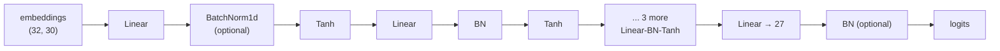

# 09 · Activations, BatchNorm and initialisation

**What you'll build:** two experiments on lesson 08's model. The first fixes its terrible start (a first loss of 28 instead of 3.30), finds the "saturated" tanh neurons that are not learning, applies **Kaiming initialisation**, and implements **Batch Normalisation** from scratch. The second builds a deep 6-layer network out of your own `Linear`, `BatchNorm1d` and `Tanh` classes and prints the health statistics professionals look at to diagnose training.
**Like you're 5:** if you whisper a message down a line of 10 children, it can fade to nothing or turn into shouting. Good starting weights and BatchNorm are like telling every child "pass it on at the same volume you heard it".
**Time:** ~3 h (plus the 2 h video) · **Builds on:** [08 · MLP language model](../08-mlp-language-model) · **Needs:** nothing extra

## Why this matters
The bigger and deeper a network, the more it depends on numbers staying a healthy size as they flow forward (activations) and backward (gradients). This is why GPT uses careful initialisation, normalisation layers (LayerNorm and RMSNorm, cousins of BatchNorm) and residual connections. When a real training run "doesn't learn" or blows up, the diagnosis is almost always found with exactly the statistics this lesson prints.

## What you'll learn
- **Expected initial loss:** a fair guess over 27 characters costs `−ln(1/27) = 3.2958`; anything far above it wastes training.
- **Saturation:** tanh outputs stuck near ±1 have slope ≈ 0, so their neurons stop learning.
- **Kaiming initialisation:** scale weights by `gain / √fan_in` so signals keep a steady size.
- **Batch Normalisation:** force each neuron's pre-activations to mean 0, std 1 over the batch, then let the network rescale; running averages for use at test time.
- **Diagnostics:** activation statistics, gradient statistics and the **update:data ratio**.

## Before you start
```bash
pip install torch matplotlib
```
`matplotlib` is only for `--plot`. No API key needed.

## Run it
1. From the course folder `llm-from-scratch`:
```bash
cd part-2-language-models-step-by-step/09-activations-batchnorm-and-initialization
```
2. Initialisation and BatchNorm experiments (4 models × 50,000 steps; about 1–2 minutes). `--plot` saves `hidden_activations.png`:
```bash
python init_and_batchnorm.py --plot
```
3. Deep-network health check (about 10 seconds):
```bash
python diagnostics.py
```

### What you should see
`python init_and_batchnorm.py --plot`:
```
expected loss for a fair guess: -ln(1/27) = 3.2958

init        first loss   logit range   |h|>0.99 (saturated)  preact std
naive          28.2343  -47.0..42.3                  62.2%        5.47
fix_output      3.3265   -0.4..0.4                   62.2%        5.47
kaiming         3.3266   -0.3..0.3                    9.6%        1.62
batchnorm       3.3270   -0.3..0.3                    0.4%        0.98
saved hidden_activations.png

training each version for 50000 steps (lr 0.1, then 0.01 for the second half)
  naive       train 2.2308   dev 2.2503
  fix_output  train 2.1312   dev 2.1691
  kaiming     train 2.0947   dev 2.1362
  batchnorm   train 2.1293   dev 2.1510

Fixing the output and using Kaiming init each lower the dev loss: less time wasted at the start,
fewer saturated neurons. BatchNorm lands close to Kaiming WITHOUT any careful maths. In a net this
shallow it does not win (the video sees the same); it shines in deep nets (run diagnostics.py).
```
`python diagnostics.py` (the middle experiment shown in full, the others shortened):
```
=== Tanh layers, gain 5/3 (Kaiming), no BatchNorm ===
health at initialisation (first batch):
layer       out mean  out std  saturated   grad std
 1 Tanh        -0.04     0.75     20.25%   4.02e-04
 3 Tanh        -0.01     0.68      8.22%   3.85e-04
 5 Tanh        +0.01     0.68      7.16%   3.62e-04
 7 Tanh        -0.00     0.66      5.59%   3.24e-04
 9 Tanh        -0.02     0.66      5.94%   3.00e-04
after 1000 steps: average batch loss over the last 100 steps 2.3509
...
=== Tanh layers, gain 0.5 (too small), no BatchNorm ===
health at initialisation (first batch):
layer       out mean  out std  saturated   grad std
 1 Tanh        -0.02     0.41      0.00%   1.82e-05
 3 Tanh        -0.00     0.19      0.00%   3.84e-05
 5 Tanh        +0.00     0.10      0.00%   7.76e-05
 7 Tanh        +0.00     0.05      0.00%   1.52e-04
 9 Tanh        -0.00     0.02      0.00%   3.00e-04
after 1000 steps: average batch loss over the last 100 steps 2.5415
weight shape    grad:data   log10 update:data (avg of last 100 steps)
(27, 10)         6.36e-03                                       -3.14
(30, 100)        8.51e-02                                       -2.05
(100, 100)       7.31e-02                                       -2.12
(100, 100)       4.17e-02                                       -2.35
(100, 100)       3.33e-02                                       -2.41
(100, 100)       2.89e-02                                       -2.41
(100, 27)        1.93e-01                                       -1.63

=== Tanh layers, gain 0.5 (too small), WITH BatchNorm ===
health at initialisation (first batch):
layer       out mean  out std  saturated   grad std
 2 Tanh        -0.00     0.63      3.19%   7.52e-04
 5 Tanh        -0.00     0.64      2.91%   6.22e-04
 8 Tanh        +0.00     0.64      2.34%   5.78e-04
11 Tanh        +0.00     0.63      2.75%   5.20e-04
14 Tanh        -0.00     0.64      3.12%   4.68e-04
after 1000 steps: average batch loss over the last 100 steps 2.4201
...
```
Read the second table like a doctor: with gain 0.5 the signal's std **halves at every layer** (0.41 → 0.19 → 0.10 → 0.05 → 0.02) and the gradients are 16× smaller in layer 1 than in layer 9. Add BatchNorm and every layer is back to a healthy std of ~0.64, and the loss after 1,000 steps drops from 2.54 to 2.42.

## How it works

### Problem 1: the first loss is 28 (`fix_output`)
With 27 possible characters, a model that knows nothing should spread probability evenly: `1/27` each, loss `−ln(1/27) = 3.2958`. Lesson 08's random `W2` makes logits as big as ±47, so the model is wildly, randomly *confident*, and confidently wrong costs a lot (28). The first thousands of steps are spent just undoing that. **Fix:** multiply `W2` by 0.01 and set `b2` to 0. Logits start near 0, softmax gives ≈ 1/27 each, the first loss is 3.33. Dev loss improves from 2.250 to 2.169.

### Problem 2: saturated tanh (`kaiming`)
```
tanh(x):  -1 ─────╮                       slope = 1 − tanh(x)²
                  ╰──╮      ╭──             at x = 0: slope 1   (learns)
                     ╰─────╯               at |x| > 3: slope ≈ 0 (frozen)
              -3     0     3   → +1
```
`hpreact` (the hidden layer's input to tanh) has std 5.47, so most values are far out on the flat parts: **62% of neurons output |h| > 0.99**. Backprop multiplies by tanh's slope `1 − h²`, which is ≈ 0 there, so those neurons barely learn. If a neuron is saturated for *every* example it is **dead** and never learns. (Open `hidden_activations.png`: the left histogram is piled up at −1 and +1.)

**Kaiming initialisation** chooses the weight scale so the output std matches the input std:

$$W \sim \mathcal{N}(0, 1)\cdot \frac{\text{gain}}{\sqrt{\text{fan\_in}}}$$

| Symbol | Plain words |
|--------|-------------|
| `W ~ 𝒩(0, 1)` | weights drawn from a normal (bell-curve) distribution with mean 0, std 1 (`torch.randn`) |
| `fan_in` | how many inputs each neuron adds up (here 3 × 10 = 30) |
| `√fan_in` | adding up 30 random products makes the std grow by √30 ≈ 5.5; dividing by it cancels that growth |
| `gain` | extra boost to make up for the squashing non-linearity: 5/3 for tanh, √2 for ReLU, 1 for none |

Worked example: a sum of 30 terms, each input (std ≈ 1) times a weight (std 1), has std √30 ≈ 5.5, close to the 5.47 we measured. Scaling the weights by `(5/3)/√30 = 0.304` makes the std about 1.6 (we measured 1.62), and saturation falls from 62% to 9.6%. Dev loss improves again: **2.136**.

### Problem 3: BatchNorm (`batchnorm`)
Instead of carefully calculating scales, why not *force* every neuron's pre-activation to be well-behaved? For each of the 200 neurons, over the 32 examples in the batch:

$$\hat{x} = \frac{x - \mu_B}{\sqrt{\sigma_B^2 + \epsilon}} \qquad y = \gamma\,\hat{x} + \beta$$

| Symbol | Plain words |
|--------|-------------|
| `x` | one neuron's pre-activation for each example in the batch |
| `μ_B` (Greek "mu") | the mean of that neuron over the batch |
| `σ_B²` (Greek "sigma" squared) | the variance (std squared) over the batch |
| `ε` (Greek "epsilon") | a tiny number (1e-5) so we never divide by zero |
| `x̂` ("x hat") | the normalised value: mean 0, std 1 |
| `γ` (gamma, `bngain`), `β` (beta, `bnbias`) | learnable scale and shift, starting at 1 and 0, so the network can *undo* the normalisation if that helps |

Worked example: one neuron sees `[2, 4, 6]` in a batch of 3. Mean 4, std ≈ 1.63, so `x̂ = [−1.22, 0, 1.22]`. Whatever scale the weights produce, the tanh always receives nicely sized inputs (std 0.98 in our table, saturation 0.4%).

**The catch: training vs using the model.** Each example's output now depends on the other examples in its batch. To use the model on a single name, we need fixed statistics. So during training we keep a slow **running average** (`bnmean_running = 0.999 · old + 0.001 · batch_mean`, same for std), and use those after training (`training=False`). The bias `b1` becomes useless (BatchNorm subtracts the mean, removing any constant), which is why deep-net code uses `bias=False` before BatchNorm.

**The honest result:** BatchNorm (2.151) did not beat careful Kaiming init (2.136) here, matching the video. In a one-hidden-layer net, Kaiming is already enough. The value of BatchNorm appears in deep nets, below.

### The deep-network health check (`diagnostics.py`)
`Linear`, `BatchNorm1d` and `Tanh` are written as small classes with the same names and behaviour as `torch.nn` (each stores its output in `self.out` so we can inspect it). `build()` stacks 5 hidden layers of 100 neurons:

For each experiment it prints, on the first batch:
| Statistic | Healthy | Sick |
|-----------|---------|------|
| **out std** of each Tanh | roughly equal across layers (≈ 0.6–0.7) | shrinking toward 0 (signal dies) or saturated near 1 |
| **saturated** % (\|t\| > 0.97) | a few % | large (many frozen neurons) |
| **grad std** per layer | similar across layers | very different (some layers learn much faster than others) |

and after training, per weight matrix, the **update:data ratio**: `std(lr × grad) / std(weights)`, shown as a power of ten. `−3` means each step changes the weights by about 0.1% of their size, Karpathy's rule of thumb. Ours are around `−2` to `−2.5`, meaning `lr = 0.1` is on the fast side but fine for a short run; below `−4` would mean painfully slow learning, above `−1` reckless steps. The last layer's ratio is higher because we deliberately shrank its weights at the start (they are small, so relative changes look big).

What the three experiments show:
1. **gain 5/3:** stable std ~0.66–0.75 through all 5 layers. Healthy.
2. **gain 0.5:** each layer multiplies the signal's size by about 0.5, so after 5 layers it is 2% of its start, and the first layer's gradient is 16× smaller than the last. The deeper the network, the worse this gets (with 50 layers, nothing would reach the end). The loss after 1,000 steps is clearly worse (2.54).
3. **gain 0.5 + BatchNorm:** BatchNorm re-normalises after every Linear, so the bad gain doesn't matter: std ~0.64 everywhere, and the best loss of the three (2.42). This robustness is why normalisation layers are in every deep network, including every transformer block.

## If something goes wrong
- **`ModuleNotFoundError: No module named 'matplotlib'`** → only needed for `--plot`; `pip install matplotlib` or drop the flag.
- **Very slow training** → keep `torch.set_num_threads(1)` at the top of the scripts (tiny matrices run fastest on one thread).
- **Your numbers differ slightly** → different PyTorch versions or CPUs can change the last digits; the pattern (which version wins, std shrinking with gain 0.5) is what matters.
- **`RuntimeError: ... does not require grad`** → if you add a new parameter, also list it in `params()` / set `requires_grad = True` (see `make_model()`).
- **BatchNorm model gives bad results when sampling one name at a time** → you used batch statistics with a batch of 1 (std 0). Use `training=False` so the running averages are used.

## Try this
1. In `diagnostics.py`, add an experiment with gain **3.0** and no BatchNorm. What happens to the saturation column?
   <details><summary>Hint</summary>Add `experiment("gain 3.0, no BatchNorm", 3.0, False, X, Y, args.steps)`. Too large a gain pushes pre-activations far out, so many tanh outputs sit near ±1: in our run saturation jumped to 40–48% in every layer (6–20% with gain 5/3). Both too small and too large are bad; 5/3 is "just right" for tanh.</details>
2. Remove the `Tanh` layers in `build()` (keep only Linear layers, gain 1.0). What does the network become, mathematically?
   <details><summary>Answer</summary>A stack of linear layers is just one big linear layer (`x @ W1 @ W2 ... = x @ (W1 W2 ...)`). Without non-linearities depth adds nothing; the model can only learn what a single matrix can. The statistics stay healthy, but the loss will not reach what the tanh network reaches.</details>
3. In `init_and_batchnorm.py`, change the running-average momentum from `0.001` to `0.1` (both lines). Do dev losses change? Why might a large momentum be risky?
   <details><summary>Hint</summary>With momentum 0.1 the running averages mostly reflect the last ~10 batches, which are noisy, so the statistics used at test time are noisier. With 0.001 they average over ~1,000 batches: smoother, but slow to adapt early in training. PyTorch's default `momentum=0.1` works because typical batches are much larger than 32.</details>

## Check yourself
1. A model predicts over 27 characters and its first loss is 3.30. Is that good?
2. Why does a saturated tanh neuron stop learning?
3. What do `γ` and `β` in BatchNorm let the network do?
4. In the deep net with gain 0.5, the layer-9 output std is 0.02. What problem does this cause?
<details><summary>Answers</summary>

1. Yes: `−ln(1/27) = 3.2958`, the loss of a fair, uniform guess. The model starts unconfident, which is what we want.
2. Its slope `1 − tanh²` is ≈ 0, and backprop multiplies the incoming gradient by that slope, so almost no gradient reaches its weights.
3. Rescale and shift the normalised values, including undoing the normalisation entirely if that is best, so normalising never limits what the network can represent.
4. The signal reaching the output is tiny, so the output barely depends on the input; and the gradients become uneven across layers, so early layers learn far more slowly than late ones. Training is slow and poor.
</details>

## Watch alongside
**Andrej Karpathy, "Building makemore Part 3: Activations & Gradients, BatchNorm"** (L4): https://www.youtube.com/watch?v=P6sfmUTpUmc. Approximate times from the chapter list:

| Video chapter (≈ time) | Matches in this lesson |
|------------------------|------------------------|
| starter code; fixing the initial loss (≈ 0:01–0:13) | Problem 1 (`fix_output`) |
| fixing the saturated tanh (≈ 0:13) | Problem 2, `hidden_activations.png` |
| calculating the init scale: "Kaiming init" (≈ 0:28) | Problem 2, the formula |
| batch normalisation; summary (≈ 0:40–1:03) | Problem 3 |
| real example: resnet50 walkthrough (≈ 1:04) | why `bias=False` before BatchNorm |
| PyTorch-ifying the code (≈ 1:18) | the classes in `diagnostics.py` |
| viz #1 forward activations; viz #2 backward gradients (≈ 1:26–1:32) | out std / saturated / grad std columns |
| the fully linear case of no non-linearities (≈ 1:32) | Try this 2 |
| viz #3 parameter statistics; viz #4 update:data ratio (≈ 1:36–1:46) | the weight table |
| bringing back batchnorm, looking at the visualisations (≈ 1:46) | the third experiment |

## Learn more (optional)
**Read the official docs**
- `torch.nn.BatchNorm1d`: https://pytorch.org/docs/stable/generated/torch.nn.BatchNorm1d.html
- `torch.nn.init` (Kaiming and other initialisers, with the gain table): https://pytorch.org/docs/stable/nn.init.html
- `torch.nn.LayerNorm` (the transformer's cousin of BatchNorm, Part 3): https://pytorch.org/docs/stable/generated/torch.nn.LayerNorm.html

**The papers:** Ioffe & Szegedy (2015), *Batch Normalization*: https://arxiv.org/abs/1502.03167 · He et al. (2015), *Delving Deep into Rectifiers* (Kaiming init): https://arxiv.org/abs/1502.01852 · Glorot & Bengio (2010), *Understanding the difficulty of training deep feedforward neural networks*: http://proceedings.mlr.press/v9/glorot10a/glorot10a.pdf

## Next
→ [10 · Backprop ninja: manual gradients](../10-backprop-ninja-manual-gradients)
