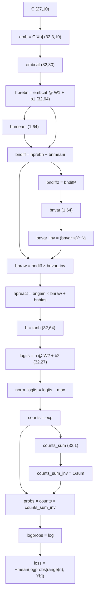
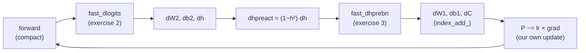

# 10 · Backprop ninja: manual gradients

**What you'll build:** the MLP + BatchNorm language model from lesson 09, with **every gradient written by hand**: first through 20 tiny "atomic" steps (each checked against PyTorch), then with the two famous shortcuts (softmax + cross-entropy, and the whole BatchNorm layer in one formula), and finally a full training run that never calls `loss.backward()` and still reaches a dev loss of 2.19.
**Like you're 5:** so far a calculator did your long division. Today you do it by hand, step by step, and check each step against the calculator. After this, no calculator answer will ever mystify you.
**Time:** ~4 h (plus the 2 h video) · **Builds on:** [09 · Activations, BatchNorm and initialisation](../09-activations-batchnorm-and-initialization) · **Needs:** nothing extra

## Why this matters
`loss.backward()` is a **leaky abstraction**: it works until it doesn't. Exploding or vanishing gradients, dead neurons, a silently wrong custom layer, a numerically unstable loss: you can only debug these if you know what flows backwards through each operation. Writing the backward pass for whole tensors (not single numbers, like micrograd) is also how high-performance kernels such as FlashAttention and llm.c are written. This is the hardest lesson of Part 2, and the most valuable.

## What you'll learn
- **Backprop through tensor operations:** matmul, broadcasting, sums, max, indexing, `view`, embedding lookups.
- **Two rules that solve almost everything:** "the gradient has the same shape as the value" and "broadcast forward = sum backward" (and vice versa).
- **Softmax + cross-entropy backward in one line:** `dlogits = (softmax − one_hot) / n`.
- **BatchNorm backward in one formula**, and Bessel's correction (`n − 1`).
- **Training with your own gradients only.**

## Before you start
```bash
pip install torch pytest
```
`names_data.py` is the same helper as lesson 07. No API key needed.

## Run it
1. From the course folder `llm-from-scratch`:
```bash
cd part-2-language-models-step-by-step/10-backprop-ninja-manual-gradients
```
2. Exercises 1–3: all hand-written gradients vs PyTorch (a few seconds):
```bash
python backprop_ninja.py
```
3. Exercise 4: train with only your own gradients (50,000 steps, about 30 seconds):
```bash
python train_manual.py
```
4. Tests: `pytest -q`

### What you should see
`python backprop_ninja.py`:
```
loss = 3.482923

EXERCISE 1: every intermediate, ours vs PyTorch
logprobs        | exact: True  | approximate: True  | maxdiff: 0.0e+00
probs           | exact: True  | approximate: True  | maxdiff: 0.0e+00
counts_sum_inv  | exact: True  | approximate: True  | maxdiff: 0.0e+00
counts_sum      | exact: True  | approximate: True  | maxdiff: 0.0e+00
counts          | exact: True  | approximate: True  | maxdiff: 0.0e+00
norm_logits     | exact: True  | approximate: True  | maxdiff: 0.0e+00
logit_maxes     | exact: True  | approximate: True  | maxdiff: 0.0e+00
logits          | exact: True  | approximate: True  | maxdiff: 0.0e+00
h               | exact: True  | approximate: True  | maxdiff: 0.0e+00
W2              | exact: True  | approximate: True  | maxdiff: 0.0e+00
b2              | exact: True  | approximate: True  | maxdiff: 0.0e+00
hpreact         | exact: False | approximate: True  | maxdiff: 4.7e-10
bngain          | exact: False | approximate: True  | maxdiff: 3.7e-09
bnbias          | exact: False | approximate: True  | maxdiff: 2.8e-09
bnraw           | exact: False | approximate: True  | maxdiff: 4.7e-10
bnvar_inv       | exact: False | approximate: True  | maxdiff: 3.7e-09
bnvar           | exact: False | approximate: True  | maxdiff: 1.2e-09
bndiff2         | exact: False | approximate: True  | maxdiff: 4.4e-11
bndiff          | exact: False | approximate: True  | maxdiff: 4.7e-10
bnmeani         | exact: False | approximate: True  | maxdiff: 3.7e-09
hprebn          | exact: False | approximate: True  | maxdiff: 4.7e-10
embcat          | exact: False | approximate: True  | maxdiff: 1.4e-09
W1              | exact: False | approximate: True  | maxdiff: 5.1e-09
b1              | exact: False | approximate: True  | maxdiff: 3.7e-09
emb             | exact: False | approximate: True  | maxdiff: 1.4e-09
C               | exact: False | approximate: True  | maxdiff: 3.7e-09

EXERCISE 2: softmax + cross-entropy in one step
F.cross_entropy loss 3.482923  vs atomic loss 3.482923  diff 2.4e-07
logits (fast)   | exact: False | approximate: True  | maxdiff: 7.0e-09

EXERCISE 3: BatchNorm backward in one formula
hprebn (fast)   | exact: False | approximate: True  | maxdiff: 9.3e-10

ALL GRADIENTS MATCH. You are a backprop ninja.
```
`python train_manual.py`:
```
parameters: 4,137
step 0 check: biggest difference between our grads and PyTorch's = 1.1e-08
step      0/50000  loss 3.4938
step  10000/50000  loss 2.0686
step  20000/50000  loss 2.3211
step  30000/50000  loss 2.1404
step  40000/50000  loss 2.0084

train loss 2.1789   dev loss 2.1879
names from a network trained with 100% hand-written gradients:
  carlah
  amille
  khi
  mrix
  taty
  sacassie
  mahnen
  dellynn
  kaeli
  ner
```
"exact: False, approximate: True" with differences around `1e-9` is perfect: those are float32 rounding differences from doing the same maths in a different order. A real mistake shows up as `approximate: False` with a large `maxdiff`. And `pytest -q` prints `3 passed`.

## How it works

### The forward pass, split into atoms (`forward_atomic()`)
Lesson 09's model, written so every line is one simple operation. `n = 32` examples, 64 hidden neurons, 27 classes.

Then `manual_backward()` walks this graph from the bottom up. Notation: `d["x"]` (written `dx` below) always means **∂loss/∂x**, and it always has **the same shape as x**.

### The rules you need
| Forward | Backward | Plain words |
|---------|----------|-------------|
| `c = a * b` (same shapes) | `da = b * dc`, `db = a * dc` | each gets the other one times the upstream gradient |
| `c = a @ b` | `da = dc @ b.T`, `db = a.T @ dc` | the only arrangement whose shapes fit |
| `c = a + b` where `b` is `(1, 64)` broadcast over 32 rows | `db = dc.sum(0, keepdim=True)` | **broadcast forward = sum backward**: b was reused by every row, so add up its blame |
| `s = x.sum(1, keepdim=True)` | `dx = torch.ones_like(x) * ds` | **sum forward = broadcast backward**: every element contributed 1:1 |
| `y = x.exp()` | `dx = y * dy` | e^x is its own slope |
| `y = x.log()` | `dx = (1/x) * dy` | |
| `y = x ** k` | `dx = k * x**(k−1) * dy` | power rule |
| `y = tanh(x)` | `dx = (1 − y²) * dy` | |
| `m = x.max(1)` | `dx[i, argmax_i] += dm[i]` | only the winning element was used |
| `e = C[X]` (lookup) | for every position, add `de` into row `X` of `dC` (`index_add_`) | a row looked up 5 times collects 5 gradients |
| a value used twice | add the two gradients | the `+=` rule from micrograd |

### Exercise 1, walked through (`manual_backward()`)
1. **`dlogprobs`**: `loss = −(1/n) Σ logprobs[i, Yb[i]]`. Only the 32 picked entries affect the loss, each with slope `−1/n`; everything else gets 0.
2. **`dprobs = (1/probs) * dlogprobs`**: log's rule.
3. **`probs = counts * counts_sum_inv`** has a broadcast: `counts_sum_inv` is `(32, 1)`, stretched over 27 columns. So `dcounts_sum_inv = (counts * dprobs).sum(1, keepdim=True)` (broadcast → sum) and the first contribution `dcounts = counts_sum_inv * dprobs`.
4. **`counts_sum_inv = counts_sum ** −1`** → `dcounts_sum = −counts_sum⁻² * dcounts_sum_inv`.
5. **`counts_sum = counts.sum(1)`** → **add** `ones_like(counts) * dcounts_sum` to `dcounts` (counts is used twice!).
6. **`counts = norm_logits.exp()`** → `dnorm_logits = counts * dcounts`.
7. **`norm_logits = logits − logit_maxes`** → `dlogits` gets `dnorm_logits` directly; `dlogit_maxes = −dnorm_logits.sum(1)`. Then the max adds its gradient back into the winning position. (In theory `dlogit_maxes` is exactly 0: subtracting a constant from all logits doesn't change softmax. The code still computes it, and you can check it is ~1e-9.)
8. **`logits = h @ W2 + b2`** → `dh = dlogits @ W2.T`, `dW2 = h.T @ dlogits`, `db2 = dlogits.sum(0)`.
9. **tanh** → `dhpreact = (1 − h²) * dh`.
10. **`hpreact = bngain * bnraw + bnbias`** → `dbngain = (bnraw * dhpreact).sum(0)`, `dbnraw = bngain * dhpreact`, `dbnbias = dhpreact.sum(0)` (gain and bias were broadcast over the batch).
11. **BatchNorm, atom by atom**: `bnraw = bndiff * bnvar_inv` → `dbndiff` (first use) and `dbnvar_inv = (bndiff * dbnraw).sum(0)`; `bnvar_inv = (bnvar + ε)^−½` → `dbnvar = −½ (bnvar + ε)^−³ᐟ² * dbnvar_inv`; `bnvar = 1/(n−1) · Σ bndiff2` → `dbndiff2 = 1/(n−1) * ones * dbnvar`; `bndiff2 = bndiff²` → **add** `2 · bndiff * dbndiff2` to `dbndiff` (second use); `bndiff = hprebn − bnmeani` → `dhprebn = dbndiff`, `dbnmeani = −dbndiff.sum(0)`; `bnmeani = 1/n · Σ hprebn` → **add** `1/n * ones * dbnmeani` to `dhprebn`.
12. **First layer** → `dembcat = dhprebn @ W1.T`, `dW1 = embcat.T @ dhprebn`, `db1 = dhprebn.sum(0)`.
13. **`view`** → `demb = dembcat.view(emb.shape)` (a view just relabels the numbers, so the gradient is relabelled back).
14. **Embedding** → `dC.index_add_(0, Xb.view(−1), demb.view(−1, 10))`: each of the 32 × 3 lookups adds its 10 gradient numbers into the row it came from.

`cmp()` compares each result with PyTorch's `.grad` (which we keep for intermediate tensors with `retain_grad()`).

**Bessel's correction:** `bnvar` divides by `n − 1` (31), not `n` (32). Dividing by `n` slightly underestimates the true variance from a small sample; `n − 1` corrects it. The video discusses that PyTorch's `BatchNorm1d` uses the biased (`n`) version during training but the unbiased one for its running estimate; we use `n − 1` consistently, as the video recommends.

### Exercise 2: softmax + cross-entropy in one line (`fast_dlogits()`)
Doing the maths on paper instead of atom by atom (as in lesson 05):

$$\frac{\partial\,\text{loss}}{\partial\,\text{logits}_{i,j}} = \frac{1}{n}\Big(\text{softmax}(\text{logits}_i)_j - \mathbb{1}[j = Y_i]\Big)$$

| Symbol | Plain words |
|--------|-------------|
| `i` | which example in the batch (row) |
| `j` | which character (column) |
| `softmax(logitsᵢ)ⱼ` | the probability example i gave to character j |
| `𝟙[j = Yᵢ]` | 1 for the correct character, 0 for the others |
| `1/n` | the loss is a mean over n examples |

Intuition (Karpathy's "forces" picture): for each example, the correct character's logit is **pulled up** by how much probability it was missing, and every wrong character is **pushed down** by how much probability it took. Each row of `dlogits` adds up to exactly 0: the pulls and pushes balance (one of the tests checks this).

### Exercise 3: BatchNorm backward in one formula (`fast_dhprebn()`)
Collapsing step 11 on paper gives:

$$\frac{\partial L}{\partial x_i} = \frac{\gamma\,\hat\sigma^{-1}}{n}\left(n\,\frac{\partial L}{\partial y_i} - \sum_{j}\frac{\partial L}{\partial y_j} - \frac{n}{n-1}\,\hat{x}_i\sum_j \frac{\partial L}{\partial y_j}\,\hat{x}_j\right)$$

| Symbol | Plain words |
|--------|-------------|
| `xᵢ` | `hprebn` for example i (BatchNorm's input) |
| `yᵢ` | `hpreact` for example i (BatchNorm's output), so `∂L/∂yᵢ` is `dhpreact` |
| `γ` | `bngain` |
| `σ̂⁻¹` | `bnvar_inv`, 1 / standard deviation |
| `x̂ᵢ` | `bnraw`, the normalised value |
| `Σⱼ` | sum over the batch (all n examples) |

The three terms say: each example's gradient (term 1), minus the batch's average gradient (term 2, because shifting the whole batch changes nothing after subtracting the mean), minus the part along the normalised direction (term 3, because scaling the whole batch changes nothing after dividing by the std). All of it operates on 64 neurons in parallel.

### Exercise 4: training without autograd (`train_manual.py`)

All gradient maths runs inside `torch.no_grad()`, so PyTorch does not even record a graph. On step 0 only, `loss.backward()` is called once to confirm our gradients agree (difference `1.1e-08`). After training, the BatchNorm mean and variance are measured over the whole training set (instead of running averages), and the model is evaluated and sampled. Dev loss **2.188**, with 4,137 parameters (64 hidden neurons; lesson 08 had 200), all from hand-written gradients.

## If something goes wrong
- **`approximate: False` for one line** → that line's backward formula is wrong, but every line *above* it in the table is fine (they were checked first). Fix the first `False` from the top; later lines often recover.
- **`RuntimeError: The size of tensor a (64) must match the size of tensor b (32)`** → a shape mistake in a backward step: compare the gradient's shape with its value's shape (they must match) and decide whether you need a `.sum(0, keepdim=True)` or a `.T`.
- **`AttributeError: 'NoneType' object has no attribute ...` on `.grad`** → an intermediate tensor without `retain_grad()`; `run_all()` calls it for every entry in `t`.
- **Training loss is `nan`** → a sign error in an update (`+=` instead of `+= -lr *`), or you changed `fast_dhprebn`. Run `pytest -q`: it checks both shortcuts.

## Try this
1. Break one rule on purpose: in `manual_backward()`, replace `d["b2"] = d["logits"].sum(0)` with `d["b2"] = d["logits"][0]` (forgetting "broadcast forward = sum backward"). Which lines of the table turn False?
   <details><summary>Answer</summary>Only `b2` (`approximate: False`, maxdiff about 0.16): nothing else depends on `db2`. Each gradient flows only into the parameters and values that feed it, which is why the table pinpoints the faulty step.</details>
2. Show numerically that `d["logit_maxes"]` is (almost) zero, and explain why.
   <details><summary>Solution</summary>`print(d["logit_maxes"].abs().max())` in `run_all()` gives something around 1e-9. Subtracting the same number from every logit in a row doesn't change the softmax probabilities, so the loss can't depend on `logit_maxes`: its true gradient is exactly 0, and what you see is rounding.</details>
3. Add a bigger hidden layer to `train_manual.py` (change `N_HIDDEN` in `backprop_ninja.py` to 200) and compare the dev loss with lesson 08's 2.17.
   <details><summary>Hint</summary>Everything is written in terms of shapes, so nothing else needs to change. Run `pytest -q` afterwards: the gradient checks still pass for any size. In our run the dev loss went from 2.188 (64 neurons) to 2.142 (200 neurons), beating lesson 08 (2.17) thanks to BatchNorm and Kaiming init.</details>

## Check yourself
1. In the forward pass `y = x + b` where `x` is `(32, 64)` and `b` is `(1, 64)`, what is `db`?
2. Why does `counts` receive gradient from two places, and what do you do with the two parts?
3. What does each row of `dlogits` add up to, and why?
4. Why do the matrix-multiply gradients have a `.T` in them?
<details><summary>Answers</summary>

1. `db = dy.sum(0, keepdim=True)`: b was broadcast over 32 rows, so its gradient is the sum of the 32 rows' gradients.
2. It is used in `probs = counts * counts_sum_inv` and in `counts_sum = counts.sum(1)`. Both paths affect the loss, so you add the two gradients.
3. Zero: the probabilities add up to 1 and we subtract exactly 1 at the true class.
4. Shapes: `dW2` must be `(64, 27)` like `W2`, and the only product of `h` (32, 64) and `dlogits` (32, 27) with that shape is `h.T @ dlogits`. Similarly `dh` (32, 64) = `dlogits @ W2.T`.
</details>

## Watch alongside
**Andrej Karpathy, "Building makemore Part 4: Becoming a Backprop Ninja"** (L5): https://www.youtube.com/watch?v=q8SA3rM6ckI. Approximate times from the chapter list:

| Video chapter (≈ time) | Matches in this lesson |
|------------------------|------------------------|
| intro: why you should care, fun history (≈ 0:00) | Why this matters |
| starter code (≈ 0:07) | `make_params()`, `forward_atomic()`, `cmp()` |
| exercise 1: backproping the atomic compute graph (≈ 0:13) | `manual_backward()`, steps 1–14 |
| brief digression: Bessel's correction in batchnorm (≈ 1:05) | Bessel's correction paragraph |
| exercise 2: cross entropy loss backward pass (≈ 1:26) | `fast_dlogits()` |
| exercise 3: batch norm layer backward pass (≈ 1:36) | `fast_dhprebn()` |
| exercise 4: putting it all together (≈ 1:50) | `train_manual.py` |

Karpathy's blog post "Yes you should understand backprop" (linked from the video description) is a short, convincing read on why this matters.

## Learn more (optional)
**Read the official docs**
- `torch.Tensor.retain_grad`: https://pytorch.org/docs/stable/generated/torch.Tensor.retain_grad.html
- `torch.Tensor.index_add_`: https://pytorch.org/docs/stable/generated/torch.Tensor.index_add_.html
- Extending PyTorch with your own backward (`torch.autograd.Function`): https://pytorch.org/docs/stable/notes/extending.html

Where this leads: https://github.com/karpathy/llm.c trains GPT-2 in plain C with every backward pass written by hand, the same way you just did.

## Next
→ [11 · WaveNet: a deeper character model](../11-wavenet-deeper-character-model)
