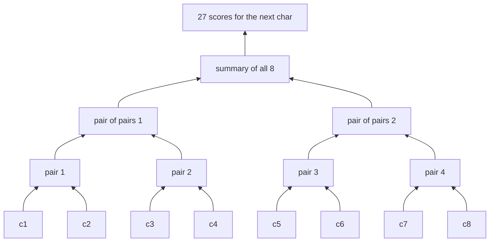

# 11 · WaveNet: a deeper character model

**What you'll build:** a deeper language model that reads **8** previous characters and combines them gradually in a tree, like DeepMind's WaveNet (2016): pairs of characters, then pairs of pairs, then the whole context. Every layer (`Embedding`, `FlattenConsecutive`, `Linear`, `BatchNorm1d`, `Tanh`, `Sequential`) is your own class, built to behave like `torch.nn`. The full run reaches a **dev loss of 1.99**, the same as the video, down from 2.17 in lesson 08.
**Like you're 5:** to understand a long sentence you don't swallow it in one gulp. You read two words, then join them into a little idea, then join two little ideas into a bigger one, until you understand the whole sentence.
**Time:** ~3 h (plus the 1 h video) · **Builds on:** [10 · Backprop ninja](../10-backprop-ninja-manual-gradients) · **Needs:** nothing extra

## Why this matters
More context makes better predictions, but cramming a long context into one layer all at once (lesson 08's way) works badly. Processing it **hierarchically**, a little at a time, is the idea behind WaveNet's dilated convolutions and, in a different form, behind the stacked layers of a transformer. You also finish turning your code into a small `torch.nn`-like library, so the GPT code in Part 3 will read like something you have already written. And you practise the real development loop: inspect shapes, find a subtle bug (BatchNorm over the wrong dimensions), fix it, scale up.

## What you'll learn
- **Hierarchical fusion:** combine neighbouring characters in pairs, layer after layer (8 → 4 → 2 → 1).
- **3-D tensors `(B, T, C)`:** batch, time (position), channels, and how `@` treats extra dimensions.
- **`FlattenConsecutive`:** a reshape (`view`) that glues neighbours together.
- **BatchNorm on 3-D input:** average over batch *and* time; the bug in the video and its fix.
- **Containers and experiment harnesses:** `Sequential`, comparing architectures fairly on the dev set.

## Before you start
```bash
pip install torch pytest
```
`names_data.py` is the same helper as lesson 07. No API key needed.

## Run it
1. From the course folder `llm-from-scratch`:
```bash
cd part-2-language-models-step-by-step/11-wavenet-deeper-character-model
```
2. Train the WaveNet (50,000 steps, about 2 minutes on a laptop CPU):
```bash
python wavenet.py
```
3. Compare with a plain MLP that reads all 8 characters at once:
```bash
python wavenet.py --model flat
```
4. The video's full run (200,000 steps, about 6–8 minutes):
```bash
python wavenet.py --steps 200000
```
5. Tests: `pytest -q`

### What you should see
`python wavenet.py`:
```
context of 8 characters | train (182625, 8) dev (22655, 8)
wavenet: 76,579 parameters

shapes for a batch of 4 examples:
  Embedding            -> (4, 8, 24)
  FlattenConsecutive   -> (4, 4, 48)
  Linear               -> (4, 4, 128)
  BatchNorm1d          -> (4, 4, 128)
  Tanh                 -> (4, 4, 128)
  FlattenConsecutive   -> (4, 2, 256)
  Linear               -> (4, 2, 128)
  BatchNorm1d          -> (4, 2, 128)
  Tanh                 -> (4, 2, 128)
  FlattenConsecutive   -> (4, 256)
  Linear               -> (4, 128)
  BatchNorm1d          -> (4, 128)
  Tanh                 -> (4, 128)
  Linear               -> (4, 27)

step       0/50000  batch loss 3.3146  (0s)
step    5000/50000  batch loss 1.8007  (10s)
step   10000/50000  batch loss 1.8617  (19s)
...
step   45000/50000  batch loss 1.7955  (88s)

train loss 1.9112   dev loss 2.0059   (lesson 08 MLP with 3 chars: dev about 2.17)
test loss (checked once, at the end): 2.0038

names invented by the model:
  carmah
  amori
  kithim
  shreet
  khalani
  emmahuel
  delsyn
  jarqui
  nellara
  chaiir
  kaleigh
  hamaira
  desian
  sulina
  livian
```
`python wavenet.py --model flat` (22,097 parameters): `train loss 2.0223   dev loss 2.0713`.
`python wavenet.py --steps 200000`: `train loss 1.7760   dev loss 1.9937`, test `1.9922`, with names like `khaleya`, `deliyah`, `neliah`, `jaquint`.

The shape table is the most important part of the output: it is the whole architecture at a glance. Then compare dev losses: bigram 2.45 → MLP (3 chars) 2.17 → flat MLP (8 chars) 2.07 → WaveNet 2.01 (50k steps) → **1.99** (200k steps). Notice train (1.78) is now well below dev (1.99): the bigger model has started to overfit a little.

## How it works

### Step 1: 8 characters of context
`build_dataset()` is lesson 08's with `block_size = 8`: `X` has shape `(182625, 8)`. More context helps (the flat MLP alone drops from 2.17 to 2.07), but the flat MLP must squash 8 × 10 = 80 numbers through one layer in a single step.

### Step 2: the layers (all in `wavenet.py`)
| Class | Input → output shape | What it does |
|-------|----------------------|--------------|
| `Embedding(27, 24)` | `(B, 8)` → `(B, 8, 24)` | look up a 24-number vector per character (`weight[IX]`) |
| `FlattenConsecutive(2)` | `(B, T, C)` → `(B, T/2, 2C)` | glue each pair of neighbouring vectors side by side |
| `Linear(in, out)` | `(…, in)` → `(…, out)` | `x @ weight (+ bias)`; works on 2-D or 3-D input |
| `BatchNorm1d(dim)` | same shape | normalise each channel over batch (and time) |
| `Tanh()` | same shape | squash |
| `Sequential([...])` | | call the layers in order; collect all parameters |

### Step 3: the tree

Each arrow-join is one `FlattenConsecutive(2) → Linear → BatchNorm1d → Tanh` block, and **the same block weights are used for every pair at that level** (just as one convolution filter slides along a signal). That is how 3 small layers can digest 8 characters.

### Step 4: how `Linear` handles 3-D input
After the first `FlattenConsecutive`, `x` has shape `(B, 4, 48)`: 4 pairs, 48 numbers each. `x @ weight` with `weight` `(48, 128)` gives `(B, 4, 128)`. PyTorch's matrix multiply only uses the **last** dimension; all earlier dimensions are treated as "a batch of separate rows". So the same `Linear` processes all 4 pairs of all B examples in one call.

`FlattenConsecutive` is just `x.view(B, T // n, C * n)`: because a tensor's numbers are stored in order (lesson 08), positions 0 and 1 of length-24 each sit next to each other in memory, and viewing them as one row of 48 glues them together without copying. When only one position is left, `squeeze(1)` drops the length-1 dimension so the result is a normal `(B, 128)`.

### Step 5: the BatchNorm bug (and fix)
For 2-D input `(B, C)`, BatchNorm averages over dimension 0 (the batch). For 3-D input `(B, T, C)`, averaging over dimension 0 only would give a separate mean for each of the T positions: shape `(1, T, C)`. Nothing crashes (broadcasting makes it "work"), but each statistic is estimated from fewer numbers, and the running averages get the wrong shape. Karpathy finds exactly this silent bug in the video. **Fix** (in `BatchNorm1d.__call__`): average over every dimension except the last:
```python
dims = tuple(range(x.ndim - 1))      # (0,) for 2-D input, (0, 1) for 3-D input
xmean = x.mean(dims, keepdim=True)
```
`test_batchnorm_uses_batch_and_time_dims` checks it: the output has mean 0 per channel, and `running_mean` has shape `(5,)`, one number per channel. (PyTorch's own `nn.BatchNorm1d` expects 3-D input as `(B, C, T)`, channels in the middle: one reason we write our own here.)

### Step 6: initialisation and training
The same ideas as lesson 09: `Linear` weights start at `randn / √fan_in`, scaled by the tanh gain 5/3; the last layer's weights are multiplied by 0.1 so the first loss is ≈ 3.30 (we see 3.31). Training: batches of 32, learning rate 0.1 for the first 75% of steps, then 0.01. Before evaluating, every `BatchNorm1d` is switched to `training = False` so it uses its running averages, the same thing `model.eval()` does in PyTorch.

Parameter count: embedding 27·24 = 648; three blocks: 48·128 + 2·128 = 6,400, then 256·128 + 2·128 = 33,024 twice; output 128·27 + 27 = 3,483; total **76,579** (exactly the video's).

### Step 7: comparing fairly
| Model | Context | Parameters | Steps | Dev loss |
|-------|---------|------------|-------|----------|
| bigram (lesson 07) | 1 | 729 | counts | 2.45 |
| MLP (lesson 08) | 3 | 11,897 | 200k | 2.17 |
| flat MLP (`--model flat`) | 8 | 22,097 | 50k | 2.07 |
| WaveNet (default) | 8 | 76,579 | 50k | 2.01 |
| WaveNet (`--steps 200000`) | 8 | 76,579 | 200k | **1.99** |

The comparison is not perfectly fair (different sizes and steps), which Karpathy points out too: a proper **experiment harness** would sweep settings for each model and compare their best dev losses. Exercise 3 starts you on that.

## If something goes wrong
- **`RuntimeError: shape '[4, 1, 256]' is invalid for input of size 1536`** (e.g. `--block-size 6`) or **`RuntimeError: Expected target size [32, 27], got [32]`** (e.g. `--block-size 16`) → the default WaveNet has exactly three pairing levels, so it needs `--block-size 8` (8 → 4 → 2 → 1). For 16, add a fourth `FlattenConsecutive(2), Linear, BatchNorm1d, Tanh` block in `wavenet()`. (`--model flat` works with any block size.)
- **Dev loss much worse than train after your edits** → check you set `training = False` on every `BatchNorm1d` before evaluating and sampling.
- **Sampling crashes with a BatchNorm error for a single example** → same cause: in training mode the variance of a batch of 1 is undefined.
- **Training is slow** → keep `torch.set_num_threads(1)`; the 200k run takes several minutes on any CPU. On a GPU the gain is small for a model this tiny.

## Try this
1. Put a print inside `BatchNorm1d.__call__` (`print(xmean.shape)`) and run `python wavenet.py --steps 1`. Then change `dims` to `(0,)` (the bug). What shape does the mean have now for the 3-D layers?
   <details><summary>Answer</summary>Fixed: `(1, 1, 128)` for the 3-D layers and `(1, 128)` for the 2-D one. Buggy: `(1, 4, 128)` and `(1, 2, 128)`: separate statistics per position. Remove the print and restore the fix afterwards.</details>
2. Train `--model flat --block-size 3` and compare it with lesson 08's MLP. Should the numbers be similar?
   <details><summary>Hint</summary>Roughly, yes: it is lesson 08's architecture (10-number embeddings, 200 hidden) plus BatchNorm and Kaiming-style init. In our run it reached dev 2.14 in 50k steps, better than lesson 08's 2.17 after 200k, thanks to the healthier initialisation from lesson 09.</details>
3. Write a tiny harness: train WaveNet with `n_hidden` = 64, 128 and 200 (edit `wavenet()` or add a flag), each for 50,000 steps, and print a table of dev losses. Which would you pick, and why not look at the test loss?
   <details><summary>Hint</summary>Add `parser.add_argument("--hidden", type=int, default=128)` and pass it to `wavenet(V, n_hidden=args.hidden)`, then run the three settings. Pick by dev loss; touch test only once for the winner, so the test number stays an honest estimate.</details>

## Check yourself
1. What shape comes out of `FlattenConsecutive(2)` for an input of shape `(32, 8, 24)`?
2. Why can one `Linear(48, 128)` process all 4 pairs at once?
3. What was wrong with averaging over dimension 0 only for `(B, T, C)` input?
4. Train loss 1.78, dev loss 1.99. What does the gap tell you?
<details><summary>Answers</summary>

1. `(32, 4, 48)`: 4 pairs, each the 2 neighbouring 24-number vectors side by side.
2. Matrix multiply works on the last dimension and treats `(32, 4)` as 128 separate rows, all multiplied by the same weights.
3. It computed separate statistics per position from only B numbers each (instead of B × T), and gave running statistics the wrong shape. Nothing crashed, which made it a silent bug.
4. The model is starting to overfit: it does better on names it has seen. Regularisation (e.g. dropout, used in GPT in Part 3), more data, or a smaller model would narrow the gap.
</details>

## Watch alongside
**Andrej Karpathy, "Building makemore Part 5: Building a WaveNet"** (L6): https://www.youtube.com/watch?v=t3YJ5hKiMQ0. Approximate times from the chapter list:

| Video chapter (≈ time) | Matches in this lesson |
|------------------------|------------------------|
| starter code walkthrough; fixing the learning-rate plot (≈ 0:01–0:09) | lessons 08–09 recap |
| PyTorch-ifying our code: layers, containers, torch.nn, fun bugs (≈ 0:09) | Step 2, `Sequential`, `Embedding` |
| overview: WaveNet (≈ 0:17) | Step 3 |
| bump the context size to 8; baseline on block_size 8 (≈ 0:19) | Step 1, `--model flat` |
| implementing WaveNet (≈ 0:21) | `FlattenConsecutive`, Step 4 |
| training the WaveNet: first pass (≈ 0:37) | default run |
| fixing the batchnorm1d bug; re-training (≈ 0:38–0:45) | Step 5, Try this 1 |
| scaling up our WaveNet (≈ 0:46) | `--steps 200000` |
| experimental harness; dilated causal convolutions; torch.nn; the development process (≈ 0:47–0:54) | Step 7, Try this 3 |
| improve on my loss! (≈ 0:55) | your challenge: beat 1.99 on dev |

Also: **3Blue1Brown, "But what is a GPT?"** (https://www.youtube.com/watch?v=wjZofJX0v4M) as a bridge to Part 3, where a transformer replaces the fixed tree with attention that decides *which* earlier characters to combine.

## Learn more (optional)
**Read the official docs**
- `torch.nn.Sequential`: https://pytorch.org/docs/stable/generated/torch.nn.Sequential.html
- `torch.nn.Embedding`: https://pytorch.org/docs/stable/generated/torch.nn.Embedding.html
- `torch.nn.BatchNorm1d` (note its `(N, C, L)` input layout): https://pytorch.org/docs/stable/generated/torch.nn.BatchNorm1d.html
- `torch.matmul` (how extra dimensions are batched): https://pytorch.org/docs/stable/generated/torch.matmul.html

**The paper:** van den Oord et al. (2016), *WaveNet: A Generative Model for Raw Audio*: https://arxiv.org/abs/1609.03499

Lighter preview: [ai-engineer-journey 5.3 · Tiny RNN name generator](../../../ai-engineer-journey/level-5-text-models/03-tiny-rnn-name-generator) (another way to use long context).

## Next
Part 2 complete: you have built five generations of character-level language models. Part 3 builds a tokenizer, attention, and GPT itself.
→ [Part 3 · Transformers and GPT](../../part-3-transformers-and-gpt), starting with [12 · BPE tokenizer from scratch](../../part-3-transformers-and-gpt/12-bpe-tokenizer-from-scratch)
