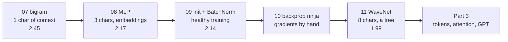

# Part 2 · Language models step by step

A language model answers one question over and over: *"given the text so far, how likely is each possible next piece?"*. In this part you build five generations of character-level language models on 32,033 real names, each one fixing a weakness of the last, exactly in the order of Andrej Karpathy's **makemore** lectures. Along the way you learn the craft of training: embeddings, mini-batches, train/dev/test splits, learning rates, initialisation, normalisation, writing every gradient by hand, and debugging deep networks.

**Like you're 5:** you are teaching a parrot to invent names. First it only remembers which letter usually comes after which. Then it looks at the last three letters, then eight. Each time it gets better, and each time you learn a new trick for teaching parrots.

## Lessons

| # | Lesson | What you build | Dev loss | Time | Karpathy video |
|---|---|---|---|---|---|
| 07 | [Bigram language model](07-bigram-language-model) | counting model and a one-layer neural net; sampling; negative log likelihood | 2.45 | ~3 h | [makemore 1](https://www.youtube.com/watch?v=PaCmpygFfXo) |
| 08 | [MLP language model](08-mlp-language-model) | Bengio 2003: embeddings, hidden layer, mini-batches, LR search, splits | 2.17 | ~3 h | [makemore 2](https://www.youtube.com/watch?v=TCH_1BHY58I) |
| 09 | [Activations, BatchNorm and initialisation](09-activations-batchnorm-and-initialization) | fixing the initial loss and saturated tanh, Kaiming init, BatchNorm, health diagnostics | 2.14 | ~3 h | [makemore 3](https://www.youtube.com/watch?v=P6sfmUTpUmc) |
| 10 | [Backprop ninja: manual gradients](10-backprop-ninja-manual-gradients) | every gradient by hand, checked against PyTorch; training without `backward()` | 2.19* | ~4 h | [makemore 4](https://www.youtube.com/watch?v=q8SA3rM6ckI) |
| 11 | [WaveNet: a deeper character model](11-wavenet-deeper-character-model) | 8-character context fused in a tree; your own `torch.nn`-like layers | 1.99 | ~3 h | [makemore 5](https://www.youtube.com/watch?v=t3YJ5hKiMQ0) |

\*Lesson 10 uses a smaller hidden layer (64 neurons) so the hand-written backward pass stays readable; with 200 neurons it reaches 2.14.

Lower is better. A model that knows nothing scores `−ln(1/27) = 3.30`. Total: about 16 hours of study, plus about 7 hours of video.



## Setup for this part
Use the course virtual environment, then:
```bash
pip install torch matplotlib pytest
```
| Package | Used for |
|---|---|
| `torch` | every model in this part |
| `matplotlib` | optional pictures with `--plot` (lessons 07–09): the count table, the letter embeddings, activation histograms |
| `pytest` | the tests in lessons 10 and 11 |

**The data.** Every lesson uses `names.txt` (32,033 names, 228 KB, MIT licence) from [karpathy/makemore](https://github.com/karpathy/makemore). Each lesson folder has a small `names_data.py` helper that downloads it on first use from `https://raw.githubusercontent.com/karpathy/makemore/master/names.txt` and saves it next to the script. Offline, it falls back to a built-in list of 151 names so the code still runs (results will be much worse than in the READMEs).

**Hardware.** Everything runs on a laptop CPU: the longest default run (lesson 11) takes about 2 minutes, and the optional full 200,000-step run 6–8 minutes. The scripts call `torch.set_num_threads(1)` because these matrices are tiny and one CPU thread is fastest for them.

**Lighter previews.** [ai-engineer-journey 5.2 · Bigram name generator](../../ai-engineer-journey/level-5-text-models/02-next-letter-predictor-bigram-name-generator) and [5.3 · Tiny RNN name generator](../../ai-engineer-journey/level-5-text-models/03-tiny-rnn-name-generator) are shorter, gentler versions of lessons 07 and 11.

## After this part you can
- Explain what a language model is and score one with negative log likelihood.
- Build and train a neural language model with embeddings, and sample text from it.
- Choose a learning rate, use train/dev/test splits, and tell underfitting from overfitting.
- Diagnose a sick network from its activation, gradient and update statistics, and fix it with initialisation or normalisation.
- Backpropagate by hand through matmuls, broadcasting, softmax, cross-entropy and BatchNorm.
- Read and write `torch.nn`-style layer code, including 3-D `(batch, time, channels)` tensors.

## Next part
→ [Part 3 · Transformers and GPT](../part-3-transformers-and-gpt): a BPE tokenizer, attention, and a GPT trained on Shakespeare.
