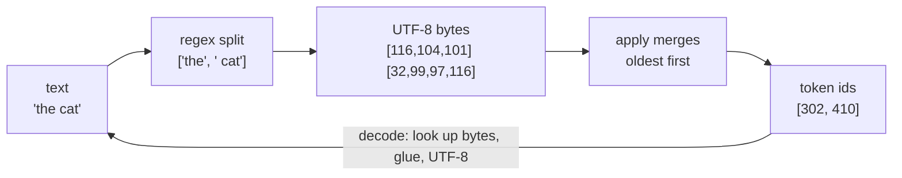

# 12 · BPE tokenizer from scratch

**What you'll build:** a real GPT-style tokenizer (`bpe.py`), the program that turns text into the numbers an LLM reads. You train it on Shakespeare, split text with the same regex GPT-4 uses, add special tokens like `<|endoftext|>`, save it to a file, and compare it with OpenAI's real GPT-2 and GPT-4 tokenizers.
**Like you're 5:** you are tired of writing "t-h-e" letter by letter, so you invent one sticker that means "the". Then a sticker for "ing". Then for "would". BPE invents the stickers that save the most writing, all by itself.
**Time:** ~3 h · **Builds on:** [11 · WaveNet, a deeper character model](../../part-2-language-models-step-by-step/11-wavenet-deeper-character-model) · **Needs:** nothing extra (internet once to download 1 MB of Shakespeare; `tiktoken` optional)

> Lighter preview of this topic: [ai-engineer-journey 5.6 · BPE tokenizer](../../../ai-engineer-journey/level-5-text-models/06-bpe-tokenizer-from-scratch). This lesson goes further: regex pre-splitting, special tokens, save/load, tests, and a side-by-side with the real GPT tokenizers.

## Why this matters
Until now your models read one **character** at a time (65 possible characters in Shakespeare). Real LLMs read **tokens**: pieces of words like `" the"`, `"ing"` or `" question"`. The tokenizer decides how long a text is for the model, which is why API prices and context windows are counted in tokens, why some languages cost more than others, and why models struggle to count the letters in "strawberry" (they never see the letters). Every model in the rest of this course needs a tokenizer, and in the capstone (lesson 22) you train your own chatbot on top of the one you build here.

## What you'll learn
- **Bytes first**: computers store every character as 1 to 4 **bytes** (numbers 0 to 255) using **UTF-8**. Starting from bytes means any text works: English, Hindi, emoji, code.
- **Byte-Pair Encoding (BPE)**: count which two neighbouring tokens appear together most often, glue them into one new token, repeat.
- **Encode / decode**: encoding applies the learned merges in the order they were learned; decoding looks each id up and glues the bytes back together. `decode(encode(x)) == x` must always be true.
- **Regex pre-splitting**: GPT-2 and GPT-4 first cut text into chunks (words, numbers, punctuation, spaces) so a merge never glues a word to the next word's punctuation.
- **Special tokens**: reserved ids such as `<|endoftext|>` that you insert on purpose to mark "a document ends here" or "the assistant speaks now" (you will need these for chatbots in lessons 19 and 22).

## Watch alongside
Andrej Karpathy, **Let's build the GPT Tokenizer**: https://www.youtube.com/watch?v=zduSFxRajkE (2 h 13 min). This lesson is the code version of that video.

| Video part | Matches here |
|---|---|
| Intro: what tokenization is and why it causes LLM weirdness | "Why this matters" |
| Unicode, UTF-8 and bytes | step 1 of "How it works" |
| The BPE algorithm, `get_stats` and `merge`, training | `BasicTokenizer` and section 1–2 of the output |
| Decoding and encoding | `decode()` and `_encode_chunk()` |
| GPT-2's regex pattern, tiktoken, GPT-4 pattern | `RegexTokenizer`, `compare_tiktoken.py` |
| Special tokens | section 4 of the output |
| minbpe exercise | this whole folder (same names as minbpe) |
| SentencePiece, vocabulary size, quirks | "Learn more" and "Check yourself" |

Tip: watch one video section, then read the matching function here, then run it.

## Before you start
1. Go to this lesson's folder (paths are relative to the course root `llm-from-scratch/`):
   ```bash
   cd part-3-transformers-and-gpt/12-bpe-tokenizer-from-scratch
   ```
2. Install the packages (inside the virtual environment you made at the start of the course):
   ```bash
   pip install -r requirements.txt
   ```
   - `regex`: a better version of Python's built-in `re`; it understands `\p{L}` ("any letter in any language"), which the GPT patterns need.
   - `tiktoken`: OpenAI's tokenizer library, only used by `compare_tiktoken.py`. It downloads each vocabulary file (~1–2 MB) the first time.
   - `pytest`: runs the small test file `test_bpe.py`.

No API key needed.

## Run it
1. Train the tokenizers and look inside them (~15 s):
   ```bash
   python train_tokenizer.py
   ```
   You should see the four numbered sections shown below, and two new files: `shakespeare.model` and `shakespeare.vocab`.
2. Compare with the real GPT-2 and GPT-4 tokenizers:
   ```bash
   python compare_tiktoken.py
   ```
   You should see a token-count table with three columns.
3. Run the tests:
   ```bash
   pytest -q
   ```
   You should see `4 passed`.
4. Open `shakespeare.vocab` in any text editor and scroll: every line shows how a token was born, for example `[ a][nd] -> [ and] 302`.

**Command, piece by piece**

| Piece | Meaning |
|---|---|
| `python` | start the Python interpreter |
| `train_tokenizer.py` | the file it should run |
| `--vocab 1024` (optional) | a **flag**: an extra setting for the script. Here: "make 1,024 tokens instead of 512". Flags are read by `argparse` at the top of the script |
| `pytest` | a tool that finds files named `test_*.py`, runs every function named `test_...` inside, and reports which ones passed |
| `-q` | "quiet": print less detail |

### What you should see
`python train_tokenizer.py` (real output; the time will differ on your machine):
```
======================================================================
1) The classic tiny example (Wikipedia): 'aaabdaaabac'

merge   1: b'a' + b'a' -> b'aa' (seen 4x)
merge   2: b'aa' + b'a' -> b'aaa' (seen 2x)
merge   3: b'aaa' + b'b' -> b'aaab' (seen 2x)
  encoded: [258, 100, 258, 97, 99]   (97='a', 98='b', 99='c', 100='d')

downloading tinyshakespeare (1 MB)...

Shakespeare: 1,115,394 characters (1,003,854 for training, 111,540 held out)
======================================================================
2) BasicTokenizer: BPE on raw bytes (first 100,000 characters, 40 merges)

  some learned tokens: [b'r ', b' the ', b'no', b'ti', b'om', b'll ', b'IUS:\n', b'of', b'ea', b'and ', b'to ', b'I ']
  notice tokens that glue a word to its neighbour's space or punctuation: that's the problem regex fixes
======================================================================
3) RegexTokenizer (GPT-4 split pattern), vocab 512

  regex chunks of the sample: ['To', ' be', ',', ' or', ' not', ' to', ' be', ':', ' that', ' is', ' the', ' question', '.']
  trained 256 merges in 9.9s
  first 10 merges: [b' t', b'he', b' a', b'ou', b' s', b' m', b'in', b' w', b're', b'ha']
  last 10 merges:  [b' was', b'ost', b'oth', b' would', b'au', b' now', b' can', b'ers', b'ond', b' their']

  How texts are cut:
  42 bytes -> 18 tokens: [To][ be][,][ ][or][ not][ to][ be][:][ that][ is][ the][ ][q][u][est][ion][.]
  47 bytes -> 26 tokens: [R][O][M][E][O][:\n][What][ li][ght][ th][r][ou][gh][ y][ond][er][ w][in][d][ow][ b][re][a][k][s][?]
  32 bytes -> 23 tokens: [To][k][en][i][z][at][ion][ of][ ][2][0][2][4][ e][m][a][il][s][ ][�][�][�][�]
  decode(encode(x)) == x for every sample  ✓

  held-out text: 111,540 bytes -> 55,963 tokens = 1.99 bytes per token (compression ratio)
======================================================================
4) Special tokens

  32 bytes -> 11 tokens: [The][ e][nd][.][<|endoftext|>][A][ ne][w][ st][or][y]
  '<|endoftext|>' became the single id 512: True
  safe default when the special string appears in normal text: text contains a special token; pass allowed_special='all'

saved shakespeare.model + shakespeare.vocab and reloaded them: same encoding  ✓
```
What to look at:
- **Section 1**: the most common pair `aa` became token 256, then `aa`+`a` became 257, then `aaa`+`b` became 258. The 11 letters shrank to 5 tokens.
- **Section 2**: without regex, tokens like `' the '` and `'and '` swallow the following space, and `'IUS:\n'` glues the end of a name (MENENIUS, CORIOLANUS) to the colon and newline. That wastes vocabulary on accidental combinations.
- **Section 3**: with regex, merges stay inside chunks. Common words become one token (`[ that][ is][ the]`); rare words are spelled out with smaller pieces (`[ ][q][u][est][ion]`). Upper-case names are rare in the training text, so `ROMEO` is still letter by letter. The emoji 🤖 is 4 bytes; each byte alone is not a valid character, so it prints as `�`, yet decoding all 4 together gives 🤖 back.
- **Compression ratio 1.99**: each token holds about 2 bytes of text on average, so the model's input is half as long as with characters. GPT-4's tokenizer reaches about 4 bytes per token on English because it has 100,000 tokens instead of 512.

`python compare_tiktoken.py` (real output):
```
1) The regex pre-split (no download needed)

  text: '    for i in range(10):\n        print(i)'
  GPT-2 chunks: ['   ', ' for', ' i', ' in', ' range', '(', '10', '):', '\n       ', ' print', '(', 'i', ')']
  GPT-4 chunks: ['   ', ' for', ' i', ' in', ' range', '(', '10', '):\n', '       ', ' print', '(i', ')']

  text: 'Order #123456789 costs $49.99'
  GPT-2 chunks: ['Order', ' #', '123456789', ' costs', ' $', '49', '.', '99']
  GPT-4 chunks: ['Order', ' #', '123', '456', '789', ' costs', ' $', '49', '.', '99']

2) Token counts (fewer tokens = cheaper and fits more text in the context window)

  text                                                    ours (513)         gpt2 (50,257) cl100k_base (100,277)
  'To be, or not to be: that is the question.'                    18                    13                    13
  'Hello world! HELLO WORLD!'                                     18                     7                     7
  '    for i in range(10):\n        print(i)'                     29                    22                    12
  'Order #123456789 costs $49.99'                                 25                    11                    10
  'नमस्ते दुनिया'                                                 37                    23                    13
  "I'm sure you've seen it 🤖"                                     16                    10                    10

3) How each tokenizer cuts the code sample

  ours (513)             [ ][ ][ ][ for][ ][i][ in][ ][r][an][ge][(][1][0][)][:\n][ ][ ][ ][ ][ ][ ][ ][ pr][in][t][(][i][)]
  gpt2 (50,257)          [ ][ ][ ][ for][ i][ in][ range][(][10][):][\n][ ][ ][ ][ ][ ][ ][ ][ print][(][i][)]
  cl100k_base (100,277)  [   ][ for][ i][ in][ range][(][10][):\n][       ][ print][(i][)]
```
What to look at: GPT-2 spends one token per space of indentation; GPT-4 (`cl100k_base`) learned tokens made of many spaces, so the same code costs 12 tokens instead of 22. That is one reason GPT-4 is better at code. Hindi costs 37 of our tokens and 23 of GPT-2's for two words: tokenizers trained mostly on English are expensive for other languages.

## How it works

(The ids in the picture are only an illustration.)

### Step 1. Text is bytes
Python can show you the bytes of any text: `list("hé🤖".encode("utf-8"))` gives `[104, 195, 169, 240, 159, 164, 150]`. Plain English letters take 1 byte, `é` takes 2, the emoji takes 4. So every text in the world is a list of numbers from 0 to 255. That is our starting vocabulary: **256 tokens, one per byte**. Nothing is ever "unknown".

### Step 2. `get_stats()` and `merge()` (the two helpers)
- `get_stats([1, 2, 3, 1, 2])` returns `{(1, 2): 2, (2, 3): 1, (3, 1): 1}`: every neighbouring pair and how often it appears. `zip(ids, ids[1:])` is a Python trick that walks over neighbours: it pairs item 0 with item 1, item 1 with item 2, and so on.
- `merge(ids, pair, idx)` walks through the list and replaces each occurrence of `pair` with the new id `idx`.

### Step 3. `BasicTokenizer.train()`
1. Turn the text into a list of bytes.
2. Repeat `vocab_size - 256` times: count pairs (`get_stats`), take the most frequent one (`max(stats, key=stats.get)`), give it the next free id (256, 257, ...), replace it everywhere (`merge`), and remember it in `self.merges[pair] = idx`.
3. `_build_vocab()` then knows the bytes of every token: token 256 = bytes of its left half + bytes of its right half.

### Step 4. `encode()` and `decode()`
- **Encoding** (`_encode_chunk`): start from the bytes and keep merging, always choosing the pair that was **learned earliest** (`min` over the merge ids). Why earliest? Later merges were built on top of earlier ones (`' the'` needs `' t'` first), so we must replay the training in the same order.
- **Decoding**: look up each id's bytes in `self.vocab`, glue them (`b"".join`) and turn the bytes back into text with `.decode("utf-8", errors="replace")`. `errors="replace"` means "if a token sequence ends in the middle of a character, print `�` instead of crashing". This can happen when a model generates a bad sequence.

### Step 5. `RegexTokenizer`: split first, then BPE
`GPT4_SPLIT_PATTERN` is the exact pattern GPT-4 uses. Read it as a list of alternatives separated by `|` ("or"); the first one that matches wins:

| Pattern piece | Plain words |
|---|---|
| `'(?i:[sdmt]\|ll\|ve\|re)` | English endings like `'s`, `'t`, `'ll`, `'ve`, `'re` (any case) |
| `[^\r\n\p{L}\p{N}]?+\p{L}+` | a word: one optional leading symbol or space, then letters (`\p{L}` = any letter in any language) |
| `\p{N}{1,3}` | numbers, in groups of at most 3 digits (`\p{N}` = any digit) |
| ` ?[^\s\p{L}\p{N}]++[\r\n]*` | punctuation and symbols, with an optional space in front and newlines after |
| `\s*[\r\n]` | newlines (with spaces before them) |
| `\s+(?!\S)` | runs of spaces, except the last space before a word (that one joins the word) |
| `\s+` | any other spaces |

`train()` uses one speed trick: the same chunk (`' the'`) appears thousands of times, so it counts each **distinct** chunk once (`Counter`) and multiplies its pair counts by how often it appears (`weight=f`). The result is identical to counting every chunk, just much faster (10 s instead of minutes). `encode_ordinary()` uses the same idea with a **cache** (`self._cache`): once a chunk is encoded, it is remembered.

### Step 6. Special tokens
`register_special_tokens({"<|endoftext|>": 512})` reserves id 512. `encode(..., allowed_special="all")` first cuts the text around the special strings and puts their ids in directly. The default `"none_raise"` refuses text containing a special string: if a user could type `<|endoftext|>` into your chatbot and it became the real control token, they could confuse the model. tiktoken has the same safety default.

### Step 7. `save()` and `load()`
`shakespeare.model` stores the pattern, the special tokens and the list of merges, one pair per line, in order. That is all a tokenizer is. `shakespeare.vocab` is only for humans. A model trained with one tokenizer must always be used with that same tokenizer: the ids mean nothing on their own.

## If something goes wrong
- **`ModuleNotFoundError: No module named 'regex'`** → you are outside your virtual environment or skipped the install. Activate the venv and run `pip install -r requirements.txt`.
- **`urllib.error.URLError` when downloading** → no internet, or GitHub is blocked on your network. Open https://raw.githubusercontent.com/karpathy/char-rnn/master/data/tinyshakespeare/input.txt in a browser, save it as `input.txt` in this folder, and run again.
- **`compare_tiktoken.py` says "tiktoken not available"** → install it (`pip install tiktoken`) and run once with internet; it caches the vocabularies afterwards. The "ours" column only appears after `train_tokenizer.py` has created `shakespeare.model`.
- **`AssertionError: text contains a special token`** → that is the safety check from step 6. If you really mean the special token, call `tok.encode(text, allowed_special="all")`.
- **Training feels slow with `--vocab 4000`** → each merge scans all distinct chunks, so time grows with the number of merges. 512–2,000 is plenty for learning; real tokenizers use compiled code (Rust in tiktoken and Hugging Face `tokenizers`).

## Try this
1. **More merges.** Run `python train_tokenizer.py --vocab 1024`. What happens to the compression ratio and to how `ROMEO:` is cut?
   <details><summary>Hint</summary>

   The ratio rises (more bytes per token, so shorter inputs for the model) because 768 merges can cover more whole words. Each extra token, though, is one more row in the model's embedding table and one more output to choose from, so vocabulary size is a trade-off. GPT-2 picked 50,257; GPT-4 about 100,000.
   </details>
2. **GPT-2's pattern.** Train with `RegexTokenizer(pattern=GPT2_SPLIT_PATTERN)` instead and compare how numbers like `123456789` and the code sample are split.
   <details><summary>Solution</summary>

   In `train_tokenizer.py`, change `from bpe import BasicTokenizer, RegexTokenizer` to also import `GPT2_SPLIT_PATTERN`, then change `tok = RegexTokenizer()` to `tok = RegexTokenizer(pattern=GPT2_SPLIT_PATTERN)`. GPT-2's pattern keeps `123456789` as one chunk (so BPE may glue random digit groups together) while GPT-4's cuts it into `123`, `456`, `789`; GPT-2 also attaches newlines differently.
   </details>
3. **A chat template.** Register three special tokens `<|user|>`, `<|assistant|>` and `<|end|>` (ids 512, 513, 514) and encode `<|user|>Hi!<|end|><|assistant|>Hello!<|end|>`. How many tokens is it, and which ids are the special ones?
   <details><summary>Solution</summary>

   ```python
   from bpe import RegexTokenizer
   tok = RegexTokenizer().load("shakespeare.model")
   tok.register_special_tokens({"<|user|>": 512, "<|assistant|>": 513, "<|end|>": 514})
   ids = tok.encode("<|user|>Hi!<|end|><|assistant|>Hello!<|end|>", allowed_special="all")
   print(ids, [tok.decode([i]) for i in ids])
   ```
   The four special strings each become one id (512, 514, 513, 514); only `Hi!` and `Hello!` are cut by BPE. This is exactly how chat models know who is speaking, and you will use it in lesson 19.
   </details>

## Check yourself
1. Why do GPT tokenizers start from 256 bytes instead of a list of all words?
2. When encoding, why must merges be applied in the order they were learned, not "most frequent in this text"?
3. What problem does the regex pre-split solve? Give an example.
4. Why does a tokenizer trained mostly on English make Hindi or Japanese more expensive to process?

<details><summary>Answers</summary>

1. 256 bytes can represent every possible text, so there is never an unknown word. Starting from words would need a huge list and would still fail on typos, names, emoji and new languages.
2. Later merges are built from earlier ones (`' the'` is made of `' t'` + `'he'`). Replaying the learned order guarantees the same pieces as in training, so the same text always gives the same ids, which is what the model was trained on.
3. It stops merges from crossing word and punctuation borders. Without it you get tokens like `'and '` or `'dog.'`, and `dog.`, `dog!` and `dog?` would each need their own token; with it they share `dog`.
4. The merges were learned from English byte pairs, so few merges cover Hindi's (multi-byte) characters. Hindi text stays close to raw bytes: many more tokens for the same meaning, which costs more money, uses more of the context window and is harder for the model.
</details>

## Learn more (optional)
- minbpe, Karpathy's reference code with exercises: https://github.com/karpathy/minbpe
- The original BPE-for-neural-networks paper (Sennrich et al., 2016): https://arxiv.org/abs/1508.07909
- Video search: [StatQuest tokenization](https://www.youtube.com/results?search_query=statquest+tokenization+byte+pair+encoding)

**Read the official docs**
- tiktoken: https://github.com/openai/tiktoken
- Hugging Face tokenizers: https://huggingface.co/docs/tokenizers
- SentencePiece (used by LLaMA and many others): https://github.com/google/sentencepiece
- Python Unicode HOWTO (bytes, UTF-8): https://docs.python.org/3/howto/unicode.html
- The `regex` package: https://pypi.org/project/regex/

## Next
→ [13 · Attention from scratch](../13-attention-from-scratch)
