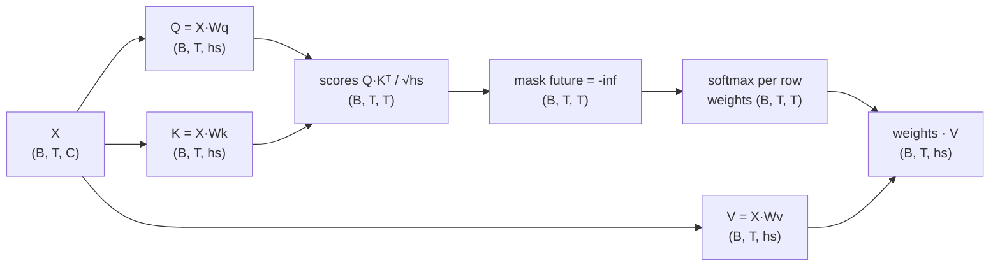

# 13 · Attention from scratch

**What you'll build:** self-attention, the one idea that makes transformers work, built twice: first with NumPy, one small step at a time with every number printed, then in PyTorch as reusable modules (one head, many heads, the fast "all heads at once" version). Finally you train a single attention head and watch it *learn where to look*.
**Like you're 5:** in a classroom, every child (token) raises a card saying what they are looking for (query) and wears a badge saying what they know (key). Each child listens most to the classmates whose badges match their card, and copies notes (values) mostly from them. And nobody may peek at the children who come later in the line.
**Time:** ~3 h · **Builds on:** [12 · BPE tokenizer from scratch](../12-bpe-tokenizer-from-scratch) · **Needs:** nothing extra

> Lighter preview of this topic: [ai-engineer-journey 6.1 · Self-attention by hand](../../../ai-engineer-journey/level-6-transformers/01-self-attention-by-hand-numpy). This lesson adds the averaging trick, the √d scaling experiment, batches, the fast multi-head layout, checks against PyTorch's built-in attention, and a trained head.

## Why this matters
Your WaveNet in lesson 11 looked at a fixed window of characters and squeezed them together in a fixed way. Attention lets each token decide, based on its content, **which** earlier tokens matter right now ("she" looks back for the name it refers to). Every LLM you have heard of (GPT, Claude, LLaMA, Gemini) is a stack of attention layers. Knowing the shapes `(B, T, C)` and `(B, nh, T, T)` by heart is what lets you read model code, debug "shape mismatch" errors, and understand later ideas like the KV cache (lesson 16) and grouped-query attention (lesson 17).

## What you'll learn
- **Dot product as similarity**: multiply two lists number by number and add up; similar vectors give a big number.
- **Softmax**: turns any list of scores into percentages that add up to 1; `-inf` becomes exactly 0%.
- **Query, Key, Value**: three learned views of every token: what I am looking for, what I contain, what I hand over.
- **Causal mask**: a GPT predicts the next token, so a token may only look at itself and earlier tokens, never later ones.
- **Multi-head attention**: several small attention "heads" run side by side and look for different things; their results are glued together and mixed.

## Watch alongside
Andrej Karpathy, **Let's build GPT: from scratch, in code, spelled out**: https://www.youtube.com/watch?v=kCc8FmEb1nY

| Video part | Matches here |
|---|---|
| "The mathematical trick in self-attention" (versions 1 to 4: loops, matrix multiply, softmax, self-attention) | `attention_numpy.py` sections 3–4, `attention_torch.py` section 1 |
| Notes on attention (a communication mechanism, no notion of space, batches don't talk, causal vs. encoder) | sections 4 and 7 |
| "Scaled" self-attention: why divide by sqrt(head_size) | `attention_numpy.py` section 5 |
| Single head, multi-head attention | `attention_torch.py` sections 2–3 |

Watch up to (and including) multi-head attention; the rest of that video (feed-forward, residuals, LayerNorm, scaling up) is lesson 14. For pictures, 3Blue1Brown's **Attention in transformers, visually explained** is excellent: https://www.youtube.com/watch?v=eMlx5fFNoYc

## Before you start
1. Go to the lesson folder (from the course root `llm-from-scratch/`):
   ```bash
   cd part-3-transformers-and-gpt/13-attention-from-scratch
   ```
2. Install:
   ```bash
   pip install -r requirements.txt
   ```
   - `numpy`: arrays and matrix maths (part 1 of the lesson).
   - `torch`: PyTorch, the same maths plus automatic gradients (part 2).

No API key, no download.

## Run it
1. The NumPy walk-through (instant):
   ```bash
   python attention_numpy.py
   ```
   You should see 7 numbered sections. It also writes `numpy_attention.npz` (a small NumPy file with the arrays from section 4) for the next script.
2. The PyTorch version plus a tiny training run (~10–60 s):
   ```bash
   python attention_torch.py
   ```
   You should see 4 sections, ending with an 8×8 table of learned attention weights.

**Command, piece by piece:** `python attention_numpy.py` = run (`python`) this file (`attention_numpy.py`). A `.npz` file is NumPy's "zip of arrays" format: `np.savez` writes it, `np.load` reads it back as a dictionary of arrays.

### What you should see
`python attention_numpy.py` (real output, shortened where marked):
```
1) The dot product: a 'how similar are we?' score
cat·dog = 1.44  (similar things -> big score)
cat·car = 0.17  (different things -> small score)
by hand: 0.9*0.8 + 0.8*0.9 + 0.1*0.0 = 1.44

2) Softmax: turn any scores into percentages that add up to 1
scores        : [2.  1.  0.1]
e^scores      : [7.39 2.72 1.11]
softmax       : [0.66 0.24 0.1 ]  sum = 1.0
softmax(10x)  : [1. 0. 0.]  <- big scores make softmax 'pick one' (almost one-hot)
softmax([2, 1, -inf]): [0.73 0.27 0.  ]  <- -inf gets exactly 0%

3) The simplest 'attention': every token averages itself and the tokens before it
weights (row = token doing the looking), shape (4, 4)
 [[1.   0.   0.   0.  ]
 [0.5  0.5  0.   0.  ]
 [0.33 0.33 0.33 0.  ]
 [0.25 0.25 0.25 0.25]]
check row 2 by hand: mean of x[0], x[1], x[2] = [0.07 0.13]

4) Real self-attention: the weights are LEARNED and depend on the tokens (one head)
X (4, 8) -> Q (4, 4), K (4, 4), V (4, 4)
scaled + masked scores
 [[ 0.2   -inf  -inf  -inf]
 [ 0.77 -0.52  -inf  -inf]
 [-0.11  0.49 -0.07  -inf]
 [ 0.78  0.46  0.79 -0.77]]
attention weights A = softmax(scores), shape (4, 4)
              the    cat    sat   down
     the     1.00   0.00   0.00   0.00
     cat     0.78   0.22   0.00   0.00
     sat     0.26   0.47   0.27   0.00
    down     0.34   0.25   0.34   0.07
output = A @ V, shape (4, 4) -> one new vector per token, built from the tokens it may see

5) Why divide by sqrt(head_size)?
head size    4: spread (std) of q·k =   1.99   after / sqrt(4) = 1.00
head size   64: spread (std) of q·k =   7.91   after / sqrt(64) = 0.99
head size  512: spread (std) of q·k =  22.60   after / sqrt(512) = 1.00

6) Multi-head attention: several heads in parallel, then glue and mix
concatenated (4, 8) -> @ Wo (8, 8) -> y (4, 8)  (same shape as X, so layers can stack)

7) Batches: many sequences at once (shape B, T, C)
Xb (3, 4, 8) -> scores (3, 4, 4) -> out (3, 4, 4)
```
`python attention_torch.py` (real output):
```
1) 'Average the past' three ways (they must give the same numbers)
loops == matmul: True | loops == softmax: True

2) One head in PyTorch gives the same numbers as NumPy
max difference vs NumPy: 1.243299051489899e-07

3) Readable multi-head == fast multi-head == PyTorch's built-in fused attention
x (2, 6, 16) -> q,k,v each (2, 4, 6, 4) -> att (2, 4, 6, 6) -> heads (2, 4, 6, 4) -> glued (2, 6, 16)
readable vs fast, max difference: 0.0
fast vs F.scaled_dot_product_attention, max difference: 5.960464477539063e-08
gradients reach the weights: torch.Size([48, 16]) grad norm 52.108

4) Training: can one head learn 'copy the token from 2 steps ago'?
step   0 | loss 2.331 | accuracy 9%
step 100 | loss 0.005 | accuracy 100%
step 200 | loss 0.002 | accuracy 100%
step 300 | loss 0.001 | accuracy 100%

learned attention weights (row = position looking, column = position looked at):
           0     1     2     3     4     5     6     7
   0    1.00  0.00  0.00  0.00  0.00  0.00  0.00  0.00
   1    0.49  0.51  0.00  0.00  0.00  0.00  0.00  0.00
   2    1.00  0.00  0.00  0.00  0.00  0.00  0.00  0.00
   3    0.00  1.00  0.00  0.00  0.00  0.00  0.00  0.00
   4    0.00  0.00  1.00  0.00  0.00  0.00  0.00  0.00
   5    0.00  0.00  0.00  1.00  0.00  0.00  0.00  0.00
   6    0.00  0.00  0.00  0.00  1.00  0.00  0.00  0.00
   7    0.00  0.00  0.00  0.00  0.00  1.00  0.00  0.00
```
What to look at:
- **The upper-right triangle is always 0** (causal mask) and **every row adds up to 1** (softmax).
- **Differences like `1.2e-07`** mean "equal up to rounding": computers store decimals with about 7 correct digits in 32-bit floats.
- **Section 4 of the torch script**: at step 0 the head guesses (9% ≈ 1 in 10 tokens). After 100 steps it is perfect, and the weight table shows why: row 5 puts 1.00 on column 3, row 6 on column 4, always exactly 2 to the left. Nobody programmed that; gradient descent found it. (Rows 0 and 1 don't matter: they have nothing 2 steps back and are not trained.)

## How it works

### The formula, symbol by symbol
The paper "Attention Is All You Need" writes the whole idea in one line:

**Attention(Q, K, V) = softmax( Q Kᵀ / √d<sub>k</sub> ) V**

| Symbol | Plain words | Shape (one head, one sequence) |
|---|---|---|
| X | the tokens coming in, each as a list of C numbers | (T, C) |
| Q = X W<sub>q</sub> | queries: "what is each token looking for?" | (T, hs) |
| K = X W<sub>k</sub> | keys: "what does each token contain?" | (T, hs) |
| V = X W<sub>v</sub> | values: "what does each token hand over?" | (T, hs) |
| W<sub>q</sub>, W<sub>k</sub>, W<sub>v</sub> | learned weight matrices (the only learned part) | (C, hs) |
| Kᵀ | K "transposed": rows become columns | (hs, T) |
| Q Kᵀ | a table of dot products: row i, column j = how much token i's query matches token j's key | (T, T) |
| √d<sub>k</sub> | square root of the head size `hs` (d<sub>k</sub> = "dimension of keys") | a number |
| softmax(...) | done on every row separately: turns scores into weights that sum to 1 | (T, T) |
| ... V | each token's output = its weights × everyone's values, added up | (T, hs) |

Letters used in the code: **B** = batch (how many sequences at once), **T** = time (tokens per sequence), **C** = channels (numbers per token, `n_embd`), **nh** = number of heads, **hs** = head size = C / nh. `@` is Python's matrix-multiply sign.

### The shapes, as a picture

Multi-head, the fast way (what real GPTs do):
```
x (B,T,C) --c_attn--> (B,T,3C) --split--> q,k,v (B,T,C) --view--> (B,T,nh,hs) --transpose--> (B,nh,T,hs)
   scores (B,nh,T,T) --mask+softmax--> @ v --> (B,nh,T,hs) --transpose+view--> (B,T,C) --c_proj--> (B,T,C)
```
`view` re-labels the same numbers with a new shape (no copying); `transpose(1, 2)` swaps dimension 1 and 2 so the heads sit next to the batch dimension and PyTorch treats every (sequence, head) pair as its own little attention problem.

### `attention_numpy.py`, section by section
1. **Dot product.** `cat @ dog` = 0.9·0.8 + 0.8·0.9 + 0.1·0.0 = 1.44. Pointing the same way → big; unrelated → small.
2. **Softmax.** e<sup>x</sup> ("e to the power x", e ≈ 2.718) makes every score positive and makes bigger scores much bigger; dividing by the total makes them sum to 1. We subtract the maximum first: it gives exactly the same answer but avoids overflowing the computer's numbers. Multiplying the scores by 10 shows the danger of big scores: softmax becomes "pick one" (a **one-hot** vector, a single 1 and the rest 0).
3. **Averaging the past.** `np.tril` makes a lower triangle of ones (`tril` = "triangle lower"). Dividing each row by its sum gives averaging weights, and one matrix multiply `w @ x` averages every prefix at once. This is attention with fixed, equal weights.
4. **Real self-attention.** Now the weights come from `Q @ K.T`: they depend on what the tokens are. The mask puts `-inf` above the diagonal so softmax turns those into exactly 0.
5. **Why √hs.** The dot product of two random vectors of length h has a spread (standard deviation) of about √h: 2, 8, 22.6 for h = 4, 64, 512. Dividing by √h brings it back to about 1, so softmax stays soft at the start of training and gradients can flow.
6. **Multi-head.** Two heads of size 4 instead of one of size 8. Each has its own W<sub>q</sub>, W<sub>k</sub>, W<sub>v</sub>, so each can look for something different (one for "the previous letter", one for "the start of the word"...). `np.concatenate` glues their outputs side by side, and `Wo` (the **output projection**) mixes them.
7. **Batches.** The same code works on `(B, T, C)`: sequences in a batch never look at each other.

### `attention_torch.py`, section by section
1. **The averaging trick, 3 ways** (exactly Karpathy's versions 1–3) and `torch.allclose` checks they agree.
2. **`Head`**: an `nn.Module` with three `nn.Linear(..., bias=False)` layers (a Linear without bias is just "multiply by a learned matrix"). `register_buffer("tril", ...)` stores the mask inside the module without making it trainable. We copy the NumPy weights in (`nn.Linear` stores its matrix transposed, hence `.T`) and get the same numbers.
3. **`MultiHeadAttention`** (a list of heads) and **`CausalSelfAttention`** (one big `c_attn` layer for all q, k, v of all heads). After copying weights, both give identical outputs, and both match PyTorch's built-in `F.scaled_dot_product_attention(q, k, v, is_causal=True)`, the fast fused version you will use from lesson 15 on. `backward()` shows gradients reach the weights, so this can be trained.
4. **Training a head.** `Copier` = token embedding + position embedding + one `Head` + a Linear that outputs 10 scores. The task: at every position, output the token from 2 positions earlier. The only way to solve it is to attend to "2 to my left", which needs the position embeddings (attention alone has no idea of order).

## If something goes wrong
- **`(run attention_numpy.py first to create numpy_attention.npz)`** → run step 1 of "Run it" before step 2, in the same folder.
- **`RuntimeError: mat1 and mat2 shapes cannot be multiplied (4x8 and 4x4)`** (after you change sizes) → a matrix multiply `A @ B` needs A's last size to equal B's first size. Print `.shape` of both sides; usually a missing `.T`/`.transpose(-2, -1)` or `n_embd` not divisible by `n_head`.
- **NaN (not a number) in the attention weights** → a whole row was masked with `-inf` (softmax of all `-inf` is 0/0). In a causal mask the diagonal must stay unmasked: use `np.tril(..., k=0)`, not `k=-1`.
- **Section 4 is slow** (more than a minute) → your computer is busy with other programs. Small models can run faster on fewer threads: try `OMP_NUM_THREADS=1 python attention_torch.py` (Mac/Linux; it limits PyTorch to one CPU core).

## Try this
1. **Turn off the mask.** In `attention_numpy.py` section 4, comment out `S[mask] = -np.inf`. What changes in the weights table, and why would that be cheating for a GPT?
   <details><summary>Hint</summary>

   The upper triangle fills up: "the" can now look at "cat", "sat" and "down". During training the model would see the very token it is supposed to predict and learn to copy it, then fail completely when generating, where the future does not exist yet. Models that don't predict the next token (like BERT, which fills in blanks) do use attention without a mask: it is then called an **encoder**.
   </details>
2. **Look 3 back.** Change the `Copier` task to copy the token from 3 steps ago and check the learned weights.
   <details><summary>Solution</summary>

   In section 4 change `model(seq)[:, 2:]` to `model(seq)[:, 3:]` and `seq[:, :-2]` to `seq[:, :-3]` (both places: the loss and the accuracy). The weight table now shows the 1.00s three columns left of the diagonal from row 3 on.
   </details>
3. **No position embeddings.** In `Copier.forward`, use `x = self.tok(idx)` only. Train again. What accuracy do you get and why?
   <details><summary>Hint</summary>

   Accuracy stays near 10% (guessing). Without position information every earlier token looks the same to the head except for its content, and the content of the token 2 steps back is random, so there is nothing to tell it apart. This is why GPT adds position embeddings (lesson 14) or rotates queries and keys by position (RoPE, lesson 17).
   </details>

## Check yourself
1. What are the shapes of Q, Kᵀ, Q Kᵀ and the output for one head with T = 10 tokens, C = 32, head size 8?
2. Why must the mask be applied *before* the softmax and not after?
3. What would happen to training if we did not divide by √hs and the head size were 512?
4. Two heads of size 16 versus one head of size 32: same number of weights. What do you gain with two?

<details><summary>Answers</summary>

1. Q is (10, 8), Kᵀ is (8, 10), Q Kᵀ is (10, 10) (one score per pair of tokens), the output is (10, 8).
2. Softmax makes each row sum to 1. Setting scores to `-inf` before softmax gives those positions exactly 0 and the remaining weights still sum to 1. Zeroing after softmax would leave rows that sum to less than 1 (and the gradient would still have used the future in the normalisation).
3. Scores would have a spread of about √512 ≈ 23, softmax would put nearly all weight on one token from the very start, its gradients would be almost zero, and learning would be slow or stuck.
4. Two independent attention patterns: each token can listen to two different places at once (for example the previous character and the start of the word), and `c_proj` combines what both found.
</details>

## Learn more (optional)
- The original transformer paper, "Attention Is All You Need" (2017): https://arxiv.org/abs/1706.03762
- The Illustrated Transformer (Jay Alammar): https://jalammar.github.io/illustrated-transformer/
- 3Blue1Brown, "But what is a GPT?": https://www.youtube.com/watch?v=wjZofJX0v4M
- Sebastian Raschka's book code, chapter 3 (attention): https://github.com/rasbt/LLMs-from-scratch

**Read the official docs**
- `torch.nn.functional.scaled_dot_product_attention`: https://pytorch.org/docs/stable/generated/torch.nn.functional.scaled_dot_product_attention.html
- `torch.nn.MultiheadAttention`: https://pytorch.org/docs/stable/generated/torch.nn.MultiheadAttention.html
- NumPy broadcasting (how `(T, T)` combines with `(B, T, C)`): https://numpy.org/doc/stable/user/basics.broadcasting.html

## Next
→ [14 · Build GPT from scratch](../14-build-gpt-from-scratch)
