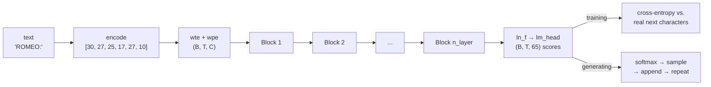

# 14 · Build GPT from scratch

**What you'll build:** a complete GPT (the "T" in ChatGPT is this) in one readable file, `gpt.py`, and a training script that teaches it Shakespeare one character at a time on your laptop's CPU. You will watch random gibberish turn into play-like text with character names and line breaks within minutes.
**Like you're 5:** you build a robot parrot out of Lego. Each Lego layer lets the parrot look back at the words it already said (attention) and then think a little (MLP). You read it Shakespeare thousands of times and, little by little, it starts to *sound* like Shakespeare.
**Time:** ~4 h (including ~5–15 min of training) · **Builds on:** [13 · Attention from scratch](../13-attention-from-scratch) · **Needs:** nothing extra (internet once for 1 MB of text; a GPU is optional)

> Lighter preview: [ai-engineer-journey 6.2 · Mini-GPT on Shakespeare](../../../ai-engineer-journey/level-6-transformers/02-mini-gpt-trained-on-shakespeare). This lesson uses GPT-2's names and initialisation (so lesson 15 feels familiar), prints samples while training so you *see* learning happen, and explains every line and every shape.

## Why this matters
This is the architecture behind GPT-2, GPT-3, GPT-4, Claude and LLaMA, shrunk until it trains on a laptop. The recipe never changes: turn tokens into vectors, let them exchange information with attention, think with an MLP, repeat for N layers, predict the next token, and learn from the mistake. Every later lesson in this course is a variation on this file: bigger (15), faster at generating (16), modernised (17), and taught to chat (19–22).

## What you'll learn
- **Embeddings**: a learned table that turns each token id into a list of numbers (what it is), plus a second table for its position (where it is).
- **Transformer block**: attention (tokens talk to earlier tokens) followed by an **MLP** (each token thinks on its own), each wrapped in a **residual connection** and **LayerNorm**.
- **Cross-entropy loss**: how surprised the model is by the real next character; it starts at about ln(65) = 4.17.
- **The training loop**: forward → loss → backward → optimizer step, thousands of times, with **train vs. validation** loss to catch memorising.
- **Generation**: predict, sample one character, append it, repeat.

## Watch alongside
Andrej Karpathy, **Let's build GPT: from scratch, in code, spelled out**: https://www.youtube.com/watch?v=kCc8FmEb1nY (1 h 56 min)

| Video part | Matches here |
|---|---|
| Reading and exploring the data, tokenization, train/val split | `train.py` "data" section |
| Data loader: batches of chunks of data | `get_batch()` |
| Simplest baseline: bigram model, loss, generation | `GPT.forward()` loss and `GPT.generate()` (you built the bigram in lesson 07) |
| Training the bigram model, port to a script | the training loop |
| Self-attention (the mathematical trick, single and multi-head) | lesson 13, `CausalSelfAttention` |
| Feed-forward layers | `MLP` |
| Residual connections | `Block.forward` (`x = x + ...`) |
| LayerNorm (and its relationship to BatchNorm) | `ln_1`, `ln_2`, `ln_f` |
| Scaling up the model, dropout | `--size video` |
| Encoder vs. decoder, nanoGPT, ChatGPT and how it's trained | "How it works" step 9 and lessons 19–20 |

## Before you start
1. Go to the lesson folder (from the course root `llm-from-scratch/`):
   ```bash
   cd part-3-transformers-and-gpt/14-build-gpt-from-scratch
   ```
2. Install:
   ```bash
   pip install -r requirements.txt
   ```
   - `torch`: PyTorch. It runs on the CPU, an NVIDIA GPU (`cuda`) or an Apple Silicon GPU (`mps`) and picks automatically.

No API key. The first run downloads `input.txt` (tiny Shakespeare, 1 MB) from GitHub.

## Run it
1. Train with the CPU-friendly default (0.82M parameters, 2,000 steps):
   ```bash
   python train.py
   ```
   You should see the loss printed every 250 steps and a text sample every 500 steps. It ends with `saved ckpt.pt`.
2. Write new text from a prompt:
   ```bash
   python generate.py "JULIET:" 300
   ```
   You should see 300 new characters that continue "JULIET:".
3. Optional, with a GPU: the bigger model from the video (10.8M parameters, val loss about 1.48 in Karpathy's run):
   ```bash
   python train.py --size video
   ```

**Command, piece by piece**

| Piece | Meaning |
|---|---|
| `python train.py` | run the training script with its defaults |
| `--size video` | a flag choosing the model size: `tiny` (default) or `video` |
| `--steps 300` | another flag: train for 300 steps instead of the default |
| `--device cpu` | force where it runs: `cpu`, `cuda` (NVIDIA GPU) or `mps` (Apple GPU) |
| `python generate.py "JULIET:" 300 0.6` | run `generate.py` with 3 **arguments** (values given in order, without a `--name`): the prompt, how many characters, the temperature. Quotes keep the prompt as one piece even if it has spaces |

### What you should see
`python train.py` (real output on a busy shared 4-core CPU; a normal laptop is usually faster):
```
1,115,394 characters | vocab 65 | 0.82M parameters | device cpu | 2000 steps

step     0 | train loss 4.228 | val loss 4.230 | 5s
--- sample ---
FsU&wg;RbtT$LmUE'tyabtjpQs;fDS;J.ikm'C,ZmmheCVS$KhVE
'JzyTD, g3vWvHVoI.poOyPVTw
--------------

step   250 | train loss 2.281 | val loss 2.300 | 77s

step   500 | train loss 1.991 | val loss 2.077 | 152s
--- sample ---
HOF ORIO:
I do dowere so klove ding panted.
FLARY:
By I set, noth good, ard andsien foreive, wired: your thee are preay
--------------

step   750 | train loss 1.804 | val loss 1.944 | 245s

step  1000 | train loss 1.707 | val loss 1.860 | 304s
--- sample ---
With injur, ah, there freamone here,
BOLINT:
O feant, should have, to for you haved; which not:
My fa thy know itservant peathers,
--------------

step  1250 | train loss 1.641 | val loss 1.803 | 364s

step  1500 | train loss 1.584 | val loss 1.775 | 422s

step  1750 | train loss 1.564 | val loss 1.707 | 484s

step  2000 | train loss 1.510 | val loss 1.711 | 543s
--- sample ---
As request the life, or honour, it with such at is soul.
KING EDWARD IV:
And then sir, all madam I besence, sir, upon, are is your lord,
And if this
--------------

saved ckpt.pt after 543s
```
`python generate.py "JULIET:" 300` (real output):
```
JULIET:
Ah, thou art you away, great not our house,
And thou have head like of quid of the man's peen?
As it would indues a fear
To peer: that not low out, a woo and for the presence,
Soft, thought hast 'now she best the sell aword;
Now, like the cames to need for hang were it is the queen.

Second Munserv
```
What to look at:
- **Step 0, loss 4.23**: close to ln(65) = 4.17, the loss of guessing evenly among 65 characters. The sample is random characters.
- **Step 500**: it learned the *format*: names in capitals followed by a colon and a new line, short lines, spaces between word-like things.
- **Step 2,000**: mostly real words ("honour", "madam", "your lord"), a real character name (KING EDWARD IV), punctuation in the right places. The sentences still make no sense: 0.8M parameters and 9 minutes is very little.
- **Train 1.51 vs. val 1.71**: validation is text the model never trained on. A gap that keeps growing would mean memorising (overfitting).

## How it works

Inside each Block:
```
x ──┬──► LayerNorm ─► attention ─► (+) ──┬──► LayerNorm ─► MLP ─► (+) ──► out
    └──────────── residual ──────────────┘└──────── residual ───────┘
```

### `gpt.py` (read top to bottom)
1. **`GPTConfig`**: the sizes. `vocab_size` 65, `block_size` 64 (the model sees at most 64 previous characters), `n_layer` 4 blocks, `n_head` 4 heads, `n_embd` 128 numbers per token, `dropout` 0.
2. **`CausalSelfAttention`**: exactly the fast version from lesson 13. One `c_attn` layer makes q, k, v for all heads; scores are scaled by 1/√hs; the `mask` buffer blocks the future; `c_proj` mixes the heads. **Dropout** randomly zeroes some numbers during training (a fraction `dropout`), so the network cannot rely on any single path; it is switched off by `model.eval()`.
3. **`MLP`**: `c_fc` widens each token's 128 numbers to 512, **GELU** (a smooth version of ReLU: negative inputs become about 0, positive ones pass) adds non-linearity, `c_proj` shrinks back to 128. Attention moves information *between* tokens; the MLP processes it *inside* each token.
4. **`Block`**: `x = x + self.attn(self.ln_1(x))` then `x = x + self.mlp(self.ln_2(x))`.
   - The `x + ...` is a **residual connection**: the block only *adds a correction* to x. In backprop, the gradient of `x + f(x)` with respect to x contains a plain 1, so gradients flow straight down through many layers (an "information highway").
   - **LayerNorm** rescales each token's numbers to mean 0 and spread 1 (then applies a learned scale and shift), which keeps values in a healthy range. Applying it *before* attention and MLP ("pre-norm") is what GPT-2 and later models do.
5. **`GPT.__init__`**: `wte` (word/token embedding, 65 × 128), `wpe` (position embedding, 64 × 128), the stack of `Block`s, the final `ln_f`, and `lm_head` (128 → 65 scores). `_init_weights` starts all weights as small random numbers (standard deviation 0.02, the GPT-2 choice).
6. **`GPT.forward(idx, targets)`**: `idx` has shape (B, T) of token ids. `wte(idx)` is (B, T, C); `wpe(pos)` is (T, C) and is **broadcast** (copied along the batch) when added. After the blocks, `lm_head` gives **logits** (raw scores) of shape (B, T, 65): a prediction for the next character at *every* position at once. `F.cross_entropy` then computes the loss:
   **loss = −(1/N) Σ log p(correct next token)**
   Read it as: for each of the N = B·T positions, take the probability the model gave to the real next character, take its logarithm (log of a number below 1 is negative, so the minus makes it positive), and average (Σ means "add them all up"). Perfect guesses give 0; guessing evenly gives ln(65) = 4.17.
7. **`GPT.generate`**: crop to the last `block_size` tokens, run the model, keep the scores of the last position, divide by `temperature`, optionally keep the `top_k` best, softmax into probabilities, `torch.multinomial` rolls a weighted die to pick one, append, repeat. Lesson 16 explores these knobs.

### `train.py`
1. **Data**: `chars = sorted(set(text))` is the vocabulary (65 characters); `stoi`/`itos` map characters to ids and back. 90% of the text is for training, the last 10% for validation.
2. **`get_batch`**: 32 random windows of 64 characters (`x`), and the same windows shifted one to the right (`y`): at every position the answer is the next character. One batch = 32 × 64 = 2,048 predictions.
3. **`estimate_loss`**: averages 20 batches per split with `torch.no_grad()` (no gradients needed, so it is faster) and `model.eval()` (dropout off).
4. **The loop**: `model(xb, yb)` (forward), `optimizer.zero_grad()` (clear old gradients, which otherwise add up), `loss.backward()` (backprop through everything you built in part 1), `optimizer.step()`. **AdamW** is a smarter gradient descent: it keeps a running average of each weight's gradients (momentum) and their size, so each weight gets its own sensible step size. `lr=1e-3` means 0.001.
5. **Save**: `torch.save` writes the weights (`state_dict`), the config and the characters to `ckpt.pt`. `generate.py` and lesson 16 load it.

### Scale check: how big is this?
| | this lesson (`tiny`) | `--size video` | GPT-2 small (lesson 15) | GPT-3 |
|---|---|---|---|---|
| parameters | 0.82 M | 10.8 M | 124 M | 175,000 M |
| layers × width | 4 × 128 | 6 × 384 | 12 × 768 | 96 × 12,288 |
| context | 64 characters | 256 characters | 1,024 tokens | 2,048 tokens |

Same code shape all the way up. ChatGPT then adds two more training stages, instruction tuning and preference tuning, which you build in lessons 19 and 20.

## If something goes wrong
- **`urllib.error.URLError`** on the first run → no internet or GitHub blocked. Download https://raw.githubusercontent.com/karpathy/char-rnn/master/data/tinyshakespeare/input.txt in a browser and save it here as `input.txt`.
- **`No ckpt.pt found`** from `generate.py` → train first (step 1). `generate.py` must run in the same folder as `ckpt.pt`.
- **Very slow steps (more than 1 s each on a tiny model)** → other programs are using the CPU. For small models fewer threads can be faster: `OMP_NUM_THREADS=1 python train.py` (Linux/Mac). Or try Google Colab with a free GPU.
- **`RuntimeError: CUDA out of memory`** with `--size video` → the GPU is too small; lower `batch_size` in the `SIZES` dictionary at the top of `train.py` (64 → 32 or 16).
- **Loss goes down then val loss goes up** → overfitting (memorising). Add dropout (`dropout=0.1`), stop earlier, or use a smaller model.

## Try this
1. **Train longer.** Run `python train.py --steps 5000`. How low does val loss get, and does the text improve?
   <details><summary>Hint</summary>

   Val loss keeps falling slowly (toward about 1.6) and the gap to train loss widens. The samples get more real words per line. Eventually val stops improving: the model is too small to learn more, or starts memorising.
   </details>
2. **Remove the residual connections.** In `Block.forward`, change both lines to `x = self.attn(self.ln_1(x))` and `x = self.mlp(self.ln_2(x))`. Train 500 steps and compare with the normal model at step 500.
   <details><summary>Hint</summary>

   Training becomes slower and worse (higher loss at the same step), and with more layers it can stall almost completely. Residuals let the gradient reach the early layers directly; without them it must pass through every layer's maths.
   </details>
3. **A mid-size model.** Add a `"small"` entry to `SIZES` with 6 layers, 6 heads, `n_embd=192`, `block_size=128`, `dropout=0.1`, `batch_size=32`, `lr=1e-3`, `steps=3000` and train it with `--size small`.
   <details><summary>Solution</summary>

   ```python
   "small": dict(n_layer=6, n_head=6, n_embd=192, block_size=128, dropout=0.1, batch_size=32, lr=1e-3, steps=3000),
   ```
   It has about 2.7M parameters, each step is roughly 3–4× slower, and it reaches a lower val loss (around 1.55–1.6) with noticeably better words. `n_embd` must be divisible by `n_head` (192 / 6 = 32 numbers per head).
   </details>

## Check yourself
1. Why does the loss start at about 4.17, and what does a loss of 1.5 mean in plain words?
2. Why are the targets `y` the inputs `x` shifted by one, and how many predictions does one batch give?
3. What does a residual connection do, and why do deep networks need it?
4. The model was trained with `block_size=64`. What happens in `generate()` when the text grows longer than 64 characters?

<details><summary>Answers</summary>

1. ln(65) ≈ 4.17 is the loss of giving every one of the 65 characters the same probability (1/65). A loss of 1.5 means the model gives the correct next character a probability of about e<sup>−1.5</sup> ≈ 22% on average, 15 times better than guessing.
2. At every position the model must predict the next character, and `y[t]` is exactly the character after `x[t]`. A batch of 32 windows × 64 positions gives 2,048 predictions from one forward pass.
3. It adds the block's output to its input (`x + f(x)`), so each block only learns a correction and the original signal always passes through. In backprop the gradient also has a direct path to early layers, which keeps it from shrinking to nothing in deep stacks.
4. `idx[:, -self.cfg.block_size:]` keeps only the last 64 characters, so the model forgets everything earlier. It also has no position embedding beyond 63, so it cannot look further back without retraining.
</details>

## Learn more (optional)
- nanoGPT, the grown-up version of this code: https://github.com/karpathy/nanoGPT
- The Illustrated GPT-2 (Jay Alammar): https://jalammar.github.io/illustrated-gpt2/
- 3Blue1Brown, "But what is a GPT?": https://www.youtube.com/watch?v=wjZofJX0v4M
- Video search: [Umar Jamil transformer from scratch](https://www.youtube.com/results?search_query=umar+jamil+coding+a+transformer+from+scratch)

**Read the official docs**
- `torch.nn.LayerNorm`: https://pytorch.org/docs/stable/generated/torch.nn.LayerNorm.html
- `torch.nn.Embedding`: https://pytorch.org/docs/stable/generated/torch.nn.Embedding.html
- `torch.nn.functional.cross_entropy`: https://pytorch.org/docs/stable/generated/torch.nn.functional.cross_entropy.html
- `torch.optim.AdamW`: https://pytorch.org/docs/stable/generated/torch.optim.AdamW.html
- `torch.multinomial`: https://pytorch.org/docs/stable/generated/torch.multinomial.html

## Next
→ [15 · Reproduce GPT-2 small](../15-reproduce-gpt2-small)
