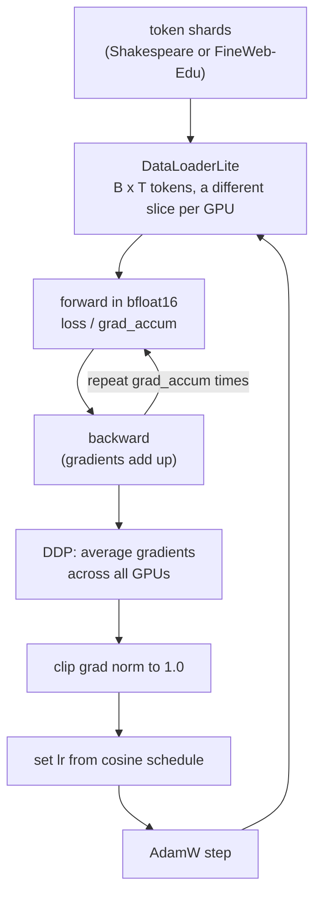

# 15 · Reproduce GPT-2 small

**What you'll build:** OpenAI's GPT-2 (124M parameters) written by you in one file, `gpt2.py`, that can load OpenAI's real 2019 weights and produce exactly the same outputs as the official version. Then a training script with every trick of a real pretraining run: AdamW with weight decay, a warm-up + cosine learning-rate schedule, gradient accumulation, gradient clipping, mixed precision (bfloat16), `torch.compile`, FlashAttention and multi-GPU training (DDP). You run it tiny on your CPU, and you get the exact recipe to run the full reproduction on rented cloud GPUs.
**Like you're 5:** in lesson 14 you built a toy car. Now you build a copy of a real car from the factory's blueprint, check that the official engine fits in it, and learn how real race teams tune it (and what renting their race track costs).
**Time:** ~5 h (plus optional cloud run) · **Builds on:** [14 · Build GPT from scratch](../14-build-gpt-from-scratch) · **Needs:** internet (tiktoken vocabulary, Shakespeare; GPT-2 weights ~550 MB for the optional part). Cloud GPU optional.

## Why this matters
Knowing a toy model is not the same as knowing how real models are trained. Every lab training LLMs today uses the techniques in `train_gpt2.py`: big batches split into micro-batches, learning-rate schedules, mixed precision, fused kernels and many GPUs. Loading OpenAI's weights into *your* code is also the best proof that you understand the architecture exactly: if one detail is wrong (a transposed matrix, the wrong GELU), the outputs don't match.

## What you'll learn
- **GPT-2's exact architecture**: lesson 14's model plus weight tying, scaled initialisation, tanh-GELU and OpenAI's parameter names.
- **Loading pretrained weights**: copying a Hugging Face `GPT2LMHeadModel` into your own module, including the transposed "Conv1D" matrices.
- **The training recipe**: AdamW (β₂ = 0.95, weight decay 0.1 on matrices only), warm-up + cosine decay, gradient clipping at 1.0, half a million tokens per step via **gradient accumulation**.
- **Speed tricks**: TF32 and **bfloat16** mixed precision, `torch.compile`, FlashAttention (`F.scaled_dot_product_attention`), "nice" numbers like a 50,304 vocabulary.
- **DDP (Distributed Data Parallel)**: one copy of the model per GPU, each on different data, gradients averaged after every step.

## Watch alongside
Andrej Karpathy, **Let's reproduce GPT-2 (124M)**: https://www.youtube.com/watch?v=l8pRSuU81PU (about 4 hours; this lesson follows it closely)

| Video section | Matches here |
|---|---|
| Section 1: exploring the GPT-2 checkpoint, implementing the GPT-2 `nn.Module`, loading Hugging Face weights, sampling | `gpt2.py`, `sample_pretrained.py`, `test_gpt2.py` |
| Section 1: data loader, cross-entropy loss, weight tying, initialisation | `DataLoaderLite`, `GPT._init_weights`, weight tying |
| Section 2: speed: GPUs, TF32, bfloat16, `torch.compile`, FlashAttention, nice numbers | `torch.set_float32_matmul_precision`, `use_amp`, `--compile`, vocab 50304 |
| Section 3: hyperparameters, AdamW, gradient clipping, learning-rate scheduler, weight decay, fused AdamW, gradient accumulation | `configure_optimizers`, `cosine_lr`, the training loop |
| Section 3: distributed data parallel (DDP), datasets (FineWeb-Edu), validation, HellaSwag | DDP part of `train_gpt2.py`, "Cloud GPU recipe", lesson 21 for evaluation |
| Section 4: results in the morning | "What the real run gives" below |

Good order: watch section 1, do steps 1–3 of "Run it"; watch sections 2–3, read `train_gpt2.py` and do step 4.

## Before you start
1. Go to the lesson folder (from the course root `llm-from-scratch/`):
   ```bash
   cd part-3-transformers-and-gpt/15-reproduce-gpt2-small
   ```
2. Install:
   ```bash
   pip install -r requirements.txt
   ```
   - `torch`: the model and training.
   - `tiktoken`: GPT-2's tokenizer (the real one; it downloads its 1.5 MB vocabulary once).
   - `numpy`: reads token shard files.
   - `transformers`: Hugging Face's library, used only to download OpenAI's GPT-2 weights and to test that our copy matches.
   - `pytest`: runs `test_gpt2.py`.

No API key. Hugging Face downloads need no account for GPT-2.

## Run it
1. **Test the architecture** (no download, ~15 s). It builds a small random GPT-2 with Hugging Face, copies it into ours and compares:
   ```bash
   pytest -q
   ```
   You should see `3 passed`.
2. **Load OpenAI's real GPT-2 and let it write** (downloads ~550 MB the first time):
   ```bash
   python sample_pretrained.py
   ```
   You should see "max difference ... e-05" or smaller, then 4 continuations of "Hello, I'm a language model,".
3. **Train a tiny GPT-2-shaped model on Shakespeare on your CPU** (7.2M parameters, 200 steps, roughly 5–20 minutes):
   ```bash
   python train_gpt2.py
   ```
   You should see the loss fall from about 10.8 and a short sample at the end. It saves `gpt2_ckpt.pt`.
4. **Optional, needs a GPU: fine-tune the real GPT-2 on Shakespeare** (minutes on any modern GPU):
   ```bash
   python train_gpt2.py --preset gpt2 --init gpt2 --steps 200 --total-batch 16384 --micro-batch 8 --seq-len 512 --max-lr 3e-5 --warmup 10 --eval-every 50
   ```
   Starting from OpenAI's weights the validation loss starts near 4 instead of 10.8: the model already knows English.
5. **Optional, the real thing**: see "Cloud GPU recipe" below.

**Command, piece by piece**

| Piece | Meaning |
|---|---|
| `--preset gpt2` | use the GPT-2 small shape (12 layers, 12 heads, 768 wide) and its hyperparameters |
| `--init gpt2` | start from OpenAI's weights instead of random numbers |
| `--total-batch 16384` | tokens per optimizer step (must be divisible by micro-batch × seq-len × number of GPUs) |
| `--micro-batch 8 --seq-len 512` | what fits in one forward pass: 8 sequences of 512 tokens |
| `--max-lr 3e-5` | peak learning rate (3 × 10⁻⁵ = 0.00003); fine-tuning uses much smaller steps than training from scratch |
| `torchrun` | PyTorch's launcher: starts one copy of the script per GPU and tells each copy its number (`RANK`) |
| `--standalone` | "everything is on this one machine" |
| `--nproc_per_node=8` | start 8 processes (one per GPU) |
| `nvidia-smi` | NVIDIA's tool that lists your GPUs, their memory and how busy they are |

### What you should see
`pytest -q` (real output):
```
...                                                                      [100%]
3 passed in 12.50s
```
`python train_gpt2.py` (real output from a busy shared CPU, 2 threads; your times will differ):
```
device cpu | GPUs 1 | tokens per step 4,096 = micro-batch 4 x seq 128 x GPUs 1 x grad-accum 8 | train tokens 304,222
7.2M parameters (random init)
decayed: 7,241,728 params | not decayed: 6,912 params | fused AdamW: False
step     0 | val loss 10.8242
step     0 | loss 10.8339 | lr 1.00e-04 | grad norm 3.56 | 5657 ms | 724 tokens/s
step    10 | loss 9.6490 | lr 1.10e-03 | grad norm 1.61 | 5899 ms | 694 tokens/s
step    20 | loss 7.6506 | lr 2.00e-03 | grad norm 1.53 | 5660 ms | 724 tokens/s
step    30 | loss 6.4998 | lr 1.99e-03 | grad norm 1.22 | 4912 ms | 834 tokens/s
step    50 | val loss 6.5063
step   100 | val loss 6.0678
step   150 | val loss 5.7063
step   190 | loss 5.3895 | lr 2.14e-04 | grad norm 0.53 | 5050 ms | 811 tokens/s
step   200 | val loss 5.6842
saved gpt2_ckpt.pt
--- sample ---
ROMEO:

DtwENUS:
IUENCE:
My'll I not;
If you, not thy love me us is
```
What to look at:
- **Start at 10.82** = ln(50,257): guessing evenly among GPT-2's 50,257 tokens. (Lesson 14 started at ln(65) = 4.17 because it had 65 characters.)
- **The lr column** climbs during the 20 warm-up steps to 2e-3, then follows the cosine curve down to 2e-4.
- **grad norm** (the length of the whole gradient) starts high and settles below 1; clipping caps it at 1.0 so one weird batch can't wreck the model.
- **The sample** has real words and the script format, but 0.8 million tokens of training is nothing for a 50k-token vocabulary. Losses here are not comparable with lesson 14's: a token carries more text than a character.

`python sample_pretrained.py`: **huggingface.co was blocked in the sandbox where this course was tested, so the real GPT-2 download could not be run there.** The loading code was verified by `pytest` and by running the script on a randomly initialised full-size GPT-2 (max difference 2.6e-06, 124,439,808 parameters). With the real weights, the output looks like this (example, your samples will differ):
```
loaded gpt2: 124,439,808 parameters (embedding shared with the output layer)
max difference between Hugging Face and our model's logits: 1.53e-05
top 5 next tokens: [(' and', 0.08), (' but', 0.05), (' I', 0.04), (' so', 0.03), (' which', 0.02)]
> Hello, I'm a language model, not a program. I'm interested in how you can use your own language to express
> Hello, I'm a language model, and I want to write a new language that can work for everyone. So I've
...
```

## How it works


### `gpt2.py`: what changed from lesson 14
1. **Names**: `transformer.wte`, `transformer.h[i].attn.c_attn`, `mlp.c_fc`, `ln_1`... are OpenAI's names. Matching names make `state_dict` copying a simple loop.
2. **`nn.GELU(approximate="tanh")`**: in 2019 the exact GELU was slow in TensorFlow, so GPT-2 used a tanh formula that approximates it. To reproduce GPT-2 exactly we must use the same one.
3. **Weight tying**: `self.transformer.wte.weight = self.lm_head.weight`. The table that turns token ids into vectors is reused (transposed by the maths) to turn vectors back into token scores. Similar tokens should be similar on both ends, and it saves 50,257 × 768 = 38.6M parameters.
4. **Scaled init**: every block *adds* two outputs onto the residual stream, so its size would grow with depth. Layers marked `SCALE_INIT` start with std 0.02 × 1/√(2 × n_layer).
5. **`F.scaled_dot_product_attention(q, k, v, is_causal=True)`**: lesson 13 showed it equals the manual version. On GPUs it runs **FlashAttention**, which never writes the big (T × T) attention table to slow GPU memory; that is several times faster.
6. **`from_hf_model()`**: loops over Hugging Face's weights and copies each into ours. OpenAI's original code used a "Conv1D" layer that stores 4 of the matrices as (in, out) instead of PyTorch `nn.Linear`'s (out, in), so those get `.t()` (transpose). `from_pretrained("gpt2")` downloads the weights and calls it.
7. **`configure_optimizers()`**: AdamW with **weight decay** 0.1 on 2-D tensors (matrices and embeddings) and 0 on biases and LayerNorm parameters. Weight decay gently pulls weights toward 0 every step so no single weight grows huge. `fused=True` on CUDA does the whole update in one GPU kernel.
8. **`cosine_lr()`**: the learning rate (lr) schedule:
   - warm-up: lr = max_lr × (step + 1) / warmup_steps, a straight line up (big steps on a random model are dangerous);
   - decay: lr = min_lr + ½ (1 + cos(π × progress)) × (max_lr − min_lr), where progress goes from 0 to 1. cos(0) = 1 and cos(π) = −1, so the bracket goes smoothly from 2 to 0: lr glides from max_lr down to min_lr (10% of max).

### `train_gpt2.py`, top to bottom
1. **Presets**: `tiny` for CPU, `gpt2` = the exact build-nanogpt settings (524,288 = 2¹⁹ tokens per step, max lr 6e-4, 715 warm-up steps, 19,073 steps = 10B tokens). Any setting can be overridden with a flag.
2. **DDP setup**: `torchrun` sets the environment variables `RANK` (this process's number among all), `LOCAL_RANK` (its GPU on this machine) and `WORLD_SIZE` (how many processes). Without them it is a normal single-device run. `master` (rank 0) does all printing and saving.
3. **`set_float32_matmul_precision("high")`**: lets NVIDIA Ampere and newer GPUs use **TF32** (a 19-bit float format inside the matrix units) for big speed-ups at almost no accuracy cost.
4. **Gradient accumulation**: GPT-2 used ~0.5M tokens per step, which never fits in one GPU at once. `grad_accum = total_batch / (B × T × GPUs)`. We run that many small forward/backward passes; PyTorch *adds* gradients into `.grad` until `zero_grad()`. Each loss is divided by `grad_accum`, so the sum equals the average over the big batch.
5. **`DataLoaderLite`**: reads the token stream in order. GPU number `rank` starts at offset `B × T × rank` and every step jumps `B × T × WORLD_SIZE`, so GPUs never read the same tokens. Folders of shards (`*.npy` from build-nanogpt, or `*.bin` from lesson 18) are loaded one file at a time.
6. **Mixed precision**: inside `torch.autocast(..., dtype=torch.bfloat16)` matrix multiplies run in **bfloat16**, a 16-bit number with the same range as 32-bit but fewer digits. Half the memory traffic, much faster tensor cores; the weights and optimizer stay 32-bit. It is switched on only on CUDA GPUs that support it.
7. **`torch.compile`** (`--compile`): analyses the model once and generates fused GPU code, so a chain like "multiply, add, tanh" happens in one trip to memory instead of several. The first step is slow (compiling), the rest faster.
8. **DDP**: `DDP(model)` wraps the model; during `backward()` it averages gradients across GPUs. `require_backward_grad_sync` makes it talk only on the last micro-step of accumulation (talking every micro-step would waste time).
9. **Clip, schedule, step, log**: `clip_grad_norm_` rescales the gradient if its total length is above 1.0. `tokens/s` is the speed number to watch when tuning.

### What the real run gives (for scale)
In the video, the full 10B-token run on 8×A100 GPUs ends with a validation loss around 3.1 and slightly beats the original GPT-2 124M on the HellaSwag benchmark (both around 30% accuracy; lesson 21 explains this kind of eval). OpenAI trained on more data (WebText, about 100B tokens seen) but with less efficient code in 2019.

## Cloud GPU recipe (the full GPT-2 124M reproduction)
Prices change monthly; these are typical on-demand prices in 2025–2026. Always check the provider's page before starting, and **shut the machine down when finished**: you pay per minute while it is on.

| Option | Typical price | Time for 10B tokens | Rough cost |
|---|---|---|---|
| 8×H100 80GB node (Lambda, RunPod, Vast.ai, Hyperbolic, AWS p5...) | ~$2–3 per GPU per hour = ~$16–24/h | ~1–1.5 h | ~$20–40 |
| 8×A100 80GB node | ~$1.3–2 per GPU per hour = ~$10–16/h | ~2 h | ~$20–35 |
| 1×H100 80GB | ~$2–3/h | ~10–14 h | ~$25–45 |
| 1×A100 40GB (lower `--micro-batch` to 16 or 32) | ~$1–1.5/h | ~20–30 h | ~$25–45 |

Plus about 1 hour of machine time for downloading and tokenizing the data (~20 GB of shards). Exact steps on an 8-GPU Linux machine:
1. Rent the machine in the provider's web console (choose an image with PyTorch/CUDA, e.g. "Lambda Stack" or "PyTorch 2.x"), add your SSH key, and connect:
   ```bash
   ssh ubuntu@<the-ip-address-they-show-you>
   ```
2. Check the GPUs: `nvidia-smi` should list 8 GPUs.
3. Get the code (this course and Karpathy's data script):
   ```bash
   git clone https://github.com/SVashishta1/Learning.git
   git clone https://github.com/karpathy/build-nanogpt.git
   pip install torch tiktoken numpy transformers datasets tqdm
   ```
4. Download and tokenize FineWeb-Edu (10B tokens, 100 shards of 100M tokens; ~30–60 min):
   ```bash
   python build-nanogpt/fineweb.py
   ```
5. Start a session that survives disconnects, then train on all 8 GPUs:
   ```bash
   screen -S gpt2
   cd Learning/llm-from-scratch/part-3-transformers-and-gpt/15-reproduce-gpt2-small
   torchrun --standalone --nproc_per_node=8 train_gpt2.py --preset gpt2 --data ~/build-nanogpt/edu_fineweb10B --compile
   ```
   Detach with `Ctrl+A` then `D`; come back later with `screen -r gpt2`.
6. When it finishes, copy the checkpoint home and **terminate the instance** in the web console:
   ```bash
   scp ubuntu@<ip>:~/Learning/llm-from-scratch/part-3-transformers-and-gpt/15-reproduce-gpt2-small/gpt2_ckpt.pt .
   ```

| Command | Meaning |
|---|---|
| `ssh ubuntu@1.2.3.4` | open a terminal on the remote machine as user `ubuntu` |
| `git clone <url>` | download a copy of a code repository |
| `screen -S gpt2` | start a terminal session named `gpt2` that keeps running if your connection drops |
| `screen -r gpt2` | re-attach to it |
| `scp from to` | secure copy: copy a file between machines over SSH |
| `~` | your home folder |

On a single GPU, drop `torchrun ...` and run `python train_gpt2.py --preset gpt2 --data ~/build-nanogpt/edu_fineweb10B --compile`: gradient accumulation automatically does 8× more micro-steps, so the result is the same, 8× slower. If you see "CUDA out of memory", add `--micro-batch 32` (or 16): accumulation compensates.

## If something goes wrong
- **`requests.exceptions...` or `ProxyError` from `tiktoken`** → it downloads GPT-2's vocabulary on first use from openaipublic.blob.core.windows.net. You need internet once; afterwards it is cached.
- **`Could not load gpt2: ...`** from `sample_pretrained.py` → `pip install transformers`, and make sure https://huggingface.co opens in your browser (some company or school networks block it).
- **`AssertionError: total_batch must be divisible by ...`** → pick numbers where total_batch = micro_batch × seq_len × GPUs × a whole number. With `--micro-batch 8 --seq-len 512` on 1 GPU, total batch must be a multiple of 4,096.
- **`torch.compile` errors or is very slow** → it needs PyTorch 2.x and a supported GPU; on CPU and Windows just leave out `--compile`.
- **Very slow on CPU** → expected: 7.2M parameters and a 50k vocabulary is heavy for a CPU. Lower `--steps`, or use Google Colab's free GPU (Runtime → Change runtime type → GPU).

## Try this
1. **Bigger GPT-2s.** Run `python sample_pretrained.py "The meaning of life is" --model gpt2-medium`. How many parameters does it report?
   <details><summary>Hint</summary>

   About 355M (24 layers, 1,024 wide). `gpt2-large` is ~774M and `gpt2-xl` ~1.56B; the same `gpt2.py` loads all of them because only the config numbers change. Larger ones need more RAM (xl ≈ 6.5 GB in 32-bit).
   </details>
2. **Feel gradient accumulation.** Run `python train_gpt2.py --steps 50 --total-batch 512` and compare its loss at step 50 with the default run (4,096).
   <details><summary>Hint</summary>

   `--total-batch 512` means `grad_accum` = 1 (512 = 4 × 128): each step is 8× cheaper but sees 8× fewer tokens, and the loss is noisier. Bigger batches give smoother, more reliable gradients; accumulation lets you have them without more memory.
   </details>
3. **Your own schedule plot.** Print `cosine_lr(step, 6e-4, 715, 19073)` for steps 0, 100, 715, 5000, 10000, 19073, or plot it with matplotlib.
   <details><summary>Solution</summary>

   ```python
   from gpt2 import cosine_lr
   for s in [0, 100, 715, 5000, 10000, 19073]:
       print(s, f"{cosine_lr(s, 6e-4, 715, 19073):.2e}")
   ```
   You get 8.39e-07 at step 0, 8.48e-05 at 100, 6.00e-04 at the peak (715), then a slow glide down to 6.00e-05 at the end.
   </details>

## Check yourself
1. Why does `from_hf_model` transpose four of the weight matrices?
2. With 8 GPUs, micro-batch 64 and sequence length 1,024, how many accumulation steps make one 524,288-token step?
3. Why is weight decay not applied to biases and LayerNorm weights?
4. What does bfloat16 give up compared to 32-bit floats, and why is that acceptable for training?

<details><summary>Answers</summary>

1. OpenAI's code stored them for a `Conv1D` layer as (in_features, out_features); `nn.Linear` stores (out_features, in_features). Same numbers, flipped layout.
2. 524,288 / (64 × 1,024 × 8) = 1. One micro-step per GPU is enough. On 1 GPU it would be 8.
3. They are few (1-D) and act like offsets and scales; shrinking them toward 0 doesn't reduce overfitting much and can hurt (a LayerNorm scale of 0 would erase its input). Decay is meant for the big matrices where the capacity is.
4. Precision: bfloat16 keeps about 3 significant decimal digits instead of about 7, but the same range (it can still hold very big and very small numbers). Training is noisy anyway, and the master weights and optimizer state stay in 32-bit, so tiny rounding in each matmul doesn't matter.
</details>

## Learn more (optional)
- build-nanogpt (the video's code, commit by commit): https://github.com/karpathy/build-nanogpt
- llm.c (the same in C/CUDA, very fast): https://github.com/karpathy/llm.c
- nanoGPT: https://github.com/karpathy/nanoGPT
- GPT-2 paper, "Language Models are Unsupervised Multitask Learners": https://cdn.openai.com/better-language-models/language_models_are_unsupervised_multitask_learners.pdf
- FlashAttention paper: https://arxiv.org/abs/2205.14135

**Read the official docs**
- PyTorch DDP tutorial: https://pytorch.org/tutorials/intermediate/ddp_tutorial.html
- `torchrun`: https://pytorch.org/docs/stable/elastic/run.html
- Automatic mixed precision (`torch.autocast`): https://pytorch.org/docs/stable/amp.html
- `torch.compile`: https://pytorch.org/docs/stable/generated/torch.compile.html
- Hugging Face GPT-2 model docs: https://huggingface.co/docs/transformers/model_doc/gpt2

## Next
→ [16 · Sampling and the KV cache](../16-sampling-and-the-kv-cache)
