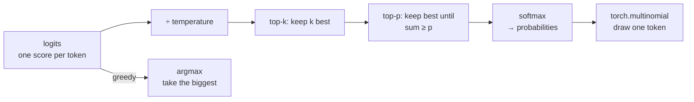

# 16 · Sampling and the KV cache

**What you'll build:** the two parts of an LLM that only matter when it *writes*: (1) the **sampling** rules that turn the model's scores into one chosen token (greedy, temperature, top-k, top-p), shown as bar charts and as real Shakespeare from your lesson 14 model; and (2) a **KV cache** that makes generation many times faster, with a test proving it changes nothing and a stopwatch measuring the speed-up.
**Like you're 5:** (1) the model gives every possible next word a number of raffle tickets; sampling is how you draw the winner (always the biggest pile? a fair lottery? only among the top 5?). (2) When you write a story you don't re-read the whole story before every new word: you remember it. The KV cache is the model's memory.
**Time:** ~3 h · **Builds on:** [15 · Reproduce GPT-2 small](../15-reproduce-gpt2-small) and the trained `ckpt.pt` from [14 · Build GPT from scratch](../14-build-gpt-from-scratch) · **Needs:** nothing extra

## Why this matters
Every chat API exposes `temperature`, `top_p` and often `top_k`, and choosing them well is part of the daily job (low temperature for extraction and code, higher for brainstorming). The KV cache is why chatbots can stream tokens quickly, why long conversations use so much GPU memory, and why serving systems such as vLLM exist (they manage KV-cache memory cleverly). Lesson 17's grouped-query attention exists to make this cache smaller.

## What you'll learn
- **Logits → probabilities**: softmax turns the model's raw scores (**logits**) into probabilities.
- **Greedy decoding**: always take the most likely token; safe but repetitive.
- **Temperature**: divide the logits by T before softmax; T < 1 makes the favourite even more likely, T > 1 spreads the chances out.
- **Top-k and top-p (nucleus)**: throw away unlikely tokens before drawing: keep the k best, or the smallest group whose probabilities add up to p.
- **KV cache**: keep every layer's keys and values from earlier tokens so each new token needs only one token's worth of computation.

## Watch alongside
There is no Karpathy lecture dedicated to these two topics; they appear inside other videos:
- **Let's build GPT** (https://www.youtube.com/watch?v=kCc8FmEb1nY): the `generate` function (multinomial sampling) in the bigram section.
- **Let's reproduce GPT-2 (124M)** (https://www.youtube.com/watch?v=l8pRSuU81PU): sampling from GPT-2 with top-k 50 in section 1.
- **Deep Dive into LLMs like ChatGPT** (https://www.youtube.com/watch?v=7xTGNNLPyMI): the "inference" part early in the video explains sampling and why the same prompt gives different answers.
- For the KV cache, search: [KV cache explained](https://www.youtube.com/results?search_query=kv+cache+explained+transformer+inference) (Umar Jamil's LLaMA videos cover it well).

## Before you start
1. Make sure lesson 14 left a trained model at `../14-build-gpt-from-scratch/ckpt.pt` (run `python train.py` there if not).
2. Go to the lesson folder (from the course root `llm-from-scratch/`):
   ```bash
   cd part-3-transformers-and-gpt/16-sampling-and-the-kv-cache
   ```
3. Install:
   ```bash
   pip install -r requirements.txt
   ```
   - `torch`: the model. `pytest`: runs `test_model.py`.

No API key, no download. `model.py` is lesson 14's `gpt.py` plus the cache and the filters (look for `# NEW`), with the same weight names so lesson 14's checkpoint loads.

## Run it
1. Run the tests (the cache must give the same numbers as a normal forward pass):
   ```bash
   pytest -q
   ```
   You should see `2 passed`.
2. See sampling in action (~10 s):
   ```bash
   python sampling.py
   ```
   You should see bar charts, then six short Shakespeare samples, one per setting.
3. Measure the KV cache (~10 s to a few minutes, depending on your CPU):
   ```bash
   python kv_cache.py
   ```
   You should see `identical: True` and a speed-up.
4. Try a longer generation for a bigger speed-up: `python kv_cache.py --tokens 600`.

| Piece | Meaning |
|---|---|
| `python sampling.py --ckpt path/to/ckpt.pt` | use a different trained model file (default: lesson 14's) |
| `python kv_cache.py --tokens 600` | generate 600 tokens in the speed test (default 200) |

### What you should see
`python sampling.py` (real output, shortened where marked `...`):
```
======================================================================
1) Toy example: the model's scores for the word after 'The cat sat on the'
======================================================================
raw scores (logits): [3.0, 2.200000047683716, 2.0, 1.5, 0.5, -0.5, -1.5]

greedy = always the highest score -> always 'mat' (same text every time)

temperature 0.5: probabilities = softmax(scores / 0.5)
       mat  71.7% █████████████████████████████
      sofa  14.5% ██████
     floor   9.7% ████
       bed   3.6% █
      roof   0.5%
      moon   0.1%
    banana   0.0%

temperature 1.0: probabilities = softmax(scores / 1.0)
       mat  46.2% ██████████████████
      sofa  20.8% ████████
     floor  17.0% ███████
       bed  10.3% ████
      roof   3.8% ██
      moon   1.4% █
    banana   0.5%

temperature 2.0: probabilities = softmax(scores / 2.0)
       mat  30.2% ████████████
      sofa  20.2% ████████
     floor  18.3% ███████
       bed  14.2% ██████
      roof   8.6% ███
      moon   5.2% ██
    banana   3.2% █

top-k = 3: keep the 3 best, set the rest to 0, re-normalise
       mat  55.0% ██████████████████████
      sofa  24.7% ██████████
     floor  20.2% ████████
       bed   0.0%
...
top-p = 0.9: keep the smallest set of best words whose probabilities add up to at least 90%
       mat  49.0% ████████████████████
      sofa  22.0% █████████
     floor  18.0% ███████
       bed  10.9% ████
      roof   0.0%
...
======================================================================
2) Lesson 14's Shakespeare model
======================================================================
next-character probabilities after 'ROMEO:\nWhat light through yonder window b':
         e  47.3% ███████████████████
         u  24.3% ██████████
         r  12.0% █████
         y   5.8% ██
         l   3.3% █
         o   3.1% █
         a   2.2% █
         i   1.6% █

--- greedy ---
I am a pardon a stand and a death, and the world,
And the shall be the send of the state of the streat,
And the shall be

--- temperature 0.5 ---
At 'man hold will the heart of slew the bearted
To his more the man of the brother world, and with the pair
Of love thei

--- temperature 1.0 ---
At 'mana, come lord, letter you see you ar
Reach my stame of the rood bestibly fessing of 'twixt?

LUCIO:
Roes, SIrmin h

--- temperature 1.5 ---
At 'mana,
To will, know!-'ere Said, he wep
Reace my tryments but boy? Unsweet, 'tis my vip's.

RIVERSA RaiRLeD:
SIr, but

--- top-k 5 ---
A good too me too, though'st that steem me,
And he he have storm more be and a the lord hand.

PORIZEL:
Ay, thereforte i

--- top-p 0.9 ---
At you here showls, I have shall be seen,
Sir be my star, who must a husband's feed, go you purbs,
To that we maliamish
```
`python kv_cache.py` (real output on a 4-core cloud CPU):
```
1) Correctness: greedy generation with and without the cache must be identical
   (using lesson 14's trained model)
   128 tokens each | identical: True
   text: 'ROMEO:\nI am a pardon a stand and a death, and the world,\nAnd the shall be the se' ...

2) Speed: 11.1M-parameter model (random weights; speed doesn't depend on them), generating 200 tokens
   without cache:   5.69 s  =   35.2 tokens/s
   with cache   :   0.53 s  =  377.4 tokens/s
   speed-up: 10.7x

3) Memory: the cache for 200 tokens holds 3.7 MB (2 tensors x 6 layers x 200 tokens x 384 numbers x 4 bytes)
   Work per new token: without cache ~ the whole text so far; with cache ~ one token.
```
What to look at:
- **The model knows "window b" continues with `e`** ("be...") or `u`, `r` ("bu", "br"); this is what the model actually outputs before any sampling choice.
- **Greedy repeats itself** ("And the shall be ..." twice): always taking the top choice falls into loops. This is why chat models sample.
- **Temperature 1.5** invents words and broken names ("RIVERSA RaiRLeD"): too many unlikely characters get drawn. **0.5** is safe but plain.
- **Top-k 5 and top-p 0.9** stay readable while still varied: they cut off the long tail of bad choices.
- **identical: True**: the cache is a pure speed trick; the text is exactly the same. The speed-up grows with the length of the text (try `--tokens 600`), because without the cache each new token re-processes everything before it.

## How it works

### Part 1: sampling, step by step

`filter_logits()` in `model.py` does the middle three boxes:
1. **Temperature**: `logits / temperature`. Softmax is p<sub>i</sub> = e<sup>z<sub>i</sub>/T</sup> / Σ<sub>j</sub> e<sup>z<sub>j</sub>/T</sup> (each token's e-to-the-score divided by the total). Dividing by a small T (0.5) doubles the gaps between scores, and e<sup>x</sup> turns bigger gaps into much bigger ratios; a large T shrinks the gaps. T → 0 becomes greedy; T = 1 is the model's own distribution.
2. **Top-k**: `torch.topk(logits, k)` finds the k-th best score; everything below it gets `-inf`, which softmax turns into exactly 0. The survivors are re-normalised (their probabilities are scaled up to sum to 1 again: in the toy example `mat` goes from 46.2% to 55.0%).
3. **Top-p (nucleus sampling)**: sort the probabilities from big to small and add them up. Keep tokens until the running total reaches p. In the code: `before = cumsum - probs` is "how much probability the better-ranked tokens already cover"; a token is removed if that is already more than p. With p = 0.9 in the toy example: mat (46%) + sofa (21%) + floor (17%) = 84% < 90%, so `bed` is still needed (94%); roof, moon, banana are cut. Unlike top-k, the number kept adapts: 1 token when the model is sure, many when it is unsure.
4. **Drawing**: `torch.multinomial(probs, 1)` picks index i with probability probs[i], like a spinner with slices of different sizes. `torch.manual_seed(7)` fixes the random numbers so every setting is compared with the same "dice".

### Part 2: the KV cache
Without a cache, generating token number t runs the model on all t tokens again, even though the keys and values of tokens 1 … t−1 are exactly the same as last time (a causal model never lets old tokens see new ones). With a cache:
```
step 1 (the prompt, "prefill"):  x = all prompt tokens  -> compute q,k,v -> store k,v of every layer
step 2 ("decode"):                x = 1 new token        -> compute its q,k,v -> k = [stored k ; new k], same for v
                                  attention: 1 query x (stored + 1) keys -> 1 output row -> store new k,v
step 3, 4, ...: same as step 2
```
In the code (search for `# NEW` in `model.py`):
1. **`KVCache`** holds two lists (`k` and `v`) with one tensor per layer of shape (B, nh, tokens so far, hs). `append()` glues new keys/values on the time axis with `torch.cat(..., dim=2)`.
2. **`CausalSelfAttention.forward(x, cache, layer)`**: computes q, k, v for the new tokens only, then appends to the cache. The scores are now (B, nh, T_new, past + T_new). The mask slice `mask[past:past+T, :past+T]` says "new query number i sits at position past + i and may see keys 0 … past + i".
3. **`GPT.forward(idx, cache=...)`**: positions continue where the cache ends: `torch.arange(past, past + T)`.
4. **`GPT.generate(..., use_cache=True)`**: the first call sends the whole prompt; after that only `idx_next`. Lesson 14's model has learned position embeddings only up to `block_size`, so when the window is full the code starts a fresh cache from the last `block_size` tokens. This gives the same result as the no-cache version (which also crops), just without the speed-up from then on. Models with RoPE (lesson 17) handle long texts more gracefully.

**How much work is saved?** Generating N tokens without a cache processes 1 + 2 + … + N ≈ N²/2 token-positions; with a cache, N. For N = 200 that is about 100× fewer token-positions, but the weights still have to be read from memory every step, so the measured speed-up (10.7×) is smaller. **The price is memory**: 2 (K and V) × layers × tokens × n_embd numbers. For a 70B model with a long context this is gigabytes per conversation (lesson 17 computes it).

## If something goes wrong
- **`No checkpoint at ../14-build-gpt-from-scratch/ckpt.pt`** → train lesson 14 first, or pass `--ckpt` with the path to your checkpoint. `kv_cache.py` still runs without it (random weights).
- **`Error(s) in loading state_dict`** → the checkpoint came from a different model file (for example lesson 17's). Use a checkpoint written by lesson 14's `train.py`.
- **`identical: False`** → in rare cases tiny rounding differences change which token wins a near-tie in greedy mode. The pytest test checks the scores themselves with a tolerance; if it passes, the cache is correct.
- **`RuntimeError: probability tensor contains either inf, nan or element < 0`** → you used `temperature=0`. Use `greedy=True` for "always the best", or a small temperature such as 0.1.

## Try this
1. **Find the loop.** Generate 400 characters greedily from `"KING RICHARD:\n"` and find where it starts repeating.
   <details><summary>Solution</summary>

   Add at the end of `sampling.py`:
   ```python
   out = model.generate(torch.tensor([encode("KING RICHARD:\n")]), 400, greedy=True)
   print(decode(out[0].tolist()))
   ```
   Greedy text quickly cycles through the same phrase. With `temperature=0.8, top_p=0.9` the loop disappears. Big LLMs also loop under greedy decoding, especially small ones; that is why APIs sample by default.
   </details>
2. **Min-p.** A newer filter keeps tokens whose probability is at least `min_p` × (the top token's probability). Add `min_p` to `filter_logits` and try `min_p=0.1`.
   <details><summary>Solution</summary>

   Add a parameter `min_p=None` and, before `return logits`:
   ```python
   if min_p is not None:
       probs = F.softmax(logits, dim=-1)
       limit = min_p * probs.max(dim=-1, keepdim=True).values
       logits = logits.masked_fill(probs < limit, float("-inf"))
   ```
   Then pass it through `generate` (add `min_p=None` to its arguments and to the `filter_logits` call). Like top-p, it adapts to how confident the model is.
   </details>
3. **Where does the time go?** Run `python kv_cache.py --tokens 50` and `--tokens 600`. Why is the speed-up so different?
   <details><summary>Hint</summary>

   With 50 tokens, the no-cache version re-processes on average 25 tokens per step; with 600, about 300. The cached version always processes 1, so its advantage grows with length. Very short generations hardly benefit.
   </details>

## Check yourself
1. With logits [2, 1, 0] and temperature 0.5, what are the scores before softmax, and which token gains probability?
2. The model's next-token probabilities are [0.6, 0.25, 0.1, 0.05]. Which tokens survive top-k = 2? Top-p = 0.8? Top-p = 0.95?
3. Why can we cache keys and values but not the queries?
4. A server holds 100 conversations of 8,000 tokens each. Why does the KV cache, not the model weights, often become the memory bottleneck?

<details><summary>Answers</summary>

1. [4, 2, 0]. The gaps double, so the first token (already the favourite) gains probability and the others lose.
2. Top-k 2: the first two. Top-p 0.8: 0.6 < 0.8 so add the second, 0.85 ≥ 0.8, stop: the first two. Top-p 0.95: 0.6, 0.85, 0.95: the first three.
3. Future tokens need the old tokens' keys (to compute scores) and values (to mix them). An old token's query is only used to compute that old token's own output, which is already done and never needed again.
4. The weights are stored once and shared by all conversations, but every conversation has its own cache that grows with its length (2 × layers × tokens × width numbers). 100 × 8,000 tokens can add up to more memory than the model itself.
</details>

## Learn more (optional)
- "The Curious Case of Neural Text Degeneration" (the top-p paper): https://arxiv.org/abs/1904.09751
- Hugging Face blog, "How to generate text": https://huggingface.co/blog/how-to-generate
- vLLM and PagedAttention (smart KV-cache memory): https://arxiv.org/abs/2309.06180

**Read the official docs**
- `torch.multinomial`: https://pytorch.org/docs/stable/generated/torch.multinomial.html
- `torch.topk`: https://pytorch.org/docs/stable/generated/torch.topk.html
- Hugging Face generation strategies: https://huggingface.co/docs/transformers/generation_strategies
- vLLM docs: https://docs.vllm.ai
- Anthropic API sampling parameters (temperature, top_p, top_k): https://docs.anthropic.com/en/api/messages

## Next
→ [17 · Modern LLM architecture, LLaMA style](../17-modern-llm-architecture-llama-style)
