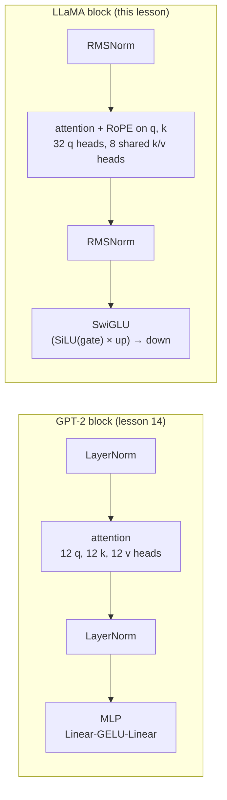

# 17 · Modern LLM architecture, LLaMA style

**What you'll build:** the four upgrades that turned GPT-2 into the architecture of LLaMA, Mistral, Qwen and most open models today: **RMSNorm**, **RoPE** (rotary position embeddings), **SwiGLU** and **grouped-query attention (GQA)**. Each one is a switch in `model.py`, so you can swap them into lesson 14's model one at a time, train both versions on the same data, and measure which is better.
**Like you're 5:** your Lego parrot from lesson 14 gets four upgrade kits: a simpler volume knob (RMSNorm), a compass that tells each word how far away the other words are (RoPE), a smarter thinking box with a gate (SwiGLU), and shared notebooks so it remembers more with less paper (GQA).
**Time:** ~4 h (including ~10–25 min of training) · **Builds on:** [16 · Sampling and the KV cache](../16-sampling-and-the-kv-cache) and the model of [14](../14-build-gpt-from-scratch) · **Needs:** nothing extra

## Why this matters
When you read the code or model card of any modern open model (LLaMA 3, Mistral, Qwen, Gemma, DeepSeek), you meet these names in the first lines of the config: `rms_norm_eps`, `rope_theta`, `hidden_act: silu`, `num_key_value_heads`. After this lesson you know exactly what each does, why it was adopted, and how much it helps at small scale. This model file is also the one you take into Part 4 to build your own assistant.

## What you'll learn
- **RMSNorm**: normalise by the vector's typical size (root mean square) without subtracting the mean; simpler and faster than LayerNorm, works as well.
- **RoPE**: instead of adding a position vector, *rotate* each query and key by an angle that depends on its position, so attention scores depend on how far apart two tokens are.
- **SwiGLU**: an MLP with three matrices where one branch, passed through SiLU, acts as a **gate** that decides how much of the other branch gets through.
- **Grouped-query attention (GQA)**: several query heads share one key/value head, which shrinks the KV cache from lesson 16 several times over.
- **Ablation**: changing exactly one thing at a time to learn what each change is worth.

## Watch alongside
Karpathy has no lecture on LLaMA's architecture. Good companions:
- **Deep Dive into LLMs like ChatGPT** (https://www.youtube.com/watch?v=7xTGNNLPyMI): the parts about base models such as LLaMA 3 and how open models are released (context, not architecture).
- Umar Jamil's **LLaMA explained** and **Coding LLaMA 2 from scratch**: [search link](https://www.youtube.com/results?search_query=umar+jamil+llama+explained+rope+rmsnorm+swiglu+grouped+query+attention). He covers RoPE, RMSNorm, SwiGLU, GQA and the KV cache in the same order as this lesson.
- 3Blue1Brown, **Attention in transformers, visually explained** (https://www.youtube.com/watch?v=eMlx5fFNoYc) for the picture of queries and keys as arrows, which makes RoPE's rotation easy to imagine.

## Before you start
1. Go to the lesson folder (from the course root `llm-from-scratch/`):
   ```bash
   cd part-3-transformers-and-gpt/17-modern-llm-architecture-llama-style
   ```
2. Install:
   ```bash
   pip install -r requirements.txt
   ```
   - `torch` version 2.1 or newer (`nn.LayerNorm(..., bias=False)` needs it).

No API key. `compare.py` downloads tiny Shakespeare (1 MB) on its first run.

## Run it
1. Look at each ingredient on its own (instant):
   ```bash
   python components_demo.py
   ```
   You should see 5 numbered sections with small tables of numbers.
2. Train both models, same data and seed, 1,000 steps each (~5–10 min on a laptop CPU):
   ```bash
   python compare.py
   ```
3. The full ablation, one change at a time (6 runs, ~25 min):
   ```bash
   python compare.py --ablation
   ```
   You should see one line per model with its validation loss at steps 0, 250, 500, 750 and 1,000.

| Piece | Meaning |
|---|---|
| `--ablation` | an on/off flag (no value): also run the 4 "GPT-2 + one change" models |
| `--steps 300` | train each model for 300 steps instead of 1,000 (quicker, noisier) |

### What you should see
`python components_demo.py` (real output):
```
1) LayerNorm vs RMSNorm on one token's vector
x                 : [2.0, 4.0, 6.0, 8.0]
mean, RMS of x    : 5.0 5.477
LayerNorm(x)      : tensor([-1.342, -0.447,  0.447,  1.342])  <- (x - mean) / std: centred at 0
RMSNorm(x)        : tensor([0.365, 0.730, 1.095, 1.461])  <- x / RMS: same direction, just resized
RMS of RMSNorm(x) : 1.0 (always ~1, like LayerNorm's std)

2) RoPE: rotate queries and keys by their position
q at position   3, k at position   1 (distance 2): score  -2.279
q at position  10, k at position   8 (distance 2): score  -2.279
q at position 150, k at position 148 (distance 2): score  -2.279
q at position   3, k at position   2 (distance 1): score  -2.267
q at position  10, k at position   2 (distance 8): score  -2.402
Same distance -> same score, wherever the pair sits: attention 'feels' RELATIVE position.
length before/after rotating: 3.395 / 3.395 (rotation never changes the length)

3) SwiGLU: an MLP with a gate
z        : [-3.0, -1.0, 0.0, 1.0, 3.0]
GELU(z)  : tensor([-0.004, -0.159,  0.000,  0.841,  2.996])
SiLU(z)  : tensor([-0.142, -0.269,  0.000,  0.731,  2.858])  (z * sigmoid(z): ~0 for negatives, ~z for positives)
GELU MLP : 131,712 parameters, weight matrices [(512, 128), (128, 512)]
SwiGLU   : 135,168 parameters, weight matrices [(352, 128), (352, 128), (128, 352)]

4) Grouped-query attention: share keys/values between query heads
Example: a LLaMA-2-70B-shaped model, 80 layers, 64 query heads of size 128, 4,096 tokens, 16-bit numbers:
  multi-head (MHA)       64 key/value heads -> KV cache  10.74 GB per sequence
  grouped-query (GQA-8)   8 key/value heads -> KV cache   1.34 GB per sequence
  multi-query (MQA)       1 key/value heads -> KV cache   0.17 GB per sequence
LLaMA 2 70B and LLaMA 3 use 8 key/value heads: 8x smaller cache, almost the same quality.
  our model with 4 query heads, 4 kv heads: 818,176 parameters, output (2, 10, 65)
  our model with 4 query heads, 2 kv heads: 752,128 parameters, output (2, 10, 65)
  our model with 4 query heads, 1 kv heads: 719,104 parameters, output (2, 10, 65)

5) The two models compared in compare.py
GPT-2 style: 818,176 parameters  {'norm': 'layernorm', 'pos': 'learned', 'mlp': 'gelu', 'bias': True}
LLaMA style: 755,072 parameters  {'norm': 'rmsnorm', 'pos': 'rope', 'mlp': 'swiglu', 'bias': False, 'n_kv_head': 2}
```
`python compare.py --ablation` (real output on a busy 4-core CPU, one thread):
```
device cpu | 1000 steps | batch 32 x 64 characters | validation loss at steps:
model                           params        0     250     500     750    1000    time
GPT-2 style (lesson 14)        818,176    4.229   2.304   2.066   1.935   1.864     222s
LLaMA style                    755,072    4.187   2.007   1.817   1.740   1.695     249s
GPT-2 + RMSNorm                817,024    4.228   2.301   2.068   1.947   1.875     224s
GPT-2 + RoPE                   809,984    4.251   2.112   1.940   1.842   1.803     246s
GPT-2 + SwiGLU                 835,328    4.175   2.248   1.954   1.832   1.773     220s
GPT-2 + GQA (2 kv heads)       752,128    4.209   2.304   2.066   1.944   1.873     226s

lowest final validation loss: LLaMA style (1.695)
```
What to look at:
- **LLaMA style wins clearly** (1.695 vs 1.864) with *fewer* parameters (755k vs 818k), and it is ahead at every checkpoint.
- **RoPE helps most** here (1.864 → 1.803), then **SwiGLU** (→ 1.773). Together (plus the others) they give more than either alone.
- **RMSNorm and GQA change almost nothing** in quality (1.875, 1.873: within noise). That is the point: RMSNorm is cheaper to compute, and GQA saves parameters and KV-cache memory "for free". At this tiny scale their speed benefits don't show; at 70B parameters they matter a lot.
- These are single runs of one small model on one dataset. Real papers repeat runs with several seeds; differences of ~0.01 here are noise.

## How it works

GPT-2 adds a learned position vector to the token embedding at the bottom; LLaMA has no position table at all and puts position into every attention layer through RoPE. LLaMA also drops all bias vectors.

### 1. `RMSNorm`
**RMS(x) = √( (x₁² + x₂² + … + x<sub>n</sub>²) / n )**: square every number, average, take the square root. It is the vector's "typical size". RMSNorm returns x / RMS(x) × weight (a learned scale per position in the vector; `eps`, a tiny number like 0.000001, is added inside the square root so we never divide by zero). LayerNorm also subtracts the mean and adds a learned bias. Experiments (Zhang & Sennrich, 2019) showed the re-centring isn't needed: RMSNorm trains as well and does less work.

### 2. RoPE (rotary position embeddings)
Take each query/key vector of head size `hs` and view it as `hs/2` pairs of numbers. Treat each pair as an arrow on a sheet of paper and **rotate** it by an angle that grows with the position: angle = position × θ<sub>i</sub>, with θ<sub>i</sub> = 10000<sup>−2i/hs</sup> for pair number i. A 2-D rotation by angle a turns (x₁, x₂) into (x₁ cos a − x₂ sin a, x₁ sin a + x₂ cos a): that is exactly the line in `apply_rope`.
Why it works: the dot product of two arrows depends only on their lengths and the angle *between* them. If q is rotated by m·θ and k by n·θ, the angle between them changes by (m − n)·θ: only the **distance** m − n matters. The demo shows the score is −2.279 for distance 2 at positions (3, 1), (10, 8) and (150, 148). The first pairs spin fast (they notice small distances), the last pairs spin slowly (they can tell apart big distances). Rotation never changes a vector's length, so it doesn't disturb the values. `rope_theta` (10,000 here, 500,000 in LLaMA 3) sets the slowest speed; bigger values help very long contexts.

### 3. `SwiGLU`
- **SiLU** (also called Swish): silu(z) = z × sigmoid(z), where sigmoid(z) = 1 / (1 + e<sup>−z</sup>) squashes any number into 0…1. For big positive z it is ≈ z; for very negative z it is ≈ 0; in between it is smooth (and slightly negative, unlike ReLU).
- **GLU** (gated linear unit): compute two things from the same input, `gate(x)` and `up(x)`, and multiply them element by element: **SwiGLU(x) = down( silu(gate(x)) ⊙ up(x) )** (⊙ = multiply position by position). The gate learns *which* parts of the content to let through, per token.
- Three matrices instead of two, so the hidden size is shrunk to 2/3 × 4 × n_embd (here 352) to keep the parameter count equal. Shazeer's 2020 paper "GLU Variants Improve Transformer" found this consistently better; nobody has a complete theory of why ("we offer no explanation... we attribute their success... to divine benevolence", the paper jokes).

### 4. Grouped-query attention
`Attention` has `n_head` query heads but only `n_kv_head` key and value heads: `k_proj` and `v_proj` output `n_kv_head × hs` numbers instead of `n_head × hs`. Before the attention maths, `repeat_interleave(n_head // n_kv_head, dim=1)` copies each key/value head so that a *group* of query heads uses the same one (with 4 query heads and 2 kv heads: queries 0, 1 share kv head 0; queries 2, 3 share kv head 1). Fewer k/v heads means fewer parameters and, more importantly, a smaller KV cache: section 4 of the demo shows 10.7 GB → 1.3 GB per sequence for a 70B-sized model. `n_kv_head = 1` is **multi-query attention (MQA)**; `n_kv_head = n_head` is normal multi-head attention.

### 5. `compare.py`
`run()` builds a model from a style dictionary, trains it with AdamW (lr 1e-3) for `--steps` steps and measures validation loss every `--eval-every` steps. Fairness tricks: `torch.manual_seed(1337)` before each model (same random start), a `torch.Generator` with a fixed seed for the training batches (every model sees exactly the same batches in the same order) and another for validation (the same 20 batches every time). `{**GPT2_STYLE, "pos": "rope"}` means "a copy of GPT2_STYLE with `pos` changed to `rope`".

## If something goes wrong
- **`TypeError: LayerNorm.__init__() got an unexpected keyword argument 'bias'`** → your PyTorch is older than 2.1. `pip install -U torch`.
- **`AssertionError`** when creating `Config(...)` → `n_embd` must be divisible by `n_head`, and `n_head` by `n_kv_head` (4 query heads can share 4, 2 or 1 kv heads, not 3).
- **Your numbers differ slightly from the ones above** → normal. Different CPUs, PyTorch versions and thread counts change the last digits of floating-point sums. The ranking should be the same; if two models are within ~0.02, treat them as equal.
- **`compare.py --ablation` takes too long** → use `--steps 300` (noisier but the LLaMA-style advantage is already visible), or run it on Google Colab with a GPU.

## Try this
1. **Bigger RoPE base.** Train LLaMA style with `rope_theta=500000.0` (LLaMA 3's value). Does it change anything with a 64-character context?
   <details><summary>Hint</summary>

   Add `("LLaMA, theta 500k", {**LLAMA_STYLE, "rope_theta": 500000.0})` to `runs`. With only 64 positions the difference is tiny or negative: a big θ makes the slow pairs rotate so slowly that they barely change within 64 positions. It pays off for contexts of 8,000 to 128,000 tokens.
   </details>
2. **Multi-query attention.** Add a run with `{**LLAMA_STYLE, "n_kv_head": 1}`. How much worse is it than 2 kv heads?
   <details><summary>Hint</summary>

   Usually only a little worse (or the same within noise), with fewer parameters. At large scale MQA loses a bit more quality, which is why most models settled on GQA with 8 kv heads as the middle ground.
   </details>
3. **Generate from the winner.** Make `run()` return the model, and print a sample from the LLaMA-style model.
   <details><summary>Solution</summary>

   Change `return history[-1]` to `return history[-1], model`, change the results line to `results = {name: run(name, style) for name, style in runs}` → `trained = {name: run(name, style) for name, style in runs}` and `results = {k: v[0] for k, v in trained.items()}`, then at the end:
   ```python
   m = trained["LLaMA style"][1].eval()
   out = m.generate(torch.tensor([[stoi["\n"]]], device=device), 300, temperature=0.8)
   print("".join(chars[i] for i in out[0].tolist()))
   ```
   `generate` is in `model.py` (it is the same function you will use for chat in Part 4).
   </details>

## Check yourself
1. What does RMSNorm skip that LayerNorm does, and why is that fine?
2. With RoPE, why does the score between a query and a key depend only on their distance?
3. Why does SwiGLU use a hidden size of about 2/3 × 4 × n_embd instead of 4 × n_embd?
4. A model has 32 query heads and 8 key/value heads. How many query heads share each kv head, and how much smaller is its KV cache than with 32 kv heads?

<details><summary>Answers</summary>

1. Subtracting the mean (and the bias). Dividing by the typical size already keeps numbers in a healthy range; experiments showed re-centring adds work without improving results.
2. A rotation by m·θ of q and n·θ of k changes the angle between them by (m − n)·θ, and a dot product depends only on the lengths and the angle between two arrows; the absolute positions cancel out.
3. It has three weight matrices (gate, up, down) instead of two. Shrinking the hidden size to 2/3 keeps the number of parameters (and the compute) about the same, so the comparison with GELU is fair.
4. 32 / 8 = 4 query heads per kv head; the cache stores 8 instead of 32 heads of keys and values, so it is 4× smaller.
</details>

## Learn more (optional)
- LLaMA paper (2023): https://arxiv.org/abs/2302.13971 · LLaMA 2 paper (GQA): https://arxiv.org/abs/2307.09288
- RoFormer, the RoPE paper: https://arxiv.org/abs/2104.09864
- RMSNorm paper: https://arxiv.org/abs/1910.07467
- GLU Variants Improve Transformer (SwiGLU): https://arxiv.org/abs/2002.05202
- GQA paper: https://arxiv.org/abs/2305.13245
- Sebastian Raschka's code converting GPT to LLaMA, step by step: https://github.com/rasbt/LLMs-from-scratch

**Read the official docs**
- Hugging Face LLaMA model docs (see the config fields `rms_norm_eps`, `rope_theta`, `num_key_value_heads`): https://huggingface.co/docs/transformers/model_doc/llama
- Meta's reference LLaMA code: https://github.com/meta-llama/llama-models
- `torch.nn.RMSNorm` (PyTorch's built-in version): https://pytorch.org/docs/stable/generated/torch.nn.RMSNorm.html
- `torch.nn.functional.silu`: https://pytorch.org/docs/stable/generated/torch.nn.functional.silu.html

## Next
→ [Part 4 · From base model to assistant](../../part-4-from-base-model-to-assistant), starting with [18 · Pretraining data pipeline](../../part-4-from-base-model-to-assistant/18-pretraining-data-pipeline)
