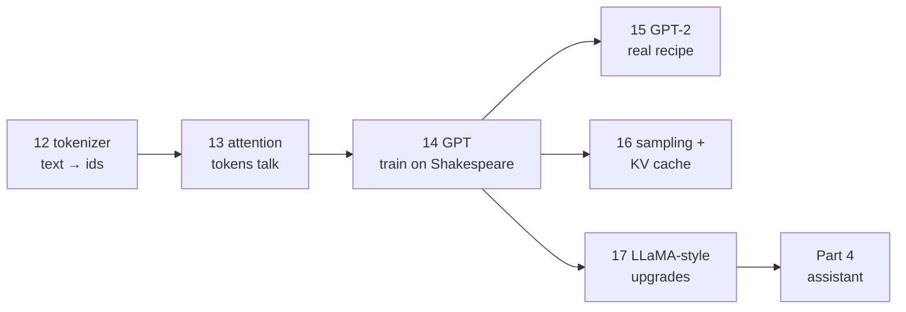

# Part 3 · Transformers and GPT

In Part 2 you built language models that read characters through a fixed window. In this part you build the real thing: the tokenizer, attention, a full GPT, an exact copy of OpenAI's GPT-2 with a professional training loop, fast generation, and the modern LLaMA-style upgrades. By the end you can read the source code of most open LLMs and know what every line does.

**Like you're 5:** Part 2 taught the parrot to guess the next letter by looking at the last few letters. Part 3 gives it word-pieces instead of letters, the ability to look back at *anything* it said, and a body as big as a real GPT-2.

## Lessons

| # | Lesson | What you build | Time | Karpathy video |
|---|---|---|---|---|
| 12 | [BPE tokenizer from scratch](12-bpe-tokenizer-from-scratch) | a GPT-4-style tokenizer with regex splitting and special tokens, compared with tiktoken | ~3 h | [Let's build the GPT Tokenizer](https://www.youtube.com/watch?v=zduSFxRajkE) |
| 13 | [Attention from scratch](13-attention-from-scratch) | self-attention in NumPy then PyTorch, multi-head, shapes, a head that learns where to look | ~3 h | [Let's build GPT](https://www.youtube.com/watch?v=kCc8FmEb1nY) (first half) |
| 14 | [Build GPT from scratch](14-build-gpt-from-scratch) | a complete GPT trained on Shakespeare on your CPU | ~4 h | [Let's build GPT](https://www.youtube.com/watch?v=kCc8FmEb1nY) |
| 15 | [Reproduce GPT-2 small](15-reproduce-gpt2-small) | GPT-2 that loads OpenAI's weights; AdamW, cosine LR, grad accumulation, bf16, compile, DDP; cloud recipe | ~5 h | [Let's reproduce GPT-2 (124M)](https://www.youtube.com/watch?v=l8pRSuU81PU) |
| 16 | [Sampling and the KV cache](16-sampling-and-the-kv-cache) | greedy, temperature, top-k, top-p; a KV cache with a measured ~10× speed-up | ~3 h | (parts of the videos above) |
| 17 | [Modern LLM architecture, LLaMA style](17-modern-llm-architecture-llama-style) | RoPE, RMSNorm, SwiGLU, GQA, swapped into lesson 14's model and compared | ~4 h | (Umar Jamil's LLaMA videos, linked inside) |

Total: about 22 hours of study, plus optional cloud GPU time in lesson 15.



## Setup for this part
Use the virtual environment from the start of the course, then install everything this part needs in one go:
```bash
pip install torch numpy regex tiktoken transformers pytest
```
| Package | Used for |
|---|---|
| `torch` | every model (CPU is fine; an NVIDIA or Apple GPU is used automatically if present) |
| `numpy` | lesson 13 (attention by hand), token shards in lesson 15 |
| `regex` | the GPT-style split pattern in lesson 12 |
| `tiktoken` | OpenAI's tokenizers (lessons 12 and 15); downloads each vocabulary once |
| `transformers` | lesson 15 only: downloads OpenAI's GPT-2 weights and checks our copy |
| `pytest` | runs the small test files in lessons 12, 15 and 16 |

Each lesson folder also has its own `requirements.txt` with just what it needs.

**Hardware.** Every default runs on a laptop CPU in seconds to ~15 minutes. Lesson 15's full GPT-2 reproduction needs rented GPUs (about $20–40, step-by-step instructions inside). Lessons 14, 16 and 17 share Shakespeare (`input.txt`, 1 MB) and lesson 16 uses lesson 14's trained `ckpt.pt`.

**Lighter previews.** If a lesson feels steep, the ai-engineer-journey course has gentler versions: [5.6 BPE tokenizer](../../ai-engineer-journey/level-5-text-models/06-bpe-tokenizer-from-scratch), [6.1 self-attention by hand](../../ai-engineer-journey/level-6-transformers/01-self-attention-by-hand-numpy), [6.2 mini-GPT](../../ai-engineer-journey/level-6-transformers/02-mini-gpt-trained-on-shakespeare).

## After this part you can
- Explain how text becomes tokens and why tokenization causes strange LLM behaviour.
- Write causal multi-head self-attention from memory and state every tensor's shape.
- Build, train and sample from a GPT, and read nanoGPT, build-nanogpt and the Hugging Face GPT-2/LLaMA code.
- Run a real pretraining loop (AdamW, schedules, accumulation, mixed precision, DDP) and estimate what a cloud run costs.
- Choose sampling settings on purpose and explain why the KV cache makes chatbots fast but memory-hungry.
- Name and implement the four architecture changes behind LLaMA-style models.

## Next part
→ [Part 4 · From base model to assistant](../part-4-from-base-model-to-assistant): data pipelines, instruction tuning, preference tuning, evaluation, and your own tiny ChatGPT.
