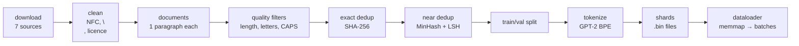

# 18 · Pretraining data pipeline

**What you'll build:** the factory that turns messy raw text into clean training food for an LLM. `pipeline.py` downloads 7 public-domain texts from GitHub, cleans them, cuts them into documents, throws out junk, removes exact duplicates (with fingerprints) and near-duplicates (with MinHash, built from scratch), splits train/validation, tokenizes everything with GPT-2's tokenizer and writes compact binary **shards**. `dataloader.py` then serves training batches from those shards, and lesson 15's trainer can read them directly.
**Like you're 5:** before cooking, you wash the vegetables, throw away the rotten ones, notice you bought the same carrots twice (and a second bag that is *almost* the same), chop everything into equal pieces and put them in labelled boxes. The model is the cook; this lesson is the kitchen prep.
**Time:** ~3 h · **Builds on:** [17 · Modern LLM architecture](../../part-3-transformers-and-gpt/17-modern-llm-architecture-llama-style) and the tokenizer ideas of [12](../../part-3-transformers-and-gpt/12-bpe-tokenizer-from-scratch) · **Needs:** internet once (~4 MB from GitHub)

## Why this matters
Labs say it again and again: **data quality matters more than clever architecture**. Most of the work in pretraining a real LLM (FineWeb, Dolma, The Pile, RedPajama) is exactly these steps at huge scale: extract text, filter low-quality pages, remove duplicates, tokenize, shard. Duplicates waste compute and make models memorise and repeat text; junk teaches junk. As an AI engineer you will also clean data for fine-tuning and for retrieval (RAG) with the same tools.

## What you'll learn
- **Cleaning**: one Unicode form, one kind of line ending, remove boilerplate (here, Project Gutenberg's licence).
- **Quality filters**: simple rules (length, share of letters, capitals) that remove junk documents.
- **Exact deduplication**: a **hash** (fingerprint) of each normalised document; equal fingerprints = same text.
- **Near-duplicate detection with MinHash + LSH**: estimate how much two documents overlap without comparing every pair.
- **Token shards and memory-mapping**: store tokens as 2-byte numbers in files of fixed size and read them without loading everything into RAM.

## Watch alongside
- **Deep Dive into LLMs like ChatGPT** (https://www.youtube.com/watch?v=7xTGNNLPyMI): the opening part on pretraining data (downloading and processing the internet, the FineWeb pipeline: URL filtering, text extraction, language filtering, deduplication, PII removal) and on tokenization. Watch from the start up to tokenization; this lesson is the hands-on version.
- **Let's reproduce GPT-2 (124M)** (https://www.youtube.com/watch?v=l8pRSuU81PU): the part where he switches to the FineWeb-Edu dataset and writes shards (`fineweb.py`).

## Before you start
1. Go to the lesson folder (from the course root `llm-from-scratch/`):
   ```bash
   cd part-4-from-base-model-to-assistant/18-pretraining-data-pipeline
   ```
2. Install:
   ```bash
   pip install -r requirements.txt
   ```
   - `numpy`: fast arrays for MinHash and for reading/writing shards.
   - `torch`: `dataloader.py` returns PyTorch tensors, ready for a model.
   - `tiktoken`: GPT-2's tokenizer (downloads its vocabulary once).
   - `pytest`: runs `test_dedup.py`.

No API key. All texts are public domain.

## Run it
1. See duplicate detection on 5 small sentences (instant):
   ```bash
   python dedup.py
   ```
2. Run the whole pipeline (~10 s after the download):
   ```bash
   python pipeline.py
   ```
   You should see 8 numbered steps and 4 shard files written to `data/shards/`.
3. Read batches from the shards:
   ```bash
   python dataloader.py
   ```
   You should see batch shapes, 4 decoded text windows and token statistics.
4. Run the tests:
   ```bash
   pytest -q
   ```
   You should see `3 passed`.
5. Optional: train lesson 15's GPT-2 on *your* shards:
   ```bash
   cd ../../part-3-transformers-and-gpt/15-reproduce-gpt2-small
   python train_gpt2.py --data ../../part-4-from-base-model-to-assistant/18-pretraining-data-pipeline/data/shards
   ```
6. Peek at the cleaned documents (one JSON object per line):
   ```bash
   head -c 600 data/documents.jsonl
   ```

**Command, piece by piece**

| Piece | Meaning |
|---|---|
| `python pipeline.py --min-chars 100` | change the "too short" limit (default 40 characters) |
| `--near-dup-threshold 0.7` | how similar two documents must be (0–1) to count as near-duplicates (default 0.5) |
| `--shard-size 100000` | tokens per shard file (default 250,000; FineWeb uses 100,000,000) |
| `head` | print the beginning of a file |
| `-c 600` | the first 600 bytes (characters) instead of the first 10 lines |
| `data/documents.jsonl` | the file to read. **JSONL** = "JSON Lines": one JSON object per line, like `{"source": "alice", "text": "...", "split": "train"}` |
| `..` | the parent folder; `../../` goes up two folders |

### What you should see
`python dedup.py` (real output):
```
exact fingerprint equal for 'punctuation changed'? False
punctuation changed  true Jaccard 1.00 | MinHash estimate 1.00
one word added       true Jaccard 0.59 | MinHash estimate 0.66
reworded             true Jaccard 0.03 | MinHash estimate 0.02
another book         true Jaccard 0.00 | MinHash estimate 0.00
```
`python pipeline.py` (real output):
```
[  0.0s] 1. download
   shakespeare             1,115,394 characters
   shakespeare_copy        1,115,394 characters
   pride_and_prejudice       704,175 characters
   frankenstein              441,064 characters
   sherlock_holmes           581,888 characters
   alice                     163,810 characters
   alice_1916_edition         73,023 characters

[  4.8s] 2. clean (unicode, line endings, Project Gutenberg header/footer)
   shakespeare             1,115,394 ->  1,115,394 characters
   pride_and_prejudice       704,175 ->    684,890 characters
   ...
   alice_1916_edition         73,023 ->     53,682 characters

[  4.8s] 3. split into documents (one paragraph = one document)
   20,966 documents

[  4.9s] 4. quality filters
   removed  3,847 (too short)
   removed     16 (too few letters)
   removed     14 (mostly CAPITALS)
   removed      4 (illustration marker)
   kept 17,085 of 20,966

[  5.3s] 5. exact deduplication (SHA-256 of normalised text)
   removed  5,813 exact duplicates from shakespeare_copy
   removed      1 exact duplicates from shakespeare

[  5.3s] 6. near-duplicate removal (5-word shingles, MinHash with 128 hashes, LSH with 32 bands)
   171 candidate pairs from LSH (instead of 63,512,085 all-pairs comparisons)
   removed    131 near duplicates from alice_1916_edition
   removed      2 near duplicates from shakespeare
   removed      1 near duplicates from alice
   example pair, estimated Jaccard 0.87, true 0.79:
     [alice] "The King looked anxiously at the White Rabbit, who said in a low voice,\n'Your Majesty must cross-examine THIS "
     [alice_1916_edition] 'The King looked anxiously at the White Rabbit, who said, in a low voice,\n"Your Majesty must cross-examine _thi'
   11,137 documents left

[  6.5s] 7. train/val split (2% of documents, chosen by fingerprint so it never changes between runs)
   train 10,913 | val 224 | saved data/documents.jsonl

[  6.6s] 8. tokenize with GPT-2's BPE (tiktoken) and write binary shards
   wrote data/shards/corpus_val_000000.bin  (13,385 tokens, 0.03 MB)
   wrote data/shards/corpus_train_000000.bin  (250,000 tokens, 0.50 MB)
   wrote data/shards/corpus_train_000001.bin  (250,000 tokens, 0.50 MB)
   wrote data/shards/corpus_train_000002.bin  (246,461 tokens, 0.49 MB)

[  7.2s] done: 2,860,675 characters -> 759,846 tokens (3.76 characters per token)
```
`python dataloader.py` (real output):
```
train: 3 shards, 746,461 tokens | val: 1 shards, 13,385 tokens
one batch: x (4, 32), y (4, 32), dtype torch.int64
x[0][:12] = [373, 198, 64, 3621, 49448, 3108, 11, 543, 645, 530, 3947, 284]
y[0][:12] = [198, 64, 3621, 49448, 3108, 11, 543, 645, 530, 3947, 284, 1988]  <- the same numbers moved one step left
  |  was\na nice sheltered path, which no one seemed to value but herself, and\nwhere she felt beyond the reach of Lady Catherine's curiosity.<|endoftext|>In
  |  he sees it not?\nBad is the world; and all will come to nought,\nWhen such bad dealings must be seen in thought.<|endoftext|>GL
  |  black magician conjures up this fiend,\nTo stop devoted charitable deeds?<|endoftext|>GLOUCESTER:\nVillains, set down the corse
  |  secret it\nmight veil, I suddenly heard the sound of steps within the room\nand saw a shadow pass backward and forward against the little\nslit of
documents in train (count of <|endoftext|>): 10,913
most common tokens: [('\n', 47130), (',', 40970), ('.', 20106), (' the', 18920), (' to', 13069), (' and', 12788), (' of', 11980), ('<|endoftext|>', 10913)]
```
What to look at:
- **Exact dedup caught the whole second copy of Shakespeare** (5,813 paragraphs). Without it, the model would see every Shakespeare line twice and learn to memorise it.
- **Near dedup caught the 1916 Alice edition** (131 paragraphs): its text differs in quotes (`"` vs `'`), commas and italics (`_this_` vs `THIS`), so fingerprints differ, but the MinHash estimate (0.87) shows they are almost the same. LSH needed only 171 comparisons instead of 63.5 million.
- **3.76 characters per token**: GPT-2's tokenizer packs almost 4 characters into each token on English prose (your 512-token tokenizer in lesson 12 managed about 2).
- **`<|endoftext|>`** separates documents inside the shards, so the model learns where one text ends and another begins.

## How it works


### `pipeline.py`, step by step
1. **Download**: `urllib.request.urlretrieve` saves each URL in `data/raw/` (skipped if already there).
2. **Clean**: `unicodedata.normalize("NFC", ...)` makes sure "é" is always stored the same way (there are two ways in Unicode: one character, or "e" + an accent character). Line endings become `\n`. Everything outside `*** START OF` … `*** END OF` (Project Gutenberg's header and licence) is cut.
3. **Documents**: split at blank lines (`\n\n`). For a web crawl a document would be a whole page; here a paragraph or a speech.
4. **Quality filters** (`quality_problem`): too short (under 40 characters), less than 60% letters (tables, numbers), mostly capital letters (title pages, headings), illustration markers. Real pipelines (C4, Gopher, FineWeb) use dozens of such **heuristics**, plus small classifier models that score "educational value" (FineWeb-Edu).
5. **Exact dedup**: `fingerprint()` lower-cases the text, squashes whitespace and computes **SHA-256**, a **hash function**: it turns any text into a 64-character code; equal texts always give equal codes, different texts (practically) never do. A Python `set` remembers the codes already seen.
6. **Near dedup**, the clever part (in `dedup.py`):
   - **Shingles**: every run of 5 consecutive words. One edited word changes only the 5 shingles that contain it.
   - **Jaccard similarity**: J(A, B) = |A ∩ B| / |A ∪ B| = (shingles both share) / (all distinct shingles of both). 1 = same set, 0 = nothing in common.
   - **MinHash**: computing J for every pair of 17,000 documents is 145 million set comparisons. Instead, for each document, apply 128 random hash functions to all its shingles and keep only the **smallest** value of each: a 128-number **signature**. Magic fact: for one random hash function, the chance that two sets have the same minimum equals their Jaccard similarity (the minimum is equally likely to come from any shingle of A ∪ B, and the two minimums match exactly when that shingle is in A ∩ B). So the fraction of the 128 positions where two signatures agree estimates J.
   - **LSH (locality-sensitive hashing)**: cut each signature into 32 bands of 4 numbers. Put documents into buckets by each band's exact values. Two documents become candidates if they share a bucket in *any* band. Similar documents almost always share at least one band; unrelated ones almost never do. Only candidates get compared.
   - Pairs with estimated J ≥ 0.5 count as near-duplicates; the later document is dropped.
7. **Split**: a document goes to validation if its fingerprint (read as a number) is divisible by 50: about 2%, and the same documents every run. Splitting by *document* (not by position in a file) keeps near-identical text from leaking between train and val.
8. **Tokenize and shard**: each document becomes `[<|endoftext|>] + tokens`. Tokens are collected until `--shard-size` is reached, then written as a **shard**: a 1,024-byte header (256 int32 numbers: a magic number 20240520 that identifies the format, a version, and the token count) followed by the tokens as `uint16` (unsigned 16-bit integers, 0–65,535, 2 bytes each: GPT-2's 50,257 ids fit). This is the layout of Karpathy's llm.c, and lesson 15's `train_gpt2.py --data` reads it.

### `dataloader.py`
- `open_shard()` checks the magic number and uses `np.memmap`: the file looks like a NumPy array but the operating system loads only the parts you touch. FineWeb-Edu's 10B tokens (20 GB) work the same way on a laptop.
- `ShardLoader.next_batch()` picks a shard (bigger shards more often), a random start, and takes T + 1 tokens: the first T are the input `x`, the last T are the targets `y`. Random windows are fine for training; lesson 15's `DataLoaderLite` reads in order instead, which makes it easy to split work across GPUs.

### Scale check
| | this lesson | FineWeb-Edu sample (lesson 15) | FineWeb (full) |
|---|---|---|---|
| tokens | 0.76 million | 10 billion | 15 trillion |
| shards | 4 × 0.5 MB | 100 × 200 MB | thousands |
| dedup | exact + MinHash on paragraphs | (already done by Hugging Face) | MinHash per crawl snapshot |

## If something goes wrong
- **`urllib.error.HTTPError: HTTP Error 404`** → a source moved. Remove that line from `SOURCES` (or replace the URL with another plain-text file) and run again; the rest of the pipeline doesn't care which texts it gets.
- **`no train shards in data/shards: run pipeline.py first`** → run step 2 before step 3, from this folder.
- **tiktoken download error at step 8** → steps 1–7 still finished (see `data/documents.jsonl`). Step 8 needs internet once for GPT-2's vocabulary.
- **Too much was removed** → check the numbers in step 4; lower `--min-chars` or loosen a rule in `quality_problem()`. Always look at what a filter removes before trusting it.
- **Near-dedup removes things you wanted** → raise `--near-dup-threshold` (0.7 or 0.8 is stricter: only very similar texts count).

## Try this
1. **See what was filtered.** Print 5 documents removed for "too few letters" and 5 for "mostly CAPITALS". Are the rules fair?
   <details><summary>Solution</summary>

   In step 4, inside the loop, add:
   ```python
   if r in ("too few letters", "mostly CAPITALS") and reasons[r] <= 5:
       print("   REMOVED", r, repr(d["text"][:80]))
   ```
   You will see chapter headings, title pages and lines of numbers, but possibly also a shouted line of dialogue: every rule has false positives, which is why teams measure the effect of filters on model quality.
   </details>
2. **Add a source.** Add Tom Sawyer (`https://raw.githubusercontent.com/GITenberg/The-Adventures-of-Tom-Sawyer_74/master/74.txt`) to `SOURCES` and run again. How many tokens do you gain?
   <details><summary>Hint</summary>

   Add `"tom_sawyer": "<the url>",` to the dictionary. Expect roughly 100,000 more tokens. Nothing else changes: that is the benefit of a pipeline.
   </details>
3. **Tune LSH.** Try `bands=16` (8 rows each) and `bands=64` (2 rows each) in step 6. How do the candidate count and the near-duplicates found change?
   <details><summary>Hint</summary>

   With r rows per band and b bands, two documents with similarity s become candidates with probability 1 − (1 − s<sup>r</sup>)<sup>b</sup>. More rows per band (fewer bands) = stricter: fewer candidates, and some real near-duplicates are missed. Fewer rows (more bands) = more candidates to check, more found. Real pipelines tune b and r so the curve jumps near their threshold.
   </details>

## Check yourself
1. Why can't exact deduplication catch the 1916 Alice edition?
2. What does a MinHash signature of 128 numbers let you estimate, and how?
3. Why does the train/val split happen *after* deduplication?
4. Why store tokens as `uint16` instead of normal Python integers or `int64`?

<details><summary>Answers</summary>

1. Its paragraphs differ by small edits (quotes, commas, italics), so the normalised texts are not identical and the fingerprints are completely different. A hash changes totally when one character changes.
2. The Jaccard similarity of two documents' shingle sets: the fraction of the 128 positions where the two signatures have the same number.
3. Otherwise a paragraph could be in training and its copy in validation; the model would "know" the validation text and the validation loss would look better than it really is (**contamination** or **leakage**).
4. GPT-2's ids are below 65,536, so 2 bytes are enough: 4× less disk and memory than `int64` (8 bytes), and far less than Python objects. At 10B tokens that is 20 GB instead of 80 GB.
</details>

## Learn more (optional)
- FineWeb: decanting the web for the finest text data at scale (Hugging Face): https://huggingface.co/spaces/HuggingFaceFW/blogpost-fineweb-v1
- Deduplicating Training Data Makes Language Models Better (Lee et al.): https://arxiv.org/abs/2107.06499
- Mining of Massive Datasets, chapter 3 (MinHash and LSH, free book): http://www.mmds.org/
- datatrove, Hugging Face's real pipeline library: https://github.com/huggingface/datatrove

**Read the official docs**
- `numpy.memmap`: https://numpy.org/doc/stable/reference/generated/numpy.memmap.html
- Python `hashlib`: https://docs.python.org/3/library/hashlib.html
- Python `unicodedata.normalize`: https://docs.python.org/3/library/unicodedata.html
- Hugging Face Datasets (for loading big corpora like FineWeb): https://huggingface.co/docs/datasets

## Next
→ [19 · Instruction tuning (SFT) from scratch](../19-instruction-tuning-sft-from-scratch)
