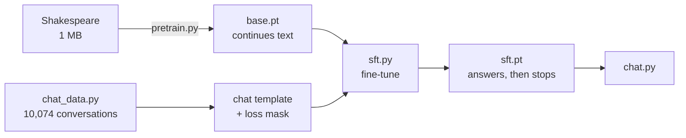

# 19 · Instruction tuning (SFT) from scratch

**What you'll build:** the step that turns a text-continuing **base model** into an **assistant**. You pretrain a small LLaMA-style model on Shakespeare (`base.pt`), invent a **chat template** with special tokens, write a small instruction dataset, and fine-tune the model with **loss masking** so it learns to *answer*. Before: "Uppercase: coral" gets Shakespeare babble. After: `CORAL`, for words it never saw in training.
**Like you're 5:** the base model is a parrot that read lots of books and keeps reciting. SFT is showing it hundreds of little conversation cards: "when someone asks this, you answer like that, then you stop talking". After enough cards, it plays the game with new words too.
**Time:** ~4 h (including ~15–25 min of training) · **Builds on:** [18 · Pretraining data pipeline](../18-pretraining-data-pipeline) and the model of [17](../../part-3-transformers-and-gpt/17-modern-llm-architecture-llama-style) · **Needs:** nothing extra (internet once for Shakespeare)

> Lighter preview: [ai-engineer-journey 6.3 · Fine-tune a small LLM with LoRA](../../../ai-engineer-journey/level-6-transformers/03-fine-tune-a-small-llm-with-lora) fine-tunes a downloaded model with a library. Here you write every part yourself.

## Why this matters
Every chat model is trained this way: OpenAI's InstructGPT, LLaMA-Chat, Claude and nanochat all start with SFT on conversations written in a fixed template. When you fine-tune a model at work (for a company's tone, a JSON format, a task), you do SFT, and the two classic bugs are exactly the ones this lesson makes you understand: a wrong chat template, and training on the wrong tokens.

## What you'll learn
- **Base model vs. assistant**: pretraining teaches language; SFT teaches the *format* and *behaviour* of a conversation.
- **Chat template and special tokens**: `<|user|>`, `<|assistant|>`, `<|end|>` mark who speaks and when a turn ends; they are single tokens that typed text can never produce.
- **Loss masking**: compute the loss only on the assistant's tokens (target = −100 elsewhere), so the model learns to answer, not to imitate users.
- **Generalisation vs. memorisation**: with ~150 real words the model memorised answers; with 2,000 made-up words added it learned the *rule*.
- **Stopping**: training on `<|end|>` is what makes the model stop talking.

## Watch alongside
- Andrej Karpathy, **Deep Dive into LLMs like ChatGPT** (https://www.youtube.com/watch?v=7xTGNNLPyMI): the section on **post-training data (conversations)**: how conversations are turned into tokens with special tokens, and where human-written example answers come from. Watch it after "Run it" step 2.
- **Let's build GPT** (https://www.youtube.com/watch?v=kCc8FmEb1nY): the closing part on how ChatGPT is trained (pretraining, then fine-tuning stages).
- Karpathy's nanochat (https://github.com/karpathy/nanochat) does this at scale in `scripts/chat_sft.py`.

## Before you start
1. Go to the lesson folder (from the course root `llm-from-scratch/`):
   ```bash
   cd part-4-from-base-model-to-assistant/19-instruction-tuning-sft-from-scratch
   ```
2. Install:
   ```bash
   pip install -r requirements.txt
   ```
   - `torch`: the model and training.

No API key. Files in this folder: `model.py` (lesson 17's LLaMA-style model, unchanged), `common.py` (tokenizer, chat template, masking), `chat_data.py` (the dataset), `pretrain.py`, `sft.py`, `chat.py`. Lessons 20 and 21 use the same `model.py`, `common.py` and `chat_data.py`.

## Run it
1. Look at the training data:
   ```bash
   python chat_data.py
   ```
   You should see "10074 training conversations" and 8 examples.
2. Make the base model (~5–15 min on a laptop CPU):
   ```bash
   python pretrain.py
   ```
   You should see the validation loss fall to about 1.55 and a Shakespeare-like sample. It writes `base.pt`.
3. Fine-tune it (~5–10 min):
   ```bash
   python sft.py
   ```
   It prints the base model's answers and test scores, trains, saves `sft.pt`, and prints the new answers and scores.
4. Chat with it:
   ```bash
   python chat.py
   ```
   Type `Uppercase: dinosaur`, `Spell pizza`, `Say hello to Maria.`, `Who are you?`. An empty line quits.

| Piece | Meaning |
|---|---|
| `python sft.py --steps 300` | fine-tune for 300 steps instead of 1,500 |
| `python sft.py --no-mask` | the experiment from "Try this": loss on every token, not only the assistant's |
| `python chat.py --model base.pt` | chat with the base model instead, to see the difference |

### What you should see
`python chat_data.py` (real output, first lines):
```
10074 training conversations | train words: 143 real + 2000 made-up | test words: 35 real | train names: 351 | test names: 12
  USER: How many letters are in yyilhe?          ASSISTANT: yyilhe has 6 letters.
  USER: How many letters are in ojnmtac?         ASSISTANT: ojnmtac has 7 letters.
  USER: What is the first letter of rok?         ASSISTANT: The first letter of rok is r.
```
`python pretrain.py` (real output on a busy shared 4-core CPU):
```
base model: 763,776 parameters | vocab 99 (96 characters + 3 special tokens) | cpu
step     0 | val loss 4.686 | 5s
step   500 | val loss 1.754 | 247s
step  1000 | val loss 1.623 | 439s
step  1500 | val loss 1.559 | 627s
step  2000 | val loss 1.541 | 810s
saved base.pt
--- sample ---
ROMEO:
To hear the sanctuary from all his shame,
Would be read to me and mercy in the cousin.

KING RICHARD II:
Say, O, I am so lold
To me to the mood prince
```
`python sft.py` (real output):
```
BEFORE SFT (the base model just continues text in Shakespeare style):
   USER: Uppercase: lantern     ASSISTANT: 'hhing the morning and the sea\nThe sea the state of the state'
   USER: Spell coral            ASSISTANT: "'d for the state of the morning and the state\nThat the stren"
   USER: Say hello to Priya.    ASSISTANT: ' are not the morning and me\nTo me the state of the state of '
   USER: Who are you?           ASSISTANT: ' is the morning and me\nTo me the state of the state of the s'

BEFORE SFT, held-out test:
   uppercase        0/ 35 correct
   spell            0/ 35 correct
   first letter     0/ 35 correct
   count letters    0/ 35 correct
   identity         0/  8 correct
   greetings to new names (5 samples each): {'other': 60}

training on 10074 conversations, 1500 steps, loss on assistant tokens only
one training row  x: [96, 54, 81, 81, 70, 83, 68, 66, 84, 70, 27, 1, 86, 88, 71, 72, 98, 97, 54, 56, 39, 40] ...
                  y: [-100, -100, -100, -100, -100, -100, -100, -100, -100, -100, -100, -100, -100, -100, -100, -100, -100, 54, 56, 39, 40, 98] ...  (-100 = no loss)
step  250 | loss 0.108 | 65s
step  500 | loss 0.021 | 122s
step  750 | loss 0.002 | 179s
step 1000 | loss 0.015 | 232s
step 1250 | loss 0.003 | 279s
step 1500 | loss 0.004 | 328s
saved sft.pt

AFTER SFT:
   USER: Uppercase: lantern     ASSISTANT: 'LANTERN'
   USER: Spell coral            ASSISTANT: 'c-o-r-a-l'
   USER: Say hello to Priya.    ASSISTANT: 'Priya. What do you want?'
   USER: Who are you?           ASSISTANT: 'I am Tiny language model.'

AFTER SFT, held-out test:
   uppercase       34/ 35 correct
   spell           34/ 35 correct
   first letter    34/ 35 correct
   count letters   35/ 35 correct
   identity         6/  8 correct
   greetings to new names (5 samples each): {'friendly': 39, 'other': 12, 'grumpy': 9}
```
What to look at:
- **Before SFT** the model ignores the question and continues with Shakespeare-like text ("the morning and the state..."): a base model has no idea it is in a conversation. 0 correct everywhere.
- **The training row**: `96` is `<|user|>`, `98` is `<|end|>`, `97` is `<|assistant|>`. In `y`, everything up to the assistant's reply is `-100`; only the reply (`54, 56, 39, 40` = "UWFG", a made-up word) and the final `98` are trained.
- **After SFT**: 34–35 of 35 on words it never saw (`coral` is a test word). It learned the *rules*, not a list of answers.
- **Identity 6/8** with a near-miss ("I am Tiny language model." instead of "I am TinyChat, a very small language model."): fixed sentences must be memorised exactly, and a tiny model blends similar ones.
- **Greetings are mixed**: friendly 39, grumpy 9, other 12 (out of 60). The model copied both styles from the data (and sometimes blends them: "other"). Lesson 20 fixes this.

## How it works


### 1. The tokenizer with special tokens (`common.py`, `ChatTokenizer`)
One token per character: newline plus the 95 printable ASCII characters (ids 0–95). Then three **special tokens**: `<|user|>` = 96, `<|assistant|>` = 97, `<|end|>` = 98. `encode()` only produces ids 0–95, so even if someone types the text "<|end|>", it becomes 7 ordinary characters, never the real control token. The base model already has these 3 rows in its embedding table (`vocab_size` 99) but never saw them during pretraining.

### 2. The chat template (`render`)
One exchange becomes:
```
<|user|>Uppercase: coral<|end|><|assistant|>CORAL<|end|>
```
At chat time we feed everything up to and including `<|assistant|>`, and the model writes the reply. Real models use the same idea with different strings (ChatML uses `<|im_start|>user ... <|im_end|>`; LLaMA 3 uses `<|start_header_id|>user<|end_header_id|> ... <|eot_id|>`). Using a template different from the one in training is the most common fine-tuning bug.

### 3. Loss masking (`make_batch`)
Inputs `x` are the ids, targets `y` are the ids shifted by one (as always). Then every target that is *not* part of the assistant's reply is replaced by **−100**, and PyTorch's `F.cross_entropy` skips targets equal to −100 (`ignore_index`):
```
x:  <|user|>  U    p   ...  l  <|end|> <|assistant|>  C    O    R    A    L
y:   U        p    p   ...  <|end|> <|assistant|>  C   O    R    A    L   <|end|>
y masked: -100 -100 -100 ... -100   -100          C   O    R    A    L   <|end|>
```
So the loss is the average of −log p(correct token) over the reply tokens and the final `<|end|>` only. Why? The user's text is given, not something the model should produce; training on it wastes capacity and teaches the model to imitate users (it may start writing the user's next question itself). Training on `<|end|>` teaches it to stop. Padding (shorter conversations in a batch are filled up) is also −100.

### 4. The data (`chat_data.py`)
Six skills: uppercase a word, spell it with dashes, name its first letter, count its letters, answer identity questions ("Who are you?"), and greet a person. Real words and names are split into **train** and **test** lists; the test uses only words the model never saw. The first version of this lesson trained on the ~150 real words only, and the model scored **0/35** on new words: it answered `Uppercase: melon` with `LEMON`, the closest word it had memorised. Adding **2,000 made-up words** of random letters forced it to learn the rule. That is a real lesson about instruction data: **diversity beats quantity of the same thing**.
The greetings have a twist: half are friendly (`Hello, Sam! It is lovely to meet you.`), half grumpy (`Sam. What do you want?`), as if two different people wrote the answers. SFT copies both styles. Lesson 20 fixes that.

### 5. Training (`sft.py`)
Load `base.pt`, train with AdamW for 1,500 steps on random batches of 32 conversations, learning rate 1e-3. Unlike pretraining, each batch is a set of whole conversations, not random windows of a long text. `evaluate()` runs every held-out prompt with greedy decoding and checks for an **exact match**; greetings are sampled 5 times per new name (temperature 1) and classified friendly / grumpy / other.

### 6. Copying vs. counting
Uppercase, spelling and first letter only need the model to *copy* characters it can attend to (lesson 13's copying head). Counting needs it to keep a tally, which transformers find harder in general. Here it still reaches 35/35 because every test word has 3–8 letters and the made-up training words cover exactly those lengths. Ask `How many letters are in hippopotamus?` (12 letters, longer than anything in training) in `chat.py` and it usually fails: models generalise well *inside* the range of their training data and poorly outside it. Big LLMs miscount letters in "strawberry" for this reason and because tokens hide the letters (lesson 12).

## If something goes wrong
- **`base.pt not found`** → run `python pretrain.py` first (step 2), in this folder.
- **The SFT model still answers with Shakespeare** → training was too short or the template is broken. Check that `sft.py` printed `loss` values going below 0.1, and that you did not change `render()` between training and chatting.
- **Answers never stop (no `<|end|>`)** → the `<|end|>` after the reply must be a training target. If you edited `render()`, make sure `reply = tok.encode(assistant) + [tok.end]` and that those positions are `True` in the mask.
- **`identity` scores low** → those 8 questions are a small part of the data; they are repeated 100 times in `sft_dataset()` (with only 30 repeats a test run scored 1/8). Raise the repetition or train longer.
- **Different numbers from the ones above** → normal: random seeds, CPU type and PyTorch version change details. The big jump from "before" to "after" should be the same.

## Try this
1. **Turn off masking.** Run `python sft.py --no-mask` and compare the held-out scores and a few chats with the masked version.
   <details><summary>Hint</summary>

   The model now also learns to predict the user's text. With this small, clean data the skill scores often stay similar, but the model wastes effort and can start continuing *as the user* (writing `Uppercase: ...` lines itself). With real, messy user prompts, masking matters much more: you don't want a model to learn to write like the people who ask the questions.
   </details>
2. **Without made-up words.** In `chat_data.py`, change `TRAIN_WORDS = REAL_TRAIN_WORDS + made_up_words(2000, seed=1)` to `TRAIN_WORDS = REAL_TRAIN_WORDS` and run `python sft.py` again. What happens to the uppercase score?
   <details><summary>Hint</summary>

   It collapses (close to 0 of 35) and the model "answers" with training words that look similar. It memorised a lookup table instead of learning the rule. This is the difference between **memorisation** and **generalisation**, and why instruction datasets need variety.
   </details>
3. **Teach a new skill.** Add "Reverse: word" → the word backwards to `task_examples()` and to the test skills. How well does it learn?
   <details><summary>Solution</summary>

   In `task_examples` add `(f"Reverse: {word}", word[::-1]),`. In `test_dataset`, add `"reverse": []` to the dictionary and the name `"reverse"` to the list in the `zip(...)` line. Reversing is much harder than copying in order (the model must find the last letter first, then the one before...), so expect a low score unless you train longer. Big LLMs also struggle to reverse words, partly because of tokens.
   </details>

## Check yourself
1. What is the difference between `base.pt` and `sft.pt` in what they were trained on and how they behave?
2. In the targets `y`, which positions get −100, and why is the final `<|end|>` *not* masked?
3. Why must the chat template at chat time be exactly the one used in SFT?
4. The first version of the dataset gave 0/35 on new words although the training loss was almost 0. What does that tell you about training loss?

<details><summary>Answers</summary>

1. `base.pt` only saw Shakespeare and continues any text in that style. `sft.pt` is the same model, further trained on conversations in the chat template; it answers the request and stops.
2. Every target that belongs to the user's message, the `<|user|>`/`<|assistant|>` markers, and padding. The `<|end|>` after the reply is the model's signal to stop talking; if it is not trained, the model never learns when to stop.
3. The model only learned to answer after the exact token sequence it saw in training (`<|end|><|assistant|>`). A different format looks like random text to it, so it falls back to base-model behaviour.
4. A low training loss can mean memorising. Only a test on held-out data shows whether the model learned something that generalises (lesson 21 is about this).
</details>

## Learn more (optional)
- InstructGPT paper, "Training language models to follow instructions with human feedback" (SFT + RLHF): https://arxiv.org/abs/2203.02155
- LIMA, "Less Is More for Alignment" (1,000 careful examples can be enough): https://arxiv.org/abs/2305.11206
- nanochat's SFT script: https://github.com/karpathy/nanochat
- Sebastian Raschka's book code, chapter 7 (instruction fine-tuning): https://github.com/rasbt/LLMs-from-scratch

**Read the official docs**
- Hugging Face chat templates: https://huggingface.co/docs/transformers/main/en/chat_templating
- Hugging Face TRL `SFTTrainer`: https://huggingface.co/docs/trl/sft_trainer
- `torch.nn.functional.cross_entropy` (`ignore_index`): https://pytorch.org/docs/stable/generated/torch.nn.functional.cross_entropy.html

## Next
→ [20 · Preference tuning (DPO) from scratch](../20-preference-tuning-dpo-from-scratch)
