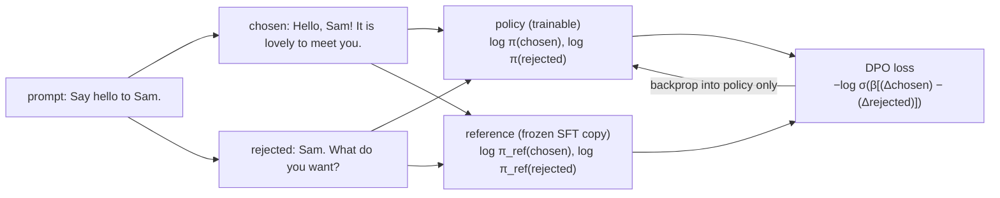
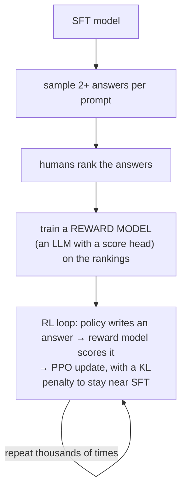

# 20 · Preference tuning (DPO) from scratch

**What you'll build:** the third training stage of a chat model. Your SFT model from lesson 19 greets people in two styles, friendly and grumpy, because its training data had both. You show it **preference pairs** (same question, a *chosen* and a *rejected* answer) and train it with **Direct Preference Optimization (DPO)**, a loss you derive and implement in a few lines, with a frozen **reference model** that keeps it from drifting. Then you measure: the friendly share goes up, and the other skills survive. You also learn how classic **RLHF with PPO** works, the method behind the original ChatGPT.
**Like you're 5:** the robot already knows how to answer. Now you sit next to it, it shows you two answers, and you point: "I like *this* one better". After many pointings it starts choosing the kind of answer you like, without forgetting everything else it knows (its old self, the reference, is its anchor).
**Time:** ~3 h · **Builds on:** [19 · Instruction tuning (SFT) from scratch](../19-instruction-tuning-sft-from-scratch) (needs its `sft.pt`) · **Needs:** nothing extra

## Why this matters
SFT can only teach "answer like these examples". But often it is much easier to say which of two answers is *better* than to write the perfect one (more helpful, more honest, safer, nicer tone). Preference tuning is how labs turn that kind of feedback into training: RLHF made ChatGPT, and DPO (2023) became the standard simpler alternative used for many open models (Zephyr, Tulu, LLaMA 3 post-training combined it with other methods). As an engineer you will meet preference data in fine-tuning libraries (TRL's `DPOTrainer`) and in evaluation (A/B judgements).

## What you'll learn
- **Preference pair**: (prompt, chosen answer, rejected answer).
- **Log-probability of an answer**: log p(answer | prompt) = the sum of the log-probabilities of its tokens.
- **Reference model**: a frozen copy of the SFT model; the DPO "reward" is how much *more* likely the trained model makes an answer than the reference does.
- **The DPO loss**: −log σ(β × (reward margin)), a logistic loss that pushes chosen up and rejected down relative to the reference.
- **RLHF / PPO**: reward model + reinforcement learning with a KL penalty; what DPO replaces and why.

## Watch alongside
- Andrej Karpathy, **Deep Dive into LLMs like ChatGPT** (https://www.youtube.com/watch?v=7xTGNNLPyMI): the last part, **reinforcement learning** and **reinforcement learning from human feedback (RLHF)**, including the reward model, why RLHF works and its limits ("RLHF is not real RL", reward hacking). Watch it after reading "How it works".
- **Intro to Large Language Models** (https://www.youtube.com/watch?v=zjkBMFhNj_g): the short section on the training stages (pretraining, fine-tuning, comparisons).
- Search: [DPO explained](https://www.youtube.com/results?search_query=direct+preference+optimization+explained) (Umar Jamil has a long, careful one).

## Before you start
1. Finish lesson 19 so that `../19-instruction-tuning-sft-from-scratch/sft.pt` exists.
2. Go to the lesson folder (from the course root `llm-from-scratch/`):
   ```bash
   cd part-4-from-base-model-to-assistant/20-preference-tuning-dpo-from-scratch
   ```
3. Install:
   ```bash
   pip install -r requirements.txt
   ```
   - `torch`: the model and training.

No API key. `model.py`, `common.py` and `chat_data.py` are the same files as in lesson 19.

## Run it
1. Train with DPO (~3–8 min on a laptop CPU):
   ```bash
   python dpo.py
   ```
   It measures the SFT model, trains 100 steps, saves `dpo.pt` and measures again.
2. Try a stronger or weaker anchor:
   ```bash
   python dpo.py --beta 0.5
   ```

| Piece | Meaning |
|---|---|
| `--sft path` | which SFT model to start from (default: lesson 19's `sft.pt`) |
| `--beta 0.1` | β, how much the model may move away from the reference (small β = it can move more) |
| `--steps 100` | training steps (16 pairs each) |
| `--lr 1e-4` | learning rate; preference tuning uses small steps |

### What you should see
OUTPUT_PLACEHOLDER_DPO

## How it works


### 1. The probability of a whole answer (`sequence_logprob`)
A model gives a probability to each next token. The probability of a whole answer is the product of its tokens' probabilities, and its **log** is the **sum** of the log-probabilities (logs turn products into sums, and avoid tiny numbers). `make_batch` from lesson 19 already marks the answer tokens (everything else is −100), so: `log_softmax` over the vocabulary, `gather` the log-probability of each real next token, multiply by the mask, sum per row.

### 2. The reward, as DPO sees it
For an answer y to prompt x:

**r(x, y) = β × ( log π(y | x) − log π<sub>ref</sub>(y | x) )**

π ("pi") is the model being trained (the **policy**), π<sub>ref</sub> the frozen SFT model, β (beta) a small number such as 0.1. In words: "how much more likely than before does the model now make this answer?" It is 0 at the start (the two models are identical).

### 3. The loss, derived simply
We want the chosen answer's reward to beat the rejected one's. The classic way to turn "A should beat B" into a probability is the **Bradley-Terry model** (also used for chess ratings): P(A beats B) = σ(r<sub>A</sub> − r<sub>B</sub>), where **σ** (sigmoid) = 1 / (1 + e<sup>−z</sup>) squashes any number into 0…1 (σ(0) = 0.5, large positive → close to 1). Maximising the probability of the human's choice is minimising its negative log:

**L = −log σ( r(x, y<sub>chosen</sub>) − r(x, y<sub>rejected</sub>) )**

That is the whole DPO loss: `-F.logsigmoid(reward_c - reward_r).mean()`. At the start both rewards are 0, so L = −log σ(0) = −log 0.5 = 0.693, which is exactly what the first line of the output shows. The gradient pushes log π(chosen) up and log π(rejected) down, and stops pushing once the margin is large (σ is then close to 1).

Why is this "RLHF without the RL"? The DPO paper (Rafailov et al., 2023) shows that the best possible policy for the RLHF objective (maximise reward, with a penalty β × KL for drifting from the reference) has a closed form, and that the reward can then be written in terms of the policy itself, as in step 2. Plugging that into the Bradley-Terry loss gives DPO: the language model *is* its own reward model, and ordinary gradient descent on pairs is enough.

### 4. Why a reference model and β?
Without the reference, the easiest way to win would be to push the rejected answer's probability to zero in any way possible, including breaking everything else (the model could start producing garbage that is neither answer). Measuring rewards *relative to the reference* and scaling by β keeps changes small and targeted. The output line "other skills still correct" checks exactly that.

### 5. The reading the output gives you
- **reward chosen / rejected**: average r for each. Typically chosen goes up a bit and rejected goes *down a lot* (DPO often works more by suppressing the rejected answer).
- **margin**: chosen minus rejected; **pairs ranked right**: how often the chosen reward is higher.
- **greetings to new names**: sampled replies for 12 names that are in neither the SFT data nor the preference pairs: the preference generalises.

### 6. RLHF with PPO (the original ChatGPT recipe), conceptually

1. **Reward model**: a copy of the LLM with its output layer replaced by a single number; trained with the same Bradley-Terry loss on human rankings, so it learns to score answers.
2. **PPO (Proximal Policy Optimization)**: the policy generates answers, the reward model scores them, and the policy is updated to make high-scoring answers more likely. "Proximal" = each update is clipped to stay small. A **KL penalty** (KL divergence measures how different two probability distributions are) against the SFT model stops it from finding weird text that fools the reward model (**reward hacking**).
3. **DPO vs. PPO**: DPO needs no reward model, no sampling during training and no RL machinery, just pairs and two forward passes, so it is simpler, cheaper and stabler. PPO-style online RL can still win when the model benefits from exploring its own answers; newer methods such as GRPO (used for reasoning models like DeepSeek-R1) also sample answers and score them, often with automatic checkers instead of human preferences.

## If something goes wrong
- **`sft.pt not found`** → run lesson 19 (`python pretrain.py`, then `python sft.py`) first, or pass `--sft` with the right path.
- **The friendly share does not rise** → train longer (`--steps 200`), use a smaller `--beta` (0.05) or a bigger `--lr` (3e-4). Check that "pairs ranked right" goes toward 100%.
- **"other skills still correct" drops a lot** → the model is drifting: use a bigger `--beta`, fewer steps or a smaller learning rate. This is the classic **alignment tax** trade-off.
- **Loss stuck at 0.693** → the policy is not changing: check that the optimizer gets `policy.parameters()` (not the reference's) and that the learning rate is not 0.

## Try this
1. **β sweep.** Run `--beta 0.02`, `0.1` and `1.0`. Compare the friendly share and "other skills still correct".
   <details><summary>Hint</summary>

   Small β lets rewards grow with small changes in log-probabilities, so the loss falls faster and the model moves further from the reference (stronger effect, more risk of side effects). Large β needs bigger changes before the loss is satisfied, so with the same steps the effect is weaker. There is no universally right β; 0.1 is a common default.
   </details>
2. **Prefer the grumpy one.** Swap chosen and rejected in the `prefs` line. Does the model become grumpy as easily?
   <details><summary>Solution</summary>

   Change it to `prefs = [(f"Say hello to {n}.", rude_greeting(n), polite_greeting(n)) for n in TRAIN_NAMES]`. Yes: DPO is not "good values", it just follows whatever the preference data says. Who writes the preferences, and how, decides the model's behaviour. That is why preference data quality and annotator guidelines matter so much.
   </details>
3. **No reference.** Replace `ref_c, ref_r` by zeros (`torch.zeros_like(pi_c)`) and train. What happens to the other skills?
   <details><summary>Hint</summary>

   The loss now only compares raw log-probabilities. The model can lower the rejected answer's probability without limit, and with enough steps the other skills and fluency degrade more. The reference is the anchor that makes DPO safe.
   </details>

## Check yourself
1. What three things make up one preference example?
2. At step 1 the loss is 0.693. Why exactly that number?
3. What would happen without the reference model?
4. Name two things RLHF with PPO needs that DPO does not.

<details><summary>Answers</summary>

1. A prompt, a chosen (preferred) answer and a rejected answer.
2. The policy starts as an exact copy of the reference, so both rewards are 0 and the loss is −log σ(0) = −log(0.5) = ln 2 ≈ 0.693.
3. The model could change anything to make rejected answers unlikely, drifting far from its SFT behaviour and losing other skills or fluency; nothing would measure "how much did I change".
4. A separately trained reward model, and online sampling of new answers during training with an RL algorithm (plus its value model and many hyperparameters). DPO uses fixed pairs and plain gradient descent.
</details>

## Learn more (optional)
- DPO paper, "Direct Preference Optimization: Your Language Model is Secretly a Reward Model": https://arxiv.org/abs/2305.18290
- InstructGPT (SFT + reward model + PPO): https://arxiv.org/abs/2203.02155
- PPO paper: https://arxiv.org/abs/1707.06347
- Hugging Face blog, "Illustrating RLHF": https://huggingface.co/blog/rlhf
- Nathan Lambert's free RLHF book: https://rlhfbook.com

**Read the official docs**
- Hugging Face TRL `DPOTrainer`: https://huggingface.co/docs/trl/dpo_trainer
- Hugging Face TRL `PPOTrainer`: https://huggingface.co/docs/trl/ppo_trainer
- `torch.nn.functional.logsigmoid`: https://pytorch.org/docs/stable/generated/torch.nn.functional.logsigmoid.html

## Next
→ [21 · Evaluating your LLM](../21-evaluating-your-llm)
