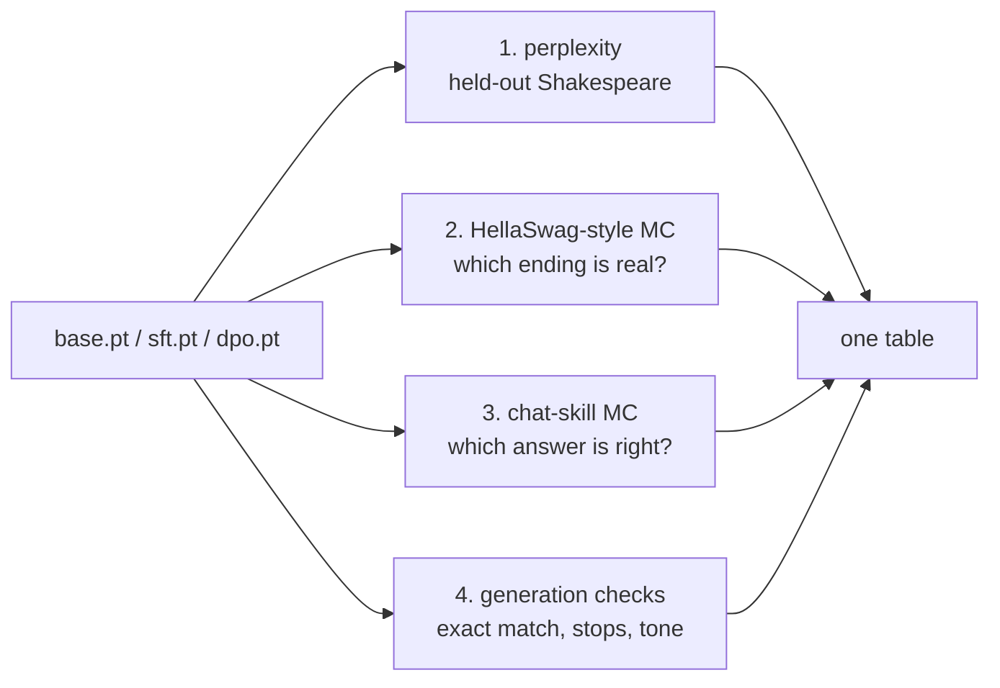

# 21 · Evaluating your LLM

**What you'll build:** one script, `evaluate.py`, that grades the three models from lessons 19 and 20 (base, SFT, DPO) side by side with the main kinds of LLM evaluation: **perplexity** on held-out text, **multiple choice by log-likelihood** (the way HellaSwag, MMLU and ARC are scored for base models), and **generation-based checks** (exact match, does it stop, what style does it use). You will see that each metric tells a different part of the truth.
**Like you're 5:** a school report has several subjects. Reading (how well it predicts real text), a multiple-choice quiz (which answer does it find most likely?) and an oral exam (ask it and listen to the answer). A student can be great in one and poor in another, and so can a model.
**Time:** ~3 h · **Builds on:** [20 · Preference tuning (DPO) from scratch](../20-preference-tuning-dpo-from-scratch) (uses `base.pt` and `sft.pt` from lesson 19 and `dpo.pt` from lesson 20) · **Needs:** nothing extra

## Why this matters
"Is the new model better?" is the question behind every training run, fine-tune, prompt change and model choice. Leaderboards (HellaSwag, MMLU, GSM8K, Chatbot Arena), model cards and your own product decisions all rest on evaluations, and each has blind spots: a model can get *worse* at perplexity while getting much *better* at following instructions. Knowing how these numbers are computed lets you trust the right ones and build your own evals for your own task, which is one of the most valuable skills of an AI engineer.

## What you'll learn
- **Perplexity**: e<sup>loss</sup>, "how many choices the model is effectively hesitating between" per token; lower is better, only comparable with the same tokenizer and data.
- **Multiple choice by log-likelihood**: score each candidate answer by how probable the model finds it, pick the most probable; no text generation needed. **acc** uses the total log-probability, **acc_norm** the per-token average.
- **HellaSwag**: a famous benchmark of this kind (pick the right ending of a short story); here you build a HellaSwag-style test from held-out Shakespeare.
- **Generation-based evals**: let the model answer, then check the answer (exact match, contains a keyword, format, stops correctly, tone).
- **Held-out data and contamination**: test only on data the model never trained on.

## Watch alongside
- Andrej Karpathy, **Let's reproduce GPT-2 (124M)** (https://www.youtube.com/watch?v=l8pRSuU81PU): the part where he adds the **HellaSwag eval** to the training loop (`hellaswag.py`, rendering each example as 4 context+ending rows and picking the lowest average loss). Our `choice_scores()` is the same idea.
- **Deep Dive into LLMs like ChatGPT** (https://www.youtube.com/watch?v=7xTGNNLPyMI): near the end, where he discusses leaderboards (LM Arena) and how to keep up with which models are actually good.

## Before you start
1. Finish lessons 19 and 20 (they create `base.pt`, `sft.pt` and `dpo.pt`). If `dpo.pt` is missing, the script evaluates the other two.
2. Go to the lesson folder (from the course root `llm-from-scratch/`):
   ```bash
   cd part-4-from-base-model-to-assistant/21-evaluating-your-llm
   ```
3. Install:
   ```bash
   pip install -r requirements.txt
   ```
   - `torch`: runs the models.

No API key. The first run downloads Shakespeare (1 MB) for the held-out text.

## Run it
1. Evaluate all models (~2–5 min on a laptop CPU):
   ```bash
   python evaluate.py
   ```
   You should see a table with one column per model and 11 rows of metrics.
2. More multiple-choice items, for steadier numbers:
   ```bash
   python evaluate.py --items 600
   ```

| Piece | Meaning |
|---|---|
| `--items 600` | how many Shakespeare multiple-choice questions to build (default 200) |
| `--base / --sft / --dpo path` | evaluate other checkpoint files |

### What you should see
OUTPUT_PLACEHOLDER_EVAL

## How it works


### 1. Perplexity (`perplexity`)
Cut the held-out 10% of Shakespeare (which `pretrain.py` never trained on) into windows of 96 characters, compute the average cross-entropy loss L (in **nats**, natural-log units) of predicting every next character, and report:
- **perplexity** = e<sup>L</sup>. If perplexity is 4.7, the model is on average as unsure as if it were choosing uniformly among 4.7 characters (out of 99).
- **bits per character** = L / ln 2: the same number in bits (log base 2), a unit that lets you compare models with different tokenizers on the same text (nanochat reports "bits per byte" for this reason).

### 2. HellaSwag-style multiple choice (`shakespeare_items` + `choice_scores`)
Each item: 64 characters of held-out Shakespeare as the **context**, the real next 32 characters as the correct **ending**, and 3 **distractors** (32 characters from elsewhere). For each of the 4 endings we feed context + ending and add up the log-probabilities of the ending's tokens: log p(ending | context) = Σ log p(token<sub>i</sub> | everything before it). The highest wins.
- **acc**: compare the **sums**. Longer endings collect more negative numbers, so sums favour short endings.
- **acc_norm**: compare the **averages per token**, which removes the length bias. The real HellaSwag reports both (build-nanogpt uses the average-loss version).
Random guessing scores 25%.

### 3. Chat-skill multiple choice
The same scoring, but the context is a chat prompt (`<|user|>Uppercase: coral<|end|><|assistant|>`) and the 4 candidates are the right answer and 3 wrong ones (lower-case, reversed, another word), each followed by `<|end|>`. This is how MMLU-style tests check *knowledge* without depending on the model's writing style.

### 4. Generation-based checks
- **exact match**: greedy answers to the 151 held-out prompts from lesson 19, compared character by character.
- **stops with `<|end|>`**: does the reply end within 40 tokens? A model that rambles on is broken as a chatbot even if its first words are right.
- **friendly greetings**: the share of sampled greetings (temperature 1, 10 per new name) in the friendly style: the thing DPO was meant to change.

### Other kinds of evaluation you will meet
| Kind | Example | Good for | Watch out for |
|---|---|---|---|
| Likelihood multiple choice | HellaSwag, MMLU, ARC | base models, cheap, no generation | doesn't test writing or following instructions |
| Exact match / unit tests | GSM8K (final number), HumanEval (code runs tests) | tasks with one right answer | formatting differences count as wrong |
| LLM-as-judge | MT-Bench, AlpacaEval | open-ended answers | judge bias (length, its own style) |
| Human preference | LM Arena (Chatbot Arena) | overall usefulness | slow, costly, popularity effects |
| Your own task evals | 50–500 real examples from your product | what you actually care about | needs maintenance, keep it held out |

**Contamination**: if test questions leaked into training data, scores are meaningless. That is why lesson 18 deduplicated *before* splitting, and why lesson 19 tests on words the model never saw.

## If something goes wrong
- **`No models found`** → run lesson 19's `pretrain.py` and `sft.py` (and lesson 20's `dpo.py`) first, or pass `--base/--sft/--dpo` with the right paths.
- **Numbers differ slightly from the example** → sampling and random seeds; the *pattern* (base best at perplexity, SFT/DPO far better at skills) should hold. Use `--items 600` for steadier multiple-choice numbers.
- **`RuntimeError: size mismatch` while loading** → the checkpoint was made with a different `model.py` or vocabulary. These three lessons must share the same `model.py`, `common.py` and `chat_data.py`.
- **Slow** → the generation checks dominate (hundreds of answers, one token at a time). Lower `--items` or skip models you don't need.

## Try this
1. **Length bias.** Make the distractors 48 characters long and the real ending 32 (change `val_text[j:j + 32]` to `val_text[j:j + 48]`). What happens to acc vs. acc_norm?
   <details><summary>Hint</summary>

   acc (total log-probability) now favours the shorter, real ending even more, for the wrong reason: fewer tokens means fewer negative numbers added. acc_norm (average per token) is not fooled by length. This is why benchmarks report normalised accuracy.
   </details>
2. **Your own eval set.** Write 10 questions with keyword answers for the skills you care about and add a check that prints the share answered correctly.
   <details><summary>Solution</summary>

   ```python
   my_tests = [("Uppercase: zebra", "ZEBRA"), ("Spell kiwi", "k-i-w-i"), ("Who are you?", "TinyChat")]
   for name, m in models.items():
       ok = sum(key in answer(m, q) for q, key in my_tests)
       print(name, f"{ok}/{len(my_tests)}")
   ```
   Put it before the report section. A small, honest, task-specific eval like this is often more useful than any public benchmark.
   </details>
3. **Calibration.** For the chat-skill items, convert the 4 scores to probabilities with softmax and check: when the SFT model is 90% sure, is it right about 90% of the time?
   <details><summary>Hint</summary>

   Collect (max probability, was it right) for every item and group by probability buckets (0.25–0.5, 0.5–0.75, 0.75–1.0). A **calibrated** model's accuracy in each bucket matches its confidence. Preference tuning often makes models over-confident, which you may see in the DPO column.
   </details>

## Check yourself
1. Model A has perplexity 4.6 and model B 5.4 on the same held-out text with the same tokenizer. Which predicts the text better, and can you compare it with a model that uses a different tokenizer?
2. Why does HellaSwag-style scoring not need the model to generate any text?
3. The base model has the best perplexity but scores 0 on exact match. How can both be true?
4. Why must eval questions never appear in the training data, and how did lessons 18 and 19 protect against that?

<details><summary>Answers</summary>

1. A (lower is better). Not directly: perplexity per token depends on what a token is. Compare in bits per character or per byte instead.
2. It only asks the model how probable each given ending is (one forward pass per ending) and picks the most probable; the candidates are already written.
3. Perplexity measures how well it predicts Shakespeare-like text, which is what it was trained for. Exact match measures following the chat format and doing the task, which it never learned. SFT trades a little of the first for a lot of the second.
4. Otherwise the model can memorise answers and the score says nothing about new inputs. Lesson 18 deduplicated before splitting (so no copy of a validation paragraph is in training), and lesson 19 tests on words and names that are not in the training lists.
</details>

## Learn more (optional)
- HellaSwag paper: https://arxiv.org/abs/1905.07830
- build-nanogpt's `hellaswag.py` (the reference implementation used in the video): https://github.com/karpathy/build-nanogpt
- MMLU paper: https://arxiv.org/abs/2009.03300
- Judging LLM-as-a-judge (MT-Bench, Chatbot Arena): https://arxiv.org/abs/2306.05685
- LM Arena leaderboard: https://lmarena.ai

**Read the official docs**
- EleutherAI lm-evaluation-harness (runs hundreds of benchmarks, including HellaSwag): https://github.com/EleutherAI/lm-evaluation-harness
- Hugging Face Evaluate library: https://huggingface.co/docs/evaluate
- Anthropic's guide to building evals: https://docs.anthropic.com/en/docs/test-and-evaluate/develop-tests

## Next
→ [22 · Capstone: train your own tiny ChatGPT](../22-capstone-train-your-own-tiny-chatgpt)
