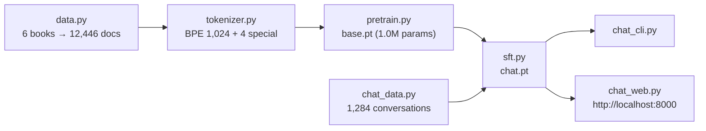
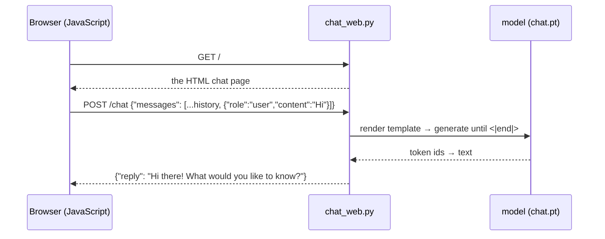

# 22 · Capstone: train your own tiny ChatGPT

**What you'll build:** a complete, end-to-end chatbot that is 100% yours, in the spirit of Karpathy's nanochat: **your data pipeline** (lesson 18) → **your BPE tokenizer** with chat special tokens (lesson 12) → **pretraining** a LLaMA-style model (lessons 14–17) → **SFT** on conversations with loss masking (lesson 19) → **a chat app** in the terminal and in the browser. It runs on a laptop CPU in well under an hour, and the same scripts scale up on a rented GPU. You also get the exact recipe for nanochat's ~$50 GPT-2-grade speedrun.
**Like you're 5:** you have built every Lego piece separately in this course. Now you build the whole castle: you collect books, invent your own alphabet of word pieces, let the robot read the books, teach it manners and a few facts, and finally give it a phone (a web page) so anyone can talk to it.
**Time:** ~5 h (including ~25–45 min of CPU training) · **Builds on:** [21 · Evaluating your LLM](../21-evaluating-your-llm) and everything before it · **Needs:** internet once (~3 MB of public-domain books from GitHub). Optional: a cloud GPU.

## Why this matters
Doing every stage yourself, end to end, is what turns "I know the pieces" into "I know how an LLM product is made". You will hit the real problems: tokenizer and model must match, special tokens must be registered everywhere, the chat template at serving time must equal the one in training, a tiny model memorises facts but can still generalise patterns. It is also a portfolio project you can show and explain line by line.

## What you'll learn
- **The full LLM pipeline**: data → tokenizer → base model → chat model → serving, each stage producing a file the next stage reads.
- **Tokenizer and model are a pair**: the vocabulary size, the special token ids and the chat template must agree in every script.
- **Multi-turn chat**: a conversation is the whole history rendered with the template, cropped to the context window.
- **Serving**: a minimal HTTP API (`POST /chat`) and a web page, with Python's standard library only.
- **Scaling up**: what changes (and what doesn't) when you go from 1M parameters on a CPU to GPT-2 size on 8 GPUs.

## Watch alongside
- Andrej Karpathy, **Deep Dive into LLMs like ChatGPT** (https://www.youtube.com/watch?v=7xTGNNLPyMI): the whole video is the story of this capstone (pretraining data, tokenization, the base model, post-training on conversations, hallucinations, tool use, RL). Re-watch it now; you will recognise every step.
- **Intro to Large Language Models** (https://www.youtube.com/watch?v=zjkBMFhNj_g): the big picture, and where LLMs are going.
- nanochat (https://github.com/karpathy/nanochat): read its README and `runs/speedrun.sh` side by side with `run_all.sh` here. Same stages, ~1,000× more compute.

## Before you start
1. Go to the lesson folder (from the course root `llm-from-scratch/`):
   ```bash
   cd part-4-from-base-model-to-assistant/22-capstone-train-your-own-tiny-chatgpt
   ```
2. Install:
   ```bash
   pip install -r requirements.txt
   ```
   - `torch`: the model. `numpy`: token files. `regex`: the GPT-4 split pattern of your tokenizer.

No API key. Files: `bpe.py` (lesson 12's tokenizer, unchanged), `model.py` (lesson 17's model, unchanged), `common.py` (paths, chat template, generation), `data.py`, `tokenizer.py`, `pretrain.py`, `chat_data.py`, `sft.py`, `chat_cli.py`, `chat_web.py`, `run_all.sh`.

## Run it
Either everything at once (Mac/Linux, or Git Bash/WSL on Windows):
```bash
bash run_all.sh
```
or stage by stage (works everywhere; each command needs the previous one's output):
1. **Data** (~10 s): `python data.py` → `data/documents.jsonl`. You should see 6 sources and "12,446 documents".
2. **Tokenizer** (~1 min): `python tokenizer.py` → `data/tok.model`, `data/train.npy`, `data/val.npy`. You should see "trained 768 merges".
3. **Pretraining** (~10–20 min): `python pretrain.py` → `base.pt`. The validation loss falls from ~7 to ~3.1.
4. **SFT** (~3–8 min): `python sft.py` → `chat.pt`. It tests the base model, fine-tunes, and tests the chat model.
5. **Chat in the terminal**: `python chat_cli.py` (type messages; `/reset` clears the history; an empty line quits). One-shot: `python chat_cli.py -p "Who are you?"`
6. **Chat in the browser**: `python chat_web.py`, then open http://localhost:8000. Stop the server with `Ctrl+C`.

**Command, piece by piece**

| Piece | Meaning |
|---|---|
| `bash run_all.sh` | run the shell script `run_all.sh` with the `bash` program |
| `set -euo pipefail` (inside the script) | `-e` stop at the first failing command, `-u` treat unset variables as errors, `-o pipefail` a pipeline fails if any part fails |
| `python chat_cli.py -p "Who are you?"` | `-p` (short for `--prompt`): ask once and exit |
| `python chat_web.py --port 8080` | serve on port 8080 instead of 8000 (a **port** is a numbered door on your computer that a program listens on) |
| `http://localhost:8000` | `localhost` = this computer; `:8000` = the port |
| `curl -X POST http://localhost:8000/chat -d '{...}'` | (to test the API) `curl` sends an HTTP request; `-X POST` = the POST method; `-d` = the request body |

### What you should see
OUTPUT_PLACEHOLDER_CAPSTONE

## How it works


### Stage 1: `data.py`
Lesson 18 condensed: download 6 public-domain texts (Shakespeare and 5 novels), cut Project Gutenberg headers and licences, split into paragraphs, drop short or symbol-heavy ones, remove exact duplicates with SHA-256 fingerprints, and assign 2% to validation by fingerprint. Output: one JSON document per line.

### Stage 2: `tokenizer.py`
Train lesson 12's `RegexTokenizer` (GPT-4 split pattern) with 768 merges → 1,024 tokens, then register 4 special tokens: `<|endoftext|>` (1024) between documents, `<|user|>` (1025), `<|assistant|>` (1026), `<|end|>` (1027). Every document becomes `[<|endoftext|>] + tokens`, saved as `uint16` NumPy arrays. About 2.55 characters per token: each training step sees 2.5× more text than a character model with the same context.

### Stage 3: `pretrain.py`
Lesson 17's LLaMA-style model (RMSNorm, RoPE, SwiGLU, GQA). One dial sets its size, nanochat-style: `--depth` (layers) and `--width` (n_embd; heads = width/32, kv heads = half). Default: 4 layers × 128 wide = 1.0M parameters, context 128 tokens (~330 characters). Training uses lesson 15's tricks at small scale: AdamW with β₂ = 0.95 and weight decay, warm-up + cosine learning rate, gradient clipping. 2,000 steps × 4,096 tokens = 8.2M tokens, about 6.6 passes over the 1.23M training tokens.

### Stage 4: `chat_data.py` + `sft.py`
- **Conversations**: 22 facts (each asked 4 ways: 3 for training, the 4th held out), identity and small-talk answers, greetings and "my name is" replies for real and made-up names, and 300 **two-turn** conversations (introduce yourself, then ask a question), so the model learns to use the history.
- **Template** (`common.render_conversation`): `<|user|>...<|end|><|assistant|>...<|end|><|user|>...` and a mask that is `True` only on assistant tokens and their `<|end|>` (lesson 19).
- **Test**: 22 held-out phrasings + 10 greetings to names never seen in training; correct if the answer contains the key word ("Paris", "eight", the name...).

### Stage 5: `chat_cli.py` and `chat_web.py`
`common.reply()` renders the whole history plus the new message, appends `<|assistant|>`, keeps the last 128 tokens (the context window), and generates with temperature and top-k (lesson 16) until `<|end|>`. `chat_web.py` uses Python's built-in `http.server`:

The browser keeps the conversation (the `messages` list) and sends all of it every time; the server is **stateless**, exactly like real chat APIs (OpenAI's and Anthropic's Messages API also take the whole message list on each call). A `Lock` makes requests take turns, since one small model can't safely generate for two people at once in this simple design. It listens on `127.0.0.1` (only your computer); `--host 0.0.0.0` would expose it to your network.

### What a 1M-parameter chatbot can and cannot do
It reliably greets new names, uses the chat format, stops at `<|end|>`, and answers many re-worded fact questions. It does **not** understand: facts are memorised associations, unseen facts get confident nonsense (**hallucination**: ask it about something not in `chat_data.py`), and long conversations fall out of its 128-token window. nanochat's ~560M-parameter d20 / GPT-2-grade d24–d26 models, trained on billions of tokens, are where answers start to feel like a (very young) assistant.

## Scale it up on a cloud GPU
**Option A: this capstone, bigger (same code).** On any machine with an NVIDIA GPU (Google Colab's free T4 works for the middle setting; a rented A100/H100 for the big one), every script picks `cuda` automatically:
```bash
python data.py && python tokenizer.py --vocab 4096
python pretrain.py --depth 8 --width 384 --context 256 --steps 5000 --batch 64
python sft.py --steps 1500
python chat_web.py
```
That is a ~15M-parameter model; expect clearly better grammar. For much more data, add sources to `data.py` (any plain-text files) or plug in lesson 18's pipeline. Rough cost on a rented single A100 (~$1–2/hour): under $2.

**Option B: nanochat's speedrun (a real GPT-2-grade chat model).** From nanochat's README (October 2026): about 2 hours on an 8×H100 node, which costs about $24/hour (~$3 per GPU-hour), so roughly **$48** (less on spot instances).
1. Rent an 8×H100 80GB node (Lambda, RunPod, Hyperbolic, a cloud provider...), connect with `ssh`.
2. Run:
   ```bash
   git clone https://github.com/karpathy/nanochat.git
   cd nanochat
   screen -L -Logfile runs/speedrun.log -S speedrun bash runs/speedrun.sh
   ```
   It installs `uv`, downloads ~170 data shards, trains a 32,768-token tokenizer, pretrains, evaluates (CORE score, bits per byte), runs SFT and evaluates again. Detach with `Ctrl+A` then `D`; re-attach with `screen -r speedrun`.
3. Chat:
   ```bash
   source .venv/bin/activate
   python -m scripts.chat_cli
   ```
4. Copy anything you want to keep, then **terminate the instance** (billing runs until you do).

| Command piece | Meaning |
|---|---|
| `screen -L -Logfile runs/speedrun.log -S speedrun` | start a detachable session named `speedrun`, logging everything to a file |
| `source .venv/bin/activate` | switch this terminal to nanochat's virtual environment |
| `python -m scripts.chat_cli` | run the module `scripts/chat_cli.py` as a program (`-m` = "module") |

Each nanochat stage maps to one of your lessons: `scripts.tok_train` (12), `nanochat.dataset` (18), `scripts.base_train` (14, 15, 17), `scripts.base_eval` (21), `scripts.chat_sft` (19), `scripts.chat_rl` (20), `nanochat/engine.py` with its KV cache (16), `scripts.chat_cli` (22).

## If something goes wrong
- **`data/tok.model not found`** or **`base.pt not found`** → stages must run in order (`data.py` → `tokenizer.py` → `pretrain.py` → `sft.py`) in this folder. `run_all.sh` does that for you.
- **`OSError: [Errno 98] Address already in use`** from `chat_web.py` → another program (or an old copy of the server) uses port 8000. Stop it, or run `python chat_web.py --port 8080` and open http://localhost:8080.
- **The bot answers with Shakespeare or never stops** → you are chatting with `base.pt`, or `chat.pt` comes from an older tokenizer. Re-run `python sft.py` after any change to the tokenizer, and keep `--model chat.pt` (the default).
- **`size mismatch for wte.weight`** → the tokenizer was retrained with a different `--vocab` after pretraining. A model only works with the exact tokenizer it was trained with: re-run `pretrain.py` and `sft.py`.
- **Confident wrong answers** → that is hallucination, expected at this size. Add the fact to `chat_data.py` (3–4 phrasings) and re-run `sft.py`, or (better, in real products) give the model the facts in the prompt (RAG) instead of training them in.

## Try this
1. **Teach it about you.** Add 3 facts about yourself (each with 4 phrasings) to `FACTS` in `chat_data.py`, re-run `python sft.py`, and ask in the web UI.
   <details><summary>Hint</summary>

   Follow the existing format: `("My creator likes chess.", ["What does your creator like?", "What is your creator's hobby?", "Tell me your creator's hobby.", "Your creator enjoys what?"], "chess")`. Only SFT has to be re-run (~5 minutes): the base model and tokenizer stay the same. The held-out 4th phrasing tells you if it generalises.
   </details>
2. **More data.** Add 3 more books to `SOURCES` in `data.py` (for example Tom Sawyer's sibling, `https://raw.githubusercontent.com/GITenberg/Through-the-Looking-Glass_12/master/12.txt`) and run `bash run_all.sh` again. Does the base model's val loss improve? (Careful: val sets differ when the data changes, so compare samples too.)
   <details><summary>Hint</summary>

   More, varied data usually helps a model that is seeing its data ~6 times (it starts to memorise). With a fixed compute budget, the best balance of parameters and data follows **scaling laws** (Chinchilla: roughly 20 tokens per parameter); nanochat's `--target-param-data-ratio` is exactly this knob.
   </details>
3. **Add DPO.** Copy lesson 20's DPO loss into a `dpo.py` here and prefer, for example, answers that end with "!" over plain ones for greetings.
   <details><summary>Hint</summary>

   You need `sequence_logprob` (use `render_conversation` and the same masking as `sft.py`'s `make_batch`), a frozen `copy.deepcopy` of the chat model as reference, and pairs `(prompt, chosen, rejected)`. Load `chat.pt`, train ~100 steps with lr 1e-4 and β 0.1, save `chat_dpo.pt`, then run `python chat_cli.py --model chat_dpo.pt`.
   </details>

## Check yourself
1. Name the five stages of this capstone and the file each one produces.
2. Why must `sft.py` and `chat_web.py` render conversations with exactly the same function?
3. Why does the web server receive the *whole* conversation on every request instead of remembering it?
4. The bot answers "The capital of Kenya is Nairobi" correctly but invents an answer for "What is the capital of Peru?". Explain why, and name two ways to fix it.

<details><summary>Answers</summary>

1. `data.py` → `data/documents.jsonl`; `tokenizer.py` → `data/tok.model` + `data/train.npy`/`val.npy`; `pretrain.py` → `base.pt`; `sft.py` → `chat.pt`; `chat_cli.py`/`chat_web.py` → the conversation (they read `chat.pt`).
2. The model only learned to answer after the exact token sequence used in training (`...<|end|><|assistant|>`). Any difference in special tokens or order makes the input look unfamiliar and the model falls back to base behaviour. Sharing `common.render_conversation` guarantees they match.
3. It keeps the server stateless and simple: any request contains everything needed, several users can't mix up their histories, and a restart loses nothing. Real chat APIs work the same way, which is also why long conversations cost more tokens on every turn.
4. Kenya is in the SFT data; Peru is not, and a 1M-parameter model has no real world knowledge, so it produces the most familiar *shape* of answer with a wrong city (a hallucination). Fixes: add the fact (several phrasings) to the SFT data, or put the relevant fact into the prompt at question time (retrieval-augmented generation); at large scale, much more pretraining data and parameters.
</details>

## Learn more (optional)
- nanochat: https://github.com/karpathy/nanochat (and its discussions tab for the speedrun write-ups)
- llm.c's GPT-2 reproduction discussion: https://github.com/karpathy/llm.c
- Chinchilla scaling laws paper: https://arxiv.org/abs/2203.15556
- Sebastian Raschka's book (pretraining → fine-tuning → chat): https://github.com/rasbt/LLMs-from-scratch

**Read the official docs**
- Python `http.server`: https://docs.python.org/3/library/http.server.html
- MDN, using the Fetch API (the JavaScript in the page): https://developer.mozilla.org/en-US/docs/Web/API/Fetch_API/Using_Fetch
- Anthropic Messages API (a real stateless chat API to compare with yours): https://docs.anthropic.com/en/api/messages
- PyTorch saving and loading models: https://pytorch.org/tutorials/beginner/saving_loading_models.html

## Next
You have built an LLM from a single neuron to a chatbot. Where to go now:
- **Ship things with LLMs**: → [forward-deployed-ai-engineer](../../../forward-deployed-ai-engineer) (or go back to whichever course you paused).
- **Run open models locally and on devices**: [open-source-and-on-device-ai](../../../open-source-and-on-device-ai).
- **Go deeper on training**: run the nanochat speedrun above, then read its `scripts/chat_rl.py` (reinforcement learning on math problems) and the DeepSeek-R1 paper (https://arxiv.org/abs/2501.12948).
- **Share your work**: put this folder (without the `.pt` files and `data/`) on GitHub with a short write-up of what you built and what you measured.
