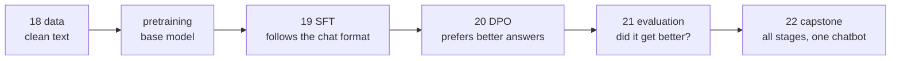

# Part 4 · From base model to assistant

A model trained only to predict the next token is a **base model**: give it "Who are you?" and it just keeps writing something that looks like its training text. ChatGPT, Claude and LLaMA-Chat are base models that went through more stages: careful data preparation, **supervised fine-tuning (SFT)** on conversations, **preference tuning** (RLHF or DPO) and lots of **evaluation**. In this part you build each stage from scratch at tiny scale, then put them together into your own small chatbot with a terminal and a web interface.

**Like you're 5:** Part 3 grew a parrot that can babble like Shakespeare. Part 4 sends it to school: first you choose clean books for it (data), then you show it how a polite conversation looks (SFT), then you tell it which of two answers you like better (DPO), and you give it tests (evaluation). At the end it can greet you and answer a few questions.

## Lessons

| # | Lesson | What you build | Time |
|---|---|---|---|
| 18 | [Pretraining data pipeline](18-pretraining-data-pipeline) | download → clean → filter → exact + MinHash dedup → tokenize → binary shards → data loader | ~3 h |
| 19 | [Instruction tuning (SFT) from scratch](19-instruction-tuning-sft-from-scratch) | a chat template with special tokens, loss masking, a base model turned into a (tiny) assistant | ~4 h |
| 20 | [Preference tuning (DPO) from scratch](20-preference-tuning-dpo-from-scratch) | preference pairs, the DPO loss derived simply, a reference model; RLHF/PPO explained | ~3 h |
| 21 | [Evaluating your LLM](21-evaluating-your-llm) | perplexity, HellaSwag-style multiple choice by log-likelihood, generation checks | ~3 h |
| 22 | [Capstone: train your own tiny ChatGPT](22-capstone-train-your-own-tiny-chatgpt) | your tokenizer → pretraining → SFT → chat in the terminal and the browser (+ a cloud GPU recipe) | ~5 h |



Lessons 19, 20 and 21 form a chain: 19 creates `base.pt` and `sft.pt`, 20 reads `sft.pt` and creates `dpo.pt`, 21 evaluates all three. Do them in order. Lesson 22 is self-contained.

## Setup for this part
Use the course virtual environment, then:
```bash
pip install torch numpy regex tiktoken pytest
```
| Package | Used for |
|---|---|
| `torch` | all models and training |
| `numpy` | MinHash, shards and token files |
| `regex` | the GPT-4 split pattern of your own BPE tokenizer (capstone) |
| `tiktoken` | GPT-2's tokenizer for the lesson 18 shards |
| `pytest` | the tests in lesson 18 |

Each lesson folder also has its own `requirements.txt`. Everything runs on a laptop CPU; each training script finishes in about 2–20 minutes. Downloads come from GitHub only (public-domain texts).

**Watch alongside this part:** Andrej Karpathy, **Deep Dive into LLMs like ChatGPT** (https://www.youtube.com/watch?v=7xTGNNLPyMI) covers exactly this journey: pretraining data, base models, post-training with conversations (SFT), hallucinations, reinforcement learning and RLHF. Each lesson README says which part to watch. His shorter **Intro to Large Language Models** talk (https://www.youtube.com/watch?v=zjkBMFhNj_g) is a good overview before you start.

## After this part you can
- Build a pretraining dataset: clean, filter, deduplicate (exact and near), tokenize and shard it.
- Explain and implement a chat template, special tokens and loss masking for SFT.
- Derive and implement the DPO loss, and explain how RLHF with a reward model and PPO differs.
- Measure a model with perplexity, likelihood-based multiple choice and generation-based checks, and know the limits of each.
- Run the whole pipeline (tokenizer → pretraining → SFT → chat UI) yourself, and scale it up on rented GPUs with nanochat.

## Next
You have finished the course. → Continue with [forward-deployed-ai-engineer](../../forward-deployed-ai-engineer) (or go back to whichever course you paused). The capstone's README lists concrete next steps for going bigger.
