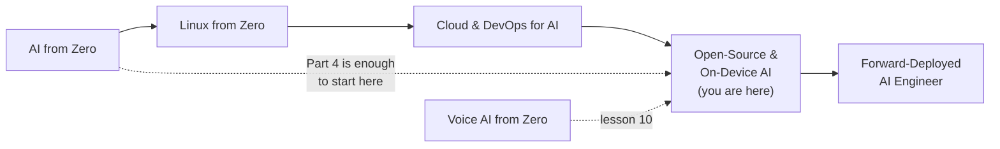

# Open-Source & On-Device AI 💻

**Run AI on your own machines.** 16 hands-on lessons that take you from "how big is a model?" to a fully offline assistant for a clinic with no internet. You'll run open models with Ollama and llama.cpp, shrink them with quantization, measure them, build private RAG, structured output and tool-calling agents on them, run them in the browser and on small devices, serve them fast with vLLM, and fine-tune your own.

Like you're 5: so far your AI apps have phoned a very clever friend far away (a cloud API) for every answer. In this course you learn to keep a smart helper *at home*: it's always there, even when the phone line is down, it never tells anyone your secrets, and it doesn't charge per question.

Every lesson follows the same pattern, so you never get stuck on your own: what you'll build → why it matters → what you'll learn → install → run it (with the output you should see) → how it works, with every command, flag and file format explained piece by piece and a flow diagram → fixes for common problems → three exercises with hints and solutions → a short self-check quiz → official docs and videos → the next lesson.

## Before this course
- **Required:** [AI from Zero](../ai-from-zero) up to the end of **Part 4 · Chatbots** (Python, running scripts in a terminal, virtual environments, FastAPI basics, what an LLM chat request looks like). Part 5 (RAG) helps for lesson 07.
- **Helpful:** [Linux from Zero](../linux-from-zero) Parts 1–2 (terminal confidence), and [Voice AI from Zero](../voice-ai-from-zero) Parts 2–4 for lesson 10.
- **No GPU needed.** Every lesson has a path that works on a normal laptop with 8 GB of RAM (16 GB is more comfortable). A GPU only makes things faster, and lesson 14 (vLLM) is easiest with an NVIDIA GPU or a free cloud notebook.

## The parts

| Part | You'll be able to | Time |
|------|-------------------|------|
| [1 · Run models locally](part-1-run-models-locally) | estimate memory needs and licences, use Ollama's CLI and API, run llama.cpp and GGUF files, quantize models yourself, benchmark and choose a model | 1 week |
| [2 · Build with open models](part-2-build-with-open-models) | switch providers with one OpenAI-compatible client, build private RAG with local embeddings, get structured output and tool calling from open models, use vision models, build a fully local voice agent | 1 week |
| [3 · Browser and edge](part-3-browser-and-edge) | run LLMs inside the browser with WebGPU, export models to ONNX and run them with ONNX Runtime, choose models and runtimes for phones and small devices | 1 week |
| [4 · Serving and tuning](part-4-serving-and-tuning) | serve many users fast with vLLM, fine-tune a small model with LoRA and export it to GGUF, and build an air-gapped offline assistant as a capstone | 1–2 weeks |

**Total: about 4 weeks at 1 hour a day.**

## All 16 lessons

**Part 1 · Run models locally**
- [01 · Why local models, and how big they are](part-1-run-models-locally/01-why-local-models-and-how-big-they-are)
- [02 · Ollama deep dive: API and Modelfiles](part-1-run-models-locally/02-ollama-deep-dive-api-and-modelfiles)
- [03 · llama.cpp and GGUF](part-1-run-models-locally/03-llama-cpp-and-gguf)
- [04 · Quantization hands-on](part-1-run-models-locally/04-quantization-hands-on)
- [05 · Choosing a model: benchmarks and speed](part-1-run-models-locally/05-choosing-a-model-benchmarks-and-speed)

**Part 2 · Build with open models**
- [06 · OpenAI-compatible APIs and switching providers](part-2-build-with-open-models/06-openai-compatible-apis-and-switching-providers)
- [07 · Local embeddings and private RAG](part-2-build-with-open-models/07-local-embeddings-and-private-rag)
- [08 · Structured output and tool calling with open models](part-2-build-with-open-models/08-structured-output-and-tool-calling-with-open-models)
- [09 · Vision models on your laptop](part-2-build-with-open-models/09-vision-models-on-your-laptop)
- [10 · A fully local voice agent](part-2-build-with-open-models/10-a-fully-local-voice-agent)

**Part 3 · Browser and edge**
- [11 · LLMs in the browser with WebGPU](part-3-browser-and-edge/11-llms-in-the-browser-with-webgpu)
- [12 · ONNX Runtime and model export](part-3-browser-and-edge/12-onnx-runtime-and-model-export)
- [13 · Phones and small devices](part-3-browser-and-edge/13-phones-and-small-devices)

**Part 4 · Serving and tuning**
- [14 · High-throughput serving with vLLM](part-4-serving-and-tuning/14-high-throughput-serving-with-vllm)
- [15 · Fine-tune a small model with LoRA and export to GGUF](part-4-serving-and-tuning/15-fine-tune-a-small-model-with-lora-and-export-to-gguf)
- [16 · Capstone: offline assistant for a clinic with no internet](part-4-serving-and-tuning/16-capstone-offline-assistant-for-a-clinic-with-no-internet)

## Where this course sits in the roadmap

You can start this course right after AI from Zero Part 4 and take it in parallel with the others. The [Forward-Deployed AI Engineer](../forward-deployed-ai-engineer) course uses it for air-gapped and on-premise deployments.

## The tools and models you'll use
| Tool | What it's for | Lessons |
|------|---------------|---------|
| **Ollama** | the easiest way to download and run open models, with a REST API | 02, 05–10, 16 |
| **llama.cpp** + **GGUF** files | the engine underneath: full control, quantization, benchmarks, tiny devices | 03, 04, 13, 15 |
| **Hugging Face Hub** (`hf` command) | where open models are published and downloaded | 03, 04, 12, 15 |
| **`openai` Python package** | one client for every OpenAI-compatible server, local or cloud | 06 and later |
| **WebGPU / ONNX Runtime** | models inside the browser and on many devices | 11, 12 |
| **vLLM** | high-throughput serving for many users | 14 |

| Model (examples) | Size on disk | Used for |
|------------------|-------------|----------|
| `llama3.2:3b` / `llama3.2:1b` (Meta) | ~2 GB / ~1.3 GB | chat, RAG answers |
| `qwen2.5:3b` (Alibaba) | ~1.9 GB | structured output, tool calling |
| `nomic-embed-text` | ~0.3 GB | embeddings for search |
| Llama 3.2 1B Instruct GGUF (F16 + quantized copies) | ~0.8–5 GB | llama.cpp and quantization (03, 04) |

## Setup (once)
Do these steps once, in order. They take 20–40 minutes, mostly downloads.

### 1. Check your computer
- Windows 10/11, macOS (Apple Silicon is great for local models) or Linux. **8 GB of RAM minimum, 16 GB recommended.**
- **Free disk space: about 15 GB** for Parts 1–2 (models are the big part; see each part's README).

### 2. Python 3.12
Use **Python 3.12** (3.10–3.13 also work). If you did AI from Zero, you already have it. Check with `python --version` (Windows: `py -3.12 --version`). Install: Windows `winget install Python.Python.3.12`; Mac `brew install python@3.12`; Ubuntu `sudo apt install python3.12 python3.12-venv`.

### 3. A virtual environment for the course
Open a terminal **in the `open-source-and-on-device-ai` folder**. Every `cd ...` command in the lessons starts from here.
- **Windows (PowerShell):**
  ```bash
  py -3.12 -m venv .venv
  .venv\Scripts\activate
  ```
- **Mac / Linux:**
  ```bash
  python3.12 -m venv .venv
  source .venv/bin/activate
  ```
Your prompt now starts with `(.venv)`. **Activate it every time you open a new terminal for this course.** Then: `python -m pip install --upgrade pip`.

| Piece | Meaning |
|-------|---------|
| `python3.12 -m venv .venv` | run Python's built-in `venv` module (`-m`) to create a private package folder called `.venv` |
| `source .venv/bin/activate` | Mac/Linux: switch this terminal to use that folder's Python and packages |
| `.venv\Scripts\activate` | the same on Windows (`\` is the Windows folder separator) |

### 4. Install Ollama
Follow lesson 02's install table (Windows/Mac: https://ollama.com/download; Linux: `curl -fsSL https://ollama.com/install.sh | sh`). Check: http://localhost:11434 says **Ollama is running**.

### 5. Packages
Each part's README (and each lesson) gives its `pip install` line, so you install only what you need when you need it. Part 1 starts with:
```bash
pip install httpx gguf huggingface_hub
```

### 6. API keys
**None are needed** for the local lessons. Lesson 06 can optionally compare your local models with Claude or OpenAI; that's the only place a key is used, and it's optional.

## How to work through a lesson
1. Activate the venv, `cd` into the lesson folder (the README shows the exact command), and follow **Run it** step by step.
2. Compare your output with **What you should see**. Outputs marked **Example output** couldn't be produced where the course was written (no model downloads were possible there), so your wording and numbers will differ; the code itself was tested.
3. Read **How it works** with the code open next to it. Every new command and file format has a "piece by piece" table.
4. Do the **Try this** exercises (open the hints only when stuck), then answer **Check yourself**.

If something breaks, check the lesson's **If something goes wrong** first. Most problems are one of: the venv isn't active (`ModuleNotFoundError`), you're in the wrong folder (`No such file`), Ollama isn't running (`Can't reach Ollama`), or a model isn't downloaded (`model ... not found`: run `ollama pull <name>`).

Large model files (`*.gguf`, `models/` folders) and files the lessons create (`rag.db`, `results.csv`) are listed in `.gitignore`, so they're never committed.

Start here → [Part 1 · Run models locally](part-1-run-models-locally)

**When you finish:** go on to [Forward-Deployed AI Engineer](../forward-deployed-ai-engineer), where you'll deploy AI systems inside customers' companies, including air-gapped ones built on the open models from this course.
